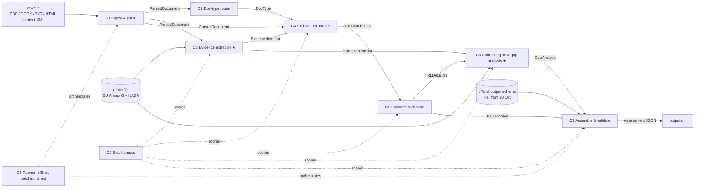

# Components and contracts — TRL assessor

_v0, 2026-10-04 07:35 IST (lead). Contracts are JSON Schema (draft 2020-12) in [`contracts/`](contracts/). The official output schema arrives 10 Oct; C7 maps our internal `Assessment` onto it at run time from the schema file — we never hard-code the official schema or any output values (rule 6, read conservatively)._

## Pipeline

★ = spike candidates (see [ADR 001](adr/001-spike.md)).

## Component table

| # | Component | Responsibility (one sentence) | Input → Output contract | Calls | Baseline (existing practice) | Isolated scalar metric | SLO (CPU, per doc) |
|---|---|---|---|---|---|---|---|
| C1 | **Ingest & parse** | Turn any raw file into ordered, addressable text sections. | `path`/bytes → `ParsedDocument` | — | pypdfium2 / pdfplumber text + heading heuristics; HTML/XML strip | Character-level F1 vs gold text on a 30-doc parse set; pages/s | ≤1 s per 10 pages |
| C2 | **Doc-type router** | Label the genre (patent, paper, report, proposal, other) so priors and calibration can condition on it. | `ParsedDocument` → `DocType` | C1 output | Rules: claims block → patent; abstract + references → paper; else report | Macro-F1 on a labelled genre set | ≤10 ms |
| C3 | **Evidence extractor ★** | Find sentences that state what was *demonstrated*, *where*, at what *scale*, and whether it was *achieved, planned or negated*. | `ParsedDocument` + rubric → `EvidenceItem[]` | rubric file | Lexicon + regex cue patterns per rubric signal (v0); then a small sentence classifier | Span-level micro-F1 (signal × polarity) on hand-annotated sentences; achieved-vs-planned accuracy | ≤300 ms |
| C4 | **Ordinal TRL model** | Estimate P(TRL > k) for k = 1..8 from text and evidence features. | `ParsedDocument` + `EvidenceItem[]` + `DocType` → `TRLDistribution` | C1–C3 outputs | TF-IDF + cumulative logit (Frank & Hall); see `eval/baseline_tfidf.py` | QWK on held-out TechPort v0 (also MAE, exact, within-1) | ≤200 ms |
| C5 | **Calibrate & decode** | Make the distribution honest and turn it into the decision that maximises the official metric (or abstain). | `TRLDistribution` → `TRLDecision` | C4 output | Temperature/isotonic on cumulative probs; median (MAE) / mode (exact) / tuned thresholds (QWK) | Ranked probability score (RPS) and ECE on held-out; official metric after decoding | ≤5 ms |
| C6 | **Rubric engine & gap analysis ★** | Check each rubric criterion against cited evidence, mark it met / not met / unknown, and list what the next level still needs. | `TRLDecision` + `EvidenceItem[]` + rubric → `GapAnalysis` | C3, C5 outputs; rubric | Deterministic rubric table (EU Annex G + NASA wording) with evidence→criterion mapping | Criterion-level Cohen κ vs expert checklist; citation precision (each cited span supports its criterion) | ≤50 ms |
| C7 | **Assemble & validate** | Build the output record and validate it against the official schema loaded from file. | all above + schema file → `Assessment` (then the official JSON) | jsonschema | pydantic/jsonschema validation; fail-closed defaults | % schema-valid on 1,000 fuzzed docs (target 100%) | ≤5 ms |
| C8 | **Runner & packaging** | Run the batch offline, deterministic, bounded in time and memory, with clean pinned dependencies. | input dir → output dir + run log | C1–C7 | CLI + process pool + per-doc timeout + network-off guard | Docs/s and peak RSS on a 100-doc batch; cold-start s; dependency/licence audit pass | ≥5 docs/s; ≤2 GB RSS |
| C9 | **Eval harness** | Score end-to-end and per component on frozen splits with fixed seeds. | predictions + gold → metrics JSON + `results.tsv` row | all | `eval/baseline_tfidf.py` (v0) | — (it *is* the metric) | — |
| C10 | **Data & weak labels** | Acquire approved public data and labels reproducibly. | sources → `.data/*.jsonl` (+ fetch scripts) | — | `data/techport/fetch_techport.py`, `build_dataset.py` | Label noise estimate (e.g. trlBegin ≤ trlCurrent ≤ trlEnd violation rate); genre coverage | — |
| C11 | **Audit UI (Round 2)** | Let a reviewer see the level, the quoted evidence and the gaps, and override with a reason. | `Assessment` → HTML report / web view | C7 output | Static HTML report | Time-to-verify per document in a user test | — |

## Contracts (summary — full JSON Schema in `contracts/`)

- `ParsedDocument` = {`doc_id`, `source_path`, `mime`, `sections[]`: {`section_id`, `heading`, `text`, `page`}, `n_pages`, `n_chars`, `parser`}.
- `DocType` = {`type` ∈ patent | paper | report | proposal | other, `confidence` ∈ [0,1]}.
- `EvidenceItem` = {`evidence_id`, `section_id`, `char_start`, `char_end`, `quote`, `signal` (rubric signal id, e.g. `lab_validation`), `environment` ∈ none | lab | relevant | operational, `scale` ∈ component | subsystem | system | unknown, `polarity` ∈ achieved | planned | negated, `confidence`}.
- `TRLDistribution` = {`p` (9 probabilities, sum 1), `p_gt` (8 non-increasing P(TRL>k)), `model_id`}.
- `TRLDecision` = {`trl` 1–9, `decode_rule`, `confidence`, `interval80` [lo, hi], `abstain` bool}.
- `GapAnalysis` = {`criteria[]`: {`criterion_id`, `level`, `text`, `status` ∈ met | not_met | unknown, `evidence_ids[]`}, `next_level`, `missing_for_next_level[]`: {`criterion_id`, `text`, `suggested_actions[]`}, `notes`}.
- `Assessment` = {`doc_id`, `decision`: TRLDecision, `distribution`: TRLDistribution, `evidence[]`, `gap_analysis`, `runtime_ms`, `versions`}.

**Error modes (all components):** empty or unparseable input → C1 emits `n_chars = 0`; C4/C5 fall back to the training prior with `abstain = true`; C7 still emits a schema-valid record with an `error` note. Never crash a batch for one bad file (C8 per-doc timeout and try/except).

**Seams.** C3 and C4 are the two seams where models will be swapped (lexicon → small encoder → open-weight LLM). Because both sides of each seam are typed, the auto-research loop on a spike can only change that component's implementation while the contract tests and the frozen `eval.py` stay fixed (PLAYBOOK §5).
