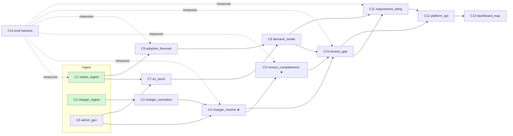

# Components and contracts — EV Infra Map India (v1, 4 Oct 2026)

Typed contracts: [`contracts/models.py`](contracts/models.py) (pydantic v2), with JSON Schemas generated next to it. Units: kW, kWh, km, minutes; WGS84 coordinates. Every external record carries `Provenance` (source, source_id, license, fetched_at, url).

## Dependency graph

Green = running on real data tonight. ★ = spike (see [ADR 001](adr/001-spike.md)).

## Components

| # | Component | Responsibility (one sentence) | Input → Output (contract) | Calls | Baseline (existing practice) | Isolated scalar metric | Status 4 Oct |
|---|---|---|---|---|---|---|---|
| C1 | `vahan_ingest` | Pull VAHAN registrations by state/RTO × vehicle class × fuel × period from the public dashboard | dashboard (HTTP) → `RegistrationRecord[]` | — | Manual Excel export from the dashboard | **Reconciliation error** \|Σ RTO − state\| / state, per state (target < 1%) | Working: plain-HTTP JSF client + Excel export ([code](../components/vahan_ingest/)) |
| C2 | `charger_ingest` | One adapter per charger source, raw → canonical record | source API/dump → `ChargerRecord[]` | — | Per-source scrapers | **Schema-valid share** and records per source; freshness (days since last edit) | OSM (Overpass) + official state counts (PIB) working; OCM needs an API key |
| C3 | `charger_normalize` | Canonical connector, power, operator and segment taxonomy; geo-validation | `ChargerRecord` → `ChargerRecord` (canonical fields filled) | C6 | Rule tables | **Field-accuracy** on a 200-record hand-labelled sample | Taxonomy drafted (`ConnectorType`) |
| C4 ★ | `charger_resolve` | Merge records of the same physical site across sources | `ChargerRecord[]` → `Site[]` with provenance + match confidence | C6 (H3 blocking) | Distance threshold (e.g. 50 m) + name fuzzy match | **Pairwise F1** on hand-labelled match/non-match pairs | v0 real: OSM × OCM mutual-NN matching (83 pairs at 150 m); labelled pairs pending |
| C5 ★ | `census_completeness` | Estimate how many public sites exist that no source lists | `Site[]` (with per-source membership) → `CompletenessEstimate` per region | C4 | Report raw counts (no completeness) | **Relative error vs official state totals** (PIB 2151390 held out) | v0 real: Chapman vs held-out official totals + first ratchet loop ([ledger](../components/census_completeness/autoresearch/results.tsv)) |
| C6 | `admin_geo` | Boundaries (SoI-consistent), LGD codes, RTO → district crosswalk, H3 grid | boundary files → `AdminUnit[]`, `RtoDistrictLink[]` | — | Census-2011 district shapes | **% RTOs mapped** and % chargers inside a polygon | RTO list for MH fetched (61 offices) |
| C7 | `ev_stock` | Registrations → on-road stock by segment (survival curves) and spatial disaggregation | `RegistrationRecord[]` + `AdminUnit[]` → `StockEstimate[]` | C1, C6 | Cumulative registrations = stock | **Holdout error** on districts with known totals | Baseline (cumulative registrations) |
| C8 | `demand_model` | Stock → public charging demand (kWh/day, sessions/day) per unit and segment | `StockEstimate[]` + parameter set → `DemandEstimate[]` | C7, C9 | Fixed ratio EVs-per-charger | **Rank correlation** of predicted demand with observed site density in well-mapped cities (backtest) | Planned |
| C9 | `adoption_forecast` | Forecast regional EV registrations to 2030 under scenarios | monthly/annual `RegistrationRecord[]` → `StockEstimate[]` (future years) | C1 | Linear / CAGR extrapolation | **Backtest sMAPE** (train ≤ 2024, test 2025) per state | Data on disk (CY2020–2026 by state) |
| C10 | `access_gap` | Supply–demand gap: EVs per site, E2SFCA access, corridor spacing vs MoP 2024 norms, gap score with reasons | `Site[]`, `CompletenessEstimate[]`, `DemandEstimate[]` → `GapRecord[]` | C4, C5, C8 | EVs-per-charger ratio | **Backtest AUC**: does the gap score at T predict where sites are added by T+1? | v0 running: state EVs per official station |
| C11 | `requirement_siting` | Chargers needed per unit/year by class (energy + queueing) and recommended sites (MCLP) | `GapRecord[]`, `DemandEstimate[]`, candidate sites → `Recommendation[]` | C8, C10 | Norm-based counts (spacing grid) | **Demand covered per added charger** vs greedy/random/norm baselines | Planned (PySAL spopt) |
| C12 | `platform_api` | Versioned store + API with provenance for every number | all outputs → DuckDB/GeoParquet + REST | all | Static CSVs | **p95 latency** of district query < 300 ms | Planned |
| C13 | `dashboard_map` | National GIS map + decision dashboard (drill-down, scenarios, reasons) | API → web UI (MapLibre) | C12 | Static choropleth | **Task time** for a planner to find the 5 worst districts (usability test) | v0 real: national state map ([`dist/index.html`](../components/dashboard_map/dist/index.html), [screenshot](../components/dashboard_map/screenshot-v0.png)) |
| C14 | `eval` | End-to-end and per-component metrics with fixed seeds and held-out data | all → `eval/results/*` | all | — | — | v0: [`eval/baseline_state_gap.py`](../eval/baseline_state_gap.py) |

## Error modes and SLOs (summary)
- **C1:** dashboard redeploy changes JSF widget ids → the client fails loudly at the first request; registrations ≠ stock (no deregistration feed) → C7 applies survival curves; a few VAHAN offices are not migrated (dashboard shows 1,468 of 1,469). SLO: full national refresh < 2 h, polite rate (≤ 3 concurrent sessions, ≥ 0.4 s between requests).
- **C2–C4:** sources disagree on the unit (site vs charger vs connector): the canonical unit is the *site* with a connector list. Coordinates outside India or outside the stated state → quarantined, never silently dropped.
- **C5:** capture–recapture assumes independent sources; CPO feeds and OSM are positively dependent (mappers copy apps) → log-linear models with interaction terms, validated against official totals.
- **C10/C11:** every gap and recommendation carries ranked reasons (`drivers`) and the parameter-set id, so a planner can see *why*.

## Data sources by component (tonight's state)
| Source | Feeds | Licence | Status |
|---|---|---|---|
| VAHAN 4 dashboard (MoRTH / NIC) | C1 | public dashboard, attribution | Real data on disk: national × 8 periods, 36 states × vehicle class, Maharashtra RTOs (in progress) |
| OpenStreetMap `amenity=charging_station` via Overpass | C2 | ODbL 1.0 | 600 features in India (OSM base 2026-10-04 00:26 UTC) |
| PIB 2151390 (MHI, 1 Aug 2025; MoP inputs) and PIB 2118894 (4 Apr 2025; BEE) | C5 ground truth | Government press release | State-wise tables parsed → [`official_pcs_statewise.csv`](../components/charger_ingest/data/official_pcs_statewise.csv) |
| Open Charge Map | C2 | CC BY-SA 4.0 / per-provider (UNVERIFIED) | API needs a key (HTTP 403); per-POI export repo exists |
| CPO locators (Statiq, Jio-bp pulse, Tata Power EZ Charge, ChargeZone…) | C2 | Terms per operator | Not ingested; need permission or an open feed (UEI / Beckn — UNVERIFIED) |
| Boundaries (Survey of India–consistent), LGD codes, Census population | C6, C7 | various | Not yet downloaded (lean mode) |
