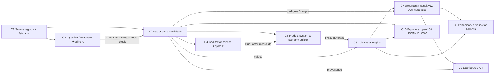

# Components — Green Auto India LCA

_Lead-owned. Contracts (typed, pydantic): [`contracts/contracts.py`](contracts/contracts.py). Record schema: [`agent-brief.md`](agent-brief.md). Spike choice: [`adr/001-spike.md`](adr/001-spike.md)._

| # | Component | Responsibility (one sentence) | Input → Output (contract) | Calls | Baseline today (status) | Isolated scalar metric | Baseline number |
|---|---|---|---|---|---|---|---|
| C1 | Source registry + fetchers | Keep every source's metadata and a script that re-downloads it. | `SourceSpec` → `Source` + raw file in `.data/raw/` | — | `data/sources/sources.yaml`, `data/fetch/fetch_sources.sh` (built) | % sources re-fetchable by script (link check) | 7/8 have scripted URLs (the GitHub code source is cited by URL) |
| C2 | Factor store + validator | Hold every number as a cited `Record` and reject records without evidence. | YAML → `Record` (validated) | C1 | `greenauto/db.py` pydantic schema + tests (built) | Quote-verification rate: share of `verified` records whose quote is found in the source text | 23 records load and pass schema; automatic quote-in-PDF check not built yet |
| C3 ★A | Ingestion / extraction | Turn Indian PDFs/XLSX (CEA, BRSR, EPDs, ministry reports) into candidate records with locator + verbatim quote, verified against the document text. | `Document` → `list[CandidateRecord]` | C1, C2 | Manual transcription by the lead (tonight) | Field-level F1 (value, unit, year, geography) vs a hand-verified gold set; % candidates with a quote found in the document | Gold set = the 16 verified records tonight; extractor not built |
| C4 ★B | Grid-factor service | Return a cited electricity emission factor for (region, period, method: average / operating margin / build margin / prospective). | `GridFactorQuery` → `GridFactor` (+ record ids) | C2 | National CEA v22 values + T&D gross-up (built as records) | Reconstruction error of national FY values from station-level data vs CEA Table S / Annexure-I | Conventional station sum reproduces Annexure-I generation (1,424.19 BU) exactly; state-level needs state RE data |
| C5 | Product-system & scenario builder | Express a vehicle/component as parameters (record ids) and stage expressions, per scenario. | `VehicleSpec` + scenario → `ProductSystem` | C2, C4 | `data/vehicles/case1_2w_scooters.yaml` (5 scenarios, built) | % parameters resolved to records (no free constants) | 100 % (contract test) |
| C6 | Calculation engine | Compute stage-wise impacts per functional unit. | `ProductSystem` + values → `StageResult` | C2, C5 | `greenauto/engine.py` (built) | Replication MAPE vs published benchmark totals | **0.06 %** vs ICCT 2021 Table 1 (scooters) |
| C7 | Uncertainty, sensitivity, DQI, data gaps | Propagate pedigree/range uncertainty with paired Monte Carlo; rank which records drive the answer. | `ProductSystem` + `Record`s → `UncertaintyResult` | C2, C6 | Built in `engine.run_scenario` | 90 % interval coverage of independent benchmarks (calibration) + mean interval width | Not yet measurable honestly: the only benchmark (ICCT 2021) is also our input source, so coverage is circular (inside with implied inputs, outside with stated inputs — `eval/results/latest.json`). Needs independent Indian benchmarks. |
| C8 | Benchmark & validation harness | Frozen evaluator: replication, cross-study checks, India-2026 case results. | benchmarks + scenarios → `EvalReport` | C5–C7 | `eval/eval.py` (built, frozen) | Count of independent benchmarks reproduced within ±2 % | 1 study (ICCT 2021 Table 1) + 1 cross-check (fact-sheet figure ≤0.03 g/km) |
| C9 | Dashboard / API | Show stage results, intervals, comparisons, what-ifs and the source behind every number. | `EvalReport` + `Record`s → HTML (static now; API later) | C2, C7 | `components/dashboard/build.py` → `deliverables/dashboard/index.html` (built) | Share of displayed numbers with one-click provenance | 100 % of parameters in the provenance table |
| C10 | Exporters | Export records/results to openLCA JSON-LD / ILCD / CSV so ICAT tools can reuse them. | `Record`s, `StageResult` → files | C2, C6 | Not built | Round-trip import success into openLCA | — |

## Error modes and SLOs (summary)
- **C2:** unknown `source_id`, duplicate id, `verified` without quote, `derived` without formula → load fails (fail closed). SLO: full DB load < 1 s at 10k records.
- **C3:** hallucinated number, wrong unit, wrong year → caught by quote-in-document and unit-normaliser checks; never auto-promoted to `verified` without the quote match.
- **C4:** method mismatch (average vs marginal) → the method is an explicit argument; results always show all three CEA margins.
- **C5/C6:** unresolved parameter → `check_scenario` error; unit errors → planned dimensional analysis (pint) in phase 2.
- **C7:** missing pedigree → schema error; seeds fixed (20261004); n = 10,000 (≈ 4 s per scenario on the M5 Mac for 2 products).
- **C9:** offline-first; no CDN; one HTML file.
