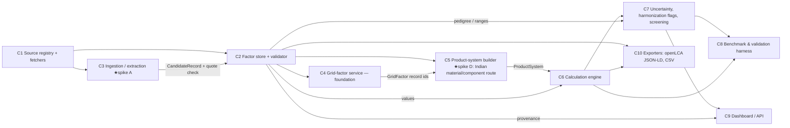

# Components — Green Auto India LCA

_Lead-owned; updated 4 Oct 2026 10:45 IST after three independent reviews. Contracts (typed, pydantic, v2 names): [`contracts/contracts.py`](contracts/contracts.py). Record schema: [`agent-brief.md`](agent-brief.md). Spike choice: [`adr/001-spike.md`](adr/001-spike.md) v2 — spikes A (C3) and D (C5); C4 is a bounded foundation._

| # | Component | Responsibility (one sentence) | Input → Output (contract) | Calls | Baseline today | Isolated scalar metric | Baseline number (see `eval/results/latest.json`) |
|---|---|---|---|---|---|---|---|
| C1 | Source registry + fetchers | Keep every source's metadata and re-download it from the registry. | `SourceSpec` → `Source` + raw file | — | `data/sources/*.yaml`, `data/fetch/fetch_sources.py` | % of sources re-fetchable | 18/18 local copies re-fetchable (dry run) |
| C2 | Factor store + validator | Hold every number as a cited `Record` and reject records without evidence. | YAML → `Record` | C1 | pydantic schema; gas-basis, allocation and EOL fields; fail-closed | Quote presence + value-in-quote rates | 104/104 quotes found; 101/102 values in their own quote (1 waived with reason) |
| C3 ★A | Ingestion / extraction | Turn Indian documents into candidate records with page/cell, quote and value checks, then human approval. | `Document` → `list[CandidateRecord]` | C1, C2 | Verifier v5 + `value_check.py`; extractor not built | Doc-level F1, complete-record precision/recall on an unseen-publisher test split; reviewer minutes per usable record | Verifier: 0 observed false accepts in 208 synthetic negatives (≈1.4 % 95 % bound) |
| C4 | Grid-factor service (foundation) | Cited grid factor by method, gas basis (CO2 / CO2e AR5\|AR6) and delivery point. | `GridFactorQuery` → `GridFactor` | C2 | National CEA v22 + CO2e adders + state loss adjustment | Accounting reconciliation (test); rolling-origin back-test before any prospective claim | 0.693 kg CO2e/kWh busbar, 0.842 meter (hand-check test) |
| C5 ★D | Product-system & scenario builder (+ route comparison) | Parameterised vehicles, components and material routes (record ids only), with scenario inheritance. | `VehicleSpec` → `ProductSystem` | C2, C4 | 2 cases, 15 scenarios; D gated 4–7 Oct | % parameters resolved; D: reproduction of source route intensities | 100 % resolved (contract test) |
| C6 | Calculation engine | Stage-wise impacts per functional unit. | `ProductSystem` → `StageResult` | C2, C5 | `greenauto/engine.py` | Arithmetic verification vs published totals | 0.06 % (2W), 1.0 % (cars) |
| C7 | Uncertainty, sensitivity, screening | Paired Monte Carlo with honoured source distributions; harmonization flags; screening importance; pedigree screening score. | → `UncertaintyResult`, `Comparison`, `ScenarioResult` | C2, C6 | built (v2) | Interval coverage on independent benchmarks (needs compatible studies; no calibration claim yet) | n/a until independent compatible benchmarks exist |
| C8 | Verification & plausibility harness | Verification vs source studies; plausibility vs independent studies; doc drift check. | → `EvalReport` + `summary.md` | C5–C7 | `eval/eval.py`, `render_docs.py`, `check_docs.py` | # benchmarks within ±2 %; # independent bands containing our central | 2 verification sets; plausibility: petrol and BEV inside, CNG and diesel outside |
| C9 | Dashboard / API | Results, intervals, sensitivities, what-if and provenance for every input. | `EvalReport` + `Record`s → HTML | C2, C7 | static offline HTML (v2) | Share of displayed inputs with provenance; what-if equals the card at default | 100 %; default what-if = card (browser-checked) |
| C10 | Exporters | openLCA JSON-LD / ILCD / CSV. | `Record`s → files | C2, C6 | not built | Round-trip import | — |

## Error modes and SLOs (summary)
- **C2:** unknown `source_id`, duplicate id, `verified` without quote, `derived` without formula → load fails (fail closed). SLO: full DB load < 1 s at 10k records.
- **C3:** hallucinated number, wrong unit, wrong year → caught by quote-in-document and unit-normaliser checks; never auto-promoted to `verified` without the quote match.
- **C4:** method mismatch (average vs marginal) → the method is an explicit argument; results always show all three CEA margins.
- **C5/C6:** unresolved parameter → `check_scenario` error; unit errors → planned dimensional analysis (pint) in phase 2.
- **C7:** missing pedigree → schema error; seeds fixed (20261004); n = 10,000 (≈ 4 s per scenario on the M5 Mac for 2 products).
- **C9:** offline-first; no CDN; one HTML file.
