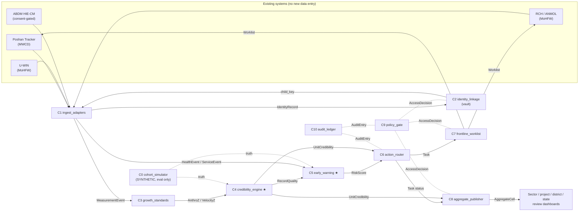

# Poshan Setu: component map and contracts

> **Poshan Setu** (working name, "nutrition bridge") is a data-governance and decision-support layer that sits *behind* Poshan Tracker and the health system's RCH/U-WIN/ABDM records. Anganwadi workers get no new app and do no new data entry. Contracts are typed in [`contracts/models.py`](contracts/models.py) (pydantic v2), with JSON Schemas exported to [`contracts/schemas/`](contracts/schemas/) (`python -m architecture.contracts.export_schemas`). Every artefact carries `synthetic` so simulator output can never pass as real.

## Design principles
1. **Two planes.** Names live only in a state **identity vault**. Analytics sees only a pseudonymous `child_key` (HMAC). Names reappear only on the worker's own device, through the beneficiary reference her app already holds.
2. **Purpose-bound by default.** Every read is an `AccessRequest` → `AccessDecision` (policy-as-code with a legal-basis citation). Every decision and action is appended to a hash-chained audit log.
3. **Act within existing timelines.** Alerts become `Task`s with owners, due dates and an escalation ladder. The ladder ends in the review meetings that already exist (sector, project, district).
4. **Trust is measured, not assumed.** Every record gets a plausibility check and every AWC a credibility score, *before* data drives alerts or prevalence.

## Dependency graph

★ = spike candidates (see [ADR 001](adr/001-spike.md)).

## Components

| # | Component | Responsibility (one line) | Input → Output (contract types) | Calls | Baseline / existing practice | Isolated scalar metric | Status · latest number |
|---|---|---|---|---|---|---|---|
| C0 | `cohort_simulator` | Synthetic cohort with known truth, for evaluation only | `SimConfig` → frames of `MeasurementEvent`, `HealthEvent` + truth | C3 (inverse z) | — | Calibration error vs ki-consortium targets (at-birth wasting, 90-day recovery) | Built · [`eval/results/cohort_calibration.json`](../eval/results/cohort_calibration.json) |
| C1 | `ingest_adapters` | Pull deltas from Poshan Tracker, RCH, U-WIN and ABDM into canonical events | source extracts / FHIR bundles → `IdentityRecord`, `MeasurementEvent`, `HealthEvent`, `ServiceEvent` | C2, C9 | ETL; ABDM FHIR exchange (HIP/HIU guidelines, V3) | % records parsed and schema-valid | Contract only |
| C2 | `identity_linkage` | Link the same child across ICDS and health registries inside the vault; issue `child_key` | `IdentityRecord[]` → `LinkDecision[]` | — | Deterministic ID join; Fellegi–Sunter (Splink) | Pairwise F1 on a labelled dual-registry benchmark | Built · SYNTHETIC F1: IDs-only **0.513**, probabilistic **0.945**, Bloom-filter PPRL **0.968** |
| C3 | `growth_standards` | WHO 2006 z-scores (+ WHO 2009 velocity), flags, SAM/MAM classes | `MeasurementEvent` → `AnthroZ`, `VelocityZ` | — | WHO Anthro (R) | Max \|z − z_WHO\| on WHO's published SD tables | Built · **0.003 z** over **87,408** points |
| C4 | `credibility_engine` ★ (measurement diagnostics, [ADR 002](adr/002-measurement-diagnostics.md)) | Record plausibility + AWC × device × month diagnostics (heaping, digit preference, dispersion, missingness, trajectory realism); **never per worker**; support before scrutiny | `MeasurementEvent`+`AnthroZ` → `RecordQuality`, AWC diagnostics | C3 | WHO/UNICEF 2019 checks, SMART plausibility (survey-level) | AUROC for copy-forward AWCs (frozen `eval.py`, 3 seeds) | Built · SYNTHETIC AUROC **0.69** (copy-forward) / **1.00** (any unreliable AWC); a 0.95 tuning candidate failed the anti-gaming holdout and was rejected; v2 evaluator (audit PPV, remote-AWC false positives) in backlog |
| C5 | `early_warning` ★ | Fill each AWC's weekly K slots (worker capacity) with the children most likely to become wasted; observed SAM/MAM and infants under 6 months go to the protocol pathway | `AnthroZ`, `VelocityZ`, observed status (`HealthEvent` optional) → ranked `RiskScore` | C3, C4 | "No weight gain in 2 months" rule; point-in-time SAM/MAM only | Rankable-episode recall@K (flagged 1–3 months before onset), leakage-free, infant-gated `eval_v2.py` | v2 · SYNTHETIC (9,107 rankable episodes; infant pathway 14.8%): transparent lowest-WHZ rule **0.473** (CI 0.461–0.489) vs programme rule **0.413** (diff CI +5.1 to +7.0 pp); logistic 0.429, +health 0.430; random 0.293 → ships the rule, ML gated ([ADR 003](adr/003-transparent-ranking-first.md)); v1 (0.429/0.365, infants in pool) kept as history |
| C6 | `action_router` | Turn alerts into owned, due-dated tasks; escalate on overdue; three clocks (child / resource / worker) | `RiskScore`, diagnostics, `Alert` → `Task` | C9, C10 | Monthly review meetings | % tasks done within SLA (ops simulation) | Built · protocol v0.2.0 cites CMAM 2023 pages; escalation scope bug fixed; demo: 482 tasks escalated after 8 days (70% on time assumed) — SYNTHETIC; ops SIMULATION 83.6% vs 15.6% within SLA |
| C7 | `frontline_worklist` | Weekly, capacity-capped worklist in the worker's existing app/SMS, bilingual reasons, no names | `Task[]` → `Worklist` | C9 | Poshan Tracker home-visit scheduler | Median payload bytes; % SMS ≤160 chars | Built (tests pass) |
| C8 | `aggregate_publisher` | Block/district/public aggregates with small-cell suppression / DP, credibility-adjusted | events + `UnitCredibility` → `AggregateCell[]` | C9 | Static dashboards | Mean relative error at ε, with rank preservation | Contract only |
| C9 | `policy_gate` | Purpose-bound access decision with verified legal basis; fail-closed geography, role-scope binding, registry-validated consent/approval, employment-use deny | `AccessRequest` (+ trusted context) → `AccessDecision` | C10 | RBAC | Red-team suite pass rate; false allows (must be 0) | Built · **39/39**, **0** false allows (incl. GPT-6 Sol exploits) |
| C10 | `audit_ledger` | Tamper-evident, append-only log; checkpoint (count + head hash) stored outside the ledger | event → `AuditEntry` | — | DB audit tables; Tessera / FHIR AuditEvent | Tamper-detection rate over random mutations + truncation | Built · **100/100** mutations; truncation detected with checkpoint |

## Error modes and SLOs (first cut)
- **C1:** schema-invalid → quarantine with a reason; never drop silently. SLO: daily delta, under 2 h.
- **C2:** ambiguous match → clerical-review queue (synthetic share 2.9–7.8%). A wrong link is worse than no link: auto-link only above a high threshold.
- **C3:** age < 0 or ≥ 60 months, or missing length → z = null. Flags follow WHO cut-offs.
- **C4:** fewer than 30 measurements per unit → `insufficient_data`. Credibility never blocks service; it routes re-measurement.
- **C5:** low `data_confidence` → the alert becomes a re-measure task, not a referral. Weekly batch.
- **C6:** a missing owner escalates immediately; a service-readiness gate runs first (ADR 002). SLA ladder from [`components/action_router/protocol.yaml`](../components/action_router/protocol.yaml) v0.2.0. Official steps cite CMAM Protocol 2023 page numbers (2-day list sharing, 3–5-day medical appraisal, fortnightly MAM visits, monthly district review); our own rules are labelled DESIGN.
- **C9:** default deny; unknown purpose → deny.

## Glossary
AWC Anganwadi centre · AWW Anganwadi worker · LS Lady Supervisor (sector) · CDPO Child Development Project Officer (ICDS project ~ block) · DPO District Programme Officer · ASHA village health activist · ANM auxiliary nurse midwife · SAM/MAM severe/moderate acute malnutrition · WLZ/WHZ weight-for-length/height z · LAZ/HAZ length/height-for-age z · WAZ weight-for-age z · THR take-home ration · PPRL privacy-preserving record linkage.
