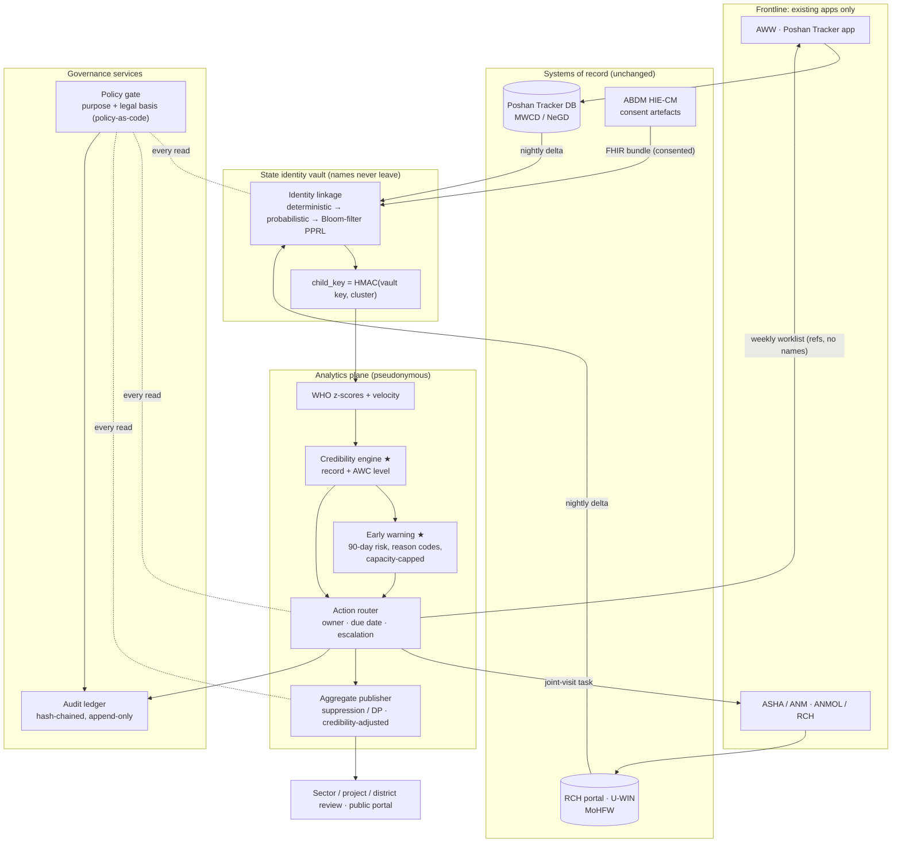

# Poshan Setu: architecture (for the proposal and the finals)

Component contracts: [`../architecture/components.md`](../architecture/components.md). Typed models: [`../architecture/contracts/models.py`](../architecture/contracts/models.py).

## 1. Data flow and trust boundaries


## 2. Lifecycle of one alert (decision rights and escalation)
```mermaid
sequenceDiagram
  autonumber
  participant PT as Poshan Tracker (monthly weighing)
  participant PS as Poshan Setu (weekly batch)
  participant AWW as AWW (own app)
  participant ASHA as ASHA/ANM
  participant LS as Lady Supervisor
  participant CDPO as CDPO + MO-PHC
  participant DM as DPO / DM review
  PT->>PS: measurement delta (child ref, weight, length, date)
  PS->>PS: z-scores · plausibility · AWC credibility · 90-day risk
  alt low data credibility
    PS->>LS: DATA_RECHECK task: re-measure 10 random children within 14 days
  else child in top-k risk for this AWC
    PS->>AWW: worklist item + reasons (Hindi/English), due in 7 days
    PS->>ASHA: joint visit if illness or low birth weight is linked
    AWW-->>PS: visit done / outcome (existing home-visit module)
  end
  Note over PS: SLA clock per task; every access and action → audit ledger
  PS->>LS: overdue → escalation level 1
  PS->>CDPO: still overdue / SAM not appraised → level 2
  PS->>DM: monthly district review: SLA breaches, credibility map, suppressed aggregates
```

## 3. Who sees what (policy gate, default deny)
| Role | Data category | Purpose | Scope | Transform |
|---|---|---|---|---|
| AWW | Identified child | Service delivery | Own AWC | none |
| ASHA / ANM, MO-PHC | Identified child (+ linked health record) | Care coordination | Only children with an open joint task | none |
| Lady Supervisor | Pseudonymous child; identified for escalated tasks | Supervision | Own sector | pseudonymise |
| CDPO | Aggregates; identified for escalated tasks | Programme monitoring | Own project | aggregate |
| DPO / DM / State | Aggregates | Programme monitoring | Own district / state | suppress small cells |
| Public | Aggregates | Public reporting | Any | differential privacy |
| Researcher | Pseudonymous only, with approval | Research | Approved scope | pseudonymise |

Legal basis per rule is cited in `components/policy_gate/policy.yaml`. Every citation is marked (VERIFY) until checked against the DPDP Act 2023, DPDP Rules 2025 and the ABDM policies.

## 4. Deployment sketch
- **Runs inside the state data centre or MeghRaj government cloud:** batch jobs (nightly ingest and linkage; weekly scoring and routing), a small Postgres for tasks and the audit log, and an object store for pseudonymous extracts.
- **Integration surfaces:** Poshan Tracker bulk export / API (to be agreed with NeGD/MWCD), RCH/U-WIN state extracts, ABDM HIU registration for consented FHIR pulls, and SMS/IVR gateway fallback for worklists.
- **Explicitly avoided:** no new frontline app, no new biometric step, no raw Aadhaar in the analytics plane.
