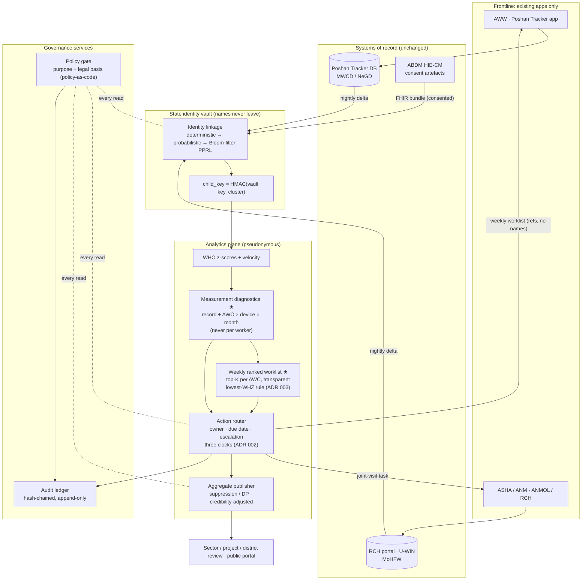

# Poshan Setu: architecture (for the proposal and the finals)

Component contracts: [`../architecture/components.md`](../architecture/components.md). Typed models: [`../architecture/contracts/models.py`](../architecture/contracts/models.py).

## 1. Data flow and trust boundaries


## 2. Lifecycle of one alert (decision rights and escalation)
```mermaid
sequenceDiagram
  autonumber
  participant PT as Poshan Tracker (monthly weighing)
  participant PS as Poshan Setu (weekly batch)
  participant AWW as AWW (own app)
  participant ASHA as ASHA/ANM
  participant LS as Lady Supervisor
  participant CDPO as CDPO + MO-PHC
  participant DM as DPO / DM review
  PT->>PS: measurement delta (child ref, weight, length, date)
  PS->>PS: z-scores · plausibility · AWC × device diagnostics · WHZ/MUAC/oedema status · weekly ranking
  alt measurement diagnostics flag the AWC
    PS->>LS: equipment calibration + stock check (14 days), then re-measure a sample (DESIGN, ADR 002)
  else observed SAM
    PS->>AWW: share SAM list with ASHA/ANM within 2 days (CMAM 2023 p.20)
    PS->>ASHA: medical appraisal by ANM/MO within 3–5 days of appetite test (CMAM 2023 p.8)
  else child in this AWC's top-K
    PS->>AWW: worklist item + reason (Hindi/English), due in 7 days (DESIGN)
    AWW-->>PS: visit done / outcome (existing home-visit module)
  end
  Note over PS: child clock always runs; missing inputs start a separate resource clock; every access and action → audit ledger
  PS->>LS: overdue → weekly village/ward review (CMAM 2023 p.22)
  PS->>CDPO: SAM not appraised → CDPO + MO-PHC (DESIGN day-14 trigger)
  PS->>DM: monthly district review, especially SAM (CMAM 2023 p.22): delays, input gaps, suppressed aggregates
```

## 3. Who sees what (policy gate, default deny)
| Role | Data category | Purpose | Scope | Transform |
|---|---|---|---|---|
| AWW | Identified child | Service delivery | Own AWC | none |
| ASHA / ANM, MO-PHC | Identified child (+ linked health record) | Care coordination | Only children with an open joint task | none |
| Lady Supervisor | Pseudonymous child; identified for escalated tasks | Supervision | Own sector | pseudonymise |
| CDPO | Aggregates; identified for escalated tasks | Programme monitoring | Own project | aggregate |
| DPO / DM / State | Aggregates | Programme monitoring | Own district / state | suppress small cells |
| Public | Aggregates | Public reporting | Any | differential privacy |
| Researcher | Pseudonymous only, with approval | Research | Approved scope | pseudonymise |

Legal basis per rule is cited in `components/policy_gate/policy.yaml` (v0.2.0), verified against the primary texts: DPDP Act 2023, the G.S.R. 843(E) commencement notification, DPDP Rules 2025, NFSA 2013 s.6, and the ABDM HIP/HIU Guidelines. See `research/sources/V1-dpdp-verified.md` and `V3-lead-verified-nfsa-abdm-cmam.md`.

## 4. Deployment sketch
- **Runs inside the state data centre or MeghRaj government cloud:** batch jobs (nightly ingest and linkage; weekly scoring and routing), a small Postgres for tasks and the audit log, and an object store for pseudonymous extracts.
- **Integration surfaces:** Poshan Tracker bulk export / API (to be agreed with NeGD/MWCD), RCH/U-WIN state extracts, ABDM HIU registration for consented FHIR pulls, and SMS/IVR gateway fallback for worklists.
- **Explicitly avoided:** no new frontline app, no new biometric step, no raw Aadhaar in the analytics plane, no worker-level scores, no employment use (policy deny `employment_action`).
- **Legal anchors (verified):** NFSA 2013 s.6 (State identifies malnourished children through the anganwadi); DPDP Act 2023 s.7(c), s.8(3), s.9 + Rules 2025 r.12 / Fourth Schedule (in force 13 May 2027, G.S.R. 843(E)); ABDM consent artefacts (purpose + duration per share).
