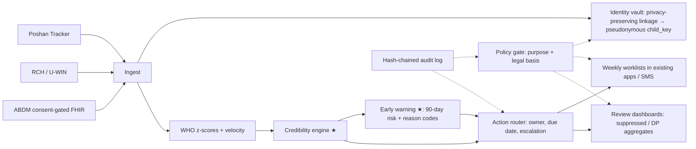

# Poshan Setu: making India's child-growth data trustworthy, linked and acted on within the week

**The India @71/100 Challenge · Theme 1: Maternal & Early Childhood Nutrition · Round 1 proposal (draft v0.1, 4 Oct 2026)**
**Team:** _[name]_ · **Team ID:** _[after registration]_ · **Institution:** IIT Delhi _(+ teammates)_ · **Contact:** _[email, phone]_

---

## 1. Problem identification: the gap and who falls into it
India weighs and measures more young children every month than any other country. In May 2026, Poshan Tracker recorded growth monitoring for **over 6.3 crore children aged 0–5** across all States and UTs [3]. Yet the system and the national survey disagree sharply on the most dangerous condition, wasting:

| Children | NFHS-5 (2019–21, under 5) [1] | Poshan Tracker, Nov 2023 [1] | Poshan Tracker, June 2025 (0–5 y) [2] |
|---|---|---|---|
| Stunted | 35.5% | 37.51% (under 6) | 37.07% |
| Underweight | 32.1% | 17.43% (under 6) | 15.93% |
| **Wasted** | **19.3%** | **6%** | **5.46%** |

Height-based stunting agrees between the two sources. Weight-based wasting and underweight diverge two- to three-and-a-half-fold. Part of the gap may be real improvement since 2019–21, or differences in timing and age range. But stunting did not fall, so improvement alone can't explain it. The Ministry's own explanation is that administrative data "suffer from data gaps due to coverage, measurement, training etc." (reply as reported in [6]).

**The measurable gap we target:** *the share of truly wasted children whom the frontline system never flags, and the time from first growth faltering to action.* The gap lands hardest on (a) **infants under 6 months**, when wasting incidence peaks. In South Asian cohorts 18.9% of babies are wasted at birth, and 52.2% of children have at least one wasting episode by age 2 [7]. It also lands on (b) **children in tribal-majority, high-burden blocks**. In Melghat, the data existed (Poshan Tracker showed 1,82,443 malnourished children in Maharashtra in Feb 2025), yet after 65 infant deaths in five months the Bombay High Court called the response "extremely casual". Officials blamed departments working "in silos" [5]. And it hits (c) **seasonal-migrant children**, who drop out of monthly weighing.

The failure isn't missing data. Nobody can tell **which numbers to trust**, the Anganwadi and health records about the same child **are not linked**, and **no one owns a deadline** for acting on a falling growth curve.

## 2. Evidence & context
- **Scale:** >8.93 crore registered beneficiaries; 13.97 lakh Anganwadi centres. Every AWW has a smartphone and every AWC has growth-monitoring devices [3, 4]. Poshan Tracker already classifies each measurement against WHO standards and schedules 23 home visits from pregnancy to age 3 [3].
- **Why it matters:** wasting is volatile. 71.1% of episodes resolve within 90 days, so monthly data must be acted on within weeks. Early wasting predicts later wasting and stunting [7].
- **Why more apps aren't the answer:** the CommCare-based ICDS-CAS raised home visits by 7.9–8.3 percentage points and counselling recall by 8–11.5 pp in Bihar and MP, but had "no effects … on infant and young child feeding practices" [8]. Frontline workers already report duplicate paper and app registers, device and network failures, and exclusion from the face-authentication step for Take-Home Ration, which has been mandatory since July 2025 [6].
- **What states do today:** periodic campaigns, for example UP's Sambhav Abhiyan, which targets the 100 highest-stunting AWCs per district for monthly committee review [9]. These are sprints, not a continuous system that verifies data, links records and enforces timelines.

## 3. Existing ecosystem: why the gap persists
| Layer | What exists | What's missing (our target) |
|---|---|---|
| Measurement | Poshan Tracker app + growth-monitoring devices; WHO classification [3] | No credibility check on the measurements themselves: heaping, copy-forward, implausible trajectories |
| Interoperability | Health system records birth weight, illness and immunisation (RCH/ANMOL, U-WIN); ABDM consent-based exchange | No routine link to Poshan Tracker; names transliterated differently; IDs often absent |
| Decision support | Point-in-time SAM/MAM classification; dashboards for review | No forward-looking risk; alerts not sized to worker capacity |
| Accountability | Sector, project and district review meetings | No owner, due date or escalation clock per alert; no audit trail of who saw what |
| Governance | DPDP Act 2023 and Rules; NDGFP 2022; ABDM consent manager | Purpose limits not enforced in code; aggregates published without disclosure control |

## 4. Proposed solution: Poshan Setu, a governance and decision layer behind existing apps
Poshan Setu needs **no new app and no new data entry**. It reads what Poshan Tracker and the health system already record, decides what is credible and what is urgent, and pushes **a short weekly worklist back into the apps workers already use**. Every access is checked against a purpose-bound policy and written to a tamper-evident log.

**4.1 Interoperability and data flow (sub-area 1).**
- Nightly deltas from Poshan Tracker, RCH/U-WIN and (with consent) ABDM FHIR bundles land in a state **identity vault**.
- Records are linked deterministically where IDs exist. Elsewhere we use probabilistic matching tuned for Indian names ("Lakshmi/Laxmi", "Baby of Sunita", DOB recorded as the 1st of the month), or keyed Bloom-filter encodings so departments can link without exchanging plaintext names.
- Only a pseudonymous `child_key` leaves the vault. Names reappear only on the worker's own device.
- Linked health events (low birth weight, diarrhoea, missed vaccines) enter the risk model; Anganwadi flags reach the ASHA/ANM through their own worklists.

**4.2 Early warning before severe malnutrition (spike B).**
- For every child under 5, each week: WHO 2006 z-scores, WHO 2009 weight-velocity z, recent change in weight-for-length, birth weight, illness, missed doses, prior episodes and the AWC's credibility.
- These feed a calibrated, interpretable model of the risk of becoming wasted within 90 days.
- Children are ranked **within each AWC up to that worker's weekly visit capacity**, so alerts never exceed what a worker can do. Each child carries two or three plain-language reasons in Hindi and English.
- Low-credibility data triggers a *re-measure* task, not a referral.

**4.3 Data quality and governance safeguards (sub-area 3).**
- *Record level:* WHO plausibility flags plus longitudinal impossibilities (height falling by more than 1.5 cm, weight jumps, identical weights three months running).
- *AWC level:* the **credibility engine (spike A)** scores digit preference, date-of-birth heaping, the spread of WHZ (expected near 1 SD), and *trajectory realism* (copied-forward data almost never shows the small dips real measurement does).
- Low-credibility AWCs get an equipment check and a supervisor re-measurement of 10 random children. This doubles as the ground truth for validating the models. Scores support supervision; they are never punitive.
- Prevalence is reported raw and credibility-adjusted.
- *Privacy by design:* purpose-bound access, data minimisation, small-cell suppression or differential privacy for public dashboards, and no profiling beyond service delivery. These follow the DPDP Act 2023 provisions on children's data and State services, and ABDM's consent model. Each rule carries its legal citation in the policy code, to be confirmed against the notified Rules.

**4.4 Decision rights and accountability (sub-area 2).**
| Role | Sees | When | Must act / escalates to |
|---|---|---|---|
| AWW | Named children of her AWC with reasons | Weekly worklist (app/SMS) | Home visit within 7 days; SAM referral within 2 days → Lady Supervisor |
| ASHA / ANM | A named child only when a joint task exists | With the task | Joint visit or medical appraisal within 7 days → MO-PHC |
| Lady Supervisor | Pseudonymous sector view; named for escalated tasks | Weekly | Re-measurement audits; overdue tasks → CDPO |
| CDPO / MO-PHC | Project aggregates + escalated cases | Fortnightly | Supply and staffing fixes → DPO |
| DPO / DM | Suppressed district aggregates, SLA breaches, credibility map | Monthly district review | Resource allocation; inter-department convergence |
| Public | Differentially private aggregates | Quarterly | — |

The timelines are working assumptions, to be aligned with the national malnutrition-management protocol (MWCD–MoHFW, 2023) and the Poshan 2.0 review cadence. Every task carries an SLA clock, and every escalation and data access is written to the hash-chained audit log.

## 5. Working prototype (what already runs)
All components are typed modules with contract tests, and every number below comes from a committed run in our repository. **Model results use a clearly labelled SYNTHETIC cohort.** Real Poshan Tracker microdata isn't public; the cohort is calibrated to published longitudinal-cohort parameters [7].

| Component | Metric | Result |
|---|---|---|
| WHO z-score engine | Max error vs WHO's own published tables (87,408 points, ±4 SD) | **0.003 z** |
| Record linkage, ICDS ↔ health (synthetic dual registry, 5,000 children) | Pairwise F1: shared IDs only / probabilistic / privacy-preserving Bloom filter | **0.51 / 0.94 / 0.97** |
| Credibility engine (synthetic, 120 AWCs, 3 seeds) | AUROC, any unreliable AWC / copy-forward AWCs specifically; gross-error recall | **1.00 / 0.69 / 0.995** |
| Policy gate | Red-team access requests correctly denied | **29/29, 0 false allows** |
| Audit log | Random tampering detected | **100/100** |

## 6. Feasibility and implementation roadmap
- **Nov–Dec 2026 (prototype):** early-warning model and its evaluation; auto-tuned credibility indices; legal review of the DPDP and ABDM mapping; finals demo.
- **Pilot, months 1–6 (one district, ~1,500 AWCs):**
  - Read-only Poshan Tracker extract under a data-sharing agreement with the state WCD department.
  - Supervisor re-measurement audits in sampled AWCs to measure true credibility.
  - Worklists delivered through existing apps/SMS.
  - Stepped-wedge rollout by sector to measure impact.
- **Scale, months 6–24:** state rollout; RCH/U-WIN linkage via the state health department; offer to NeGD as a Poshan Tracker module.
- **Feasibility:** linkage, scoring and routing are batch jobs over monthly data. A state's volume is processed in minutes to hours on standard government cloud. *Estimate; to be benchmarked.*

**Key risks and mitigations:**
- No data access → start with the aggregate and audit layer, which needs no identifiers.
- Punitive use of scores → policy and training.
- Model bias against unmeasured migrant children → missed-measurement alerts and subgroup recall reporting.

## 7. Expected impact and scalability
- **Beneficiaries:** children 0–5 enrolled at Anganwadis, prioritising infants and tribal and migrant households. Frontline workers get fewer, better-targeted tasks.
- **Outcome metrics for the pilot:**
  - share of incident wasting flagged ≥30 days before it occurs, at fixed capacity;
  - median days from flag to first home visit;
  - % of SAM referrals appraised within 7 days;
  - agreement between re-measurement and records;
  - convergence of credibility-adjusted prevalence towards independent survey estimates.
- **Scale path:** the layer is national by construction, using the same app, standards and hierarchy in every state. What changes per state is the policy file and the escalation timelines.

**References** (all accessed 4 Oct 2026):
1. PIB (MWCD), Rajya Sabha reply, 20 Dec 2023, PRID 1988614.
2. Rajya Sabha Unstarred Q. 477, 23 Jul 2025, Annexure I (Poshan Tracker, June 2025).
3. PIB Research, "Poshan Tracker: India's Real-Time Nutrition Monitoring Platform", 8 Jul 2026.
4. Digital India, "Poshan Tracker".
5. *The Hindu*, "Why do infant deaths persist in … Melghat", 2025.
6. News reports compiled in our research notes (*Hindustan Times*, BehanBox, News18), 2025.
7. Mertens et al., "Child wasting and concurrent stunting in LMICs", *Nature* 2023 (ki consortium).
8. Patil et al., *BMJ Global Health* 2022;6(Suppl 5):e007298.
9. *Hindustan Times*, "Sambhav Abhiyan 5.0", 2025.

Full URLs are in `research/landscape.md`.
