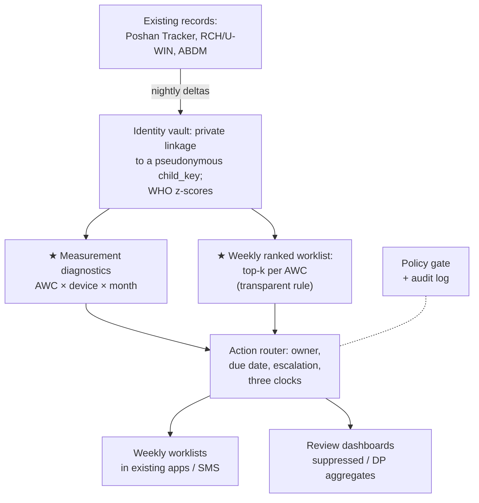

# Poshan Setu: turning child-growth records into timely, accountable action

**The India @71/100 Challenge · Theme 1: Maternal & Early Childhood Nutrition · Round 1 proposal (v0.3, 4 Oct 2026)**
**Team:** _[name]_ · **Team ID:** _[after registration]_ · **Institution:** IIT Delhi _(+ teammates)_ · **Contact:** _[email, phone]_

---

## 1. Problem identification: the gap and who falls into it
In May 2026, Poshan Tracker recorded growth monitoring for **over 6.3 crore children aged 0–5** across all States and UTs [3]. Yet the system and the national survey disagree sharply on wasting, the most dangerous form of undernutrition:

| Children | NFHS-5 (2019–21, under 5) [1] | Poshan Tracker, Nov 2023 [1] | Poshan Tracker, June 2025 (0–5 y) [2] |
|---|---|---|---|
| Stunted | 35.5% | 37.51% (under 6) | 37.07% |
| Underweight | 32.1% | 17.43% (under 6) | 15.93% |
| **Wasted** | **19.3%** | **6%** | **5.46%** |

The divergence is in the weight-based indicators, and it is universal: Poshan Tracker's wasting is below NFHS-5's in **all 36 States/UTs** (e.g. Maharashtra 4.01% vs 25.6%) [2, 14]. The figures aren't directly comparable: the age bands differ, the periods differ, and one source samples households while the other counts children registered and measured. So this is an **unexplained discrepancy**, not proof of missed children. The Ministry itself notes that administrative data "suffer from data gaps due to coverage, measurement, training etc." (Rajya Sabha reply, as reported in [6]). Today no one can say, for any district or Anganwadi, how much of the gap is real change, coverage, measurement error or misclassification.

**Who falls into the gap.** Infants and young children (0–23 months) in high-burden, tribal-majority blocks.
- Wasting starts early: in South Asian cohorts, 18.9% of babies were wasted at birth and 52.2% had at least one episode by age two [7].
- Reporting from Melghat (Maharashtra) describes infant deaths and coordination failures alongside substantial recorded malnutrition (1,82,443 malnourished children statewide in Feb 2025) [5]. It does not establish that the children who died had been identified and followed up.
- Seasonal migrants and unregistered children may never be measured at all.

**The measurable gap we target**, locally and repeatably:
1. The share of new wasting episodes preceded by an actionable flag at least 30 days before onset.
2. The days from first actionable flag to action: a home visit, or medical appraisal for SAM.
3. Agreement between records and blinded re-measurement.

The pilot question: *do existing measurements lead to a named owner, timely assessment and completed care, and which children never enter the records at all?*

## 2. Evidence & context
- **Scale and tools exist:** >8.93 crore registered beneficiaries; 13.97 lakh Anganwadi centres (AWCs). Every Anganwadi worker (AWW) has a smartphone and every AWC has growth-monitoring devices. Poshan Tracker classifies each measurement against WHO standards and schedules 23 home visits from pregnancy to age 3 [3, 4].
- **Speed matters:** in the pooled ki cohorts, 71.1% of wasting episodes ended within 90 days, fewer in South Asia [7]. Monthly data only help if acted on within weeks.
- **Another app isn't the answer:** the CommCare-based ICDS-CAS raised adequate home visits by 7.9–8.3 percentage points and counselling recall by 8–11.5 pp (Bihar, MP), but had "no effects … on infant and young child feeding practices" [8]. Workers already report duplicate paper and app registers, device and network failures, and exclusion at the face-authentication step for Take-Home Ration [6].
- **States run campaigns, not continuous governance:** UP's Sambhav Abhiyan targets the 100 highest-stunting AWCs per district for monthly committee review [9].

## 3. Existing ecosystem: why the gap persists
| Layer | What exists | Not in Poshan Tracker's published feature set [3], so our target |
|---|---|---|
| Measurement | App, devices, WHO classification | A check on the measurements themselves: heaping, copy-forward, implausible trajectories |
| Interoperability | RCH/ANMOL and U-WIN hold birth weight, illness, immunisation; ABDM consent-based exchange [10] | A routine link to Poshan Tracker records; names spelled differently; IDs often absent |
| Decision support | Point-in-time SAM/MAM status; review dashboards | Weekly lists sized to each worker's capacity |
| Accountability | Sector, project and district reviews; national CMAM protocol timelines [11] | An owner, due date and escalation clock per alert; a record of who saw what |
| Governance | DPDP Act 2023 and Rules 2025; ABDM consent manager | Purpose limits enforced in code; disclosure control on published aggregates |

## 4. Proposed solution: Poshan Setu, a governance and decision layer behind existing apps
Poshan Setu **reuses the growth records the system already collects**. Each week it decides what is credible and what is urgent, and returns a short worklist into the apps workers already use. Worklist delivery and acknowledgements depend on agreed departmental interfaces. Every data access passes a purpose-bound policy check and is written to a tamper-evident log.

**4.1 Interoperability and data flow (sub-area 1).**
- Nightly deltas from Poshan Tracker and RCH/U-WIN, plus ABDM health records under consent artefacts that fix purpose and duration [10], land in a state **identity vault**.
- Records are linked on shared IDs where they exist. Otherwise we use probabilistic matching tuned for Indian names ("Lakshmi/Laxmi", "Baby of Sunita", DOB recorded as the 1st), or keyed Bloom-filter encodings so departments can link without exchanging names.
- Only a pseudonymous `child_key` leaves the vault. The SAM list reaches the ASHA/ANM within the protocol's 2 days [11].
- **Minimum deployment contract:** source record and version, child reference, action, owner, due date, blocked-input status, acknowledgement. These fields come from existing exports and the worker's own app.

**4.2 Capacity-capped weekly worklists (spike B).**
- Children observed as SAM/MAM (WHZ, MUAC at 6–59 months, oedema) go straight to the national protocol pathway [11].
- Every AWC also gets *K* slots a week, set to its worker's visit capacity, filled with the children closest to the MAM line. An AWW can check that rule herself.
- In our leakage-free simulation, with infants under 6 months routed to the protocol pathway (15% of new episodes), this rule flagged 47% of the remaining new wasting episodes a month or more before onset, against 41% for the programme's "no weight gain in 2 months" rule and 29% for random. Our ML model (43%) did not beat it, and linked health records added no predictive gain. So the rule ships first; a model replaces it only if it does better on pilot data. Linkage is justified by care coordination, not prediction.
- WHO growth-velocity scores are used only within their published range (to 24 months).
- **Legal go/no-go:** each identifiable data flow needs a written legal basis that covers consent *and* any restriction or exemption. Without it, deployment is limited to lawfully supplied, non-identifying aggregates.

**4.3 Data quality and governance safeguards (spike A, sub-area 3).**
- *Record checks:* WHO plausibility flags and impossible trajectories, such as height falling more than 1.5 cm or three identical weights in a row.
- *Measurement diagnostics* per **AWC × device × month, never per worker**: digit preference, date-of-birth heaping, the spread of WHZ (expected near 1 SD), missingness, and trajectory realism (copied-forward data rarely dips the way real measurements do).
- *Support before scrutiny:* a flag first triggers an equipment calibration and a stock check. The Lady Supervisor re-measures a sample of children in flagged AWCs *and* in randomly chosen unflagged AWCs, with known selection probabilities.
- Workers see the same diagnostics, can annotate them ("scale broken since the 12th") and can appeal. Remote and migrant-serving AWCs are compared only with similar AWCs.
- HR, pay, transfer or disciplinary use is denied in the policy code and the data-sharing agreement. Residual misuse risk is covered by oversight and grievance.
- **The law:**
  - Every beneficiary is a "child" under the DPDP Act 2023 (s.2(f)); ss.7–10 commence on **13 May 2027** (G.S.R. 843(E)) [12].
  - The State must, "through the local anganwadi, identify" children who suffer from malnutrition (**NFSA 2013 s.6**) [13]. Processing for that function (DPDP s.7(c)) "in the interests of a child, under any law" is exempt from the parental-consent and no-tracking rules (DPDP Rules 2025, Rule 12, Fourth Schedule B(1)) [12].
  - s.8(3) requires "completeness, accuracy and consistency" when data drive decisions. *The diagnostics are how the State meets that duty.*
  - Research is allowed only without individual decisions (s.17(2)(b)). Public figures use small-cell suppression or differential privacy.

**4.4 Decision rights and accountability (sub-area 2).**
| Role | Sees | Must act (source) | Escalates to |
|---|---|---|---|
| AWW | Named children of her AWC, with reasons | Share the SAM list with ASHA/ANM within 2 days; MAM fortnightly visits [11] | Lady Supervisor (LS) at the weekly review |
| ASHA / ANM / MO-PHC | A named child only with an open joint task | Medical appraisal within 3–5 days of the appetite test [11] | CDPO + MO-PHC (our day-14 trigger) |
| LS | Pseudonymous sector view; names only for escalated tasks | Weekly village review [11]; re-measurement sample | CDPO |
| DPO / District Magistrate | Suppressed aggregates, delays, input gaps | Monthly district review, especially SAM [11] | State quarterly review [11] |

**Three clocks, so no child disappears:**
- The *child's clock* runs from the first actionable flag and is always visible.
- Missing inputs (scale, rations, NRC bed, transport) start a separate *resource clock*, escalated to CDPO/DPO. They never pause the child's clock or an urgent assessment.
- SAM, infants under 6 months and danger signs bypass ranking.
- A *worker clock* starts only once the inputs exist. Every escalation and data access is logged.

## 5. Working prototype (what already runs)
Every number below comes from a committed run in our repository. **SYNTHETIC rows are engineering checks on a simulated district, not validation.** The simulator is parameterised from published cohort estimates but does not fully reproduce them: at-birth wasting is 22.8% against 18.9% [7].

| Component | Check | Result |
|---|---|---|
| WHO z-scores (real WHO tables) | Max error vs WHO's published tables, 87,408 points at ±4 SD | **0.003 z** |
| Record linkage (SYNTHETIC, 5,000 children) | F1: shared IDs only / probabilistic / privacy-preserving Bloom filter | **0.51 / 0.94 / 0.97** |
| Measurement diagnostics (SYNTHETIC, 120 AWCs, 3 seeds) | AUROC: any unreliable AWC / copy-forward AWCs. A tuning change that hit 0.95 failed a different fabrication pattern and was rejected | **1.00 / 0.69** |
| Weekly worklists (SYNTHETIC, 9,107 new episodes in children ≥6 months, 5 slots per AWC per month) | Episodes flagged ≥1 month ahead: WHZ rule (95% CI) / ML / programme rule / random | **0.47 (0.46–0.49) / 0.43 / 0.41 / 0.29** |
| End-to-end weekly run (SYNTHETIC, 120 AWCs, 5,307 children) | Tasks → worklists; SMS length; escalated after 8 days (70% on time assumed); audit chain | **1,685 → 140; ≤80 chars; 482; verified** |
| Policy gate / audit log | Red-team cases (spoofed scope, fake consent, employment use) / tampering incl. truncation | **39/39 / 100/100** |

## 6. Feasibility and implementation roadmap
- **Nov–Dec 2026:** prototype hardening; finals demo.
- **Before any pilot:**
  - Paid co-design with Anganwadi worker unions and AWWs from tribal, migrant and low-connectivity areas.
  - A written protocol on prohibited uses, workload, correction and grievance, with worker seats in pilot governance.
  - A legal opinion for each data flow; a pre-registered evaluation.
- **Pilot, months 1–6** (one high-burden district; children 0–23 months; read-only extracts under a data-sharing agreement):
  1. Household enumeration plus concurrent blinded re-measurement, to estimate *current local* coverage and measurement/classification error. This cannot explain past national change.
  2. Prospective validation of the ranking under standard care.
  3. Stepped-wedge rollout by sector, with independently measured outcomes. Sample size to be set with the partner.
- **Team (our plan):** a data engineer, an analyst, a part-time legal/governance lead, a district coordinator, plus state WCD and health nodal officers. Costing to be done with the partner.
- **Compute:** monthly batch jobs. Our synthetic district runs end to end in seconds on a laptop; state scale is to be benchmarked.
- **Scale, months 6–24:** the components are reusable nationally. Expansion depends on state approvals, interfaces, languages, service capacity and pilot evidence.

**Risks:**
- No data access or no legal basis → aggregates-only mode.
- Punitive use → no worker-level outputs; prohibited by policy and contract.
- Missed migrant and unregistered children → household enumeration, missed-measurement alerts, subgroup reporting.

## 7. Expected impact and scalability
- **Beneficiaries:** children 0–23 months in high-burden, tribal-majority blocks first, then all Anganwadi children under 6. Workers get fewer, better-targeted tasks.
- **Pilot outcomes:**
  - share of new wasting episodes flagged ≥30 days before onset;
  - median days from flag to home visit;
  - share of SAM appraised within 3–5 days;
  - record vs blinded re-measurement agreement, including false-flag rates in remote AWCs;
  - worker time and reported burden, which must not rise;
  - completed treatment, not just closed tasks.
- **Scale path:** the same standards, hierarchy and app in every state. Each state supplies its policy file, timelines and interfaces.

**References** (accessed 4 Oct 2026):
1. PIB (MWCD), Rajya Sabha reply, 20 Dec 2023, PRID 1988614.
2. Rajya Sabha Unstarred Q. 477, 23 Jul 2025, Annexure I.
3. PIB Research, "Poshan Tracker: India's Real-Time Nutrition Monitoring Platform", 8 Jul 2026.
4. Digital India (MeitY), "Poshan Tracker".
5. *The Hindu*, "Why do infant deaths persist in … Melghat", 2025.
6. *News18*, 5 Dec 2025 (Rajya Sabha reply on Poshan Tracker vs NFHS-5); *Hindustan Times*, 18 Jun 2025 (face-recognition rule for Take-Home Ration); BehanBox, 14 May 2025.
7. Mertens et al., *Nature* 2023, "Child wasting and concurrent stunting in LMICs" (PMC10511327).
8. Patil et al., *BMJ Global Health* 2022;6(Suppl 5):e007298.
9. *Hindustan Times* (Lucknow), "Sambhav Abhiyan 5.0", 2025.
10. ABDM, Guidelines for HIPs, HRPs, HIUs and PHR apps, 24 Oct 2022, pp. 5, 19.
11. MWCD & MoHFW, Protocol for Management of Malnutrition in Children, 10 Oct 2023, pp. 8, 11, 20–22.
12. DPDP Act 2023; G.S.R. 843(E) and DPDP Rules 2025 (G.S.R. 846(E)), 13 Nov 2025.
13. National Food Security Act 2013 (No. 20 of 2013), s.6.
14. Lok Sabha Unstarred Q. 2668, 4 Aug 2023, Annexure (NFHS-5 State/UT-wise).
