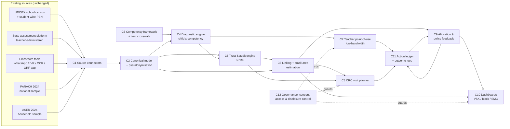

# Component map — FLN decision-support layer ("Ek Tasveer": one trusted picture)

> Lead-owned. Contracts: [`contracts/fln_contracts.py`](contracts/fln_contracts.py) (pydantic v2; JSON Schema in [`contracts/schemas/`](contracts/schemas/), regenerate with `python3 -m architecture.contracts.export_schemas` from `india71-t2-learning/`). Schema version 0.1.0.
> Factual claims about existing systems live in [`../research/sources/`](../research/sources/); this file is architecture only.

## Why these components (first principles)
Schools already *record* a lot; the brief says the gap is in how data is "governed, aggregated, and converted into classroom-level and system-level decisions". We trace five breaks between a recorded number and a changed outcome for a struggling child, and give each break an owner component:

| Break | Symptom | Owner |
|---|---|---|
| **Commensurability** | ASER levels, PARAKH scale scores, state tests and classroom checks measure different things on different scales, so teacher, block and state see different pictures | C2 canonical model, C3 competency crosswalk, C6 linking |
| **Trust** | Census-style state assessments are mostly teacher-administered with stakes attached; nobody knows how far to believe them | **C5 trust & audit engine** |
| **Granularity** | Trustworthy surveys (PARAKH, ASER) are samples: fine for state/district, silent about blocks, schools, children | C4 diagnostics (child), C6 small-area estimation (block) |
| **Actionability** | Outputs are compliance reports (averages, % "NIPUN"), not "these 7 children, this activity, this week" | C7 teacher view, C8 visit planner, C9 allocation |
| **Closed loop** | Nobody checks whether the action happened or worked | C11 action ledger, feeding C9 |

C12 (governance) wraps everything: who may see what, at which level, for which purpose.

## Dependency graph

## Component table
| # | Component | Input → Output (contracts) | Calls | Baseline (existing practice) | Spike? | Isolated scalar metric |
|---|---|---|---|---|---|---|
| C1 | Source connectors | source files/APIs → raw rows + `Provenance` | — | state ETL / VSK ingestion | no | % source fields ingested losslessly (schema-validation pass rate) |
| C2 | Canonical model & identity | raw rows → `School`, `Student`, `Response`, `AttendanceRecord` | C1 | Ed-Fi/CEDS-style schema; UDISE+ codes, LGD codes | no | contract-validation pass rate; record-linkage F1 on perturbed IDs |
| C3 | Competency framework & item crosswalk | framework docs + item banks → `Competency`, `Item` (Q-matrix) | — | expert mapping by SCERT | no | agreement with expert Q-matrix (κ); model-fit gain |
| C4 | Diagnostic engine | `Response`[] + `Item`[] → `ChildDiagnosis` | C2, C3 | ASER-style highest-level rule on a fixed paper test | candidate | level accuracy / Brier on held-out cohort; items needed for P(level) ≥ 0.9 |
| C5 | **Measurement assurance** (was: trust & audit engine) | reported school results + re-test sample + anchor → block estimates with 90 % intervals (`components/trust_audit/assurance.py`) | C2, C4 | Gunotsav / Saksham verification (grading, not calibration) | **yes (spike 2)** | **block MAE (pp) subject to held-out 90 %-interval coverage ≥ 0.85** — pre-registered PASS: 0.967, 2.16 vs 4.31 pp |
| C6 | Linking + small-area estimation | `TrustAssessment`[] + `AggregateObservation`[] + UDISE+ covariates → `AreaEstimate` (block/district, CI, benchmarked) | C2, C5 | direct averages of reported data | candidate | block RMSE (pp); 90 % CI coverage; |aggregate − survey anchor| |
| C7 | Teacher point-of-use | `ChildDiagnosis`[] + roster → `TeacherPlan` (TaRL groups, activities, WhatsApp/SMS/IVR text) | C4, C12 | state teacher apps; chatbot broadcasts | no | payload bytes / SMS segments per weekly plan; group–level match rate |
| C8 | CRC visit planner | `AreaEstimate`[] + `TrustAssessment`[] + last visits → `VisitPlan` | C5, C6 | rota / ad hoc | no | need-weighted coverage of high-need schools within 30 days (sim) |
| C9 | Allocation & policy feedback | `AreaEstimate`[] + budget + equity weights → `AllocationDecision`[] | C6, C11 | proportional to enrolment | demoted | below-goal children in targeted schools vs raw / oracle — pre-registered: no gain shown |
| C10 | Dashboards (VSK / block / SMC) | `AreaEstimate`, `AllocationDecision`, `TrustAssessment` → HTML/JSON views | C6, C9, C12 | VSK dashboards | no | % cells passing disclosure rules; page weight (KB) |
| C11 | Action ledger & outcome loop | `ActionRecord`[] + later `ChildDiagnosis` → effect estimates per action type | C7–C9 | none | no | % actions with an outcome measured within 6 weeks; bias of effect estimate (sim) |
| C12 | Governance, consent & access | `AccessRequest` → `AccessDecision`; disclosure control on aggregates | — | role-based portals | no | policy test-suite pass rate; share of published cells with n < 10 (must be 0) |

## Component specs

### C1 — Source connectors
- **Responsibility:** pull each existing source as-is, attach `Provenance`, never transform meaning.
- **Inputs:** UDISE+ school master + student-wise PEN extract (state copy); state assessment platform exports (CSV/API); classroom-tool events (WhatsApp/IVR/OCR/ORF); PARAKH and ASER published tables (`AggregateObservation`).
- **Outputs:** raw rows tagged with `Provenance(source, source_record_id, fetched_at, transform, licence)`.
- **Error modes:** schema drift, partial uploads, duplicate submissions → quarantined with reason.
- **SLO:** daily batch for administrative feeds; ≤ 1 h for classroom events.

### C2 — Canonical model & identity
- **Responsibility:** one schema for every source; replace PEN/APAAR with salted pseudonyms (`ps_<16 hex>`) at the boundary; resolve schools by UDISE+ code and geography by LGD codes.
- **Input:** C1 raw rows. **Output:** `School`, `Student`, `Response`, `AttendanceRecord`.
- **Error modes:** unmatched IDs (→ linkage queue), conflicting attributes across sources (UDISE+ wins for master data, with conflict log).
- **Metric:** validation pass rate; linkage F1 on synthetic perturbations.

### C3 — Competency framework & item crosswalk
- **Responsibility:** a machine-readable competency ladder aligned to the NIPUN Bharat learning goals, and a Q-matrix tagging every item of every instrument to competencies — the "Rosetta stone" that makes ASER levels, PARAKH learning outcomes and state tests comparable.
- **Output:** `Competency` (code, grade target, prerequisites, `source_ref`), `Item` (competency codes, optional IRT parameters).
- **Status:** skeleton uses the ASER reading/arithmetic ladder as a proxy; mapping to the NIPUN Lakshya Soochi pending verification at source.

### C4 — Diagnostic engine
- **Responsibility:** turn item responses into per-child competency mastery with honest uncertainty, and choose the next item adaptively so a teacher can diagnose a child in minutes.
- **Input:** `Response`[] for a child + `Item`[] (C3). **Output:** `ChildDiagnosis` (level, confidence, mastery[], next competency, P(meets grade goal)).
- **Baseline:** deterministic "highest level passed" rule (paper-tool logic). **Candidates:** Bayesian 2PL IRT posterior; classification CAT with stopping rule.
- **SLO:** < 50 ms per child on a low-end Android phone (pure arithmetic on a θ-grid); works offline.

### C5 — Trust & audit engine (proposed spike; see ADR 001)
- **Responsibility:** say how much to believe each reported number, verify cheaply, and correct it.
- **Steps:** (1) forensic risk score per school from public signals only (heaping at the goal level, implausibly low variance, absence of beginners, gap vs. classroom-tool estimates, gap vs. covariate-predicted value); (2) audit selection with known inclusion probabilities (random floor + risk-proportional), so estimates stay design-unbiased; (3) independent re-test of a few children per audited school (CRC, DIET trainee, third party or AI-ORF); (4) bias model fitted on audited schools, applied with Horvitz–Thompson weights to produce audit-adjusted school estimates + SE.
- **Output:** `TrustAssessment` per school × subject × grade.
- **Metric (frozen for auto-research, from 4 Oct 15:52):** block MAE (pp) of the published estimate on dev seeds 1–30, kept only if 90 %-interval coverage stays ≥ 0.85; confirmations on fresh seeds 201–230 (101–130 were spent by the pre-registered test). Method as frozen: misclassification correction from a double-assessed subsample → children-weighted HT stratum bias → Fay–Herriot model on the bias → precision-weighted same-construct anchor → full-pipeline parametric bootstrap.

### C6 — Linking + small-area estimation
- **Responsibility:** one consistent number per block/district with a confidence interval, coherent across levels (school → block → district) and benchmarked to the independent survey anchor (PARAKH/ASER).
- **Method ladder:** direct mean (baseline) → audit-adjusted direct → Fay–Herriot shrinkage with UDISE+ covariates → benchmarking to the district anchor.
- **Output:** `AreaEstimate` (estimate, CI, sources used, suppressed flag).

### C7 — Teacher point-of-use
- **Responsibility:** the weekly "what to do on Monday" for a teacher: TaRL groups by level, one or two activities per group, delivered as a WhatsApp message, ≤ 3 SMS segments, or an IVR script, in the local language.
- **Input:** `ChildDiagnosis`[] + local roster (names stay on the teacher's device). **Output:** `TeacherPlan` (with `payload_bytes`).
- **Design rule:** content is retrieved from a curated activity catalogue mapped to competency codes (state/DIKSHA content IDs), never free-generated.

### C8 — CRC visit planner
- **Responsibility:** each week, which schools a cluster coordinator visits and what to do there (coach a group, observe, re-test for audit).
- **Input:** `AreaEstimate`, `TrustAssessment`, last-visit dates. **Output:** `VisitPlan`.

### C9 — Allocation & policy feedback
- **Responsibility:** turn block/district estimates into resource decisions (remedial camps, training slots, TLM grants, volunteer support) that maximise expected additional children meeting the goal, with equity weights for SC/ST share and single-teacher schools; emits AWP&B-ready rationale and an SMC one-pager.
- **Output:** `AllocationDecision`[] with expected gain and rationale.
- **Metric:** expected additional children reached vs. oracle and vs. enrolment-proportional baseline (simulation; effect sizes cited as assumptions).

### C10 — Dashboards
- **Responsibility:** render the same numbers at every level: state/VSK, district, block, cluster, SMC; always with intervals and trust flags; no cell below the disclosure threshold.

### C11 — Action ledger & outcome loop
- **Responsibility:** log every action (plan sent, acknowledged, visit made, camp held), link it to the next diagnosis, and estimate what worked (staggered roll-outs make this causal); feed effect estimates back into C9's priors.

### C12 — Governance, consent & access
- **Responsibility:** purpose-bound, role-scoped access; child-level data only on the teacher's device and for the teacher's own class; pseudonymised everywhere else; aggregates with small-cell suppression (n < 10); audit trail of access.
- **Metric:** table-driven policy test suite pass rate (must be 100 %).

## Seams for parallel work
Every arrow above is a contract in `fln_contracts.py`. A component can be swapped (e.g., C4 Bayesian IRT ↔ a CDM, C6 Fay–Herriot ↔ MRP) without touching its neighbours, and each has its own evaluator under `components/<name>/evaluate.py`; the end-to-end harness is `eval/run_eval.py`.
