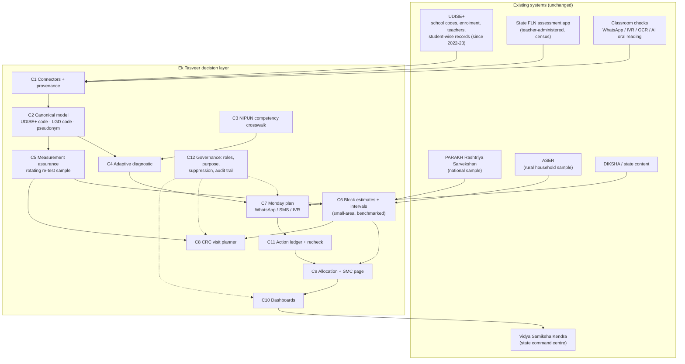

# Ek Tasveer — architecture (Round-1 companion)

> Component contracts: [`../architecture/contracts/fln_contracts.py`](../architecture/contracts/fln_contracts.py) · component specs and isolated metrics: [`../architecture/components.md`](../architecture/components.md) · spike decision: [`../architecture/adr/001-spike.md`](../architecture/adr/001-spike.md).

## 1. System view — existing systems stay; the layer adds five links


## 2. Loop 1 — classroom, weekly
```mermaid
sequenceDiagram
  participant T as Teacher (printed tool or phone)
  participant D as C4 diagnostic (school/CRC smartphone or server)
  participant P as C7 Planner
  participant L as C11 Ledger
  T->>D: termly oral check, child by child (printed branching tool by default; adaptive engine where a device exists)
  D-->>T: level + confidence per child (names stay on device)
  D->>P: levels by pseudonym
  P-->>T: weekly plan — groups, 1 activity each, recheck date (print / WhatsApp / ≤ 3 SMS / IVR)
  T->>L: "done" (one tap / IVR key)
  Note over T,L: 4–6 weeks later the same competency is rechecked; the change is logged against the action
```

## 3. Loop 2 — system, termly (measurement assurance)
```mermaid
sequenceDiagram
  participant S as State assessment (all schools)
  participant M as C5 Moderation
  participant C as CRC visit
  participant E as C6 Estimation
  participant B as Block / District / VSK
  S->>M: teacher-reported results (school × grade × subject)
  M->>M: choose rotating sample: uncertainty × decision value, random floor, known inclusion probabilities
  M->>C: re-test 12 children per sampled school from a frozen roster (cross-cluster assessor, blinded; coach only after recording)
  C-->>M: independent levels
  M->>E: calibrated school estimates + SE (model-assisted, design-weighted)
  E->>E: Fay–Herriot model on the reporting bias; benchmark only to an independent same-construct, same-term survey (precision-weighted)
  E-->>B: block numbers with intervals that add up across levels (no school-level trust labels)
```

## 4. Data model and keys
| Entity | Key | Source of truth | Notes |
|---|---|---|---|
| School | 11-digit UDISE+ code | UDISE+ | management, rural, teachers, single-teacher flag, enrolment by grade |
| Geography | LGD state / district / block codes | LGD directory | cluster ID from the state |
| Student | `ps_<16 hex>` = salted SHA-256 of PEN/APAAR | UDISE+ student-wise record | raw IDs never leave C1; salt held by the state |
| Competency | e.g. `L.STORY`, `M.SUB` mapped to NIPUN Lakshya Soochi goals | C3 framework | Grade 3 goal: reads with meaning ≥ 60 wpm; numbers to 9,999 |
| Item / Response | item ID + Q-matrix row | instrument owner | score, administrator (teacher / CRC / third party / AI), date |
| AggregateObservation | source × area × indicator × year | PARAKH, ASER | value, SE, n, citation |
| TrustAssessment | school × subject × grade | C5 | visible only to the moderation team and the state analyst; never used for personnel decisions |
| AreaEstimate | area × subject × grade | C6 | estimate, 90 % interval, sources used, suppressed flag |

## 5. Who sees what (C12, enforced by a 36-case test suite)
| Role | Child-level | School-level moderation data | Aggregates |
|---|---|---|---|
| Teacher / head teacher | own class only, on device | no | own school |
| SMC | no | no | own school (pictorial) |
| CRC | no (pseudonymised re-test rows only when auditing) | no | own cluster |
| BRC / DEO / State | no | state + moderation team only | own scope; cells with n < 10 suppressed |

## 6. Deployment
- Runs inside the state's VSK cloud tenancy; batch jobs (nightly connectors; termly moderation) + a stateless plan service for messages.
- Teacher side: a printed branching tool works with no device; where a school/CRC smartphone exists the adaptive engine runs offline. Plans fit one WhatsApp message (755 bytes in Hindi for a synthetic class of 60) or three SMS, or are printed.
- Every component has its own evaluator and contract tests, so states can adopt one component at a time and swap implementations without touching neighbours.
