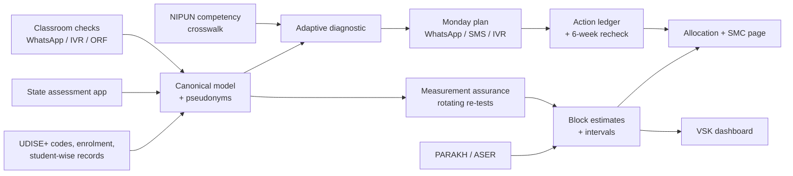

# Ek Tasveer — one trusted picture of every child's foundational learning
### A NIPUN Bharat decision-support layer built on UDISE+, PARAKH, ASER and state assessments
*India @ 71/100 Challenge · Theme 2: Foundational Learning Outcomes · Round 1 proposal — draft v0.2 (4 Oct 2026)*

**Team:** ⟦Team name⟧ · **Team ID:** ⟦Team ID⟧ · **Institution(s):** ⟦…⟧ · **Contact:** ⟦email, phone⟧

---

## 1. Problem identification

**The scorecard.** India scores 71/100 on the SDG India Index 2023-24 and 61 on SDG 4 (Quality Education); the adjusted net enrolment rate in elementary education is 96.5 % [1]. NIPUN Bharat (launched 5 July 2021) commits to "universal FLN in primary schools by 2026-27": every child reads with meaning at **≥ 60 words a minute** and handles numbers to 9,999 by the end of Grade 3 [2]. **2026-27 is this school year.**

**The lived reality.** In rural **government** schools, **23.4 %** of Std III children can read a Std II-level text and **27.6 %** can do at least subtraction (ASER 2024) [3]. Both rose sharply from 2022 (16.3 % and 20.2 %), so the system *can* move — but three in four Grade 3 children in government schools still cannot read a Grade 2 text. In private schools the reading figure is 35.5 % [3].

**The measurable gap.** *Share of Grade 3 children in government schools who meet the Grade 3 reading and numeracy goals*: mission target 100 % in 2026-27 [2]; independently measured ≈ 23 % (reading) and ≈ 28 % (subtraction) [3].

**The underserved group.** Children in Grades 1–3 of rural government schools — 68.9 % of India's 14.71 lakh schools are government schools [4] — and, within them, those the data system sees least well: children in **1,04,125 single-teacher schools (33.8 lakh enrolled)** [4], Scheduled Tribe and Scheduled Caste children, and children whose home language is not the language of instruction.

**The implementation gap — five breaks.** The brief is right that data is not missing. UDISE+ has collected student-wise records with "more than 60 fields for each student" since 2022-23 [4]; states run census-style FLN assessments; Vidya Samiksha Kendras (VSKs) run dashboards. Yet for a struggling child the chain *recorded → believed → acted on → rechecked* breaks at five points:

| Break | Today | Consequence |
|---|---|---|
| **Commensurability** | ASER levels, PARAKH scale scores and state tests use different constructs and scales | Teacher, block and state see different pictures |
| **Trust** | Census-style tests are often "proctored and graded by teachers in the same school"; Madhya Pradesh's Pratibha Parv (~6–7 million students) was shown to "mislead inferences about learning levels" [5] | Officials cannot tell progress from reporting pressure |
| **Granularity** | Trustworthy surveys (ASER, PARAKH) are samples | Silent about a block, a school, a child |
| **Actionability** | Outputs are averages and "% NIPUN" | Nobody is told *which children, which skill, which activity, this week* |
| **Closed loop** | Actions are not logged or rechecked | Nobody learns what worked |

## 2. Evidence and context

| Evidence | Finding | Source |
|---|---|---|
| ASER 2024 (rural, household, one-on-one oral test) | Std III govt: reading Std II text 20.9 % (2018) → 16.3 % (2022) → 23.4 % (2024); subtraction 20.2 % (2022) → 27.6 % (2024) | [3] |
| Foundational Learning Study 2022 (NCERT; ~86,000 Grade 3 students, 10,000 schools, 20 languages) | Numeracy: 37 % limited, 42 % sufficient, 10 % superior skills | [6] |
| UDISE+ 2024-25 | 14,71,473 schools; 24.69 crore students; 1.01 crore teachers; PTR at primary 20; 7,993 schools with zero enrolment | [4] |
| PARAKH Rashtriya Sarvekshan 2024 | Grade 3 national/state results — *to be added from the official release (not yet verified at source)* | [7] |
| **Official-data audit, Madhya Pradesh** (re-test in 283 schools) | Official census scores inflated by **+38.9 pp (maths)** and **+33.8 pp (Hindi)** over independent re-test levels of 25.1 % and 37.9 %; in Andhra Pradesh, paper tests inflated by 16–20 pp, while tablet-based tests (≈ US$0.50 per test) mostly removed the distortion | [5] |
| Diagnostic feedback to teachers, Andhra Pradesh (RCT) | Reports on their pupils' results alone: no detectable learning gain | [13] |
| School-governance reform, Madhya Pradesh (RCT, 1,774 schools) | High compliance with ratings and improvement plans; learning effects null (maths +0.031 SD, Hindi +0.004 SD) | [14] |
| Teaching at the Right Level (RCTs) | Haryana +0.15 SD (language); Uttar Pradesh learning camps +0.6–0.7 SD; "six randomized evaluations in seven states"; "over 60 million students" reached | [8], [15] |
| Phone + SMS targeted instruction, Botswana (RCT) | +0.121 SD numeracy; SMS alone +0.024 SD (not significant) | [16] |
| Global Education Evidence Advisory Panel (2023) | "Targeting teaching instruction by learning level, not grade" is a *Great Buy* | [17] |

**Design lesson.** Measurement alone does not change learning — feedback reports and school ratings produced compliance, not learning [13], [14] — and unverified administrative numbers can be wrong by more than thirty percentage points [5]. What works is diagnosis that becomes a grouped, level-appropriate action, with follow-up [8], [15], [16]. So the layer must (i) make the numbers trustworthy and (ii) end every diagnosis in an action.

## 3. Existing ecosystem — why the gap persists

| System (deployed) | What it does | What it leaves undone |
|---|---|---|
| **UDISE+** [4] | School census + student-wise records since 2022-23 | No learning levels |
| **VSKs** (Gujarat: 54,000 schools, 1.15 crore students, per officials [9]) | Command-centre dashboards: attendance, assessments | Monitoring, not a classroom action; no causal evaluation found |
| **State FLN assessments** — UP NIPUN Lakshya app with DIET-trainee verification; Haryana *Saksham Ghoshna* (block is "Saksham" if > 80 % of students score > 50 %, third-party test in all 119 blocks); Gujarat *Gunotsav* (self-evaluation of every school, then ~3,000 officials externally evaluate ~9,000 schools — 25 % per block) [10] | Census data + verification | Verification is pass/fail or school grading — it is not used to *calibrate* the data, so it must be huge (a full census or a quarter of all schools) |
| **AI oral-reading tests** — Wadhwani AI Vaachan Samiksha in ~30,000 Gujarat schools (developer figures) [11] | Fluency scores, tamper-resistant | No independent accuracy check vs. human raters found; no remediation plan |
| **Chatbots** — ConveGenius SwiftChat, 14 states (vendor figures) [12] | Delivery channel to teachers | Diagnosis-to-action logic is left to each state |
| **TaRL** (Pratham) [8] | Assess → group → targeted activities | Needs a light, recurring diagnostic and follow-up at scale |

**Why the gap persists.** (1) Data pipes scaled; verified impact did not. (2) Teacher-graded data is fragile, so states verify by brute force. (3) Verification samples are not used as measurement. (4) Dashboards monitor; few systems turn a diagnosis into next week's activity. (5) Indian-language AI tools need validation before they are trusted.

## 4. Proposed solution — "one picture, two loops"

Ek Tasveer is **not a new app**. It is a thin decision layer that plugs into what states run — UDISE+ for master data, the state assessment app for capture, the VSK for dashboards, DIKSHA for content, WhatsApp/SMS/IVR for delivery — and adds the five missing links through 12 components with typed, open contracts (JSON Schema), so a state can adopt one component at a time.

**Loop 1 — the classroom, weekly.** A teacher runs a few-minute oral check per child on the NIPUN-aligned ladder (letter → word → Grade 1 text → Grade 2 text; numbers → subtraction → division). An adaptive engine stops as soon as it is ≥ 90 % sure of the child's level and returns a **Monday plan**: TaRL groups, one activity per group from the state's own content, and the competency to recheck in four weeks — as one WhatsApp message, ≤ 3 SMS, or an IVR call in the local language. Names stay on the teacher's phone; the system holds only pseudonyms.

**Loop 2 — the system, termly ("measurement assurance").** Boards moderate school-based marks by re-marking a sample; we do the same for FLN. Each term a small, rotating sample of schools — chosen by statistical uncertainty and decision value, always with a random component, so every school has a known inclusion probability — is re-tested by the cluster coordinator during the regular academic-support visit, who then coaches that group. A model-assisted estimator calibrates every school's reported results; small-area estimation with UDISE+ covariates then gives **block numbers with intervals that add up to the PARAKH/ASER anchor**. No school-level "trust label" is published: the aim is a true picture, not blame.

**Decisions it feeds.** Cluster coordinators get a weekly visit plan (where, which group, what to re-test); blocks and districts get remedial-camp and training allocations ranked by expected children helped, weighted for single-teacher schools and SC/ST share; School Management Committees get a one-page pictorial summary; district AWP&B proposals under Samagra Shiksha get evidence with intervals.

**Governance and standards.** Keys: UDISE+ school code, LGD codes, salted pseudonym of the student ID. Competency codes from the NIPUN Lakshya Soochi. Purpose-bound, role-scoped access: child-level data only on the teacher's device; aggregates elsewhere; cells with < 10 children suppressed; school-level moderation data visible only to the moderation team. Consent and purpose limitation follow the DPDP Act 2023 ⟦rules for children's data — verify DPDP Rules 2025 text⟧. NIPUN asks for "IT based solutions … field level child wise monitoring" built on DIKSHA, UDISE+ and NDEAR standards [2] — this is that layer.

**Working demo (real runs; synthetic children — no real child data used).** A simulated district (6 blocks, ~600 government primary schools) in which ~30 % of schools inflate teacher-reported results; code, seeds and commands in the repository (`eval/run_eval.py`, `components/*/evaluate.py`).

| Result (first runs, 4 Oct 2026) | Value |
|---|---|
| Adaptive check capped at 8 of 16 items: exact level accuracy (5 levels, both subjects, seeds 101–105) | 0.551 — baseline for the auto-research loop |
| Monday plan for a class of 60, Hindi WhatsApp | 659 bytes; SMS version 3 segments; IVR script |
| Block error of "% meeting goal", teacher-reported vs moderated (10 % of schools re-tested; 5 seeds) | 4.09 ± 0.32 pp → 2.34 ± 1.09 pp |
| Detecting inflating schools (AUC) from public signals only | 0.77 |
| Governance policy tests (`components/governance/evaluate.py`) | 36 / 36 pass |

Honest limits: in a single-seed run on a small district (120 schools, 12 re-tested) moderation *increased* block error (5.4 → 7.7 pp) and confidence intervals under-covered — the minimum effective moderation sample and calibrated intervals are the next engineering targets; targeting gains for camp allocation are not yet demonstrated. The simulator's ASER calibration (23.4 % / 27.6 %) is verified; the 5-seed figures above used the simulator's default calibration (25 % / 30 %) and will be re-run.

## 5. Feasibility and implementation roadmap

| Phase | Scope | What happens | Exit criterion |
|---|---|---|---|
| 0 (3 months) | 1 district, 2 blocks, clusters staggered | Loop 1 in Grades 1–3; Loop 2 at a 10 % rotating sample; staggered start gives a causal comparison | Teachers use the plan weekly; moderated vs reported gap measured |
| 1 (1 year) | 1 state via its VSK | Connectors to the state assessment app and UDISE+; SMC pages; AWP&B evidence | Block estimates with intervals in the state's planning cycle |
| 2 (2–3 years) | Multi-state | Open contracts and components offered as digital public goods | Adopted component-by-component |

**People and time.** Teacher: a few minutes per child per term for the check, one message a week. CRC: re-tests ride on existing academic-support visits. Block/district: the existing review meeting uses the moderated numbers. **Costs:** ⟦per-child cost with stated assumptions⟧. **Risks:** teacher workload (adaptive checks keep it short); language (per-language validation of items and AI scoring); connectivity (SMS/IVR fallbacks, offline-first); gaming moving elsewhere (rotation + random component + no published labels); privacy (pseudonyms, suppression, purpose limits).

## 6. Expected impact and scalability

**Beneficiaries.** Grade 1–3 children in government schools of the pilot district, then the state (counts from UDISE+ grade-wise enrolment ⟦compute⟧).
**Outcome indicators.** Share of Grade 3 children meeting the reading and numeracy goals at block level, with intervals, every term; teacher minutes per child; share of actions rechecked within six weeks; gap between reported and moderated figures.
**Expected effect.** TaRL-style grouping has strong RCT support [8]; our pilot measures its effect through the staggered roll-out rather than assuming it.
**Scale path.** No new hardware or app: the layer runs on the state's VSK, uses UDISE+ identifiers, and speaks WhatsApp/SMS/IVR.

## References
1. NITI Aayog SDG India Index 2023-24 — PIB release, https://pib.gov.in/PressReleaseIframePage.aspx?PRID=2032857 ; SDG 4 score infographic https://static.pib.gov.in/WriteReadData/userfiles/image/image010QARO.jpeg
2. Ministry of Education (2021). *NIPUN Bharat* launch document, pp. 2, 5, 12, 29. https://static.pib.gov.in/WriteReadData/specificdocs/documents/2021/jul/doc20217531.pdf
3. ASER Centre (2025). *Annual Status of Education Report (Rural) 2024*. https://asercentre.org/wp-content/uploads/2022/12/ASER_2024_Final-Report_13_2_24-1.pdf
4. Ministry of Education. *UDISE+ 2024-25* report, pp. 10, 28–32. https://dashboard.udiseplus.gov.in/report-new-v.11-demo2025/static/media/UDISE+2024_25_Booklet_existing.118ba29d4773e6372f72.pdf
5. Singh, A. (2020). *Myths of Official Measurement: Auditing and Improving Administrative Data in Developing Countries*. RISE Working Paper 20/042, pp. 1–5. https://riseprogramme.org/sites/default/files/2020-11/RISE_WP-042-Singh.pdf
6. Rajya Sabha Unstarred Question 3224 (Foundational Learning Study 2022). https://sansad.in/getFile/annex/259/AU3224.pdf?source=pqars
7. NCERT PARAKH. *Rashtriya Sarvekshan 2024* reports. https://parakh.ncert.gov.in/prs
8. J-PAL. *Teaching at the Right Level to improve learning* (case study). https://www.povertyactionlab.org/case-study/teaching-right-level-improve-learning
9. Careers360 (citing Gujarat officials). https://news.careers360.com/focus-on-quality-learning-fund-allocation-have-transformed-gujarats-education-sector-officials
10. Haryana Saksham, Gujarat Gunotsav and UP NIPUN verification sources: see `research/sources/methods-sae-audit.md`.
11. Wadhwani AI, Vaachan Samiksha: see `research/sources/deployed-states-ngos.md`.
12. AWS press release on ConveGenius SwiftChat (2023). https://press.aboutamazon.com/in/2023/9/convegenius-builds-swiftchat-conversational-ai-platform-on-aws-to-improve-education-for-100-million-students

13. Muralidharan, K. & Sundararaman, V. (2010). The impact of diagnostic feedback to teachers on student learning: experimental evidence from India. *Economic Journal*. Summary opened: https://www.povertyactionlab.org/print/pdf/node/702092
14. Muralidharan, K. & Singh, A. *Improving Public Sector Management at Scale? Experimental Evidence on School Governance in India*. NBER WP 28129. https://www.nber.org/system/files/working_papers/w28129/w28129.pdf
15. Banerjee, A. et al. *Mainstreaming an Effective Intervention: Evidence from Randomized Evaluations of "Teaching at the Right Level" in India* (2016). https://www.povertyactionlab.org/sites/default/files/research-paper/TaRL_Paper_August2016.pdf
16. Angrist, N., Bergman, P. & Matsheng, M. (2022). Experimental evidence on learning using low-tech when school is out. *Nature Human Behaviour*. https://www.nature.com/articles/s41562-022-01381-z.pdf
17. Global Education Evidence Advisory Panel (2023). *Cost-effective approaches to improve global learning*. https://documents1.worldbank.org/curated/en/099008110232520373/pdf/IDU-9401bfdd-f4ff-486b-84b4-570be4f65543.pdf

All sources accessed 4 Oct 2026; quotes and page numbers in `research/sources/`.
