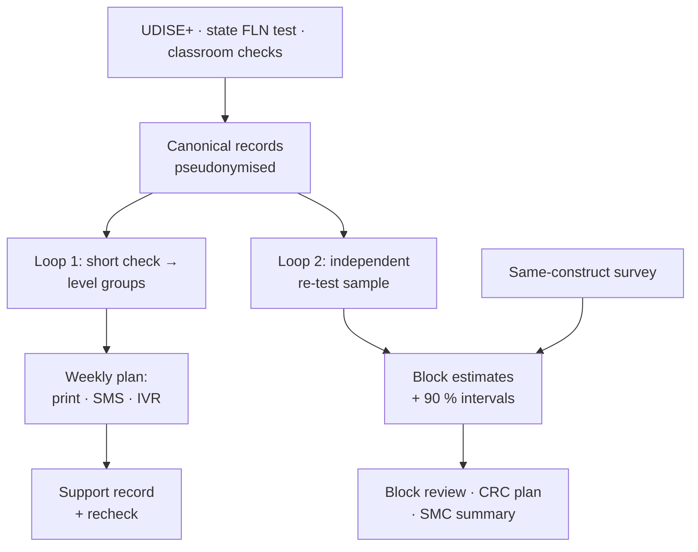

# Ek Tasveer: one trusted picture of every child's foundational learning
### A NIPUN Bharat decision layer on UDISE+, state assessments, PARAKH and ASER
India @ 71/100 Challenge · Theme 2: Foundational Learning Outcomes · Round 1 proposal v1.1

**Team:** _[name]_ · **Team ID:** _[after registration]_ · **Institution:** IIT Delhi _(+ teammates)_ · **Contact:** _[email, phone]_

---

## 1. Problem identification: the gap and who falls into it

**The scorecard.** India scores 71/100 on the SDG India Index 2023-24 [1]. NIPUN Bharat (2021) set "universal FLN in primary schools by 2026-27": by the end of Grade 3 a child reads with meaning at ≥ 60 words a minute and handles numbers to 9,999 [2]. A 2024 parliamentary answer restates the goal as FLN "by Grade 2 by 2026-27" [3]; a pilot follows its state's operative goal order.

**The lived reality (proxy evidence).** In rural **government** schools, **23.4 %** of Std III children could read a Std II-level text and **27.6 %** could do at least subtraction in 2024, up from 16.3 % and 20.2 % in 2022 [4]. These are ASER foundational-skill proxies, not measured NIPUN attainment, but they show most children were far from the goal two years before its 2026-27 target year. PARAKH 2024 finds Scheduled Tribe children lowest in Grade 3 (maths 57 % vs 61 % for others) [5]; 1,04,125 single-teacher schools enrol 33.8 lakh children [6].

**The implementation gap we target.** Schools already record a lot: UDISE+ holds student-wise records ("more than 60 fields for each student") [6]. States run census-style FLN tests; the Ministry itself says UDISE, NAS, NIPUN Bharat and DIKSHA are "efficient systems working in silos" [7]. The gap is between **recorded** and **acted on, by someone trusted**:
1. **Untrusted numbers.** Teacher-graded census tests in Madhya Pradesh overstated maths by **38.9** and Hindi by **33.8 percentage points** against independent re-tests [8]. NAS 2017 state averages were "likely artificially high", and ASER is "less reliable" for district averages [9]. Officials cannot see which blocks are truly behind.
2. **No action loop.** A randomised trial of frequent assessment (CCE) in north-west India found "no impact on language and maths skills" amid "onerous" paperwork [10]; diagnostic reports alone did not raise learning [11].

**Pilot measure (baseline taken in phase 0):** the share of Grade 3 children assessed below level who receive a level-appropriate activity and a recheck within six weeks, and the gap between reported and independently re-tested block results, with intervals.

## 2. Evidence and context

| Evidence | Finding | Source |
|---|---|---|
| ASER 2024 (rural households, oral one-to-one) | Std III, govt schools: reads Std II text 20.9 % (2018) → 16.3 % (2022) → 23.4 % (2024) | [4] |
| PARAKH 2024 (21,15,022 children, 74,229 schools) | Grade 3 average score, language / maths: rural 64 / 60 %; ST 61 / 57 % vs 66 / 61 % others | [5] |
| Independent re-test audit, MP (283 schools) | Official scores +38.9 pp (maths), +33.8 pp (Hindi); tablet tests in Andhra Pradesh largely removed the distortion | [8] |
| School-governance reform, MP (RCT, 1,774 schools) | High compliance; learning effects null (maths +0.031 SD) | [12] |
| Teaching at the Right Level (six RCTs, seven states) | Haryana +0.15 SD (language); UP learning camps +0.6–0.7 SD; reaches "over 60 million students" | [13], [14] |

**Our real-data check (27 states).** ASER 2024 government-school reading and PARAKH 2024 Grade 3 language rank states differently (Spearman ρ = 0.44; maths ρ = 0.26). Predicting one from the other barely beats the national mean (out-of-state error 9.2 vs 10.5 points). They measure different constructs and populations, so we **keep them separate** and never substitute one for the other.

**Lesson.** Reports and ratings produced compliance, not learning [10]–[12]. Grouped, level-appropriate teaching with protected time and mentoring did produce learning [13]. A decision layer must make numbers trustworthy *and* end in classroom action.

## 3. Existing ecosystem: why the gap persists

| System | What it does | What the sources reviewed do not document |
|---|---|---|
| **UDISE+** [6] | School census; student-wise records since 2022-23 | Learning levels |
| **Vidya Samiksha Kendras** [7] | State command centres; MoE scope: 15 lakh schools, 26 crore students; Rs. 2–5 crore per State/UT | An evaluated link from dashboard to classroom action |
| **State FLN verification** — Haryana *Saksham*: third-party test in all 119 blocks [15]; Gujarat *Gunotsav*: 3,000 officials assess 25 % of schools in every block [16] | Large external checks | Use of the check to *calibrate* every school's reported data |
| **AI oral reading** — Wadhwani AI *Vaachan Samiksha*, ~30,000 Gujarat schools (developer figures) [17] | Tamper-resistant fluency scores | Independent accuracy against human raters |
| **TaRL** (Pratham) [13] | Assess → group → teach at level | A light recurring check and follow-up inside state systems |

**Why the gap persists.** Pipes scaled faster than trust. Verification is used to grade, not to correct the data. VSKs aim to support data-driven decisions [7], but the sources we reviewed document no evaluated mechanism that equips a teacher to act on the data each week.

## 4. Proposed solution: one picture, two loops

Ek Tasveer is **not a new app**. It is a decision layer on what states already run (UDISE+ codes, the state assessment app, the VSK, DIKSHA content, SMS/IVR). It is built as 12 components with open, typed contracts, so a state can adopt one at a time.

**Loop 1: classroom support (teacher-led, every week).** Once a term the teacher runs a short oral check per child. The default is a printed ASER-style branching tool; an adaptive engine runs on a school or CRC smartphone where one exists. Children are placed in level groups, never labelled. The teacher receives one activity per group from the state's own content, by print, SMS or IVR, plus a recheck date. The state protects a **daily level-grouped period** and CRCs mentor, as in the evaluated TaRL model [13]. We do not claim TaRL's effects for software alone. The check *replaces* the state test's data entry; it is not an extra task.

**Loop 2: measurement assurance (independent, every term).** We adapt moderation, back-checks and small-area estimation to census FLN data. Each term a rotating random sample of schools (risk-weighted, known inclusion probabilities) is re-tested from a frozen roster within a two-week window. Assessors come from another cluster, scores are blinded, and 20 % of re-tested children are assessed twice to estimate assessor error (this assumes the two assessors err independently; a recorded-audio expert check tests that assumption). Coaching happens only after scores are recorded. A calibration model corrects every school's reported results. A Fay–Herriot model then gives **block estimates with conservative 90 % intervals**, benchmarked only to an independent survey of the *same construct, population and term* (run by SCERT/DIET or a contracted agency), never to PARAKH scale scores or old ASER rounds; without one, estimates are published unbenchmarked. A discrepancy is never treated as proof of cheating.

**Learning-support record, with a firewall.** The record is time-limited, revisable and institution-owned: group, activity, recheck date, support needs. It holds no ability labels, quotas or rankings of teachers. A state order bars using these diagnostic or moderation records for personnel, transfer or promotion decisions. Parents and teachers can see and correct records, and school-level moderation data stays with the moderation team. Unmet need is reported only as an uncertain aggregate for planning.

**Inclusion.** No phone, APAAR or Aadhaar is required for service; local temporary IDs work. "Not assessable with this instrument" is a valid outcome with human review. Pilot languages and accessible modes are fixed with SCERT/DIET before launch.

**Data protection (verified dates).** DPDP Act s. 9 requires verifiable parental consent and bars "tracking or behavioural monitoring of children". It commences 18 months after 13 Nov 2025 [18]. Rule 12 and Fourth Schedule item 3 exempt "an educational institution" only for monitoring "for the educational activities of such institution" or safety, and do not exempt s. 9(2) [19]. Pseudonymous records remain personal data. So each purpose (classroom support, state analytics, research, messaging) passes a legal gate with qualified review before live use. Child-level processing is disclosed, minimised and retention-limited.

| Record (proposed design) | Holds | Who sees it | Kept |
|---|---|---|---|
| Learning-support record | pseudonym, group, activity, recheck date, support needs | the child's teacher and head teacher; parent on request | current year + 1 |
| Re-test sample | pseudonym, independent result, assessor | moderation team (DIET) only | until estimates and appeals close |
| School-level moderated figure | calibrated share, interval | moderation team and state analyst; never for personnel decisions | two terms |
| Block estimates | share, 90 % interval, children counted | public (VSK, SMC summaries); cells under 10 children suppressed | aggregate only |

**Working demo (SYNTHETIC children; real runs).** A simulated district (600 schools, 6 blocks) matched to two ASER 2024 marginals, in which 30 % of schools inflate. Two **pre-registered** tests on fresh held-out districts (30 each, 180 blocks): v1, and v2 with the audit-design corrections from our code review.

| Result (v1 / v2) | Value |
|---|---|
| Block error, teacher-reported → moderated (10 % of schools re-tested) | **4.31 → 2.16 pp** / **4.17 → 2.10 pp** |
| Coverage of nominal 90 % intervals (conservative); mean half-width | **96.7 %** / **96.7 %**; **±6.0 pp** (district-clustered 95 % CI for v1: 93.3–98.9 %) |
| Re-test budget 5 % / 10 % / 20 % of schools (v1): half-width | ±8.3 / ±6.0 / ±4.2 pp |
| Blocks clearly above or below the district average (post hoc) | 97 of 180, all on the correct side, but raw reports rank blocks as well (98 % vs 97 % on the correct side): moderation fixes the level, not the ranking |
| Camp targeting with moderated school figures | **No gain** (v1: +0.2 children, CI −5.6 to +6.1); **worse** in v2 (−8.1, CI −13.5 to −2.8) and at a 5 % budget, so school figures are not used for targeting |
| Adaptive check, 8 of 16 items: exact level (5 levels) | 0.538, vs 0.592 for the full test (frozen cut-points, synthetic items) |
| Weekly plan for a class of 60 / policy tests incl. forged requests | 801-byte Hindi message, 3 SMS / 42 of 42 pass |

These are stress tests of the method, not evidence about real states. Item difficulties, error rates and the honesty of classroom data are simulator assumptions, and the adaptive stopping rule is a model rule, not field certainty.

## 5. Feasibility and implementation roadmap

| Who | Role |
|---|---|
| State FLN mission / Samagra Shiksha | Order: protected period, firewall, data agreements; funds the pilot |
| SCERT | Owns competency mapping, tools, languages, content |
| DIET | Trains and checks assessors; runs the moderation sample |
| BRC / CRC | Mentoring; re-tests in another cluster |
| Teachers / SMC | Teach groups; record the termly check / see school summaries |
| VSK IT team | Hosts approved services only |
| Independent evaluator | Measures outcomes |

**Pilot operating box (phase 0).** Grade 3 first (Grades 1–2 follow a SCERT play-based adaptation); one district and one language chosen with the state; a daily level-grouped period fixed by state order. **Quantities per 100 schools per term (design, at 10 %):** 10 school re-tests × 12 children = 120 independent assessments plus 24 double checks; at 16 items and an assumed 20 seconds per item a full check takes ~5.3 minutes per child. **Anchor per district per term:** ~200 children in 20 random schools, same tool, run by SCERT/DIET or a contracted agency. Prices are quoted in phase 0 and approved before launch; VSKs already receive Rs. 2–5 crore per State/UT [7].

| Phase | Scope and gate |
|---|---|
| 0: feasibility (1 term) | One district, one language. **Gates:** state order, legal review, data-sharing and processor agreements, VSK slot, timetable release. Measures: time use, data quality, harms, the reported vs re-tested gap. No impact claims. |
| 1: evaluation (1 year) | Cluster-randomised: the same supported pedagogy (protected period + mentoring) with vs without the layer; pre-specified, independently assessed learning outcome; spillover controls. |
| 2: scale | Only if incremental learning, workload and harm indicators pass; open components as public goods. |

**Risks → mitigations.** Workload → the check replaces existing entry, and the plan is printed. Gaming → random rotation, cross-cluster assessors, no quotas. Stigma → no labels, plus the firewall. Language → validate before use. Weak benefit → stop at the phase-1 gate.

## 6. Expected impact and scalability

**Beneficiaries.** Grade 1–3 children in the pilot district's government schools (counted from UDISE+), with ST children, single-teacher schools and language-minority children tracked separately.

**Outcomes.**
- Children assessed below level who get an activity and a recheck within six weeks.
- Independently re-tested learning, by group, with intervals.
- The reported-versus-re-tested gap.
- Teacher minutes; harm indicators.

**Scale.** The layer reuses UDISE+ identifiers, state apps, VSKs and SMS/IVR. It adds no new hardware, and it expands only if phase 1 shows incremental learning at acceptable cost.

## References (all accessed 4 Oct 2026; quotes in `research/sources/`)
1. NITI Aayog SDG India Index 2023-24 (PIB). https://pib.gov.in/PressReleaseIframePage.aspx?PRID=2032857
2. MoE (2021). *NIPUN Bharat*, pp. 2, 5, 12. https://static.pib.gov.in/WriteReadData/specificdocs/documents/2021/jul/doc20217531.pdf
3. Rajya Sabha Unstarred Q. 523, 7 Feb 2024. https://sansad.in/getFile/annex/263/AU523.pdf?source=pqars
4. ASER Centre (2025). *ASER 2024*. https://asercentre.org/wp-content/uploads/2022/12/ASER_2024_Final-Report_13_2_24-1.pdf
5. NCERT (2025). *PARAKH Rashtriya Sarvekshan 2024, National Report*, pp. 1–4; 35 state reports. https://parakh.ncert.gov.in/sites/default/files/2025-07/REPORT_India_IND.pdf
6. MoE. *UDISE+ 2024-25*, pp. 10, 28–32. https://dashboard.udiseplus.gov.in/report-new-v.11-demo2025/static/media/UDISE+2024_25_Booklet_existing.118ba29d4773e6372f72.pdf
7. Rajya Sabha Unstarred Q. 349, 20 Jul 2022 (Vidya Samiksha Kendra). https://www.sansad.in/getFile/annex/257/AU349.pdf?source=pqars
8. Singh, A. (2020). *Myths of Official Measurement*. RISE WP 20/042. https://riseprogramme.org/sites/default/files/2020-11/RISE_WP-042-Singh.pdf
9. Johnson, D. & Parrado, A. (2021). Assessing the assessments. *IJED* 84. https://riseprogramme.org/sites/default/files/inline-files/Johnson_Assessing%20the%20assessments_RISE%20version_v2.pdf
10. Berry, J. et al. (2020). Failure of frequent assessment. *J. Dev. Econ.* 143 (summary: https://voxdev.org/topic/education/failure-frequent-assessment-evidence-indias-continuous-and-comprehensive-evaluation)
11. Muralidharan & Sundararaman (2010). Diagnostic feedback to teachers. *Economic Journal* (summary: https://www.povertyactionlab.org/print/pdf/node/702092)
12. Muralidharan & Singh. *Improving Public Sector Management at Scale?* NBER WP 28129. https://www.nber.org/system/files/working_papers/w28129/w28129.pdf
13. J-PAL. *Teaching at the Right Level*. https://www.povertyactionlab.org/case-study/teaching-right-level-improve-learning
14. Banerjee et al. (2016). *Mainstreaming an Effective Intervention: TaRL in India*. https://www.povertyactionlab.org/sites/default/files/research-paper/TaRL_Paper_August2016.pdf
15. Govt. of Haryana. *Saksham Haryana*. https://www.prharyana.gov.in/en/the-saksham-haryana-programme-an-initiative-of-haryana-school-education-department-which-has-been-0
16. Govt. of Gujarat. *Gunotsav*. https://gunotsav.gujarat.gov.in/aboutus.html
17. Wadhwani AI. *Vaachan Samiksha*. https://www.wadhwaniai.org/vaachan-samiksha-leveraging-ai-to-bridge-the-literacy-divide/
18. *DPDP Act 2023*, s. 9; commencement G.S.R. 843(E), 13 Nov 2025. https://www.meity.gov.in/static/uploads/2025/11/c56ceae6c383460ca69577428d36828b.pdf
19. *DPDP Rules 2025*, G.S.R. 846(E), Rule 12, Fourth Schedule. https://www.meity.gov.in/static/uploads/2025/11/53450e6e5dc0bfa85ebd78686cadad39.pdf
