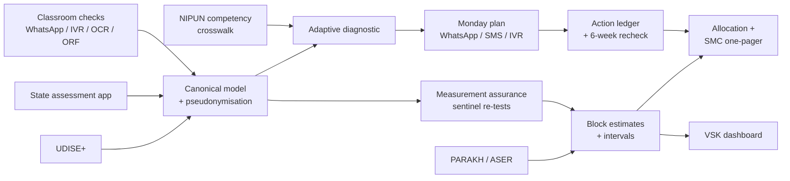

# Ek Tasveer — one trusted picture of every child's foundational learning
### A NIPUN Bharat decision-support layer built on UDISE+, PARAKH, ASER and state assessments
*India @ 71/100 Challenge · Theme 2: Foundational Learning Outcomes · Round 1 proposal (draft v0.1, 4 Oct 2026)*

**Team:** ⟦Team name⟧ · **Team ID:** ⟦Team ID⟧ · **Institution:** ⟦Institution(s)⟧ · **Contact:** ⟦email, phone⟧

---

## 1. Problem identification — the gap and who it hurts

**The scorecard.** NIPUN Bharat commits that every child reaches foundational literacy and numeracy (FLN) by the end of Grade 3 ⟦target year — verify in NIPUN guidelines⟧, and UDISE+ shows near-universal primary enrolment ⟦GER/NER — verify⟧.

**The lived reality.** In rural government schools, **23.4 %** of Std III children could read a Std II-level text and **27.6 %** could do at least a subtraction in 2024 [1]. Both figures recovered from 2022 (16.3 % and 20.2 %), so change is possible, but three in four children leave Grade 3 without the skill the mission promises.

**The measurable gap we target.** *Share of Grade 3 children in government schools who meet the Grade 3 reading and numeracy goals* — mission target 100 %; independently measured ≈ 23 % (reading) and ≈ 28 % (subtraction) [1]. Our system measures this gap at block level, every term, with a confidence interval, and moves it.

**The underserved group.** Children in Grades 1–3 of rural government schools — children whose families cannot pay for private school (in the same survey, Std III reading is 35.5 % in private schools vs 23.4 % in government schools [1]) — and, within them, the children the data system sees least well: Scheduled Tribe and Scheduled Caste children, children whose home language differs from the language of instruction, and children in single-teacher, multigrade schools ⟦UDISE+ single-teacher schools and enrolment — verify⟧.

**The implementation gap.** Schools already record a great deal: UDISE+ records every school, teacher and (since ⟦year⟧) every student; many states run census-style FLN assessments through teacher apps; PARAKH tested ⟦N⟧ students in 2024; states run Vidya Samiksha Kendras (VSKs) ⟦verify count⟧. For a struggling child, the chain *recorded → believed → acted on → rechecked* breaks at five points:

| Break | What happens today | Consequence for the child |
|---|---|---|
| Commensurability | ASER levels, PARAKH scale scores and state tests use different constructs and scales | Teacher, block and state see different pictures; nobody can reconcile them |
| Trust | State census assessments are mostly teacher-administered; no routine independent check | Officials cannot tell real progress from reporting pressure |
| Granularity | Trustworthy surveys are samples; they cannot speak for a block, school or child | Survey results arrive as state averages, too coarse to act on |
| Actionability | Outputs are compliance reports (averages, % "NIPUN") | No one is told *which children, which skill, which activity, this week* |
| Closed loop | Actions are not logged or rechecked | Nobody learns what worked |

## 2. Evidence and context

⟦Table: ASER 2018/2022/2024 govt vs all; PARAKH 2024 Grade 3 language/maths; FLS 2022; UDISE+ 2024-25 headline numbers⟧

⟦Real-data finding: ASER 2024 vs PARAKH 2024 across states — correlation, rank disagreements (our analysis, `scripts/compare_aser_parakh.py`)⟧

**What the causal evidence says about turning data into learning.** ⟦TaRL effects; diagnostic feedback alone; MP governance reform; inflation of official data; low-tech phone/SMS TaRL — each with effect size and citation from `research/sources/evidence-*.md`⟧ The lesson we design around: *information alone rarely moves learning; information that arrives as a grouped, level-appropriate action for a specific teacher, with a recheck, does.*

## 3. The existing ecosystem and why the gap persists

⟦Table: UDISE+, PARAKH, ASER, state FLN assessment apps (UP/Gujarat/Haryana…), VSKs + cQube, DIKSHA, APAAR, NGO tools (Pratham TaRL, Wadhwani AI ORF, SwiftChat) — what each does, scale, and the gap it leaves; each row cited⟧

**Why the gap persists despite these systems.** ⟦3–4 evidenced patterns from research: teacher-administered data with stakes; siloed dashboards built for reporting; survey data too coarse and too slow; content not linked to diagnosed gaps; no action ledger⟧

## 4. Proposed solution — "one picture, two loops"

Ek Tasveer is **not a new app**. It is a thin decision layer that plugs into what states already run — UDISE+ for master data, the state assessment platform and teacher apps for capture, the VSK for dashboards, DIKSHA for content, WhatsApp/SMS/IVR for delivery — and adds the five missing links. Its contracts are typed and open (JSON Schema), so any state can adopt one component at a time.

**Loop 1 — classroom, weekly (spike 1).** A teacher runs a few-minute adaptive check per child (oral tasks on the ASER-style ladder mapped to NIPUN goals). The engine places each child on the ladder with a confidence and returns a **Monday plan**: TaRL groups, one activity per group from the state's own content, and the next competency to check — as one WhatsApp message, at most three SMS, or an IVR call in the local language. Children's names never leave the teacher's phone. Four to six weeks later the same competency is rechecked and the action is logged.

**Loop 2 — system, termly (spike 2).** Teacher-administered results are *moderated*, as boards moderate school-based marks: each term a small rotating sample of schools — chosen by statistical uncertainty and decision value, with a random component — is re-tested independently by the cluster coordinator during the regular academic-support visit, who then coaches that group. A model-assisted estimator calibrates reported results, and small-area estimation with UDISE+ covariates produces **block numbers with intervals that add up to the PARAKH/ASER anchor**. No school-level "trust label" is ever published; officials see moderated block estimates.

**Decisions it feeds.** ⟦C8 CRC visit plan; C9 allocation of remedial camps / training slots with equity weights; SMC one-pager; AWP&B evidence⟧

**Data governance and standards.** ⟦Keys: UDISE+ code, LGD codes, salted pseudonym of PEN/APAAR; competency codes; DPDP Act 2023 / Rules — verifiable parental consent, purpose limitation; role-scoped access; small-cell suppression n < 10; NDEAR alignment; Ed-Fi/CASE-inspired schema⟧

**Working demo (real runs, synthetic children).** ⟦numbers from eval/results: CAT items and minutes per child at accuracy parity; Monday plan payload bytes / SMS segments; block MAE raw vs moderated at budgets; targeting gain; governance tests 100 %⟧ All child-level data in the demo are synthetic, calibrated to ASER 2024 government-school Std III levels [1].

## 5. Feasibility and implementation roadmap

⟦Phases: (0) 3-month pilot in one district, two blocks, staggered by cluster for causal evaluation; (1) state roll-out via the VSK; (2) multi-state via open contracts/DPGs. Staffing: teacher (5 min/child/term), CRC (existing visits), BRC, DIET, VSK analyst. Cost per child — estimate with stated assumptions. Risks & mitigations: teacher burden, language, connectivity, Campbell's law, consent.⟧

## 6. Expected impact and scalability

⟦Beneficiaries (UDISE+ Grade 1–3 government enrolment in pilot district/state/nation); KPIs: % meeting Grade 3 goal at block level with interval; teacher minutes per child; % actions rechecked within 6 weeks; moderated vs reported gap; expected learning gains from cited TaRL effect sizes (range); scale path.⟧

## References
1. ASER Centre (2025). *Annual Status of Education Report (Rural) 2024*. https://asercentre.org/wp-content/uploads/2022/12/ASER_2024_Final-Report_13_2_24-1.pdf (accessed 4 Oct 2026).
