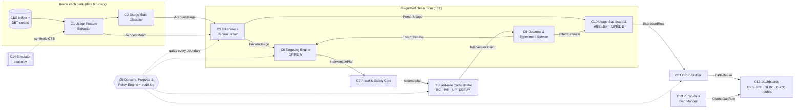

# Sakriya — component map and contracts (v0.1, 4 Oct 2026)

> **Sakriya** (सक्रिय, "active") is a usage-intelligence and accountability layer for Jan Dhan accounts. It does not create a new financial product. It plugs into rails that already exist — bank core banking systems (CBS), the DBT Mission and PFMS, NPCI's Aadhaar Payment Bridge (APBS) mapper, Business Correspondents (BCs), AePS, UPI and UPI 123PAY, and the Lead Bank Scheme forums (SLBC/DLCC) — and governs the data they already generate so that outreach targets the people it can actually help, and implementers are measured on usage, not enrolment.
>
> Status: lead-owned design. Typed contracts live in [`contracts/contracts.py`](contracts/contracts.py) (pydantic v2) with JSON Schema exports in [`contracts/schema/`](contracts/schema/). Facts used in this design are cited in [`../research/`](../research/); anything not yet verified is marked **UNVERIFIED** or **ASSUMPTION**.

## 1. Design principles

1. **Count people, not accounts.** Exclusion is a property of a person. An inoperative account belonging to someone who actively uses another account is a duplicate to consolidate, not an excluded person to reactivate. Person-level views exist only inside a regulated clean room.
2. **Target the persuadable, not just the dormant.** Prioritise by *expected incremental* sustained usage per rupee (uplift), under budget and equity constraints — not by dormancy risk alone.
3. **Data stays where its legal basis is.** Account-level lists never leave the account-holding bank (and its BC acting for it). Government forums see aggregates with differential privacy. Every boundary crossing passes a policy engine and is written to a tamper-evident audit log.
4. **Measure causally and continuously.** Every outreach programme keeps a small randomised holdout, so effects and implementer contributions are estimated, not assumed.
5. **Gaming-resistant usage definitions.** "Active" counts only customer-induced, recurring, diverse use — token credits or bank-induced entries do not count.
6. **Best existing practice by default; innovation only in the spikes.** Each component names its existing baseline.

## 2. Dependency graph

C4 (the clean room itself) is the runtime that hosts C3, C6, C9 and C10; it is specified in §4 rather than drawn as a box.

## 3. Component table

| # | Component | Responsibility (one sentence) | Input → Output contract | Calls / called by | Existing baseline | Isolated scalar metric | Spike? |
|---|---|---|---|---|---|---|---|
| C1 | Usage Feature Extractor | Turn each bank's month of CBS ledger and DBT credits into a standard per-account usage record. | CBS journal (bank-internal) → `AccountMonth[]` | called by bank batch; feeds C2, C3 | Bank MIS/CBS reports; RBI inoperative-account rule | Feed conformance: share of rows passing contract validation **and** whose derived inoperative flag reconciles with the bank's official flag (↑, target 1.0) | no |
| C2 | Usage-State Classifier | Assign each account a transparent, gaming-resistant usage state and a 0–100 Meaningful Usage Score. | `AccountMonth[]` (≤24 months) → `AccountUsage[]` | C1 → C2 → C3 | RBI "inoperative" (no customer-induced txn for 2 years); Findex "inactive" (no deposit/withdrawal in 12 months) | Macro-F1 of state vs simulator ground truth (↑); secondary: gaming inflation in pp per ₹ of token transactions (↓) | no |
| C3 | Tokeniser + Person Linker | Replace identifiers with purpose-scoped pseudonyms and link a person's accounts across banks inside the clean room. | `AccountUsage[]` + `AccountMonth[]` + identity reference → `PersonUsage[]` (+ `AccountPersonLink[]`, clean-room only) | C2 → C3 → C6, C10 | NPCI APBS mapper (Aadhaar → DBT-receiving bank); CKYC | Pairwise linkage F1 (↑); secondary: abs. error of person-level vs true inactive rate (↓) | no |
| C4 | Regulated clean room (runtime) | Run linkage, targeting and scoring on encrypted bank inputs and release only policy-approved outputs. | Encrypted inputs + signed policy → approved outputs only | hosts C3, C6, C9, C10; enforced by C5 | DEPA Training confidential clean rooms; cloud confidential clean rooms (see `research/privacy-tech.md`) | Red-team leakage tests failed (↓, target 0) | no |
| C5 | Consent, Purpose & Policy Engine | Decide every cross-boundary data request from role, purpose, data element, granularity and legal basis, and write a hash-chained audit entry. | `AccessRequest` → `AccessDecision` (+ `AuditEntry`) | gates C3, C6, C8, C11, C12 | Account Aggregator consent artefact; DPDP notice/consent; manual MoUs | Decision accuracy on the governance scenario suite derived from law (↑, target 100%) | no |
| C6 | Targeting & Prioritisation Engine | Choose who gets which intervention to maximise incremental sustained usage per rupee under budget and equity constraints, with a randomised holdout. | `TargetingFeatures[]` + `TargetingRequest` → `InterventionPlanRow[]` | C3 → C6 → C7; learns from C9 | Status quo: "reactivate all inoperative / re-KYC due" drives; risk-score targeting | **Normalised policy value**: share of oracle incremental activations captured at fixed budget, (V−V_random)/(V_oracle−V_random), on held-out persons (↑) | **A** |
| C7 | Fraud & Safety Gate | Hold or add verification for reactivation candidates with mule-account risk before and after outreach. | `InterventionPlanRow[]` + risk signals → `SafetyDecision[]` | C6 → C7 → C8 | Bank AML rules; RBIH MuleHunter.AI; I4C suspect registry | Recall of injected mule accounts at 1% false-positive rate (↑) | no |
| C8 | Last-mile Orchestrator | Turn the cleared plan into channel tasks (BC/BC Sakhi visit list, IVR/voice in local language, assisted UPI 123PAY, re-KYC) and log what happened. | cleared `InterventionPlanRow[]` → `ChannelTask[]` → `InterventionEvent[]` | C7 → C8 → C9 | Branch-led camps, bulk SMS, BC lists on paper | Completed interventions per BC-day under a fixed route budget (↑) | no |
| C9 | Outcome & Experiment Service | Estimate the causal effect of each arm per segment and implementer from holdouts, and feed it back to C6. | `InterventionEvent[]` + later `AccountUsage[]` → `EffectEstimate[]` | C8 → C9 → C6, C10 | Before/after counts of "accounts activated" (non-causal) | RMSE of arm-effect estimates vs simulator truth (↓); secondary: 95% CI coverage (target 0.95) | no |
| C10 | Usage Scorecard & Attribution | Score each implementer (district, bank, branch, BC) on person-level meaningful usage and its *incremental* change vs comparable units, with gaming flags. | `PersonUsage[]` + `EffectEstimate[]` → `ScorecardRow[]` | C3, C9 → C10 → C11 | SLBC/DLCC tables of accounts opened, Aadhaar seeding, RuPay issued (enrolment counts); RBI FI-Index (national only) | Spearman ρ between implementer ranking and true causal contribution under simulated gaming (↑) | **B** |
| C11 | DP Publisher | Release aggregate tables with differential privacy, small-cell rules and a privacy-budget ledger. | `ScorecardRow[]` / aggregate query → `DPRelease` | C10 → C11 → C12 | Small-cell suppression; none at present for FI tables | MAE (percentage points) of district person-level active rate at ε = 1 (↓) | no |
| C12 | Dashboards | Show each forum only what it needs: DFS/RBI (national), SLBC (state), DLCC/LDM (district), bank/branch, BC (own tasks), public. | `DPRelease`, `DistrictGapRow[]` → role-scoped views | C11, C13 → C12 | PMJDY progress report, SLBC agenda PDFs | Data-to-decision latency (days from month-end to DLCC view) — SLO ≤ 10 days | no |
| C13 | Public-data Gap Mapper | Combine real public data (NFHS-5/4, PMJDY, DBT Bharat, FI-Index, Findex) into district/state access-to-usage gap indicators to choose pilot geographies. | public datasets → `DistrictGapRow[]` | → C12; informs C6 pilot choice | National averages in PMJDY/FI-Index releases | Coverage: share of districts with validated indicator values (↑) | no |
| C14 | Simulator (eval only) | Generate a labelled synthetic population of persons, accounts, 24-month histories and potential outcomes under each arm, calibrated to public aggregates. | `SimConfig` + calibration targets → `SimWorld` | feeds C1…C11 in eval | — | Calibration error: mean absolute deviation from published targets (↓) | no |

## 4. Contracts in prose (types in `contracts/contracts.py`)

- **`AccountMonth`** (C1 → C2, C3): `account_token`, `bank_id`, `month`, `district_code`, `is_pmjdy`, `gender`, `age_band`, `rural`, customer-induced transaction counts by channel (`n_branch`, `n_bc_aeps`, `n_atm`, `n_pos`, `n_upi`), `n_customer_txn`, `dbt_credit_count`, `dbt_credit_amount`, `share_dbt_withdrawn_7d`, `eom_balance`, `months_since_last_customer_txn`, `kyc_due`, `official_inoperative`, `rupay_active_90d`, `has_pmjjby`, `has_pmsby`, `has_apy`, `token_credit_count` (credits ≤ ₹10 not initiated by the customer), `last_bc_id`.
- **`AccountUsage`** (C2 → C3, C10): `account_token`, `bank_id`, `as_of_month`, `state ∈ {inoperative, dormant_risk, pass_through, basic, meaningful}`, `mus` (0–100) with sub-scores `frequency`, `diversity`, `retention`, `protection`, and `reason_codes`.
- **`PersonUsage`** (C3 → C6, C10; clean-room only): `person_token` (purpose-scoped), `n_accounts`, `best_state`, `dbt_account_token`, `any_meaningful`, `district_code`, `gender`, `age_band`, `rural`.
- **`AccessRequest` / `AccessDecision` / `AuditEntry`** (C5): who (`requester_role`), why (`purpose`), what (`data_elements`), how fine (`granularity`), claimed `legal_basis` → `allow`, `obligations` (`dp_epsilon`, `min_cell_size`, `retention_days`, `masked_fields`), `rule_ids`, `reason`; audit entries are hash-chained (`prev_hash`, `entry_hash`).
- **`TargetingRequest` / `InterventionPlanRow`** (C6): budget in ₹, arm costs, constraints (`min_share_women`, `max_tasks_per_bc`), `holdout_fraction`, seed → per selected account: `arm`, `expected_uplift`, `cost_inr`, `priority_rank`, `in_holdout`, `reason_codes`.
- **`SafetyDecision`** (C7): `decision ∈ {allow, verify, hold}`, `risk_score`, `reasons`.
- **`ChannelTask` / `InterventionEvent`** (C8): task per account and channel (BC id, language, due date) → status `{delivered, contacted, completed, failed}`, timestamp, cost.
- **`EffectEstimate`** (C9): `arm`, `segment`, `implementer_id`, `ate`, `se`, `ci_low`, `ci_high`, `n_treated`, `n_control`, `method`.
- **`ScorecardRow`** (C10): `unit_type ∈ {district, bank, branch, bc}`, `unit_id`, `period`, `persons`, `mu_rate`, `inactive_rate`, `gender_gap_pp`, `enrolments`, `incremental_usage` (attributed, with CI), `gaming_flags`.
- **`DPRelease`** (C11): `table`, `epsilon`, `mechanism`, `min_cell_size`, rows, `budget_spent_total`.
- **`DistrictGapRow`** (C13): `state`, `district`, NFHS-5 and NFHS-4 women own-account-use %, change in pp, covariates, `gap_rank`.

Error modes common to all batch components: schema violation (reject the batch, alert the sender), late feed (use last good month, flag staleness), small cells (suppress below `min_cell_size`), policy denial (return the decision; never a partial release).

## 5. SLOs (pilot scale: one district ≈ 3–5 lakh PMJDY accounts — **ASSUMPTION**, to be checked against SLBC data)

| Component | Latency | Memory | Quality |
|---|---|---|---|
| C1–C3 | monthly batch ≤ 2 h per bank | ≤ 8 GB | conformance ≥ 99.5% |
| C6 | ≤ 30 min per district plan | ≤ 8 GB | normalised policy value ≥ 0.6 (to be set from baseline) |
| C9, C10 | monthly | ≤ 4 GB | CI coverage 0.9–0.97 |
| C11 | per release | — | MAE ≤ 1 pp at district level |
| C12 | ≤ 10 days after month-end | — | — |

## 6. Spikes (provisional — decided in [ADR 001](adr/001-spike.md))

- **Spike A — C6 Targeting Engine:** uplift (heterogeneous-treatment-effect) allocation across arms with budget and equity constraints and a randomised holdout. Beats the status quo because dormancy ≠ persuadability: many inoperative accounts belong to people who migrated, died, or use another account.
- **Spike B — C10 Usage Scorecard & Attribution:** person-level, gaming-resistant meaningful-usage metrics with causal attribution to implementers, released with differential privacy into SLBC/DLCC reviews and NSFI monitoring.
