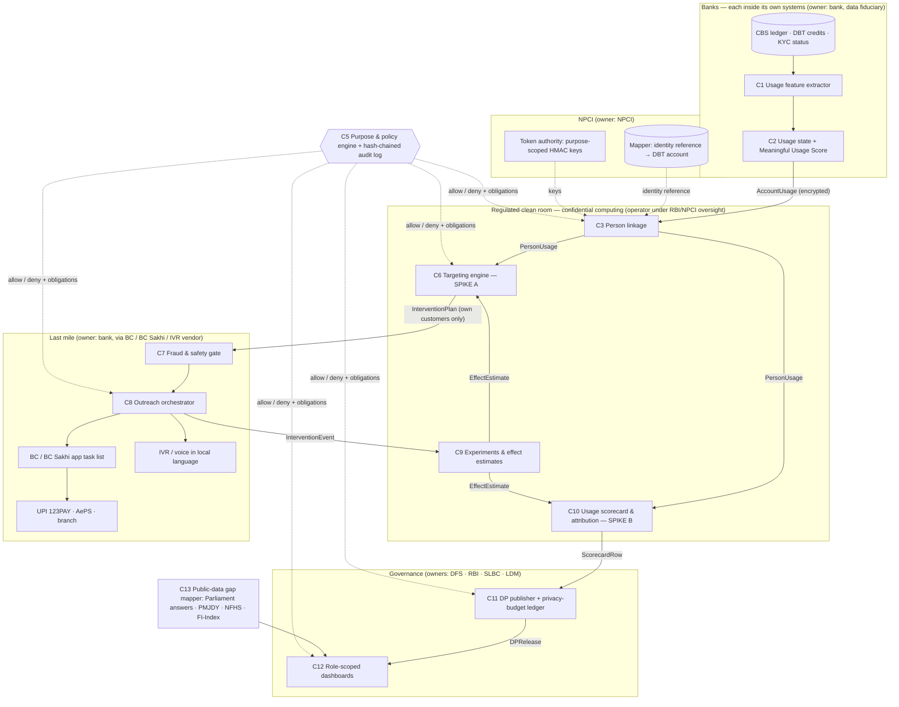

# Sakriya — technical architecture (Round-1 companion, v0.1, 4 Oct 2026)

Component contracts and metrics: [`../architecture/components.md`](../architecture/components.md) · typed contracts: [`../architecture/contracts/contracts.py`](../architecture/contracts/contracts.py) · spike decision: [`../architecture/adr/001-spike.md`](../architecture/adr/001-spike.md) · evidence: [`../research/landscape.md`](../research/landscape.md).

## 1. System view — where each component runs and who owns it



## 2. Monthly cycle (sequence)

```mermaid
sequenceDiagram
  autonumber
  participant Bank as Bank (C1–C2)
  participant PE as Policy engine (C5)
  participant CR as Clean room (C3, C6, C9, C10)
  participant BC as BC / IVR (C7–C8)
  participant DP as DP publisher (C11)
  participant Forum as SLBC / DLCC dashboards (C12)
  Bank->>Bank: compute AccountMonth → AccountUsage (rules published)
  Bank->>PE: request: upload usage for purpose "targeting" + "statistics"
  PE-->>Bank: allow; obligations (encrypt, retention 90 d), audit entry #n
  Bank->>CR: encrypted AccountUsage
  CR->>CR: link accounts → persons (purpose-scoped tokens)
  CR->>CR: estimate uplift per arm; allocate within budget; draw 10% holdout
  CR->>Bank: InterventionPlan for the bank's own customers (reason codes)
  Bank->>BC: fraud-gated task list (visit · IVR · UPI 123PAY onboarding · re-KYC)
  BC-->>CR: InterventionEvents (via bank)
  CR->>CR: next month: effects by arm × segment × implementer (holdouts)
  CR->>PE: request: publish district scorecard
  PE-->>CR: allow; ε = 1, min cell 20, audit entry #n+1
  CR->>DP: ScorecardRows
  DP->>Forum: DP tables + confidence intervals + gaming flags
```

## 3. Data-governance flows

| Flow | From → to | Data | Granularity | Technique | Residual risk |
|---|---|---|---|---|---|
| F1 | Bank → clean room | usage features, state, KYC flag, DBT pattern | account (encrypted) | confidential computing; purpose-bound upload; retention limit | operator compromise → attestation, audit |
| F2 | NPCI → clean room | identity reference → pseudonym | person | per-purpose HMAC keys held by token authority | linkage across purposes → separate keys |
| F3 | Clean room → bank | target list with reason codes | own customers only | policy engine (C5) | re-identification of others → never released |
| F4 | Bank → BC | visit / call tasks | own customers in the BC's area | BC app, least-privilege fields | misuse by agent → fraud gate, logs |
| F5 | Clean room → forums | usage rates, gaps, incremental effects | district, bank, BC (≥ cell size) | differential privacy (ε budget), small-cell suppression | small-area noise → CIs, pooling |
| F6 | Forums → public | state-level usage table | state | DP | — |

Legal anchors (verified texts in [`../research/verification-law.md`](../research/verification-law.md); mapping is our reading, pending legal review):

| Flow | Anchor | Design consequence |
|---|---|---|
| F1, F3, F4 (targeting) | A decision specific to a person — *not* covered by the DPDP statistics exemption (s. 17(2)(b)) | Person lists exist only inside the account-holding bank (data fiduciary for its own customers); clean-room copies purpose-bound and deleted after use |
| F2 (identity) | Aadhaar Act s. 29; UIDAI Circular 14 of 2025 (Aadhaar Data Vault, Reference Key) | Only reference keys leave the vault, HMAC-ed per purpose; never Aadhaar numbers or biometrics |
| F5, F6 (statistics) | DPDP s. 17(2)(b): statistical processing not used for person-specific decisions, per prescribed standards | Aggregate only, separate token key, differential privacy, small-cell suppression |
| DBT-side data | DPDP s. 7(b): State processing to provide prescribed subsidies/benefits/services | To be examined with the DBT Mission |
| Usage definitions | RBI/2023-24/105: DBT/scholarship accounts exempt from the inoperative flag | C2 usage states needed beside the official flag |
| Timing | G.S.R. 843(E): DPDP substantive provisions in force ~May 2027 | Pilot built compliant from day one |

## 4. Contracts at a glance

| Contract | Producer → consumer | Key fields |
|---|---|---|
| `AccountMonth` | C1 → C2, C3 | channel counts, DBT credits and 7-day withdrawal share, balance, months since last customer-induced txn, KYC due, protection products, token credits |
| `AccountUsage` | C2 → C3, C10 | state ∈ {inoperative, dormant_risk, pass_through, basic, meaningful}, MUS 0–100 + sub-scores, reason codes |
| `PersonUsage` | C3 → C6, C10 | purpose-scoped person token, n_accounts, best state, DBT account, demographics |
| `AccessRequest` → `AccessDecision` | any → C5 | role, purpose, data elements, granularity, legal basis → allow, obligations (ε, min cell, retention), rule ids |
| `InterventionPlanRow` | C6 → C7, C8 | arm, expected uplift, cost, priority, holdout flag, reason codes |
| `EffectEstimate` | C9 → C6, C10 | arm × segment × implementer effect with SE and CI |
| `ScorecardRow` | C10 → C11 | unit, persons, meaningful-use rate, gender gap, enrolments, incremental usage + CI, gaming flags |
| `DPRelease` | C11 → C12 | table, ε, mechanism, min cell, rows, budget spent |

## 5. Demo (walking skeleton)

```
cd india71-t3-finance
uv venv .venv && uv pip install -r requirements.txt --python .venv/bin/python
.venv/bin/python eval/public_data/parse_ls4090.py         # real: state-wise inoperative PMJDY accounts
.venv/bin/python eval/targeting_eval.py --seeds 0 1 2 --n 20000   # SYNTHETIC: policy comparison
```
