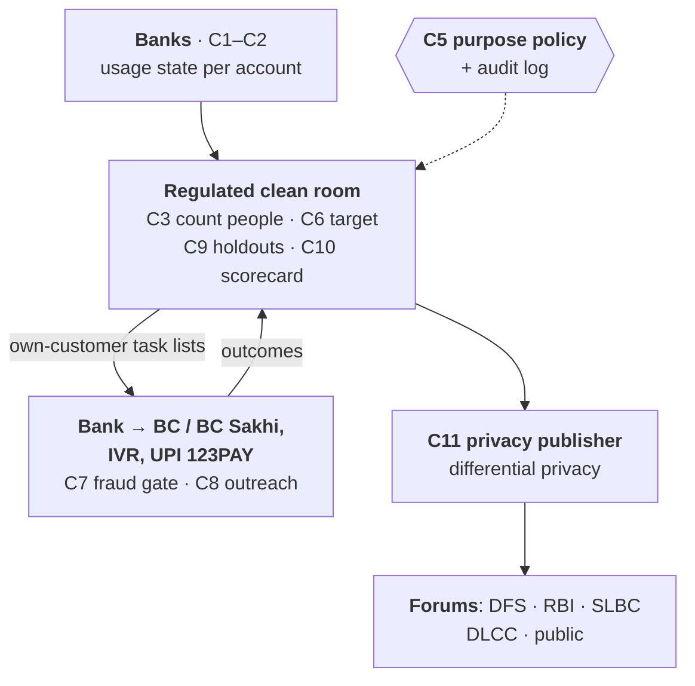

# Sakriya — counting people, not accounts: a usage-data governance, targeting and accountability layer for Jan Dhan

**India @71/100 Challenge · Theme 3: Financial Inclusion & Meaningful Banking Access · Round 1 proposal (DRAFT v0.2, 4 Oct 2026)**

> Draft status: must fit ≤ 6 A4 pages (Arial ≥ 11 pt, 1-inch margins); check with `deliverables/render_html.py`. [P*] = official or primary source in *References*; SYNTHETIC = simulator output, not field results. Remaining UNVERIFIED items are listed in `research/landscape.md` §7 and must be cited or removed before submission.

**Team information.** Team name: _TBD_ · Team ID: _TBD_ · Institution(s): IIT Delhi (+ _TBD_) · Contact: _TBD_ · Members (≤ 4): _TBD_.

## 1. Problem identification

India's scorecard says inclusion is rising. PMJDY accounts grew from 42.20 crore (March 2021) to 59.09 crore (August 2026) [P1, P4], and the RBI Financial Inclusion Index reached 70.0 in March 2026, a rise RBI attributes "mainly" to an "uptick in Usage" [P6]. The administrative record says otherwise: **inoperative PMJDY accounts — no customer-induced transaction for two years — rose from 5.94 crore (14.1%, March 2021) to 15.09 crore (26.4%, Lok Sabha answer of 8 December 2025)** [P1, P3]. Accounts grew 35%; inoperative accounts grew 154%.

The World Bank's survey tells a third story: Indian adults with an *inactive* account fell from 27.4% (2021) to 14.3% (2024) [P7]. The lenses disagree because the State counts **accounts, not people** — someone may use one account while an old Jan Dhan account lapses — and no one can tell which. Both agree on **who is left behind**: in 2024, 19.6% of women account owners had an inactive account against 12.6% of men, and 23.2% of the poorest 40% against 11.6% of the richest 60% [P7, derived]. Yet the Ministry of Finance told Parliament that inoperative accounts by gender and by rural/semi-urban area, accounts holding under ₹500, and credit to PMJDY holders are **"not centrally maintained"** [P1, P3].

**Gap.** One Jan Dhan account in four is inoperative and the share is rising; one woman account owner in five has not used her account in a year; and the data that could find, reach and count these people — bank ledgers, DBT credits, Business Correspondent (BC) networks — is not governed to do so. **Community:** women, the poorest and less-educated account holders, mostly in the rural and semi-urban areas that hold 77.8% of Jan Dhan accounts [P4, P7].

## 2. Evidence and context

| Indicator | Value | Source |
|---|---|---|
| PMJDY accounts (women) | 59.09 crore (32.92 crore), 19 Aug 2026; 45.95 crore rural/semi-urban | [P4] |
| Deposits; RuPay cards | ₹3,16,514 crore; 41.29 crore cards (19 Aug 2026) | [P4] |
| Inoperative PMJDY accounts | 5.94 → 6.57 → 9.45 → 10.21 → 11.94 crore (Mar 2021–Mar 2025) → 13.05 (Jul 2025) → 15.09 crore (Dec 2025) | [P1–P3] |
| Inoperative share by state (31 Jul 2025) | 12.5% (Lakshadweep) to 39.0% (Goa); among the 16 states with > 1 crore accounts, 16.3% (West Bengal) to 32.5% (Telangana); Uttar Pradesh 2.75 crore (27.5%) | [P2], our parse |
| RBI FI-Index | 64.2 (Mar 2024) → 67.0 (Mar 2025) → 70.0 (Mar 2026) | [P5, P6] |
| Adults with an inactive account | 27.4% (2021) → 14.3% (2024); of owners in 2024: women 19.6%, men 12.6%, poorest 40% 23.2% | [P7] |
| Overdraft availed | 35.99 lakh holders (≈ 0.6% of accounts), Mar 2025 | [P1] |
| "Not centrally maintained" | inoperative by gender and area, balance ranges, accounts < ₹500, credit to PMJDY holders | [P1, P3] |

The rise continued through a nationwide Gram Panchayat saturation campaign (1 July – 30 September 2025) that targeted re-KYC of inactive PMJDY accounts [P1, P2]. The two Parliament answers word the definition differently, so part of the late-2025 jump may be definitional — itself a governance problem.

## 3. Existing ecosystem and why the gap persists

**What exists.** Zero-balance accounts with RuPay card, accident cover and overdraft [P4]; DBT credited "even to the inactive accounts" [P2]; RBI's revised inoperative-account rules in force since April 2024 — annual review, alerts a year ahead, tracing of holders, KYC at any branch or by video, no activation charges, monitoring of reactivated accounts [P8]; unclaimed balances to RBI's DEA Fund after ten years [P3]; saturation campaigns and 2,421 Centres for Financial Literacy [P1]; feature-phone payments through UPI 123PAY (IVR, missed call, app, sound) [P10]; Account Aggregator consent rails with 310 million+ accounts linked [P11]; and the national FI-Index [P6]. BCs, AePS and the NPCI mapper for Aadhaar-based DBT carry the last mile (citations pending).

**Why the gap persists** — failures of data governance, not of rails:
1. **The official flag is not a usage measure.** "Inoperative" is a fraud-control status, and accounts opened for DBT or scholarships are deliberately exempted from it [P8] — unused DBT accounts can be invisible, and an account emptied the day DBT lands counts as "operative".
2. **Counting accounts, not people; enrolment, not use.** Forums review openings and totals; breakdowns by person, gender or area do not exist centrally [P1, P3].
3. **Blanket outreach.** Alerts and campaigns go to every dormant account [P2, P8]; visits are spent on duplicates, migrants and the deceased while persuadable holders get a generic SMS.
4. **Reactivation friction.** Fresh KYC at a branch or by video [P8] is hard for the people who stopped coming.
5. **No feedback loop.** No one measures which outreach changed behaviour for whom, so programmes cannot learn and implementers cannot be credited or held to account.
6. **Unclear sharing rules.** Usage, DBT and identity data sit with banks, NPCI and departments under the DPDP Act 2023 and Aadhaar law; without an agreed pattern each keeps its silo.

## 4. Proposed solution — Sakriya

Sakriya (सक्रिय, "active") is a **data-governance and decision layer on existing rails — no new financial product**. It (a) measures meaningful usage *per person*, (b) decides who gets which outreach to maximise *incremental* usage per rupee, (c) measures what worked, and (d) publishes usage-based accountability tables to the forums that already review inclusion, with privacy built into every flow. Fourteen components sit behind typed contracts; two are the innovation spikes.

**4.1 Usage state, not "operative" (C1–C2).** Each bank computes monthly, inside its own systems, a standard record per account — customer-induced transactions by channel, DBT credits and how fast they are withdrawn, balance, KYC status, insurance and pension enrolment — and a published rule set assigns one of five states (*inoperative, dormant-risk, DBT pass-through, basic, meaningful*) with a 0–100 Meaningful Usage Score. Token credits never count as use; anyone can recompute any state.

**4.2 Count people, not accounts (C3–C5).** In a regulated confidential-computing clean room, accounts are linked to *purpose-scoped pseudonyms* (keyed hashes of an identity reference, never the Aadhaar number); tokens issued for targeting cannot be joined with tokens issued for statistics. A policy engine decides every request by role × purpose × data × granularity × legal basis and writes a hash-chained audit entry.

| Data | Bank and its BC | Clean room | DFS · RBI · SLBC · DLCC | Public |
|---|---|---|---|---|
| Ledger, KYC status | Own customers | Encrypted features | Never | Never |
| Person usage state, target list | Own customers, with reason codes | Purpose-bound, deleted after use | Never | Never |
| Usage rates, gender gaps, effects | Own units | Computed | Differentially private, with CIs | State level |

**4.3 Targeting engine (spike A, C6).** For each person and outreach arm — local-language IVR/SMS, BC or BC Sakhi visit with doorstep re-KYC, assisted UPI 123PAY onboarding, a small first-use incentive — the engine estimates the *incremental* probability of meaningful use over six months and allocates arms to maximise total gain within a rupee budget, with a floor on the share of women and a cap on tasks per BC. Every plan keeps a 10% randomised holdout, and a learned allocation is used only where it beats simple rules on held-out pilot data. A fraud gate (C7) adds verification before reactivating accounts at risk of mule use.

**4.4 Learning and accountability (spike B, C9–C11).** Holdouts give unbiased monthly effects by arm, segment and implementer. The **usage scorecard** reports for each district, bank, branch and BC: persons in meaningful use, inoperative persons, the gender gap, and the implementer's *incremental* usage with a confidence interval, plus gaming flags (token credits, reactivate-then-lapse, account churn). A differential-privacy publisher with a privacy-budget ledger feeds existing forums: DFS/RBI nationally (beside the FI-Index), SLBCs, District Consultative Committees and Lead District Managers, banks and BCs for their own units, and a public state page. "Accounts opened" targets become **"people actively banking" targets**.

**4.5 What the working skeleton shows.** End to end on a SYNTHETIC population calibrated to the official 23% inoperative share, at the same budget (₹10 per eligible person), held-out persons, 3 seeds:

| Policy | Share of achievable gain | Extra persons in meaningful use (per ~11,500) |
|---|---|---|
| Status quo: BC visits to inoperative, then dormant, then pass-through accounts | 0.04 ± 0.00 | 47 |
| Highest "risk of non-use" first | −0.07 ± 0.01 | 18 |
| Best average arm (IVR) to everyone | 0.37 ± 0.01 | 134 |
| Sakriya v0.1 (uplift, shrunk; women ≥ their share) | 0.33 ± 0.02 | 126 |
| Oracle (true effects) | 1.00 | 300 |

_Share of achievable gain = (policy − random) / (oracle − random). Reproduce: `python eval/rebaseline_c6.py exp1 0.5`._ Dormancy-first outreach wastes most of the budget and risk ranking is worse than random: **dormancy is not persuadability**. Our first learner does not yet beat the simple best-arm rule — hence the rule that a learned policy must win on held-out data before use. On a real 64,000-person randomised e-mail experiment [P9] (retail, not banking), the same learner beat "best message to a random subset" by 2.5–3.2 responses per 1,000 when only 10–20% could be contacted (CIs include zero in two of three splits) but lost at full coverage: target *who* when contacts are scarce — as for 15 crore inoperative accounts — and personalise *which* intervention cautiously.

## 5. Feasibility and implementation roadmap

**Owners, within existing mandates.** DFS (PMJDY mission) sponsors; RBI sets usage-state definitions alongside its inoperative-account and KYC directions and oversees the clean room; NPCI issues identity-reference tokens and runs UPI 123PAY/AePS; banks run C1–C2 and outreach through their BCs; SLBCs and the Lead Bank Scheme review scorecards in existing meetings; the DBT Mission supplies credit metadata; DAY-NRLM provides BC Sakhis.

**Plan.** *Months 0–3:* publish the usage-state rules and contracts; run C1–C2 on one bank's history inside the bank; legal review of the governance matrix (DPDP Act, Aadhaar law). *Months 3–9:* one-district randomised pilot (two to three banks, BC Sakhi presence, high inoperative share): targeting engine vs blanket outreach in randomised blocks; primary outcome persons in meaningful use at six months; secondary cost per incremental active person, women's share, fraud incidents. *Months 9–18:* state scale-up through the SLBC; scorecards on DCC/SLBC agendas; public DP page. *Months 18–36:* national — NSFI monitoring adds person-level usage by district and gender beside the FI-Index.

**Feasibility and risks.** A district plan runs on a laptop in minutes in our skeleton; banks already hold every input; outreach uses existing BC commissions and IVR; clean rooms and differential privacy are mature techniques. Risks and mitigations: legal basis for linkage (purpose-scoped tokens, minimisation, person lists only inside the bank, legal review first); opacity (published rules, reason codes, simple-rule fallback); exclusion by targeting (women's floor, holdouts, grievance channel); gaming (customer-induced definitions, persistence, gaming flags, comparison units); fraud on reactivation (C7).

## 6. Expected impact and scalability

**Beneficiaries:** the people behind 15.09 crore inoperative accounts and the DBT pass-through users — mostly rural women and the poorest. **Outcomes:** more people (not accounts) in sustained use at lower cost per reactivated user; gender and district breakdowns that are "not centrally maintained" today become routine, privacy-preserving statistics; implementers are reviewed on usage. **KPIs:** persons in meaningful use by district and gender; inoperative persons; incremental users per ₹ lakh of outreach; women's share of incremental users; DBT pass-through share; fraud per lakh reactivations; data latency ≤ 10 days after month-end. **Scale:** every component runs on systems and forums that already exist nationally, so scaling is a matter of standards and adoption, not new infrastructure. Impact will be measured from the pilot's randomised design, not the simulator.

## References

[P1] Rajya Sabha USQ 2636, Ministry of Finance (DFS), 12 Aug 2025, Annexures I–II, sansad.in · [P2] Lok Sabha USQ 4090, 18 Aug 2025, state annexure, sansad.in · [P3] Lok Sabha USQ 1333, 8 Dec 2025, sansad.in · [P4] PIB, "12 Years of PM Jan Dhan Yojana", 27 Aug 2026 · [P5] RBI Press Release 2025-2026/759, FI-Index for March 2025, 22 Jul 2025 · [P6] RBI Press Release 2026-2027/686, FI-Index for March 2026, 16 Jul 2026 · [P7] World Bank, Global Findex Database 2025, data file (account_t_d, inactive_t_d; owner shares derived) · [P8] RBI circular RBI/2023-24/105, Inoperative Accounts/Unclaimed Deposits – Revised Instructions, 1 Jan 2024 · [P9] Hillstrom, MineThatData e-mail challenge dataset, 2008 · [P10] RBI Press Release 2021-2022/1830 (UPI 123PAY launch), rbi.org.in prid=53385 · [P11] Sahamati, "Account Aggregator crosses 500 million consents", Sept 2026 · Techfest 2026-27, India @71/100 Challenge statement.
