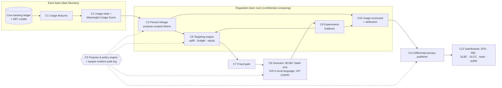

# Sakriya: making Jan Dhan accounts work — a usage-data governance, targeting and accountability layer for PMJDY

**India @71/100 Challenge · Theme 3: Financial Inclusion & Meaningful Banking Access · Round 1 proposal (DRAFT v0.1, 4 Oct 2026)**

> Draft status: written for ≤ 6 A4 pages (Arial 11 pt, 1-inch margins) when rendered. Numbers marked [P*] come from official documents listed in *References*; numbers marked SYNTHETIC come from our simulator and are not field results. Items marked UNVERIFIED will be checked or removed before submission.

**Team information.** Team name: _TBD_ · Team ID: _TBD_ · Institution(s): IIT Delhi (+ _TBD_) · Contact: _TBD_ · Members (≤ 4): _TBD_.

## 1. Problem identification — the gap and who it hurts

India's scorecard says financial inclusion is rising: PMJDY accounts grew from 42.20 crore (March 2021) to 59.09 crore (August 2026), and the RBI Financial Inclusion Index rose from 53.9 (2018) to 67 [P1, P4]. The lived reality moved the other way: **inoperative PMJDY accounts — no customer-induced transaction for two years — rose from 5.94 crore (14.1% of accounts, March 2021) to 15.09 crore (26.4%, Lok Sabha answer of 8 December 2025)** [P1, P3]. Accounts grew 35%; inoperative accounts grew 154%.

The people behind these accounts are overwhelmingly the scheme's intended beneficiaries: 55.7% of PMJDY accounts belong to women and 77.8% are in rural or semi-urban areas [P4]. Yet when asked in Parliament, the Ministry of Finance stated that inoperative accounts by gender and by rural/semi-urban area, the number of accounts holding less than ₹500, and credit extended to PMJDY holders are **"not centrally maintained"** [P1, P3]. The State cannot say *which* women, in *which* districts, hold an account they no longer use — so it cannot target help to them, and it cannot hold banks, Business Correspondents (BCs) or districts accountable for usage rather than openings.

**Gap statement.** One in four Jan Dhan accounts is inoperative and the share is rising, while the data systems that could identify, reach and count the people behind them — bank ledgers, DBT credits, BC networks — are not governed to do so. **Community:** rural, low-literacy and women account holders, many of whom receive DBT into accounts they use only to withdraw cash, or not at all.

## 2. Evidence and context

| Indicator | Value | Source |
|---|---|---|
| PMJDY accounts / women's accounts | 59.09 crore / 32.92 crore (19 Aug 2026) | [P4] |
| Rural + semi-urban accounts | 45.95 crore of 59.09 crore (77.8%) | [P4] |
| Deposits / RuPay cards issued | ₹3,16,514 crore / 41.29 crore (19 Aug 2026) | [P4] |
| Inoperative PMJDY accounts | 5.94 cr (Mar 2021) → 6.57 → 9.45 → 10.21 → 11.94 cr (Mar 2025) → 13.05 cr (Jul 2025) → 15.09 cr (Dec 2025) | [P1, P2, P3] |
| Inoperative share, by state (31 Jul 2025) | 16.3% (West Bengal) to 39.0% (Goa); largest counts UP 2.75 cr (27.5%), Bihar 1.39 cr, MP 1.07 cr | [P2], our parse |
| Overdraft availed | 35.99 lakh holders (≈ 0.6% of accounts), ₹393 crore outstanding (Mar 2025) | [P1] |
| Women's / men's accounts with balance below ₹2,500 | 22.86 crore / 20.04 crore (Mar 2025) | [P1] Annexure-I |
| Data "not centrally maintained" | inoperative by gender, by rural/semi-urban, balance ranges, accounts < ₹500, credit to PMJDY holders | [P1, P3] |
| Household view | 16% of Indian account owners made no deposit or withdrawal in 12 months (2024) — UNVERIFIED (news report of Global Findex 2025) | [S1] |

The trend survived a nationwide Gram Panchayat-level saturation campaign (1 July – 30 September 2025) in which re-KYC of inactive PMJDY accounts was a key focus [P1, P2]: the count reported in December 2025 was higher than in July 2025. (The two answers word the definition slightly differently, so part of the increase may be definitional — itself a data-governance problem.)

## 3. Existing ecosystem — what exists and why the gap persists

**What exists** (verified in the Ministry's answers [P1–P4]): zero-balance BSBD accounts with RuPay card, accident cover and overdraft; DBT credited directly to accounts — "even to the inactive accounts" [P2]; bank alerts before an account turns inoperative and quarterly letters/SMS to inoperative holders [P2]; reactivation by completing KYC at any time, with unclaimed balances moving to RBI's DEA Fund after ten years [P3]; saturation campaigns; 2,421 RBI Centres for Financial Literacy [P1]; and the RBI FI-Index for national monitoring [P4]. The payment and access rails — UPI and feature-phone UPI 123PAY, Aadhaar-enabled Payment System (AePS), the NPCI mapper for Aadhaar-based DBT, BC and BC Sakhi networks, and the Account Aggregator consent framework — are in production (details UNVERIFIED in this draft; to be cited).

**Why the gap persists** — five failures of data governance, not of infrastructure:
1. **Counting accounts, not people; enrolment, not use.** Review forums see openings and totals; key breakdowns are not maintained [P1, P3]. A person with three accounts, one active, appears as two "inoperative" accounts; a person who only cashes out DBT appears "active".
2. **Blanket outreach.** Alerts and campaigns go to every dormant account [P2]. Visits are wasted on duplicates, migrants and the deceased, while persuadable holders get a generic SMS.
3. **Reactivation friction.** Reactivation requires KYC [P3] — usually a branch or BC visit for the very people who stopped visiting.
4. **No feedback loop.** No one measures which outreach changed behaviour for whom, so programmes cannot learn and implementers cannot be credited or held to account.
5. **Legal uncertainty about sharing.** Usage, DBT and identity data sit with banks, NPCI and scheme departments under the DPDP Act 2023 and Aadhaar rules; without an agreed pattern, each keeps its silo.

## 4. Proposed solution — Sakriya

Sakriya (सक्रिय, "active") is a **data-governance and decision layer** on top of existing rails. It adds no new financial product. It (a) measures *meaningful usage per person*, (b) decides *who should get which outreach* to maximise incremental usage per rupee, (c) measures *what worked*, and (d) publishes *usage-based accountability* tables to the forums that already review financial inclusion — with privacy built into each data flow.

**4.1 Usage state and Meaningful Usage Score (C1–C2).** Each bank computes, monthly and inside its own systems, a standard record per account (customer-induced transactions by channel, DBT credits and how fast they are withdrawn, balance, KYC status, insurance/pension enrolment). A transparent rule set assigns one of five states — *inoperative*, *dormant-risk*, *DBT pass-through*, *basic*, *meaningful* — and a 0–100 score from frequency, channel diversity, retention of credited funds and protection products. Token credits (e.g. ₹1 deposits by staff) never count as use. The rules are published, so a bank, an auditor or a citizen can recompute any state.

**4.2 Count people, not accounts (C3–C5).** Inside a regulated clean room (a confidential-computing environment operated under RBI/NPCI oversight), each account is mapped to a *purpose-scoped pseudonym* (HMAC of an identity reference such as an Aadhaar Data Vault reference key — never the Aadhaar number). Tokens issued for targeting cannot be joined with tokens issued for statistics. A **policy engine** decides every request from *role × purpose × data element × granularity × legal basis* and writes a hash-chained audit entry. Governance matrix (proposed; section-level legal mapping to be verified):

| Data | Account-holding bank / its BC | Clean room | DFS · RBI · SLBC · DLCC | Public |
|---|---|---|---|---|
| Account ledger, KYC status | Own customers, full | Features only, encrypted | Never | Never |
| Person-level usage state, target list | Own customers only (task list with reason codes) | Yes, purpose-bound, deleted after use | Never | Never |
| District / bank / BC usage rates, gender gaps | Own units | Computed here | Differentially private, small cells suppressed | DP, district and above |
| Effects of outreach, implementer scores | Own units | Computed here | With confidence intervals | State level |

**4.3 Targeting engine (spike A, C6).** Inputs: person-level usage state, DBT pattern, KYC due, phone and literacy proxies a bank already holds, distance to the nearest BC, BC Sakhi presence. The engine estimates, for each person and each outreach arm — IVR/SMS in the local language (≈ ₹3), BC or BC Sakhi visit with on-the-spot re-KYC (≈ ₹100), assisted UPI 123PAY onboarding (≈ ₹120), a small first-transactions incentive (≈ ₹55) (costs are ASSUMPTIONS) — the *incremental* probability of meaningful use over six months, and allocates arms to maximise total incremental usage within the budget, with a floor on the share of women reached and a cap on tasks per BC. Every plan keeps a 10% randomised holdout. Before any allocation is used, it must beat simple rules (best single arm for all; dormancy-first) on held-out pilot data; otherwise the simple rule is used. A **fraud gate (C7)** holds reactivation where mule-account risk is high, because a reactivated dormant account is attractive to fraudsters.

**4.4 Learning and accountability (spike B, C9–C11).** The holdouts give unbiased monthly estimates of each arm's effect by segment and by implementer. The **usage scorecard** reports, for every district, bank, branch and BC: persons (not accounts) in meaningful use, inoperative persons, the gender gap, and *incremental usage attributable to the implementer* with a confidence interval, plus gaming flags (token credits, sudden reactivation-then-dormancy, account churn). Tables pass through a **differential-privacy publisher** with a privacy-budget ledger and go to the forums that already exist: DFS/RBI (national; complements the FI-Index), State Level Bankers' Committees (state), District Consultative Committees and Lead District Managers (district), banks and BCs (own units), and a public state-level page. This turns "accounts opened" targets into **"people actively banking" targets** that can be assigned and reviewed.

**4.5 What the demo already shows.** A working skeleton (Python; 14 components behind typed contracts) runs end to end on a SYNTHETIC district population calibrated to the official 23% inoperative share. On held-out synthetic persons at the same budget, we compare policies by the share of the oracle's achievable incremental usage they capture (0 = random allocation, 1 = perfect knowledge):

{{TARGETING_TABLE}}

Interpretation: blanket, dormancy-first outreach captures little of what the budget could achieve, and ranking by "risk of non-use" is worse than random — dormancy is not persuadability. Our first, untuned policy learners capture a substantial share but leave a large gap to the oracle; closing it is the subject of our automated improvement loop. These are simulator results that show the mechanism, not field impact.

## 5. Feasibility and implementation roadmap

**Owners, using existing mandates.** DFS (PMJDY mission office) — sponsor and scheme owner; RBI — usage-state definitions in the inoperative-accounts and KYC directions, oversight of the clean room, FI-Index linkage; NPCI — identity-reference tokens via the mapper, UPI 123PAY/AePS rails; banks — C1–C2 inside their systems, outreach via their BCs; SLBC/Lead Bank Scheme — review of scorecards in existing DCC/SLBC meetings; DBT Mission — DBT-credit metadata; MoRD/DAY-NRLM — BC Sakhi channel.

**Phased plan.**
1. *Months 0–3 — Standards and sandbox.* Publish the usage-state rule set and contracts; run C1–C2 on one bank's historical data in its own environment; legal review of the governance matrix under the DPDP Act and Aadhaar rules.
2. *Months 3–9 — One-district randomised pilot* (two to three banks, BC Sakhi presence; a district with a high inoperative share, e.g. from the state table): baseline month, then the targeting engine against blanket outreach in randomised blocks; primary outcome: persons in meaningful use at six months; secondary: cost per incremental active person, women's share, fraud incidents.
3. *Months 9–18 — State scale-up* through the SLBC; scorecard enters DCC/SLBC agendas; DP public page.
4. *Months 18–36 — National:* NSFI monitoring adds person-level usage indicators by district and gender beside the FI-Index.

**Feasibility.** Compute is small (a district plan runs on a laptop in minutes in our skeleton); banks already hold every input; outreach uses existing BC commissions and IVR; the clean room and DP use mature, open techniques. **Key risks and mitigations:** legal basis for linkage (purpose-scoped tokens, data minimisation, bank-only person lists, legal review in phase 1); model opacity (published rules, reason codes, simple-rule fallback); exclusion by targeting (women's floor, holdouts, grievance channel); gaming of scorecards (customer-induced definitions, persistence, gaming flags, attribution against comparable units); fraud on reactivation (C7 gate).

## 6. Expected impact and scalability

**Beneficiaries:** the 15.09 crore inoperative PMJDY account holders and the DBT pass-through users behind them — mainly rural women. **Outcomes:** more people (not accounts) in sustained, meaningful use; lower cost per reactivated user; the gender and district breakdowns that are "not centrally maintained" today become routine, privacy-preserving statistics; implementers are reviewed on usage. **KPIs:** persons in meaningful use (by district, gender), inoperative persons, incremental usage per ₹ lakh of outreach, women's share of incremental users, DBT pass-through share, fraud incidents per lakh reactivations, data latency (target ≤ 10 days after month-end). **Scale path:** every component runs on rails and forums that already exist nationally — bank systems, NPCI tokens, BCs, Lead Bank Scheme forums — so scaling is a matter of standards and adoption rather than new infrastructure. Impact numbers will be estimated from the pilot's randomised design, not from the simulator.

## References

- [P1] Rajya Sabha Unstarred Question 2636, Ministry of Finance (DFS), answered 12 Aug 2025, with Annexures I–II. sansad.in/getFile/annex/268/AU2636_2RfYLG.pdf
- [P2] Lok Sabha Unstarred Question 4090, Ministry of Finance (DFS), answered 18 Aug 2025, with state-wise annexure. sansad.in/getFile/loksabhaquestions/annex/185/AU4090_LCDFLT.pdf
- [P3] Lok Sabha Unstarred Question 1333, Ministry of Finance (DFS), answered 8 Dec 2025. sansad.in/getFile/loksabhaquestions/annex/186/AU1333_viWPuz.pdf
- [P4] Press Information Bureau, "12 Years of PM Jan Dhan Yojana: Banking for All, Empowerment for All", 27 Aug 2026 (URL to be added).
- [S1] News reports (CNBC-TV18, Financial Express) of World Bank Global Findex 2025 — UNVERIFIED; replace with the Findex report.
- Techfest 2026-27, The India @71/100 Challenge — problem statement.
