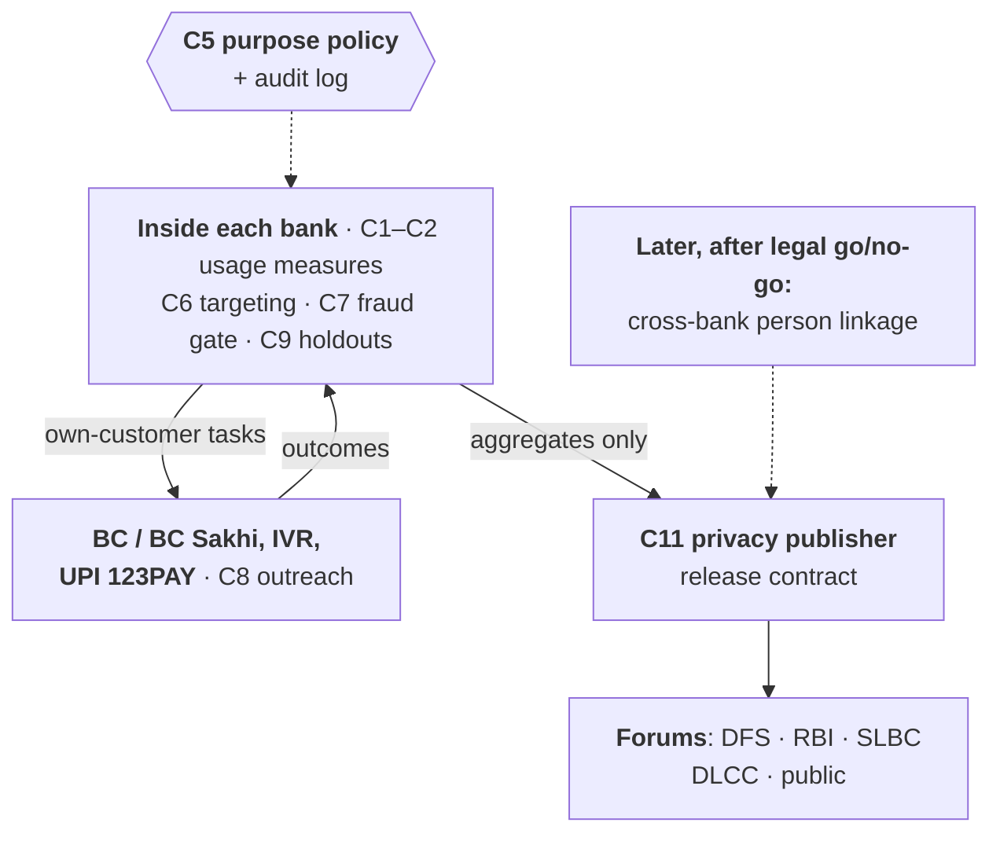

# Sakriya — counting people, not accounts: a usage-data governance, targeting and accountability layer for Jan Dhan

**India @71/100 Challenge · Theme 3: Financial Inclusion & Meaningful Banking Access · Round 1 proposal (v1.1, 4 Oct 2026)**

> Draft status: must fit ≤ 6 A4 pages (Arial ≥ 11 pt, 1-inch margins); check with `deliverables/check_pdf.py`. [P*] = primary source in *References*; SYNTHETIC = simulator output, not field results. Numbers are checked against committed results by `eval/check_docs.py`.

**Team information.** Team name: [to be filled at registration] · Team ID: [to be filled] · Institution(s): IIT Delhi [+ others] · Contact: [name, e-mail, phone] · Members (≤ 4): [names]

## 1. Problem identification

India's scorecard says inclusion is rising. PMJDY accounts grew from 42.20 crore (March 2021) to 59.09 crore (August 2026) [P1, P4], and the RBI Financial Inclusion Index reached 70.0 in March 2026, a rise RBI attributes "mainly" to an "uptick in Usage" [P6]. The scheme's administrative record shows **inoperative PMJDY accounts — no customer-induced transaction for two years — rising from 5.94 crore (14.1%, March 2021) to 15.09 crore (26.4%, Lok Sabha answer of 8 December 2025)** [P1, P3]. The World Bank's household survey points the other way: Indian adults with an inactive account fell from 27.4% (2021) to 14.3% (2024) [P7].

These indicators measure different things — a two-year status of accounts, a one-year survey of people, a national composite — and cannot be netted against each other. Their disagreement is the problem: administrative data count **accounts, not people**, so nobody can tell whether a lapsed Jan Dhan account belongs to someone excluded or to someone who banks elsewhere. The survey does show **who is left behind**: in 2024, 19.6% of women account owners had an inactive account against 12.6% of men, and 23.2% of the poorest 40% against 11.6% of the richest 60% [P7, derived]. Asked in Parliament for inoperative accounts by gender and balance range, the Ministry of Finance gave totals; it said range-wise inoperative data, closures of inoperative accounts by women and by area, accounts under Rs 500 and credit to PMJDY holders are "not centrally maintained" [P1, P3].

**Gap.** One Jan Dhan account in four is inoperative and the share is rising; one woman account owner in five has not used her account in a year; and the data that could find, reach and serve these people — bank ledgers, DBT credits, Business Correspondent (BC) networks — are not governed to do so. **Community:** women, the poorest and less-educated account holders, mostly in the rural and semi-urban areas that hold 77.8% of Jan Dhan accounts [P4, P7].

## 2. Evidence and context

| Indicator | Value | Source |
|---|---|---|
| PMJDY accounts (women) | 59.09 crore (32.92 crore), 19 Aug 2026; 45.95 crore rural/semi-urban | [P4] |
| Deposits; RuPay cards | Rs 3,16,514 crore; 41.29 crore cards (19 Aug 2026) | [P4] |
| Inoperative PMJDY accounts | 5.94 → 6.57 → 9.45 → 10.21 → 11.94 crore (Mar 2021–Mar 2025) → 13.05 (Jul 2025) → 15.09 crore (Dec 2025 answer) | [P1–P3] |
| Inoperative share by state (31 Jul 2025) | 12.5% (Lakshadweep) to 39.0% (Goa); among the 16 states with > 1 crore accounts, 16.3% (West Bengal) to 32.5% (Telangana); Uttar Pradesh 2.75 crore (27.5%) | [P2], our parse |
| RBI FI-Index | 64.2 (Mar 2024) → 67.0 (Mar 2025) → 70.0 (Mar 2026) | [P5, P6] |
| Adults with an inactive account | 27.4% (2021) → 14.3% (2024); of owners in 2024: women 19.6%, men 12.6%, poorest 40% 23.2% | [P7] |
| Not published centrally | range-wise inoperative data; closures by women and area; accounts < Rs 500; credit to PMJDY holders | [P1, P3] |

The rise continued through a nationwide Gram Panchayat saturation campaign (1 July – 30 September 2025) that targeted re-KYC of inactive PMJDY accounts [P1, P2]. The two answers word the definition differently and the December count has no stated as-of date, so part of the late-2025 jump may be definitional — itself a governance problem.

## 3. Existing ecosystem and why the gap persists

**What exists.** Zero-balance accounts with RuPay card, accident cover and overdraft [P4]; DBT credited "even to the inactive accounts" [P2]; RBI's inoperative-account rules — annual review, alerts a year ahead, tracing of holders, KYC at any branch or by video, no activation charges [P8] — amended in June 2025 so that authorised BCs can facilitate re-KYC, with self-declarations recorded electronically after biometric e-KYC [P24, P25]; AePS, with 92.6 million cash withdrawals in September 2026 [P18]; 65,949 SHG women deployed as BC Sakhis between 2022-23 and June 2025 [P19]; UPI 123PAY for feature phones [P10]; Account Aggregator consent rails [P11]; the NPCI mapper, which routes every Aadhaar-based DBT credit to the bank with the latest seeding mandate, seeded only with the customer's written consent [P20]; and the National Strategy for Financial Inclusion 2025-30, which stresses "effective usage", a gender-sensitive approach and grievance redressal across 47 action points [P26].

**Why the gap persists** — failures of data governance more than of rails:
1. **The official flag is not a usage measure.** "Inoperative" is a fraud-control status, and accounts opened for DBT or scholarships are deliberately exempted from it [P8]: unused DBT accounts can be invisible, and an account where DBT lands and is withdrawn counts as "operative".
2. **Accounts, not people.** Published breakdowns stop at account totals [P1, P3], and the mapper sends Aadhaar-based DBT to whichever bank seeded last [P20], so the account that receives benefits need not be the one a person uses.
3. **Blanket outreach.** Alerts and campaigns go to every dormant account [P2, P8]; field visits are spent alike on duplicates, migrants and the persuadable.
4. **Friction lowered on paper, unevenly in practice.** BC-assisted re-KYC is now permitted [P24, P25], but each bank must build it into its BC systems, and those who most need it are hardest to reach.
5. **Weak feedback.** We found no published measure of which outreach changes behaviour for whom; NSFI 2025-30 asks for effective usage [P26], but usage data stay inside banks, so programmes cannot learn and implementers cannot be credited.

## 4. Proposed solution — Sakriya

Sakriya (Hindi for "active") is a **data-governance and decision layer on existing rails — no new financial product**. It starts **inside one bank**, where the data and the customer relationship already are, and widens only through explicit legal and technical gates.

**4.1 Two measures, not one label (C1–C2).** Each bank computes monthly, inside its own systems, (a) the **regulatory status** exactly as RBI defines it, DBT exemption included [P8], and (b) **analytical usage descriptors** — successful and failed withdrawals and payments by channel, how long credited funds stay, voluntary use beyond benefit withdrawal, insurance and pension enrolment — summarised in published states (*no use for 24 months, dormant-risk, DBT pass-through, basic, meaningful*). The primary outcome is **successful, safe access when the holder wants it**: withdrawing a benefit in cash is legitimate use, and "pass-through" describes a pattern, never a failure of the person. Token credits never count as use.

**4.2 Counting people lawfully, in stages (C3–C5).** *Phase 1 is bank-local:* a bank links accounts through its own customer IDs, so "people" means its customers, and targeting uses only its own data under its duty to review inactive accounts and contact or trace holders [P8]. *Cross-bank person counts are an explicit, unbuilt dependency:* UIDAI requires each entity's Aadhaar Data Vault to be logically segregated and forbids hashing Aadhaar numbers into reference keys [P16], so linking people across banks needs a separately authorised translation service (for example by NPCI, which already maps Aadhaar to the DBT-receiving bank [P20]) and a clean room whose operator, fiduciary roles, processor contracts, notice and legal basis are fixed first. DEPA's open-source Confidential Clean Room is a candidate, but its authors call it work-in-progress, not for production [P21]. A policy engine decides every request by role × purpose × data × granularity × claimed legal basis and logs it in the same step ({{C5_CLAIM}}).

| Data flow | Who sees it | Legal footing (our reading; legal review first) |
|---|---|---|
| Target lists, BC tasks | The bank and its BC, own customers only | Duty to review and contact inactive account holders [P8]; BC re-KYC rules [P24, P25] |
| Usage statistics | DFS · RBI · SLBC · DLCC (bank, district); public (state) | DPDP Act s.17(2)(b), no decision about any individual, and Rules 2025 r.16 Second Schedule standards [P13, P23] |
| Identity | Nobody beyond the bank; never Aadhaar numbers or biometrics | Aadhaar Act s.29 [P15]; UIDAI Circular 14/2025 [P16] |
| Cross-bank linkage | Not until a legal go/no-go | Not yet authorised |

The DPDP Act's substantive duties apply from about May 2027 [P14]; the pilot is designed to meet them from day one.

**4.3 Targeting (spike A, C6): a transparent rule by default, a learned model only behind a gate.** Arms: local-language IVR/SMS, BC or BC Sakhi visit with doorstep re-KYC, assisted UPI 123PAY onboarding, a small first-use incentive. Targeting allocates only *extra* outreach; every holder keeps standard alerts and branch/BC service. A randomised 10% holdout gets standard service only. The *default* rule can be recomputed from the pilot table: the cheapest arm the pilot has not shown to be harmful goes to everyone eligible, and the leftover budget upgrades persons, drawn by lottery, to the arm with the best extra effect per extra rupee. A *learned challenger* keeps exactly that plan but lets an uplift model choose *whom* to upgrade; it replaces the lottery only if it beats the rule on held-out pilot data. Both enforce a floor for women. A fraud gate (C7) adds verification before reactivating accounts at risk of mule use, alongside MuleHunter.AI, which RBI Innovation Hub has implemented across banks [P12, P22].

**4.4 Learning and accountability (spike B, C9–C11).** Holdouts give monthly effects by arm and segment. The **usage scorecard** reports persons in meaningful use, inoperative persons, the gender gap and each bank's and district's *incremental* usage with a confidence interval, plus gaming flags (token credits, reactivate-then-lapse, account churn). It never scores individual BCs or BC Sakhis: BC-level data serve only to fix liquidity, connectivity and workload. Releases follow a fixed contract — each person's contribution bounded, one cumulative privacy budget across overlapping tables per quarter, small cells suppressed — and feed existing forums: DFS and RBI (beside the FI-Index and NSFI 2025-30 monitoring [P26]), SLBCs, District Consultative Committees and a public state page. In a stylised SYNTHETIC test (200 implementer units, 20% gaming via token credits and duplicate accounts, independent person rows), ranking units by enrolments correlated 0.04 with their true contribution, the account-level "operative" share correlated 0.16, and holdout-based incremental usage correlated **0.90**; gamers were {{GAMERS_TOP}} of its top 20 against {{GAMERS_ALL}} overall — a mechanism test, not proof of robustness to real gaming.

{{C6_SECTION}}

## 5. Feasibility and implementation roadmap

**Who does what (proposed; no partner has committed yet).** One partner bank's financial-inclusion head owns data permissions, BC service and the pilot budget; the bank pays BCs and BC Sakhis for time and travel under its BC contracts; its risk team runs the fraud gate. DFS sponsors; the SLBC and Lead District Manager review results in existing meetings; DAY-NRLM advises on BC Sakhis. NPCI, RBI and the DBT Mission take no new role until a cross-bank phase is separately approved.

**Gates, not dates.** (1) *Approval:* legal review of every data flow, impact assessment, the bank's board approval, consent and grievance scripts. (2) *Bank-local, read-only analysis* of 24 months of history: usage measures, data quality, inoperative-but-active-elsewhere-in-the-bank counts. (3) *Powered pilot:* persons or BC clusters randomised, outcomes and analysis pre-registered, size fixed beforehand — e.g. detecting a 2-point rise from an assumed 20% base needs {{N_IND}} persons per arm (5% significance, 80% power), about {{N_CL}} with BC clusters (`eval/power_calc.py`). Primary outcome: successful, safe access and meaningful use at six months; secondary: cost per incremental active person, shares of women and high-barrier groups, complaints, fraud. (4) *Scale on evidence:* more banks and districts through the SLBC; cross-bank linkage only after an authorised translation service, audited hosting and security, interface tests and field outcomes pass acceptance.

**Rights and risks.** Outreach is optional and never conditions benefits; holdouts and non-targeted holders keep standard service; every contact has a recorded, explainable reason; complaints go through the bank's grievance channel; no worker scores; person lists never leave the bank; Aadhaar numbers and biometrics are never used.

## 6. Expected impact and scalability

**Beneficiaries:** holders of the 15.09 crore inoperative accounts and of DBT accounts used only for withdrawal who want help to use them — mostly rural women and the poorest. **Outcomes:** more people with successful, safe access and voluntary use, at a known cost; gender and district usage breakdowns that are unpublished today become privacy-protected statistics; banks and districts are reviewed on usage, not enrolment, in line with NSFI 2025-30 [P26]. **KPIs:** successful-access rate; persons in meaningful use by district and gender; incremental users per Rs lakh of outreach; shares of women and high-barrier groups; complaints and fraud per lakh reactivations; data latency ≤ 10 days after month-end. **Scale:** the bank-local design needs only a bank's existing systems and BC network and can spread bank by bank through the SLBC; cross-bank person counts and any shared clean room are later, separately approved infrastructure. Impact will be measured from the pilot's randomised design, not the simulator.

## References

[[P1]](https://sansad.in/getFile/annex/268/AU2636_2RfYLG.pdf?source=pqars) Rajya Sabha USQ 2636, Ministry of Finance (DFS), 12 Aug 2025, Annexures I–II · [[P2]](https://www.sansad.in/getFile/loksabhaquestions/annex/185/AU4090_LCDFLT.pdf?source=pqals) Lok Sabha USQ 4090, 18 Aug 2025 · [[P3]](https://www.sansad.in/getFile/loksabhaquestions/annex/186/AU1333_viWPuz.pdf?source=pqals) Lok Sabha USQ 1333, 8 Dec 2025 · [[P4]](https://pib.gov.in/PressNoteDetails.aspx?NoteId=159721&ModuleId=3) PIB, "12 Years of PM Jan Dhan Yojana", 27 Aug 2026 · [[P5]](https://www.rbi.org.in/scripts/BS_PressReleaseDisplay.aspx?prid=60875) RBI PR 2025-2026/759, FI-Index March 2025 · [[P6]](https://www.rbi.org.in/scripts/BS_PressReleaseDisplay.aspx?prid=63164) RBI PR 2026-2027/686, FI-Index March 2026 · [[P7]](https://www.worldbank.org/en/publication/globalfindex/download-data) World Bank, Global Findex Database 2025 data file (owner shares derived) · [[P8]](https://www.rbi.org.in/Scripts/NotificationUser.aspx?Id=12589&Mode=0) RBI/2023-24/105, Inoperative Accounts – Revised Instructions, 1 Jan 2024 · [[P9]](http://www.minethatdata.com/Kevin_Hillstrom_MineThatData_E-MailAnalytics_DataMiningChallenge_2008.03.20.csv) Hillstrom e-mail experiment data, 2008 · [[P10]](https://rbi.org.in/scripts/BS_PressReleaseDisplay.aspx?prid=53385) RBI PR 2021-2022/1830, UPI 123PAY · [[P11]](https://sahamati.org.in/media-article/account-aggregator-crosses-500-million-consents-as-india-marks-5th-aa-foundation-day/) Sahamati, Sept 2026 · [[P12]](https://www.rbi.org.in/Scripts/BS_PressReleaseDisplay.aspx?prid=59245) RBI PR 2024-2025/1648, 6 Dec 2024 · [[P13]](https://www.meity.gov.in/static/uploads/2024/06/2bf1f0e9f04e6fb4f8fef35e82c42aa5.pdf) DPDP Act 2023 · [[P14]](https://www.meity.gov.in/static/uploads/2025/11/c56ceae6c383460ca69577428d36828b.pdf) MeitY G.S.R. 843(E), 13 Nov 2025 · [[P15]](https://backend.uidai.gov.in/get/files/media/document/2026-06/Aadhaar_Act_2016_as_amended_0.pdf) Aadhaar Act 2016, s.29 · [[P16]](https://uidai.gov.in/images/Circular-No.14_of-2025.pdf) UIDAI Circular 14 of 2025 · [[P18]](https://www.npci.org.in/product/aeps/product-statistics) NPCI AePS statistics, Sept 2026 · [[P19]](https://www.sansad.in/getFile/loksabhaquestions/annex/185/AU1598_DuNizn.pdf?source=pqals) Lok Sabha USQ 1598 (MoRD), 29 Jul 2025 · [[P20]](https://dbtbharat.gov.in/data/dbt_payments/Standard-Operating-Procedure-of-Aadhaar-Payments-Bridge-(APB).pdf) APB SOP v3.0.2, Feb 2021 · [[P21]](https://github.com/iSPIRT/depa-training) iSPIRT depa-training · [[P22]](https://pib.gov.in/PressReleasePage.aspx?PRID=2260277) PIB (MHA), I4C–RBIH MoU, 12 May 2026 · [[P23]](https://www.meity.gov.in/static/uploads/2025/11/53450e6e5dc0bfa85ebd78686cadad39.pdf) DPDP Rules 2025, G.S.R. 846(E) · [[P24]](https://www.rbi.org.in/Scripts/NotificationUser.aspx?Id=12864&Mode=0) RBI/2025-26/52, 12 Jun 2025 · [[P25]](https://www.rbi.org.in/Scripts/NotificationUser.aspx?Id=12866&Mode=0) RBI/2025-26/51 (KYC), 12 Jun 2025 · [[P26]](https://www.rbi.org.in/Scripts/BS_PressReleaseDisplay.aspx?prid=61712) RBI, NSFI 2025-30, 1 Dec 2025 · Techfest 2026-27, India @71/100 Challenge statement.
