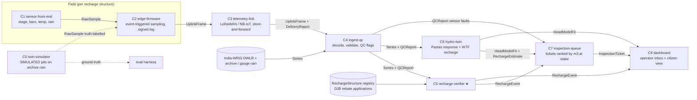

# Components and contracts — JalSakshi (working name: "water witness")

> **System in one line:** a low-cost IoT node in each rainwater-harvesting (RWH) recharge pit/shaft turns every storm into a measured, uncertainty-bounded **recharge event with a verdict** (verified / clogged / no inflow / implausible). DJB can tie its 10 % rebate and 1.5× penalty to measurement instead of self-certification. A QC'd digital twin of the existing CGWB/Delhi DWLR network then checks whether the aquifer responds.
> **Contracts:** `architecture/contracts/gwcontracts.py` (pydantic v2, single source of truth) → `architecture/contracts/schemas/*.schema.json` (generated by `export_schemas.py`). The version is in `CONTRACTS_VERSION`.
> **Spike components** (ADR 001): **C5 recharge-verifier** (primary) and **C4 ingest-qc** (data integrity). The rest are best existing practice.

## Dependency graph

## Component table

| # | Component | Responsibility (one sentence) | Input → Output (contract) | Calls | Baseline (existing practice) | Isolated scalar metric | SLO |
|---|---|---|---|---|---|---|---|
| C0 | **twin-simulator** | Generates truth-labelled pit stage series from real rainfall, with known geometry, clogging and faults | Open-Meteo archive hourly rain (default model; frozen fixture) + `RechargeStructure` → `RawSample` stream + ground-truth `RechargeEvent`s | — | none (test harness) | mass-balance closure error of the simulator itself (must be < 1e-9 m³) | 1 year × 100 pits < 60 s on M5 |
| C1 | **sensor-front-end** | Measures pit water column with a 0–5 m 4–20 mA throw-in probe (DFRobot KIT0139, ±0.5 % FS), with an optional rain gauge, plus a barometer only if the probe is absolute-referenced | physical → `RawSample` (abs_pressure, baro, water_temp) | — | vented transducer or ultrasonic in tank | stage RMSE vs reference dip tape (mm), drift mm/month | ≤ ±15 mm stage (0–3 m FS) |
| C2 | **edge-firmware** | Samples slowly when dry and in bursts during rain or level rise; packs deltas; keeps a signed, append-only local log | `RawSample` → `UplinkFrame` (+ `EdgeEvent` level_rise / tamper / low_battery) | C3 | fixed-interval logging (e.g. 2 readings/day on CGWA DWLRs) | **mAh/day** at equal event-volume error (vs fixed 15-min sampling) | ≥ 3 yr on primary cell (target, UNVERIFIED) |
| C3 | **telemetry-link** | Delivers frames from a lid-mounted antenna; buffers and retries until delivered | `UplinkFrame` → `DeliveryReport` | C4 | GPRS/4G modem | % of storm events delivered within 24 h | ≥ 99 % within 24 h |
| C4 | **ingest-qc** ★2 | Decodes frames and public series, validates contracts, converts IST→UTC, flags zeros/flatlines/spikes/steps/gaps/sign errors | `UplinkFrame` or WRIS JSON → `Series` + `QCReport` | C5, C6, C7 | range + flatline checks | **F1 on injected faults**; % usable readings recovered on real DWLR | 1 M readings < 10 s |
| C5 | **recharge-verifier** ★1 | For each storm: detect the event, run the pit water balance (inflow − overflow − Δstorage = infiltration), fit the recession constant, compute the clogging index and a verdict with uncertainty | `Series` (stage, rain) + `RechargeStructure` → `RechargeEvent` | C7, C8 | manual inspection / annual self-certification | **event infiltration-volume error (median absolute % error, MdAPE)**; clogging precision/recall | verdict ≤ 1 h after event end |
| C6 | **hydro-twin** | Fits per-station head response to rain/ET on QC'd DWLR data; estimates monsoon recharge by water-table fluctuation | `Series` (depth, rain, ET0) → `HeadModelFit`, `RechargeEstimate` | C7, C8 | Pastas TFN (open source) | holdout **NSE** of daily depth | refit per station < 5 s |
| C7 | **inspection-queue** | Turns verdicts, clogging trends and sensor faults into tickets ranked by m³/month at stake × confidence. Rule v0: maintenance when the volume-weighted clogging index of the last 3 storms ≥ 0.5 m³ falls below 0.5; implausible → random inspection; an inspector can override; no bill changes automatically | `RechargeEvent`, `QCReport`, `HeadModelFit` → `InspectionTicket` | C8 | complaint-driven inspection | precision@k of the ticket list on the simulated fleet | daily batch |
| C8 | **dashboard** | Operator inbox (DJB/RWA), structure page (events, verdicts), city map (DWLR outcome), every series labelled real/simulated. v0 = offline demo `deliverables/demo/jalsakshi-demo.html` | all of the above → HTML | — | generic IoT dashboards (ThingSpeak/Blynk) | median time for 5 operator tasks (usability test, Round 2) | static, works offline |

★ = spike. C0 exists only for evaluation and is never shipped to the field.

## Contracts (summary; full types in `contracts/gwcontracts.py`)

| Model | Producer → consumer | Key fields | Error modes |
|---|---|---|---|
| `RawSample` | C1 → C2 | device_id, ts (UTC), channel, value | sensor out of water (≈ baro), cable cut (no samples) → `EdgeEvent.tamper` |
| `UplinkFrame` / `ChannelBlock` / `EdgeEvent` | C2 → C3 → C4 | fcnt, t0, period_s, delta-packed blocks, events, battery_mv, payload_bytes | duplicate or out-of-order fcnt → dedupe in C4; gaps → C4 `gap` flag |
| `DeliveryReport` | C3 → C4/eval | delivered, attempts, latency_s, energy_mj | undelivered after retries → stays in the node buffer |
| `Series` | C4 → C5/C6/C8 | station_id, variable, unit (checked), provenance, strictly increasing UTC ts | unit mismatch / non-UTC / non-monotonic → validation error |
| `QCReport` / `QCIssue` | C4 → C5/C6/C7 | reason ∈ {spike, flatline, drift, out_of_range, gap, step, duplicate} | — |
| `RechargeStructure` | registry → C5 | catchment_m2, runoff_coeff prior, pit_area_m2, overflow_stage_m, k_as_built | wrong geometry → systematic volume bias (caught by the commissioning test) |
| `RechargeEvent` | C5 → C7/C8 | rain_mm, inflow/recharged/overflow m³, k_per_h, clogging_index, verdict | rain gauge failure → verdict deferred, not guessed |
| `HeadModelFit`, `RechargeEstimate` | C6 → C7/C8 | NSE/RMSE calib/valid, params; WTF rise, Sy, recharge_mm | Sy unknown → reported as rise only |
| `InspectionTicket` | C7 → C8/field | kind, priority, confidence, evidence, recommended_action | — |

## End-to-end metric
Over a **simulated fleet of 40 pits per split, driven by Open-Meteo archive hourly rain for Delhi (monsoons 2024 and 2025; default model, not pinned; minute pattern synthetic)**, with known geometry and injected faults (clogging, blocked inlet, staged "bucket" fakes, sensor dropouts), the share of structures whose **season verdict matches ground truth**, together with the **median event-volume error**. Real-world validation comes in Round 2 on a physical rig: a 200 L drum "pit" with a calibrated drain, plus a metered inflow.

## What is real vs simulated (must be visible in every demo)
- **Real:** India-WRIS station metadata and DWLR series for Delhi (382 stations / 185 telemetric); Open-Meteo archive rain/pressure for Delhi (reanalysis-based; default model); DJB rule parameters (≥100 m², 10 %/15 % rebate, 1.5× penalty).
- **Simulated:** every RWH pit node, its stage series, clogging and faults (C0). Labelled `provenance = simulated`.
