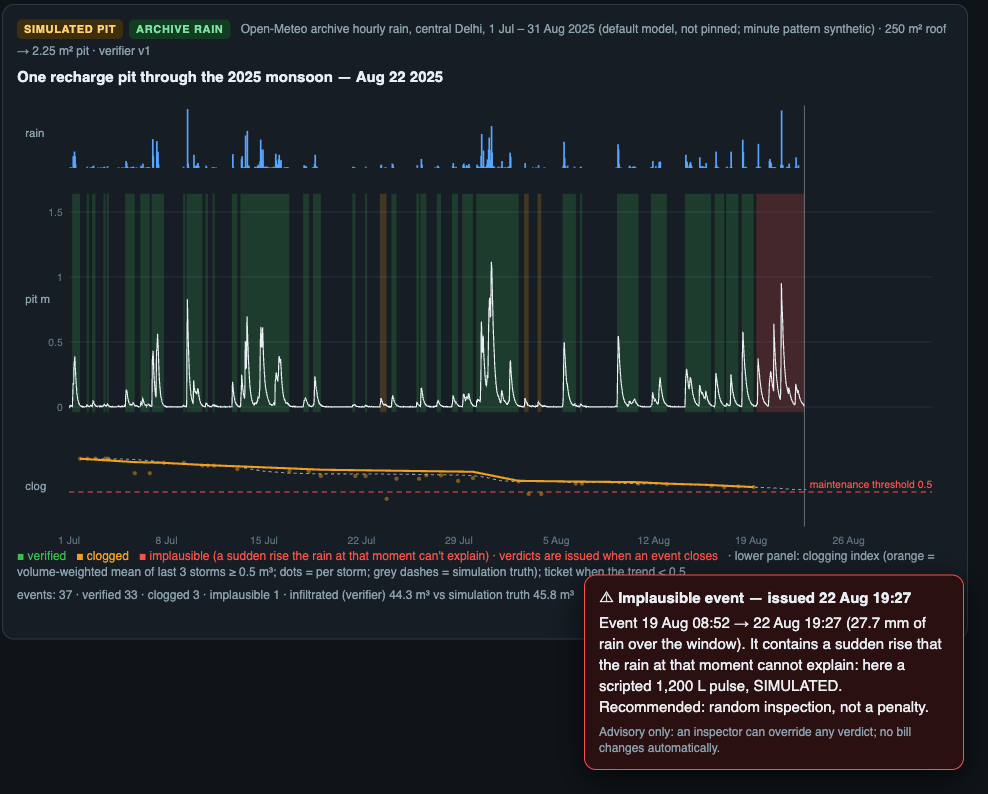

<!-- _class: lead -->
# JalSakshi
### Per-storm evidence that Delhi's rainwater-harvesting pits still work

**Team:** ‹TEAM NAME› · **Team ID:** ‹ID› · **Theme 1:** IoT-based underground water management
‹Member 1 — role› · ‹Member 2 — role› · ‹Member 3 — role› · ‹Member 4 — role› · ‹email / phone›

<!--
TIME 0:00–0:20 (20 s). LOGISTICS: present from your own laptop, zonal-deck.pdf first, with the demo HTML pre-opened in a second tab (offline). Cue card: presenter-card.pdf.
SAY: "We're ‹team›. Delhi has made rainwater harvesting compulsory for 25 years and pays rebates for it. Today, checking a pit means an inspector's visit. We propose continuous, storm-by-storm evidence. We've built the software and a simulation; the field instrument is our Round-2 build."
-->

---

# A rule Delhi funds, checked by periodic inspection

| What | Status | Source |
|---|---|---|
| RWH mandatory for plots ≥ 100 m² | in force **since 2001** | Indian Express (2026) |
| 10 % water-bill rebate if functional (15 % with recycling) | in force | Hindustan Times, 21 Apr 2026 |
| ₹204.46 crore rebates paid, 2017–2024 | reported | HT, citing DJB data |
| Functionality certificate | issued **after inspection**, periodic renewal | HT, 21 Apr 2026 |
| Annual owner self-certification | **being planned** | HT, 21 Apr 2026 |
| 1.5× bill for non-compliance | **"may attract"** | HT, 21 Apr 2026 |

> "Till now, there was a rule but no real checking." — Delhi water minister (HT, 21 Apr 2026)

"Many have become non-functional due to inadequate maintenance" — an official, quoted by Indian Express

<!--
TIME 0:20–1:40 (80 s).
SAY: "The rule is 25 years old and the rebate is real money. Verification today is an inspection visit plus a renewal, and the plan adds owner self-declaration."
LINE TO LAND: "Nothing measures a pit storm by storm. That's the layer we propose, alongside inspection, not instead of it."
DON'T SAY "never checked" or "self-certification is the rule". It's planned.
-->

---

# Why it matters now

- Delhi extracts **92.1 %** of its annually extractable groundwater. **10 of 34 tehsils** are over-exploited (337.44 km²).
  CGWB, *Dynamic Ground Water Resources of India 2025*, §7.32
- DJB Phase I planned to **restore 1,000 non-functional** RWH systems in government buildings and build 500 new ones (target was 30 Jun 2026; we found no completion report). 7,596 of 9,148 government buildings have RWH.
  Indian Express (2026)
- The campaign's recharge potential is **estimated at ≈ 733 million litres a year** (rooftop area × average rainfall). No instrument reports how much the structures actually take in.
  Indian Express (2026); an estimate, not a measurement

<!--
TIME 1:40–2:30 (50 s).
SAY: "Not 'Delhi is running dry'. CGWB 2025 says 92 %, with 10 tehsils still over-exploited. The city is spending on recharge structures; we want each one to report how it performs after every storm."
-->

---

# JalSakshi: one witness per recharge pit

IN THE PIT · PLANNED HARDWARE 0–5 m vented stainless steel probe (±0.5 % FS) in a slotted, socked stilling tube, **tip 5–10 cm above the floor** (water below the tip isn't seen)
IN THE LID · PLANNED MCU + LoRaWAN radio, signed local log; vent tube ends in a desiccant chamber; antenna clear of any metal cover. **Rain gauge required** (it wakes the node and checks plausibility)

BUILT · SOFTWARE, TESTED IN SIMULATION per storm:
1. **Drain rate → clogging index** vs commissioning: the core product, **maintenance screening**
2. **Infiltrated volume: a model-based estimate** (storage + drain law fitted from one metered hose fill). Bypass and water leaving the pit are not observed. A per-event uncertainty band is **PLANNED**, not built.

**Verdicts:** verified · clogged · no inflow · implausible · **deferred** (missing rain or stage data → no judgement)
→ **ranks inspections; an inspector can override; no bill changes automatically**

<!--
TIME 2:30–4:00 (90 s).
SAY: "We don't claim aquifer recharge. We measure how fast a pit drains after each storm, and estimate how much it took in, using a model we calibrate once with a metered fill."
"If data are missing, it says 'deferred'. It never guesses." (Implemented and unit-tested: components/recharge_verifier/test_verifier.py.)
-->

---

# 60-second demo (offline laptop)

**REAL** Delhi DWLR network → **SIMULATED** pit on **archive** 2025 rain → a verdict when each event **closes** → tickets

- "Implausible" here = a **large injected pulse** (1,200 L in 1 min)
- A 20 L bucket (~9 mm rise) is below the 2 cm threshold: **not detected**
- Tickets arrive when an event closes: **hours to days** after onset
- 🔌 **Unplug rain gauge** → **deferred**, no accusation

<!--
TIME 4:00–5:15 (75 s). The demo tab is PRE-OPENED; press space. ~45 s at 1×.
SAY (left panel): "Real data: Delhi's own groundwater monitors. 185 telemetric stations; only 46 reported this year (the latest public reading is 4 June); a quarter of all readings are exactly zero."
SAY (right): "A simulated pit on Delhi's 2025 monsoon rain. Each event gets a verdict when it closes. Here's a large pulse the rain can't explain: random inspection, not a penalty. At the end, drain rate below half: a maintenance ticket."
FALLBACK: this slide's image.
-->

---

# How good is it? Simulation today; blind rig tests in November

40 simulated pits per split · monsoon-2024 holdout · rain: Open-Meteo archive (default model, not pinned); minute pattern synthetic

| Frozen test | Median error | 1 in 10 off by more than |
|---|---|---|
| **Stress:** non-linear drains + imperfect gauge | **13.1 %** | 58 % |
| **+ realistic probe:** ±25 mm offset, drift, 2.1 mm steps | **14.5 %** | 61 % |
| Same drain model as the verifier (best case) | 3.0 % | 16 % |

- Unit: **event windows** with ≥ 0.2 m³ true infiltration (1,233 on the stress test)
- **Large injected pulses** (500–2,000 L): **10/10** flagged · honest windows flagged: 2/1,291 (stress), 15/1,156 (probe)
- Clogging precision / recall: **holdout 0.67 / 1.0** (10 pits) · **dev 0.40 / 0.67** (3 pits)
- Assumes **1-min sampling** throughout; the duty cycle is untested

<!--
TIME 5:15–6:15 (60 s).
SAY: "Lead with the hard number: 13 percent on the stress test, 14.5 with a realistic probe. Three percent only happens when our simulator and verifier share the physics, so we don't sell that. Clogging calls are still noisy, with dev precision 0.4. That's why the blind drum tests come first."
IF ASKED: five candidate fixes were rejected by a written keep rule (four helped one test but hurt another; one didn't help enough).
Ledger and denominators: components/recharge_verifier/autoresearch/results.tsv, eval/results/manifest.json
-->

---

# Built for Delhi conditions: status, not promises

- PLANNED **Underground link:** only the probe is below ground; the antenna sits clear of the metal lid; a site survey picks LoRaWAN or NB-IoT
- DATASHEET **Accuracy:** 0.5 % of a 5 m range = ±25 mm per reading → ±0.11 m³ worst case on a 2.25 m² pit (A). The 5–10 cm below the probe tip (0.11–0.23 m³) is not seen
- PLANNED **Vent & silt:** vent end kept dry with desiccant; socked tube and stand. Auto-zero was tested in simulation, not adopted
- PLANNED TEST **Power & outages:** settle time and sleep current measured in Oct (D-cell vs solar); 24 h outage recovery is an acceptance test. **No battery-life claim**
- SAFETY **No pit entry:** probe lowered from the lid by an empanelled installer; low-voltage battery device; lids stay closed; install only with site permission
- PLANNED **Before each monsoon:** a metered-fill check, because clogging that develops in the dry season shows up only at the next storm

<!-- TIME 6:15–7:00 (45 s). Probe datasheet: farnell.com/datasheets/3708809.pdf. (A) pit geometry 1.5 × 1.5 m is an assumption. -->

---

# Cost, prospective customer, adaptation

| Parts only (6 listings, 4 Oct 2026; excl. tax, shipping, mounting, labour, service) | ₹ |
|---|---|
| Base node (probe ₹4,254.51 + LoRa module + host board + cell + IP67 box + gland) | **11,166.18** |
| First site: node + rain gauge + shared gateway | 48,454.18 |
| 3-pit pilot: 3 nodes + 3 gauges + 1 gateway | 78,244.54 |

- For scale: one packaged CGWA-compliant DWLR (Acorn) lists ≈ ₹38,000 and logs twice a day. Not like-for-like.
- **Prospective pilot customer:** DJB's Phase-I restoration programme and its 59 empanelled RWH providers (IE). **No contact yet.** Then campuses and RWAs.
- **Adapting to other cities:** same software; per-site metered-fill calibration and safety check; local radio choice; local rebate rules. The first pilot covers **one structure type** (roof-runoff pit with filter media).

<!-- TIME 7:00–8:00 (60 s). DON'T call ₹204 cr our market. DON'T say "first buyer". -->

---

# Impact, boundaries and the ask

- **Structure-level evidence** against the campaign's ≈ 733 M L/yr *estimate*: drainage and infiltration at structures, **not aquifer recharge**
- **Clogging alerts** after each observed storm, plus a pre-monsoon fill check, so crews clean the pits that stopped working
- **Water-quality gate:** pilot only on permitted roof-runoff structures with existing pretreatment and a responsible site operator. We never recommend recharging runoff we can't vouch for.
- **Roadmap:**
  - Oct: drum pour rig + node
  - Nov: blind weighed-water trials + 1–3 real pits
  - 1 Dec: report + working prototype
- **Ask:** a pilot partner (DJB zone, campus or RWA) and permission to instrument 3 pits

## Measured, not self-declared.

<!-- TIME 8:00–9:15 (75 s). RESERVE 9:15–10:00 for handoff and questions. -->

---

<!-- _class: lead -->
# Backup slides

---

# Backup 0: Delhi's own sensors, a public-stream snapshot (REAL data)

India-WRIS public API, fetched 4 Oct 2026 (483,253 Delhi readings):
- **185** telemetric piezometers (DWLR), reporting every 6 h
- **46** reported in 2026 (latest public reading **4 Jun 2026**)
- **23 %** of readings are exactly 0.000 m; **17 %** of 6-h slots missing (up to each station's last report)
- Exploratory: median 2025 monsoon depth change **2.5 m** (79 stations); not attributed to RWH

<!-- Reproduce: eval/realdata_profile.py. Sign convention resolved heuristically per station. -->

---

# Backup 1: Why we don't claim to catch illegal borewells

- DJB identified **20,297** illegal borewells; **15,962** sealed; **4,000+** "couldn't be traced on the ground" (HT, 10 Jun 2025; Millennium Post). The NGT found seals that let borewells run "very conveniently" (The Bar Bulletin, 2026).
- Public piezometers report **every 6 h**, so pump cycles shorter than ~12 h alias. Drawdown is confounded by legal pumping, barometric pressure and rain.
- So we **never accuse a well**. A zone-level influence index is research only.

---

# Backup 2: BOM and price evidence (4 Oct 2026)

| Part | Vendor | ₹ |
|---|---|---|
| DFRobot KIT0139 0–5 m 4–20 mA probe | element14 India | 4,254.51 |
| RAK3172 LoRaWAN module (IN865) | electronicscomp.com | 1,672.80 |
| ESP32-C6-DevKitM-1 (prototype host) | robu.in | 1,099.00 |
| Forte ER34615 D Li-SOCl₂ 3.6 V | robu.in | 879.00 |
| IP67 ABS box 150×100×70 mm | amazon.in | 3,250.87 |
| PG7 gland | robu.in | 10.00 |
| DFRobot tipping-bucket rain gauge (listed unavailable) | amazon.in | 3,729.00 |
| shared: LPS8N 8-ch LoRaWAN gateway (IN865 variant unconfirmed) | amazon.in | 33,559.00 |

Seen by us on 4 Oct 2026 (URLs: prototype-plan.md §3). An independent re-check the same day was blocked by most vendors (HTTP 403/503), so get quotes before buying. Not priced: boost converter, antenna, tube, sock, mounting, potting, cable.

---

# Backup 3: The evaluators and the keep rule

- **v1:** linear-reservoir pits (same model as the verifier); **v2:** drain ∝ h^β, β ~ U(0.5, 1.5), gauge × lognormal(0.25)/day, 0–5 min lag; **v3:** v2 + probe offset ±25 mm, ±10 mm drift, floor at 0 m, 2.1 mm quantisation
- **Fleet:** 40 pits per split (healthy / clogging / blocked / faker); registry 5–10 % wrong. Dev = monsoon 2025, holdout = monsoon 2024.
- **Keep rule:** improve the target by > 0.5 points; worsen no other evaluator by > 10 %; confirm on holdout.
- **Chronology:** the v1 and v2 rules were committed before their results (git: 08:03 → 08:15, 08:26 → 09:46 IST). The v3 rule was written before its runs (our log) but committed together with them, so it isn't independently provable.
- **Pre-registered?** Read the holdout numbers as recorded checks, not an untouched prospective test.

---

# Backup 4: One worked event, and what a level sensor can't see

| One event (SIMULATED pit, archive rain) | Value |
|---|---|
| Window | 30 Jul 05:53 → 2 Aug 07:01, 2025 |
| Rain in window × 250 m² roof × 0.75 runoff prior | 52.0 mm → 9.75 m³ (cross-check) |
| Infiltrated volume, model-based estimate | **9.80 m³** |
| Simulation truth | 10.38 m³ (−5.6 %; best case, same drain model) |
| Fleet error, stress test | median 13.1 %, 1 in 10 off by > 58 % (**not** a per-event interval; that is PLANNED) |

| Water path | Seen by stage + rain? |
|---|---|
| Water entering the pit | **Yes**: the rise, checked against rain × roof |
| Inlet bypass / diverted downpipe | **Partly**: under-delivery vs rain × roof, or "no inflow" |
| Overflow | That it happened (time at spill level): **yes**; how much: **estimated** |
| Leak or crack out of the pit | **No**: indistinguishable from infiltration → inspection |
| Water below the probe tip | **No**: a 0.11–0.23 m³ blind zone (A: 2.25 m² pit) |
