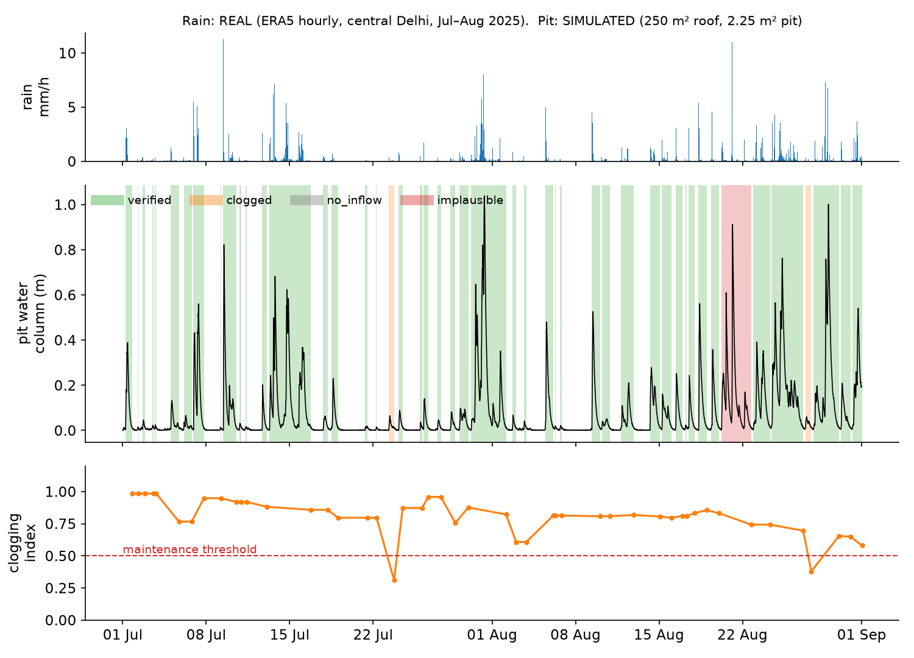

<!-- _class: lead -->
# JalSakshi
## Measured, not self-declared, groundwater recharge for Delhi

Team **<TEAM NAME>** · Team ID **<ID>** · Theme 1: IoT-based underground water management
<MEMBER 1> · <MEMBER 2> · <MEMBER 3> · <MEMBER 4> · contact: <EMAIL / PHONE>

<!-- Speaker (0:00–0:30): "We're <team>. Delhi's groundwater rules work on paper but not in the ground. We've built an IoT instrument and a data pipeline that turn one of those rules into evidence." -->

---

# Delhi pumps more than it recharges, and the ground shows it

- Delhi extracts **92.1 %** of its annually extractable groundwater; **10 of 34 tehsils** are *over-exploited* (337.44 km² of 1,487.62 km² recharge-worthy area) (CGWB, *Dynamic Ground Water Resources of India 2025*, §7.32)
- **20,297** illegal borewells identified by DJB; **15,962** sealed; **4,000+** "couldn't be traced on the ground" (*Hindustan Times*, 10 Jun 2025, on an NGT order of 30 May 2025; also *Millennium Post*)
- 2026: the NGT found seals that let borewells run *"very conveniently"* (*The Bar Bulletin*)
- Dwarka: residents stopped pumping, but *"the adjoining areas – they're still using the groundwater"* (CNA). The land is sinking.

<!-- Speaker (0:30–1:45): Pause on the last line. "Policing extraction is adversarial and slow. The lever the city controls is recharge, and it's blind there too." -->

---

# The lever Delhi already pulls, blind

| Rule (DJB) | Value |
|---|---|
| Rainwater harvesting mandatory | plots ≥ 100 m² |
| Rebate if functional | 10 % of water bill (15 % with recycling) |
| Penalty if not | 1.5× bill → disconnection |
| Rebates paid 2017–2024 | **₹204.46 crore** (HT, citing DJB data) |
| Verification from 2026 | **annual self-certification** |

> "Till now, there was a rule but no real checking." (Delhi water minister, *Hindustan Times*, 21 Apr 2026)

DJB is restoring **1,000 non-functional** RWH systems in govt buildings (*Indian Express*, 2026)

<!-- Speaker (1:45–3:00): Why existing solutions fall short: inspections are manual and rare. CGWA-style DWLR loggers cost ≈ ₹38,000 (Acorn listing) and log twice a day, which can't see a 2-hour storm. Hobby kits show a tank level and stop there. Nobody turns a storm into evidence. -->

---

# Even the monitoring network needs auditing (our analysis, real data)

India-WRIS public API, 483,253 Delhi readings (fetched 4 Oct 2026):
- **185** telemetric piezometers, readings every **6 h**
- only **46** reported in 2026
- **23 %** of readings are exactly 0.000 m; **17 %** of 6-hour slots missing
- where clean: monsoon-2025 rise **2.5 m** (median, 79 stations). Recharge works when water gets in.

<!-- Speaker (3:00–3:45): "Real data, our code, reproducible: eval/realdata_profile.py." -->

---

# JalSakshi: one witness per recharge pit

**Node (≈ ₹6k target):**
- sealed pressure sensor in a slotted stilling tube at the pit bottom
- barometer, MCU, LoRaWAN/NB-IoT radio and a signed log in the lid
- optional rain gauge
- samples every 15 min when dry, every 1 min in storms

**Cloud, per storm:**
1. Detect the event
2. **Water balance:** inflow − overflow − Δstorage = **infiltrated volume ± uncertainty**
3. Recession constant → **clogging index**
4. **Verdict:** verified · clogged · no inflow · implausible (e.g. a bucket poured with no rain)

**City twin:** QC'd DWLR network + rain response. Did the aquifer respond?

<!-- Speaker (3:45–5:30): Draw the equation. "We call it infiltrated volume, not aquifer recharge: that's what we can measure honestly." -->

---

# Demo: a season in one pit

Rain **REAL** (ERA5, Delhi, Jul–Aug 2025) · pit **SIMULATED** · verdicts from our verifier

<!-- Speaker (5:30–7:00): Live laptop demo offline; this slide is the fallback. Point at the clogging index crossing 0.5 → maintenance ticket; the red band = poured-water fake caught. -->

---

# Does it work? Our evaluation (simulation now, rig in October)

Frozen evaluator · 40 SIMULATED pits per monsoon · REAL Delhi rain · imperfect registry

| Metric | Baseline | v1 (monsoon 2024 holdout) |
|---|---|---|
| Infiltrated volume per storm: median error | 10.3 % | **3.0 %** |
| Fake "bucket" events caught | 30 % | **100 %** (n = 10) |
| Honest storms wrongly flagged | 25 % | **0 %** |
| Clogging precision / recall | 0.63 / 1.0 | **0.83 / 1.0** |

Harsher stress test (non-linear drains + imperfect rain gauge): v1 median error **13.0 %**. Drain-law fits reach **4.9 %** there but worsen the ideal case, so **not yet adopted** (pre-registered keep rule; ledger).

<!-- Speaker (7:00–7:30): "Simulation is an upper bound; that's why we built a harsher evaluator and a physical rig with a metered inflow next." Numbers: components/recharge_verifier/autoresearch/results.tsv. -->

---

# Built for Delhi conditions

- **Underground connectivity:** the antenna sits in the lid, never below grade. Store-and-forward, so no lost events.
- **Power:** sleeps almost always, bursts only during storms. Primary lithium cell. Battery life is bench-measured in Oct (target ≥ 3 yr).
- **Calibration:**
  - a commissioning fill with a metered hose fixes pit area and drain rate
  - barometric compensation avoids vent-tube moisture failures (Solinst)
  - annual dip-tape check
- **Silt & heat:** geotextile-socked stilling tube, sensor on a stand above the silt line, enclosure rated 50 °C+.
- **Tamper:** sensor-out-of-water = barometer; rise without rain = implausible; signed logs.

<!-- Speaker (7:30–8:00) -->

---

# Cost, model, scale

- **Node BOM target < ₹6,000** (prices being confirmed) vs ≈ **₹38,000** for a CGWA-style DWLR (Acorn listing)
- **Who pays first:** campuses and RWAs that want the rebate or need proof. Then DJB's restoration drive.
- **Model:** device + per-year verification service. Verdicts feed DJB billing (rebate / penalty).
- **Scale:**
  - any Indian city with an RWH bylaw
  - the city twin runs on any state's India-WRIS stations
  - parameters per aquifer type

<!-- Speaker (8:00–9:00): Don't present ₹204 cr as our market. It's the money paid without checking. -->

---

# Impact and ask

- Turns a **paper rebate** into **measured m³ per storm** for every instrumented structure
- **Clogging alerts** recover recharge that silt is quietly stealing
- Non-functional or fake systems stop being paid
- **Roadmap:**
  - Oct: rig + bench node
  - Nov: blind trials + 1–3 pilot pits
  - 1 Dec: report + prototype
- **Ask:** a pilot partner (DJB zone / RWA / campus)

## Measured, not self-declared.

<!-- Speaker (9:00–10:00) -->
