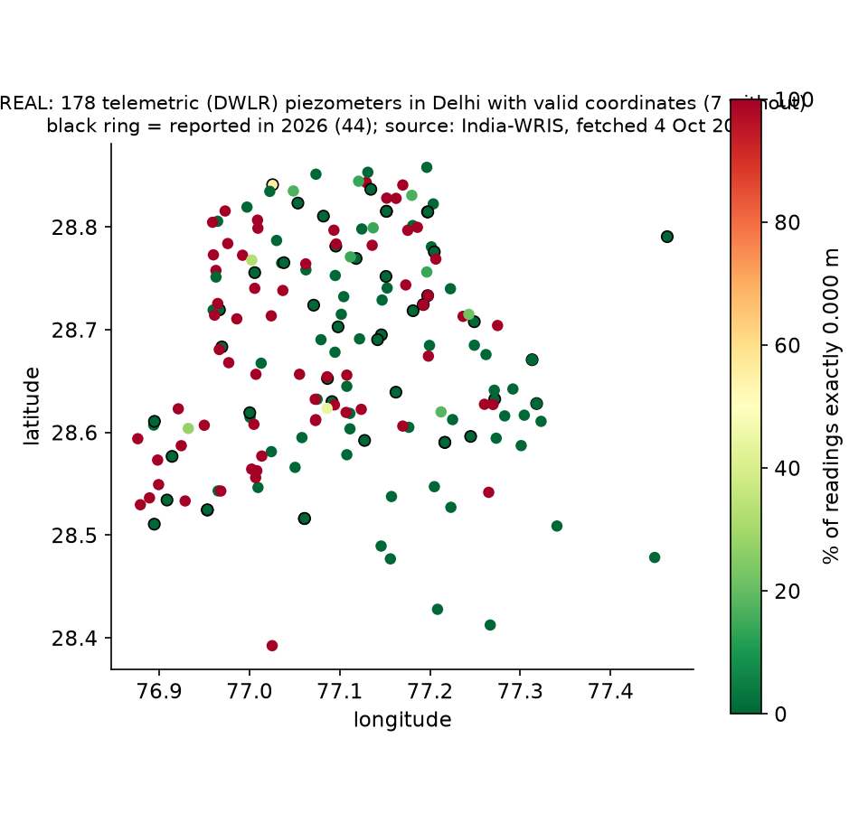
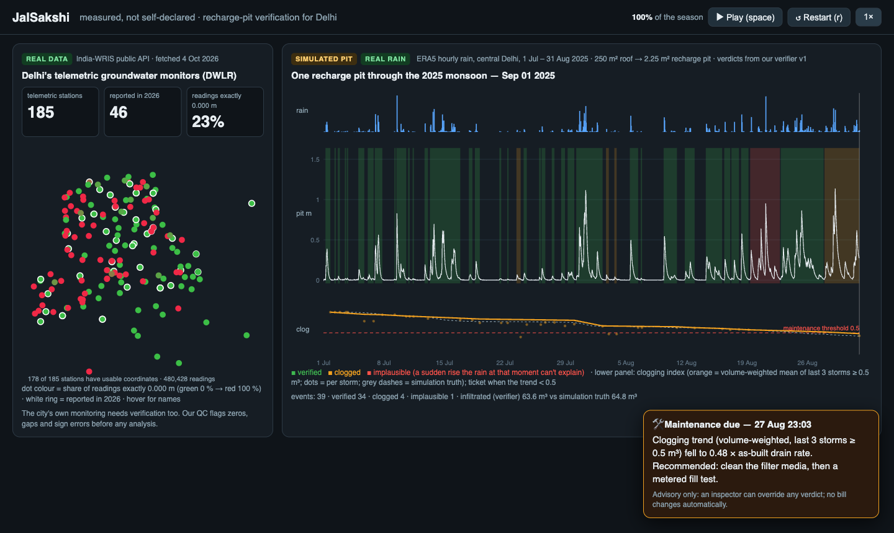

<!-- _class: lead -->
# JalSakshi
### Delhi pays for rainwater harvesting it cannot check. We measure it.

**Team:** ‹TEAM NAME› · **Team ID:** ‹ID› · **Theme 1:** IoT-based underground water management
‹Member 1 — role› · ‹Member 2 — role› · ‹Member 3 — role› · ‹Member 4 — role› · ‹email / phone›

<!--
TIME 0:00–0:20 (20 s).
SAY: "We're ‹team›. Delhi has made rainwater harvesting compulsory for 25 years and paid crores in rebates for it. Nobody can tell you whether those pits work. We built the instrument that can."
-->

---

# A rule Delhi funds, but can't verify

| What | Status | Source |
|---|---|---|
| RWH mandatory for plots ≥ 100 m² | in force **since 2001** | Indian Express (2026) |
| 10 % water-bill rebate if functional (15 % with recycling) | in force | Hindustan Times, 21 Apr 2026 |
| ₹204.46 crore rebates paid, 2017–2024 | reported | HT, citing DJB data |
| Functionality certificate | issued **after inspection** | HT, 21 Apr 2026 |
| Annual owner self-certification | **being planned** | HT, 21 Apr 2026 |
| 1.5× bill for non-compliance | **"may attract"** | HT, 21 Apr 2026 |

> "Till now, there was a rule but no real checking." — Delhi water minister (HT, 21 Apr 2026)

"Many have become non-functional due to inadequate maintenance" — an official, quoted by Indian Express

<!--
TIME 0:20–1:40 (80 s).
SAY: "The rule is 25 years old. The rebate is real money. Checking it today means a person visiting a pit, and the plan is self-declaration."
LINE TO LAND: "The verification system doesn't exist yet. We're bidding to be it."
DON'T SAY "never checked" or "self-certification is the rule". HT says it's planned.
-->

---

# Why it matters now

- Delhi extracts **92.1 %** of its annually extractable groundwater. **10 of 34 tehsils** are over-exploited (337.44 km²).
  CGWB, *Dynamic Ground Water Resources of India 2025*, §7.32
- DJB Phase I: **restore 1,000 non-functional** RWH systems in government buildings and build 500 new ones (target 30 Jun 2026). 7,596 of 9,148 government buildings already have RWH.
  Indian Express (2026)
- The campaign's recharge potential is **estimated at ≈ 733 million litres a year** (rooftop area × average rainfall). Today nobody can say how much of that reaches the ground.
  Indian Express (2026); an estimate, not a measurement

<!--
TIME 1:40–2:30 (50 s).
SAY: "Not 'Delhi is running dry'. CGWB 2025 says 92 %, and 10 tehsils are still over-exploited. The city is spending on recharge right now. Our job: make that 733-million-litre estimate auditable, one structure at a time."
-->

---

# Even the city's own sensors need checking (our analysis, REAL data)

India-WRIS public API, fetched 4 Oct 2026 (483,253 Delhi readings):
- **185** telemetric piezometers (DWLR), reporting every 6 h
- only **46** reported anything in 2026
- **23 %** of readings are exactly 0.000 m; **17 %** of 6-h slots are missing
- where the data are clean, water levels rose a median **2.5 m** in the 2025 monsoon (79 stations)

<!--
TIME 2:30–3:15 (45 s). Reproduce: eval/realdata_profile.py
SAY: "This is our code on public data. The network that should show the aquifer responding is mostly stale or zero. So we QC it before we believe it. And where it's clean, the monsoon visibly recharges the aquifer: worth getting right."
-->

---

# JalSakshi: one witness per recharge pit

**In the pit:** a 0–5 m stainless steel pressure probe (±0.5 % FS) in a slotted, socked stilling tube
**In the lid:** MCU + LoRaWAN radio, battery and a signed local log. Optional rain gauge.
**Sampling:** every 15 min when dry, every 1 min when rain or a rise wakes it

**Two outputs per storm, nothing more:**
1. **Drain rate** (the storm runs a falling-head test for us) → **clogging index** vs as-built
2. **Infiltrated volume ± band**: the rise is checked against rain × roof area, overflow is capped at the spill level, and one metered hose fill fixes pit area and drain rate

**Verdict:** verified · clogged · no inflow · implausible (a rise with no rain)
→ **ranks inspections; an inspector can override; no bill changes automatically**

<!--
TIME 3:15–4:45 (90 s).
SAY: "We don't claim aquifer recharge. We measure what the pit does with the water it gets: how fast it drains, and roughly how much soaked in, with an honest band."
POINT at the four verdicts. "Implausible" is how we catch a bucket poured to fake a storm.
-->

---

# 60-second demo (offline laptop)

**REAL** Delhi DWLR network → **SIMULATED** pit on **REAL** 2025 rain → a verdict per storm → **"Implausible"** and **"Maintenance due"** tickets

<!--
TIME 4:45–6:00 (75 s).
DO: open deliverables/demo/jalsakshi-demo.html (works offline), press space, let it run ~45 s, talk over the tickets.
FALLBACK: this slide's screenshot (same demo, end of season).
SAY: "Everything you see in the pit is simulated, and labelled so. The rain is Delhi's real 2025 monsoon."
-->

---

# How good is it? (simulation today; a blind rig test by 1 Dec)

Simulated pits, real Delhi rain; median error of infiltrated volume per storm.

| Test (frozen; monsoon-2024 holdout) | Median error | 1 storm in 10 is off by more than |
|---|---|---|
| **Stress test:** non-linear drains + imperfect rain gauge | **13.1 %** | 58 % |
| **+ realistic probe:** ±25 mm offset, drift, quantisation | **14.5 %** | 61 % |
| Same drain model as the verifier (best case) | 3.0 % | 16 % |

- Fake pours (no rain to explain them) flagged: **10/10 simulated fakes** in every test. Honest storms wrongly flagged: ≤ 1.3 %.
- Clogged-pit verdict (end of season): precision 0.60–0.67, recall 0.90–1.0 (stress tests, holdout)

We **rejected** five candidate fixes under a rule set before running them: four helped one test but hurt another, and one didn't help enough.

<!--
TIME 6:00–7:00 (60 s).
SAY: "Lead with the hard number: 13 percent on the stress test, 14.5 with a realistic probe. Three percent only happens when our simulator and verifier agree on the physics, so we don't sell that. The real number comes from a blind weighed-water drum test in November."
Ledger: components/recharge_verifier/autoresearch/results.tsv
-->

---

# Built for Delhi conditions

- **Underground link:** only the probe is below ground. The antenna sits flush with the lid. A local buffer means no lost events.
- **Accuracy:** ±25 mm per reading (datasheet) → ±0.11 m³ worst case on a 2.25 m² pit, about 3 % of a 4 m³ storm. A dry-floor auto-zero removes constant offset.
- **Silt:** probe on a stand above the silt line, inside a socked tube. A floor reading during rain raises a check.
- **Heat & water:** probe rated −20 to 70 °C, 316L stainless steel, IP68; IP67 enclosure.
- **Power:** probe switched on only to sample. **Battery life gets measured, not promised.** Settle time decides D-cell vs solar.
- **Calibration:** one metered hose fill at commissioning, an annual dip check, a re-fill after cleaning.

Probe: DFRobot KIT0139 datasheet (farnell.com/datasheets/3708809.pdf)

<!-- TIME 7:00–7:45 (45 s). -->

---

# Cost, buyer, rollout

- **Node: ₹11,166 in verified retail parts** (probe ₹4,254.51 at element14; LoRa module, host board, Li-SOCl₂ cell, IP67 box; tube/cable/potting not yet priced)
  vs one CGWA-compliant DWLR (Acorn): **≈ ₹38,000**, logging twice a day
- **First buyer: DJB's Phase-I restorations of 1,000 government buildings.** DJB has **59 empanelled RWH service providers** who could install it, and is building a compliance-tracking portal our events could feed (Indian Express).
- **Then:** campuses and RWAs that want proof for the rebate.
- **Model:** node + annual verification service. Verdicts rank inspections. **₹204 cr is not our market.**

<!--
TIME 7:45–8:45 (60 s).
DON'T claim volume pricing (not quoted). DON'T say households will rush to buy it.
-->

---

# Impact and the ask

- **Audit the campaign's own estimate** (≈ 733 M L/yr) structure by structure, in measured litres
- **Clogging alerts** send cleaning crews to the pits that stopped working, before the monsoon
- **Data hygiene:** QC for the city's DWLR stream, so the aquifer response can be checked
- **Roadmap:**
  - Oct: drum pour rig + node
  - Nov: blind weighed-water trials + 1–3 real pits
  - 1 Dec: report + working prototype
- **Ask:** a pilot partner (DJB zone, campus or RWA), and permission to instrument 3 pits

## Measured, not self-declared.

<!-- TIME 8:45–10:00 (75 s incl. buffer). -->

---

<!-- _class: lead -->
# Backup slides

---

# Backup 1: Why we don't claim to catch illegal borewells

- DJB identified **20,297** illegal borewells; **15,962** sealed; **4,000+** "couldn't be traced on the ground" (HT, 10 Jun 2025; Millennium Post). The NGT found seals that let borewells run "very conveniently" (The Bar Bulletin, 2026).
- Public piezometers report **every 6 h**, so pump cycles shorter than ~12 h alias. Drawdown is confounded by legal pumping, barometric pressure and rain.
- So we **never accuse a well**. A zone-level influence index is research only.

---

# Backup 2: BOM (verified 4 Oct 2026, single-unit retail)

| Part | Vendor | ₹ |
|---|---|---|
| DFRobot KIT0139 0–5 m 4–20 mA probe | element14 India | 4,254.51 |
| RAK3172 LoRaWAN module (IN865) | electronicscomp.com | 1,672.80 |
| ESP32-C6-DevKitM-1 (prototype host) | robu.in | 1,099.00 |
| Forte ER34615 D Li-SOCl₂ 3.6 V | robu.in | 879.00 |
| IP67 ABS box 150×100×70 mm | amazon.in | 3,250.87 |
| PG7 gland | robu.in | 10.00 |
| **Subtotal** | | **11,166.18** |
| optional: tipping-bucket rain gauge (DFRobot) | amazon.in | 3,729.00 |
| shared: LPS8N 8-ch LoRaWAN gateway | amazon.in | 33,559.00 |

URLs and access dates: deliverables/prototype-plan.md §3. Not priced: boost converter, antenna, tube, sock, potting, cable.

---

# Backup 3: The evaluators (frozen, pre-registered keep rule)

- **v1:** linear-reservoir pits (same model as the verifier) → best case
- **v2:** drain outflow ∝ h^β, β ~ U(0.5, 1.5); rain gauge × lognormal(0.25)/day; 0–5 min lag
- **v3:** v2 plus a probe offset of ±25 mm, ±10 mm/season drift, readings floored at 0 m, 2.1 mm quantisation
- **Fleet:** 40 pits per split (healthy / clogging / blocked / faker); registry ±5–10 % wrong. Dev = monsoon 2025, holdout = monsoon 2024 (real ERA5 rain).
- **Keep rule:** improve the target by > 0.5 points and worsen no other evaluator by > 10 %; confirm on holdout.
