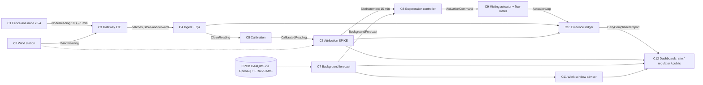

# Components — DustLedger (C&D dust, Delhi-NCR)

*Lead-owned. Contracts: [`contracts/contracts.py`](contracts/contracts.py) (pydantic v2; `python contracts.py` exports JSON Schemas). Spike choice: [ADR 001](adr/001-spike.md).*

**System in one line:** a ring of 3–4 low-cost PM nodes plus a wind sensor on a construction site's boundary. It measures how much dust *this site* adds on top of Delhi's background, mists only when the site is the cause, and keeps a tamper-evident ledger. Regulators can then rank sites by measured contribution instead of stopping all of them.

| # | Component | Responsibility (one sentence) | Input → Output | Baseline (existing practice) | Isolated scalar metric | SLO | Error modes |
|---|---|---|---|---|---|---|---|
| C1 | Fence-line node | Measure PM1/2.5/10 (+ size bins), T and RH at the site boundary, and sign each record | air → `NodeReading` (10 s samples, 1-min means) | Sensirion SPS30-class optical sensor on an ESP32 (what Indian compliance monitors use; CSTEP-tested class) | Inter-unit precision: CV of 1-min PM10 across co-located nodes (target < 10 %) | ≥ 95 % minutes delivered | fan clog, fog (RH > 95 %), coarse-dust under-reading, heat > 50 °C |
| C2 | Wind station | Measure wind speed and direction at ~3 m | air → `WindReading` | cup anemometer + vane (ultrasonic optional) | Direction error vs reference (°, target < 15°); completeness | 1-min resolution | wake of buildings and hoardings, vane stuck |
| C3 | Gateway / connectivity | Buffer and forward node and wind data over LTE Cat-1, keeping time sync | readings → HTTPS batches | ESP32 + 4G modem, MQTT/HTTPS, SD buffer | Delivery ratio after a 24-h outage (target 100 % after backfill) | p95 latency < 2 min online | network loss, power loss, clock drift |
| C4 | Ingest + QA | Validate, de-duplicate and flag bad or suspicious data (stuck, fog, spray-like spikes) | batches → `CleanReading` | range/stuck checks (Breathe London-style ratification) | F1 on injected faults (simulated fault library) | < 5 s per batch | over-flagging in real dust storms |
| C5 | Calibration | Turn raw optical PM into reference-equivalent PM with uncertainty; keep nodes consistent with each other | `CleanReading` → `CalibratedReading` | Linear + RH correction fitted on reference co-location (EPA/Barkjohn style) + weekly re-fit (Breathe London) | RMSE / R² vs reference on a held-out co-location period (EPA PM2.5 targets: R² > 0.70, RMSE < 7 µg/m³) | re-fit weekly | season shift, humidity growth, dust type |
| **C6** | **Attribution (spike)** | **Estimate the site's own PM10 increment and P(site is the cause) per 15 min from the ring + wind** | `CalibratedReading` × `WindReading` → `SiteIncrement` | Upwind–downwind subtraction with a single pair (simple fence-line practice) | **MAE of increment vs truth (µg/m³) in a replay of real Delhi background + real wind with simulated site plumes and sensor errors (SIMULATED); secondary: CSI of exceedance detection** | < 1 s per window | wind meander, calm (< 0.5 m/s), neighbouring sites, node bias |
| C7 | Background forecast | Forecast next-day background PM2.5/PM10 (quantiles) at the nearest CAAQMS | public data → `BackgroundForecast` | Persistence; IITM AQEWS/DSS (operational) | MAE skill vs persistence on a time-ordered holdout; CSI for severe days | daily, < 1 min | unseen extremes (Diwali, stubble peaks) |
| C8 | Suppression controller | Decide when and where to mist, given increment, wind, forecast and water budget | `SiteIncrement` + `BackgroundForecast` → `ActuationCommand` | Timer-based anti-smog gun (current practice) | Increment-µg·h avoided per kL water vs timer baseline (simulated) | decision < 1 s | chasing background, over-watering, slippery work zones |
| C9 | Misting actuator | Spray the commanded zone and log the litres used | `ActuationCommand` → `ActuationLog` | relay + pump/solenoid + flow meter | Command-to-spray latency; logged vs metered litres | < 5 s | clogged nozzles, empty tank, power |
| C10 | Evidence ledger | Hash-chain every reading, increment and actuation; issue daily signed reports | all records → `LedgerEntry`, `DailyComplianceReport` | CCTV + monthly self-audit upload (current DPCC practice) | Tamper detection rate on test edits (target 100 %) | append < 10 ms | key loss; gaps look like tampering |
| C11 | Work-window advisor | Recommend hours for dusty tasks when background and ventilation are favourable | `BackgroundForecast` + ERA5 → `WorkWindowAdvice` | none (sites work fixed shifts) | Share of dusty-task hours moved into low-impact windows (replay) | daily | worker-shift constraints |
| C12 | Dashboards | Site supervisor (mobile, Hindi/English), regulator ranking and public view | all → UI | DPCC dust-portal self-audit forms | Time for a regulator to answer "which sites caused today's exceedances?" (scripted test) | < 2 s load | information overload |

**Walking skeleton today** (`eval/`): C7 runs on real CPCB/DPCC data (OpenAQ archive) + ERA5 with a time-ordered split; the C6 attribution replay (real background + wind, SIMULATED site and sensors) runs in `components/attribution/autoresearch/` (5-seed evaluator v1). C1–C3 and C9 are hardware (by 1 Dec); until then they're replaced by a labelled simulator that writes `NodeReading`/`WindReading` with `provenance="SIMULATED"`.

**Seams:** C5 ↔ C6 (attribution consumes calibrated data with uncertainty, so a better calibration improves attribution without code changes); C6 ↔ C8 (the controller sees only `SiteIncrement`, so attribution methods can be swapped); C7 is optional for C8 (degrades to increment-only control).
