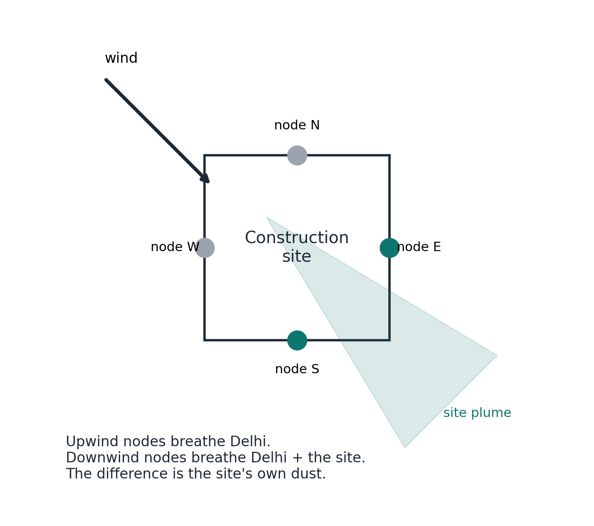
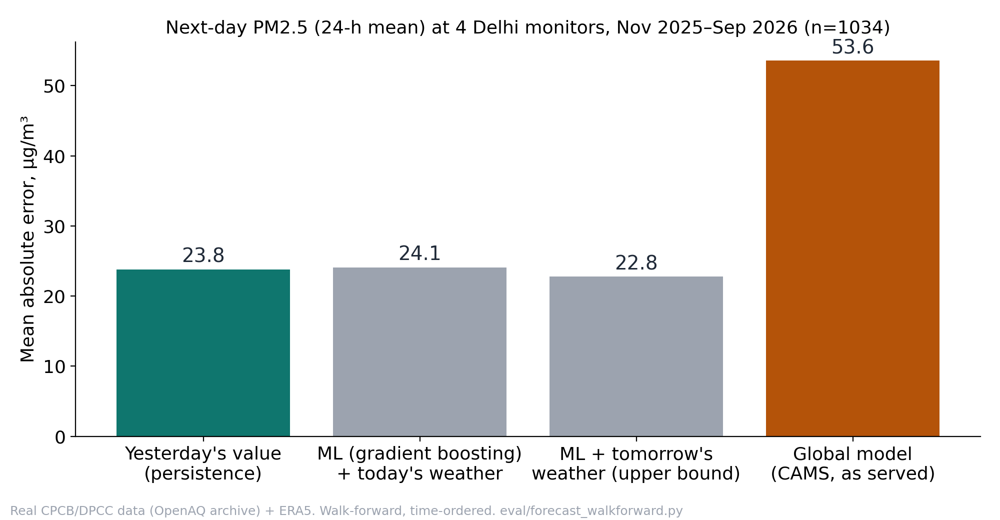
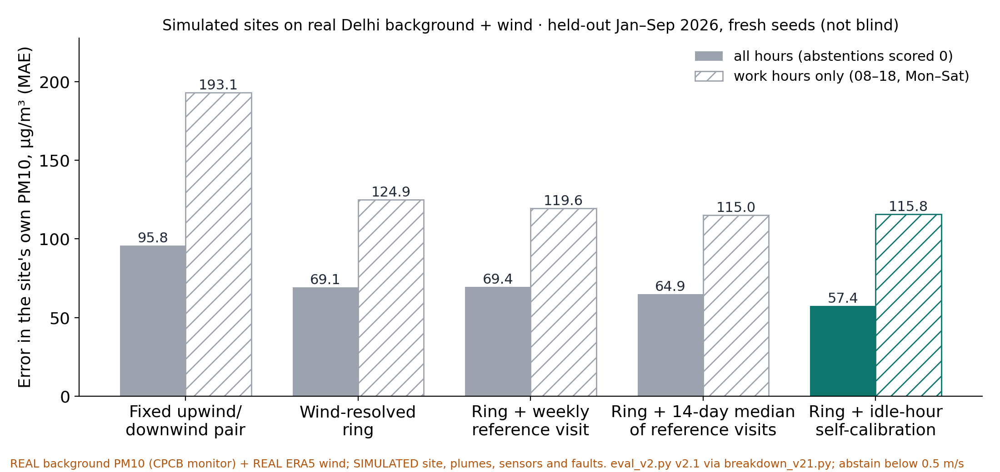
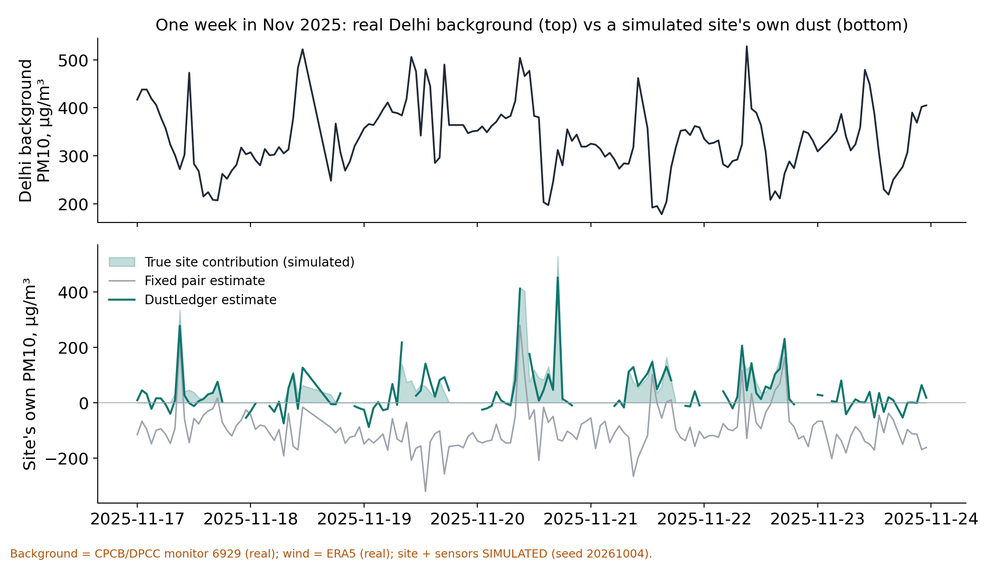
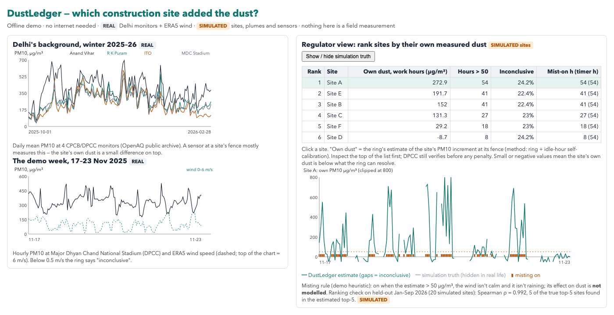

<!-- _class: lead -->
# DustLedger
### Measure each construction site's own dust — so Delhi can act on the dirty sites instead of stopping all of them

**Team:** ‹TEAM NAME› · **Team ID:** ‹ID› · **Theme 2:** Rising AQI Levels in Modern Urban Cities
‹Member 1 — role› · ‹Member 2 — role› · ‹Member 3 — role› · ‹Member 4 — role› · ‹email / phone›

<!--
TIME 0:00–0:20 (20 s). LOGISTICS: present zonal-deck.pdf from your own laptop, with demo/dustledger-demo.html pre-opened in a second tab (offline); backup slides B1–B7 follow the last main slide. Cue card: presenter-card.pdf.
SAY: "We're ‹team›. Every winter Delhi stops every construction site, clean or dirty, because it can't tell them apart. We propose a way to measure each site's own dust. Today we have the data pipeline and a stress-tested simulation; the sensor ring is our Round-2 build."
-->

---

# This winter, Delhi restricts every construction site

| When | What |
|---|---|
| Nov 1 – Jan 31 | dust-generating demolition and outdoor civil works **prohibited** |
| Dec 10 – Jan 20 | **total ban** on construction and demolition |
| GRAP emergencies | stage-wise stops on top; GRAP-3 halted construction for 16 days in 2025 (₹10,000 compensation announced) |
| Every site | 100% CCTV coverage mandated |

**The same rule for every site — whatever its dust control.**

Sources: Delhi Winter Action Plan 2026-27 as reported by The News Mill (Sept 2026, secondary); Hindustan Times (Dec 2025). Full table: research/fact-check.md (F1, F3).

<!--
TIME 0:20–1:10 (50 s).
SAY: "Delhi's Winter Action Plan for this year prohibits dust-generating demolition and outdoor civil works from November first to January thirty-first, and bans all construction from December tenth to January twentieth. GRAP emergencies stop sites on top of that: last year GRAP-3 halted construction for sixteen days. Every site is treated the same, whatever it does about dust."
-->

---

# A monitor can say the air is bad — not which site made it bad

- **City-scale sensing:** 47 reference monitors in Delhi (going to 60); planning norm is one per 25-50 km²
- **Site compliance = checklists:** anti-smog guns (₹7,500 fine per missing gun per 5,000 m²), CCTV, self-audit uploads
- **Fines by area, not by dust:** CAQM's 2024 schedule sets ₹1 lakh to ₹2 lakh per construction-site violation depending on area, doubled under GRAP
- **Trust is broken:** in Oct 2025 water tankers were filmed spraying at the Jahangirpuri reference monitor; CPCB says its data can't be manipulated

**Penalties track checklists, not the dust a site actually releases.**

Sources: Hindustan Times (2026; Feb 2024, reporting the CAQM order of 6 Feb 2024); Newslaundry (30 Oct 2025); New Indian Express (3 Dec 2025). Fact rows F5, F6, F25.

<!--
TIME 1:10–2:00 (50 s).
SAY: "Delhi measures air at city scale: forty-seven reference monitors, roughly one per twenty-five to fifty square kilometres. A monitor can tell you the air is bad; it can't tell you which of the sites around it made it bad. So compliance is a checklist — anti-smog guns, CCTV, self-audits — and fines are set by site area, not by how much dust a site actually releases. And when tankers are filmed spraying a reference monitor, people stop trusting the numbers."
-->

---

# A small source, handled with the bluntest tool

2-5%
of Delhi's ambient PM10 came from construction material in IIT Kanpur's receptor study for DPCC (data 2013–14).
Construction & demolition: 3.6% of PM10 *emissions*; concrete batching another 10%.

1,378,199
construction workers on Delhi's welfare-board rolls — only 89,518 active members.
In one survey, 5 of 75 site workers were registered; none had received the ₹8,000 aid.

**Blanket stops cost most to those least able to pay — for a few per cent of the city's PM.**

Sources: IIT Kanpur (2016) for DPCC, §4.6 and Table 3.1 (primary; 3.6% is our arithmetic: 5.1668 of 143 t/d); Down To Earth (Dec 2024). Fact rows F7–F10.

<!--
TIME 2:00–3:00 (60 s).
SAY: "Here's the honest size of the problem. In IIT Kanpur's source study for the Delhi government, construction material was two to five per cent of ambient PM10. It's a real source, but a small one. Yet it gets the bluntest tool there is. The cost falls on workers: nearly fourteen lakh are on Delhi's welfare-board rolls but only about ninety thousand are active members, and in one survey most site workers weren't even registered for the aid. So we are not promising to clean Delhi's air. We're proposing to make enforcement on this source fair and targeted."
-->

---

# Why today's tools fall short

| What exists | The gap |
|---|---|
| Reference monitors (CAAQMS) | city scale — can't single out a site |
| Compliance monitors streaming to the DPCC cloud (e.g. Airveda, Prana Air) | absolute PM; Delhi's winter PM10 averages 314 ± 77 µg/m³, so a site is a small difference on top |
| Anti-smog guns, sprinklers | run on timers — no feedback on whether dust fell |
| City AQI forecasts (IITM, Google) | tomorrow's city AQI, not today's dusty site |
| Fence-line dust systems (Aeroqual, Envirosuite) | mines and refineries; we found no low-cost Indian construction workflow in the product pages we reviewed |

Sources: research/landscape.md §3–4 (vendor pages; TERI–ARAI 2018). Fact row F11.

<!--
TIME 3:00–3:50 (50 s).
SAY: "Indian compliance monitors stream a PM number to the DPCC cloud. But in Delhi's winter, background PM10 averages around three hundred micrograms, so a sensor at the fence mostly measures Delhi, not the site. Anti-smog guns run on timers. Forecasts predict the city, not the site. Fence-line attribution exists — for mines and refineries — and we'd borrow it, but we didn't find it packaged for Indian construction sites at low cost."
-->

---

# DustLedger: a fence-line ring that subtracts Delhi

1. **Sense** — 4 PM nodes + 1 wind sensor on the boundary; solar + LoRa; LTE gateway PLANNED
2. **Attribute** — downwind minus upwind = the site's own dust; says **"inconclusive"** in calm or confused wind SIMULATED
3. **Act** — mist only when the site is the cause, flow-metered PLANNED
4. **Prove** — signed, hash-chained records → a ranking that tells inspectors where to look PLANNED

Data pipeline on real Delhi monitors + ERA5 BUILT

<!--
TIME 3:50–5:10 (80 s).
SAY: "Four cheap sensors on the boundary and a wind sensor. Delhi's background reaches all four; the site's own dust reaches only the downwind ones. The difference is the site's contribution. When the wind is calm or swirling we say 'inconclusive' instead of guessing — and inconclusive never means clean. When the site is the cause, the misting line turns on; not on a timer. Records are signed on the device and hash-chained, so edits become detectable. The output is a ranking that tells inspectors where to look; penalties still need DPCC's own verification."
-->

---

# Real Delhi data: next-day city forecasting is not the gap BUILT

Yesterday's value predicts tomorrow's PM2.5 within **23.8 µg/m³** on average (r 0.91, n = 1,034 station-days); our ML adds at most 4%. So forecasts only schedule dusty work — the innovation is attribution.

<!--
TIME 5:10–5:50 (40 s).
SAY: "Here's real data: four CPCB and DPCC monitors, two years, a strict time-ordered test. Yesterday's value predicts tomorrow's PM2.5 within about twenty-four micrograms. With one year of history, our gradient-boosting model added at most four per cent. IITM already runs city forecasting. So we use forecasts only to schedule dusty work, and put the innovation where nobody is: at the site."
-->

---

# Attribution, stress-tested SIMULATED site · REAL background + wind

The wind-resolved ring cuts the error by 28% vs a fixed pair; re-calibrating nodes against each other in quiet hours cuts another 17% vs weekly reference visits (**simulation only**). In Nov–Jan, ERA5 wind is below 1 m/s in 16.2% of hours — we say "inconclusive" there.

<!--
TIME 5:50–7:00 (70 s).
SAY: "This is the core test. The background PM and the wind are real Delhi data; the site, its dust and the sensor faults are simulated. An independent reviewer made the simulator harder — sensor fouling, dust responding differently from ambient air, dirty nights, a neighbouring site, a biased wind vane — and we ran the held-out test once. A fixed upwind-downwind pair is off by about ninety-six micrograms; the wind-resolved ring by sixty-nine; adding self-calibration from the site's quiet hours, fifty-seven. That last step is seventeen per cent better than weekly reference visits — but it's simulation. A controlled dust test decides it. And in Delhi's winter, the wind is under one metre per second about one hour in six; there we say 'inconclusive'."
-->

---

# Cost and power — from vendor listings and datasheets

| | |
|---|---|
| Kit parts: 4 nodes + wind + gateway + misting | **₹60,711** (listed retail parts incl. GST; excludes masts, cabling, data plan, installation, upkeep) |
| One node | ₹10,032 |
| Wind sensor | ₹14,810 — 24% of the kit |
| Power per node | 10.2 Wh/day (datasheet currents + stated assumptions) |
| 10 W panel in December (worst month) | 2.1× the daily load |
| Battery with no sun | 12.1 days |

Yardstick: one construction-site violation costs ₹1 lakh to ₹2 lakh under CAQM's 2024 schedule (doubled under GRAP). The parts are 30–61% of one fine — not a lifetime cost.

Prices seen by the lead on robu.in / amazon.in, 4 Oct 2026 (deliverables/bom/bom.csv). Datasheets: Sensirion SPS30, Espressif ESP32-S3; irradiance: NASA POWER (fact rows F20–F22).

<!--
TIME 7:00–7:50 (50 s).
SAY: "Costs come from vendor listings we opened: about sixty-one thousand rupees of parts for a four-node ring, wind sensor, gateway and misting line. That's parts only — not installation or upkeep. The wind sensor is a quarter of it. Power comes from datasheets: about ten watt-hours a day per node, so a ten-watt panel covers about twice the load even in December, and the battery lasts about twelve days without sun. Compare that with one violation: one to two lakh rupees under CAQM's schedule, doubled under GRAP."
-->

---

# What we will prove by 1 December — and our ask

| When | What | Evidence it produces |
|---|---|---|
| Oct | order parts; 4 nodes side by side; reference co-location if a slot is available | inter-node agreement; calibration vs a reference |
| Before 1 Nov | real-site trial window (Delhi's restrictions start 1 Nov) — or a site permitted to operate | first real fence-line increments |
| Nov | controlled dust-source trial: ring + wind + misting on/off | site increment, abstention rate, litres used |
| 1 Dec | report + working prototype | real sensor data, labelled |

**Proposal, not a promise:** an "earned-permission" pilot for verified-clean sites, for CAQM to consider.
**Ask:** a pilot site · a reference co-location slot · a DPCC/CAQM contact

### Measure the site, not the city.

<!--
TIME 7:50–9:15 (85 s). Then stop: 45 s reserve.
SAY: "Here's what we'll prove, and when. In October, four nodes side by side and, if we get a slot, next to a reference monitor. A real-site trial has to happen before November first, when Delhi's restrictions start, or at a site that's allowed to operate. Otherwise our evidence is a controlled dust-source trial on campus, with misting on and off, measuring the site's own dust, how often we abstain, and the water used. On the first of December: a working prototype with real sensor data. One proposal — not a promise: an earned-permission pilot for sites that prove they're clean. Our ask: a pilot site, a reference co-location slot, and a contact at DPCC or CAQM. Measure the site, not the city."
-->

---

# B1 · One week of the replay SIMULATED site

<!-- BACKUP. Use for "show me how it behaves". Top: real Delhi background PM10 at a DPCC monitor. Bottom: a simulated site's true contribution vs the fixed pair and DustLedger; gaps are 'inconclusive' hours. The clipped peak is a calm-wind hour in the simulation. -->

---

# B2 · What is built, simulated and planned

| BUILT (committed, reproducible) | SIMULATED (labelled) | PLANNED (Round 2) |
|---|---|---|
| CPCB/DPCC hourly PM at 4 Delhi monitors (OpenAQ archive) + ERA5 | construction site, emissions, plumes | 4-node ring, wind mast, gateway |
| next-day forecast benchmark, walk-forward split | sensor gains, fouling, drift, faults | misting line with flow meter |
| attribution replay + frozen evaluators (v1, v2.1) + ledger | neighbour site, road, dirty nights | signed records + hash chain |
| typed component contracts, verified BOM, power budget | misting effect: **not modelled** | supervisor app, regulator ranking |

<!-- BACKUP. Use for "what have you actually built?" Answer: the data pipeline, the forecast benchmark and the stress-tested replay are real and reproducible; the site and sensors in the replay are simulated; the hardware is the Round-2 build. -->

---

# B3 · Calm wind: when we say "inconclusive"

| Delhi, Nov–Jan (ERA5, 2023–2026) | Share of hours |
|---|---|
| wind < 0.5 m/s | 4.0% |
| wind < 1.0 m/s | 16.2% |
| wind < 1.5 m/s | 39.0% |
| median wind | 1.7 m/s |

ERA5 is a ~25 km grid that smooths out calms, so a site vane will see **more** calm than this. These shares are lower bounds. "Inconclusive" never counts as clean.

<!-- BACKUP. Use for "what about Delhi's calm winter nights?" The replay abstains below 0.5 m/s (coverage 0.95); with a 1 m/s threshold, expect at least one winter hour in six to be inconclusive. Improving calm-wind handling is on the backlog, not a claim. -->

---

# B4 · How the stress test works (evaluator v2.1)

| Scenario (held-out Jan–Sep 2026, unseen seeds) | Fixed pair | Ring | Ring + weekly reference visits | Ring + self-calibration |
|---|---|---|---|---|
| easy | 80.1 | 43.6 | 41.3 | 36.5 |
| medium | 95.4 | 57.8 | 53.1 | 45.2 |
| hard | 101.9 | 81.8 | 86.0 | 66.7 |
| hard, unseen site shape | 105.9 | 93.3 | 97.2 | 81.3 |

MAE of the site's own PM10, µg/m³. Stress factors from an independent review: separate dust vs ambient sensor gain, fouling steps, offsets, saturation, work on some nights, spatial gradients, a neighbour site, a road, vane bias and decorrelation. Holdout run once by the lead; the earlier, easier v1 simulator overstated the gain.

<!-- BACKUP. Use for "isn't your simulator rigged?" Answer: an independent reviewer found v1 favoured our method; v2.1 adds those failure modes and a fair baseline (weekly reference visits). Self-calibration still wins in all four scenarios, by less. It remains a simulation until the dust test. -->

---

# B5 · Parts list summary (prices seen 4 Oct 2026)

| Subsystem | ₹ (incl. GST) |
|---|---|
| 4 nodes (SPS30, SHT30, ESP32-S3, SX1262, 10 W panel, LiFePO4 + MPPT charger, IP65 box) | 40,128 |
| Wind speed + direction sensor | 14,810 |
| Gateway (A7670C LTE, ESP32-S3, SX1262, box) | 3,516 |
| Misting kit + flow sensor + relay | 2,257 |
| **Kit parts total** | **60,711** |

Not included: buck converters, cabling, masts, radiation shields, SIM/data, installation, reference co-location, upkeep. Every line with its URL: deliverables/bom/bom.csv. The relay listing was out of stock; the SX1262 module's IN865 band is unconfirmed.

<!-- BACKUP. Use for "how much does it cost?" Say "parts" every time; installed and lifetime costs are not known yet. -->

---

# B7 · Offline demo (screenshot) SIMULATED sites · REAL background + wind

Six simulated sites ranked by their own dust over a real Delhi week. Held-out check, 20 simulated sites: Spearman ρ 0.99, 5 of the true top-5 found — an easy test (emissions differ up to 30-fold).

<!-- BACKUP. If the demo tab fails, show this. Say: "Real background and wind; simulated sites. The list tells an inspector where to look first; the truth toggle shows where the ring is wrong — Site D and F swap places because both are near the noise floor." -->

---

# B6 · Sources (selected)

- Delhi Winter Action Plan 2026-27 — The News Mill, Sept 2026 (secondary) · GRAP — Hindustan Times, Nov–Dec 2025
- CAQM penalty order (6 Feb 2024) — Hindustan Times, Feb 2024 · CAAQMS network — Hindustan Times, 2026
- Construction workers and aid — Down To Earth, Dec 2024 · Supreme Court order, 25 Nov 2024
- Source apportionment — IIT Kanpur for DPCC, *Comprehensive Study on Air Pollution and GHGs in Delhi*, Jan 2016 (primary)
- Winter PM10 — TERI–ARAI (2018) · Low-cost sensors for construction dust — CSTEP guidance (2025)
- Health — Lancet Planetary Health 10-city study via Hindustan Times (4 Jul 2024)
- Datasheets — Sensirion SPS30 v0.9; Espressif ESP32-S3 v2.1 · Irradiance — NASA POWER climatology
- Data — CPCB/DPCC monitors via the OpenAQ archive; ERA5 and CAMS via Open-Meteo
- Every number with URL, quote and grade: research/fact-check.md · run numbers: eval/render_docs.py

<!-- BACKUP. Sources slide. -->
