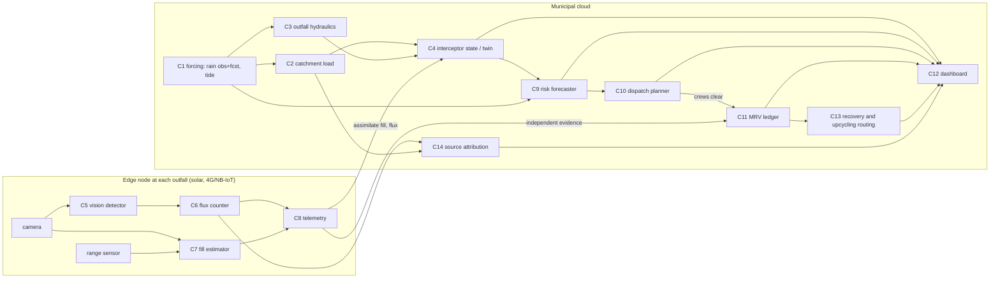

# Architecture — components and contracts

> Owner: project lead. Contracts (typed, pydantic v2): [`contracts/contracts.py`](contracts/contracts.py); JSON Schemas: [`contracts/schemas/`](contracts/schemas/) (regenerate with `python3 architecture/contracts/export_schemas.py`). Status of each component: [thought node](../thought_node.md#components). Spike choice: [ADR 001](adr/001-spike.md).

## 1. System in one paragraph
A *measured, tide-aware interception network* for Mumbai's nullah outfalls. Each outfall gets a flood-safe barrier and a solar edge node that counts floating plastic and senses how full the barrier is. A cloud twin combines that telemetry with real rainfall (observed + forecast) and predicted tides to forecast when each barrier will overflow, re-float or release; a dispatcher sends clearance crews *before* the pulse and in low-tide windows. Every clearance is written to a tamper-evident ledger and reconciled against independent sensor evidence, so contractors are paid per verified kilogram and the catch can be routed to recycling / co-processing with EPR paperwork. Outfall-level flux maps back to wards, so source reduction targets the worst catchments.

## 2. Dependency graph

## 3. Components
Each row is a deep module behind a typed seam: callers see only the contract types; any implementation (baseline, spike, auto-researched) can be swapped without touching neighbours.

| # | Component (folder) | Responsibility | Input → output (contract types) | Calls | Baseline | Isolated scalar metric | Error modes → behaviour | SLO (target) |
|---|---|---|---|---|---|---|---|---|
| C1 | Forcing — `components/twin_sim/forcing` | Hourly rain (observed, forecast) and tide at a site | `Site`, period → `ForcingSeries` | Open-Meteo APIs; tide source (see twin.md) | ERA5 reanalysis rain; tide predictions | tide RMSE vs gauge (when a gauge series is available) | API down → cached data + climatology flag; gaps → interpolate ≤3 h else mark missing | refresh hourly |
| C2 | Catchment load — `components/twin_sim/catchment_load` | Plastic arriving at the outfall | `ForcingSeries`, `CatchmentDescriptor` → `LoadSeries` | — | build-up / wash-off (first-flush) model | NSE vs observed boom catch (needs field data) | parameters outside range → clamp + warn | 1 site-season < 1 s |
| C3 | Outfall hydraulics — `components/twin_sim/hydraulics` | Flow, signed surface velocity and level at the barrier | `ForcingSeries`, `Site` → `HydraulicSeries` | — | rational method + tidal stage | — (validated with a velocity sensor later) | tide-locked outfall → velocity ≈ 0, flag | — |
| C4 | Interceptor model — `components/twin_sim/interceptor` | Barrier mass balance: capture, entrainment, overtopping, bypass, re-floating, clearance | `LoadSeries`, `HydraulicSeries`, clearances → `InterceptorSeries` | — | fixed-efficiency boom | capture efficiency vs flume runs (Round 2) | invariant breach → raise (mass-balance test) | — |
| C5 | Vision detector — `components/detection` | Floating plastic boxes per frame | image → `FrameDetections` | — | YOLO11n trained on a public floating-litter set | held-out test mAP50 | lens fouling / night / glare → low scores + health flag | ≤ 1 fps on edge NPU is enough |
| C6 | Flux counter — `components/detection` | Items crossing a line → items/min → kg | `FrameDetections` stream → `FluxEstimate` | C5 | ByteTrack + line crossing | count error % on a labelled sequence | ID switches in dense mats → cap by area-based estimate | 15-min windows |
| C7 | Fill estimator | How full the barrier pocket is | frame + range reading → `FillEstimate` | C5 (masks) | ultrasonic / ToF range to the debris mat | fill-fraction MAE vs labelled frames | foam/rain echoes → median filter, fuse with camera | 15-min |
| C8 | Edge telemetry | Reliable, small messages from the node | readings → `SiteTelemetry` | C6, C7 | MQTT over 4G Cat-1 / NB-IoT, store-and-forward | delivery rate; bytes/day | outage → buffer ≥7 days, resend | ≤ 1 KB / 15 min |
| C9 | Risk forecaster — `components/twin_sim/risk_forecaster` | P(overflow/release) and expected load for the next 24–48 h | `ForcingSeries` (fcst), state → `SiteForecast` | C1, C4 | rain-threshold rule | Brier score on held-out monsoons | forecast missing → persistence + wider interval | hourly |
| C10 | Dispatch planner — `components/twin_sim/dispatch` | Which crew clears which barrier when | `SiteForecast`s, states, `Crew`s → `DispatchPlan` | C9 | fixed schedule (status quo) | escaped kg on held-out monsoons at equal crew-hours | infeasible plan → greedy fallback | plan by 06:00 IST + re-plan on alerts |
| C11 | MRV ledger — `components/mrv_ledger` | Tamper-evident clearance records reconciled with independent evidence | `ClearanceRecord` + evidence → `LedgerEntry` | C7, C8, weighbridge | paper / manual weighbridge slips | recall of inflated claims at ≤5% false flags (synthetic); tamper detection 100% | missing evidence → `review` | append < 1 s |
| C12 | Dashboard — `components/dashboard` | One screen for ward engineers and crew supervisors | `DashboardBundle` → UI | all | — | task completion time (usability test, Round 2) | stale data → banner | static, offline-capable |
| C13 | Recovery & upcycling | Route the catch by category to recycling / co-processing; EPR paperwork | `CatchComposition` → `RecoveryRoute`s | C11 | kabadiwala sale + cement-kiln co-processing | ₹ recovered per tonne; diversion rate | unknown composition → manual sort sample | weekly |
| H1 | Barrier hardware — `deliverables/prototype-plan.md` (PLANNED) | Keep floating plastic out of the sea without raising flood levels: angled boom, one-way pocket that holds catch when the tide reverses, fail-open fuse at a set head | flow, tide → retained catch, head rise (modelled by C4) | — | BMC steel-net boom + conveyor | tow-tank T2 retention after N reversals; T3 head rise ≤ cap; T6 capture vs normal velocity | jam → fuse opens; fouling → crew checklist | no upstream head rise above the cap at design flow |
| C14 | Source attribution | Which wards leak most, for targeted collection and enforcement | `FluxEstimate`s by outfall + catchments → `WardHotspot`s | C6, C2 | complaint-driven | rank correlation with true sources (simulation) | sparse sensors → wide intervals | monthly |

## 4. Provenance rule
Every series carries a `Provenance.kind` (`observed`, `reanalysis`, `forecast`, `harmonic_prediction`, `model_output`, `simulated`, `synthetic`, `assumption`). The dashboard badges anything `simulated`/`synthetic` and `SiteTelemetry.simulated` must be `true` for twin output. This is how the walking skeleton stays honest while hardware does not yet exist.

## 5. Deployment view
- **Edge (per outfall):** camera + NPU board, range sensor, rain gauge, 4G/NB-IoT modem, solar + LiFePO4, IP-rated enclosure on a pole above the highest recorded water level. Runs C5–C8. Bill of materials: [`../deliverables/prototype-plan.md`](../deliverables/prototype-plan.md).
- **Cloud (municipal):** C1–C4 and C9–C14 as batch jobs (hourly) behind a static dashboard; the ledger is append-only storage with a public hash anchor.
- **Walking skeleton (tonight):** the twin generates SIMULATED telemetry for real sites under real rain and tide; the detector runs on a public dataset; the dashboard reads one validated `DashboardBundle`.

## 6. Glossary
- **Nullah** — open stormwater drain; in Mumbai also carries sewage and solid waste.
- **Outfall** — where a drain discharges to a creek or the sea; many are tide-locked by flap gates at high tide.
- **High-tide day** — a day the tide forecast exceeds the municipal threshold (≈4.5 m, to verify); rain on these days floods low areas.
- **Boom / barrier** — floating line with a skirt that deflects surface debris to a collection pocket.
- **Entrainment** — debris dragged under the skirt when flow is fast; **overtopping** — debris spilling over a full boom; **bypass** — water and debris going around/over at high stage or after a flood release; **re-floating** — trapped debris lifted and carried back by the flood tide.
- **First flush** — the early part of a storm that mobilises most of the accumulated litter.
- **Crew-hour** — one clearance crew working one hour; policies are compared at equal crew-hours.
- **MRV** — measurement, reporting and verification of quantities removed.
- **PIBO / EPR certificate** — producers, importers, brand owners under India's Plastic Waste Management Rules, who meet Extended Producer Responsibility targets with certificates generated by registered processors (details: [policy-economics](../research/components/policy-economics.md)).
