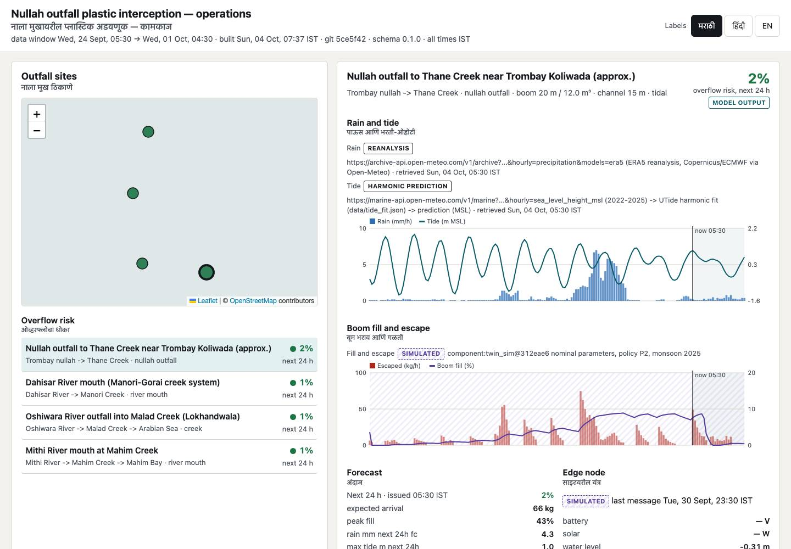
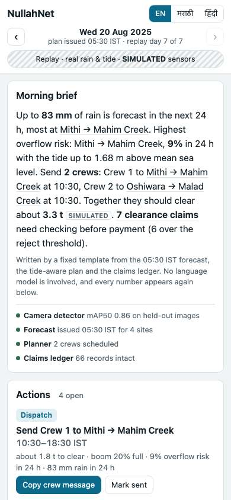
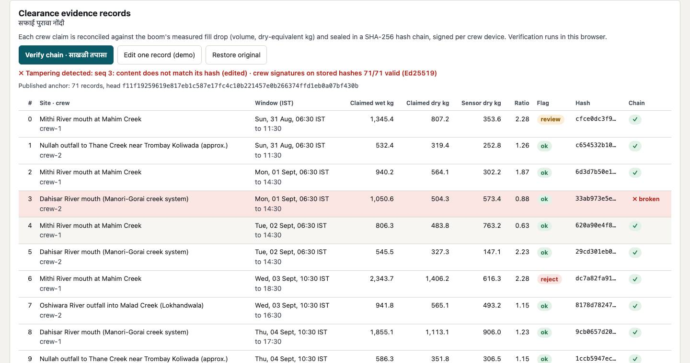

# C12 — Municipal operations dashboard (static, offline-capable)

One static page serves two users: a BMC ward engineer at a laptop and a crew supervisor on a phone. It covers outfall sites on an OSM map, **real** rain and tide with provenance, the digital twin's **SIMULATED** boom fill, escape and telemetry, the 48 h overflow-risk forecast, today's dispatch plan per policy, the clearance evidence records with **in-browser hash-chain and Ed25519 verification**, and component metrics. All times are IST. Headings carry Marathi or Hindi labels; these are draft translations, **UNVERIFIED** until a native speaker reviews them.



| Phone | Tamper demo (one claim edited in the browser) |
|---|---|
|  |  |

## Run
```bash
python3 innovatex-t3-coastal-plastic/components/dashboard/build_bundle.py      # merge inputs -> site/
cd innovatex-t3-coastal-plastic/components/dashboard/site && python3 -m http.server 8000
# open http://localhost:8000  (phone on the same Wi-Fi: http://<laptop-ip>:8000)
python3 innovatex-t3-coastal-plastic/components/dashboard/screenshot.py        # headless render, fails on JS errors
cd innovatex-t3-coastal-plastic/components && python3 -m pytest dashboard/tests -q   # 5 tests
```

## Data flow
`build_bundle.py` merges three inputs:
- `components/twin_sim/results/bundle_part.json` (sites, forcing, interceptor, forecasts, plans, telemetry, metrics)
- `components/detection/results/metrics.json` plus sample detections, when they exist
- a ledger built by C11 on the twin's clearance events

It validates the result with `contracts.DashboardBundle` and writes:
- `site/dashboard_bundle.json` — the contract; about 240 KB for a 6-day window plus 2 days ahead
- `site/aux.json` — anchor, Ed25519 signatures, key registry, synthetic ground truth, detection samples
- `site/data.js` — the same data, so the page also opens from `file://`

If the twin output is absent, `--mock` or the fallback uses `mock_inputs.py`. That mock is **SYNTHETIC** everywhere: site names end in "(mock)", positions are approximate, and a banner says so.

The current build uses the twin's real forcing:
- Rain is **ERA5 reanalysis via Open-Meteo**.
- Tide is a **harmonic prediction** (UTide fit to Open-Meteo marine sea level).
- Each provenance comes from the twin's own `Provenance` fields, shown as badges next to the chart.

Boom fill, escape and telemetry are `simulated` and drawn on a hatched background. The evidence records are **SYNTHETIC claims**: honest, plus about 20 % injected inflation or phantom trips laid on the twin's simulated clearances. Expand a row to see its injected label.

## Design decisions (assumptions, no user interview possible overnight)
- **Operate mode.** Light, high-contrast theme for outdoor phone use in daylight. System sans with Devanagari fallback. One sea-teal accent. Semantic colours: ok green, review amber, reject red. SIMULATED is violet, dashed and hatched; SYNTHETIC is brown and dashed; real data has a solid ink badge.
- **Phone.** Single column, a sticky section bar, tap targets of at least 44 px, and the site list ranked by risk so the map is optional.
- **Verification.** It runs locally. SHA-256 uses WebCrypto, with a pure-JS fallback for phones on plain-http LAN, which is not a secure context. Ed25519 uses WebCrypto where supported; Chromium headless verified 71/71. "Edit one record (demo)" raises one claim by 25 % in memory, and the chain check pinpoints that record.
- **Map.** Leaflet 1.9.4 is vendored (BSD-2-Clause, `site/vendor/leaflet/LICENSE`), so everything except the base tiles works offline.
  - OSM tiles follow the [OSMF tile usage policy](https://operations.osmfoundation.org/policies/tiles/) (opened 2026-10-04): HTTPS URL, visible attribution, Referer sent, **no bulk prefetch**.
  - Offline tiles for field use therefore need a self-hosted extract (next step, UNVERIFIED).
- **Forecasts and plans.** The page shows the shortest available horizon (the twin issues 48 h). Plans of the latest issue appear as policy tabs; P0 is labelled reference because the twin's metrics report P1/P2 "reduction vs P0".

## Not yet in
- Detection card: the C5 session has not yet published `metrics.json`, so the card shows its newest results file, `zeroshot_groningen_eval.json`: COCO YOLO11n zero-shot on the Groningen split, mAP50 0.405, with the source file named in the card. Sample images with boxes appear once `results/sample_detections.json` exists. Re-run `build_bundle.py` when it lands.
- No usability metric yet (task time). That is planned with real ward staff.
