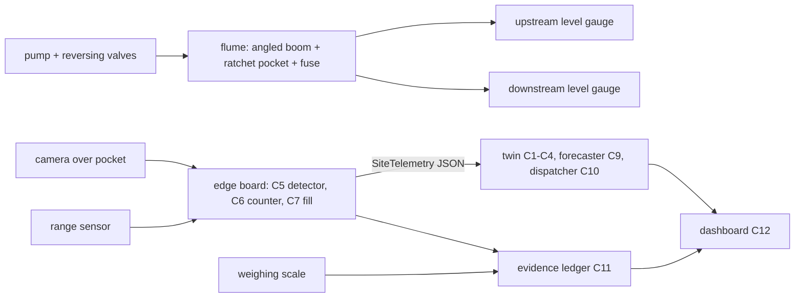

# Prototype plan — NullahNet (Round 2: report + working prototype due 1 Dec 2026)

> Draft v1, 4 Oct 2026, by the project lead. Labels used below:
> - **SIMULATED**, **SYNTHETIC**, **ASSUMPTION** — marked wherever they apply.
> - **⟨FILL⟩** — a price or number still to be pulled from the sourced BOM ([`../research/components/sensing-edge-bom.md`](../research/components/sensing-edge-bom.md)) or from a committed run.
> - **[V]** — a fact still to be verified.
>
> Architecture and contracts: [`../architecture/components.md`](../architecture/components.md). Spike rationale: [ADR 001](../architecture/adr/001-spike.md).

## 1. What we will demonstrate on 1 Dec and at the finals
1. **A. Reversible-flow flume demonstrator.** A tabletop model of a small tidal nullah outfall that pits three barrier designs against each other:
   - a straight boom;
   - an angled boom;
   - the **ratchet pocket with a fail-open fuse** (Spike 2).

   Flow can run "ebb" (seaward) or "flood" (landward). This shows capture, retention after the flow reverses, and the upstream head rise when the barrier is jammed.
2. **B. Edge sensor node** mounted over the flume pocket. It is the same design as the field node:
   - camera + range sensor;
   - computes pocket fill % and a floating-item count;
   - sends `SiteTelemetry` messages (see contracts) over Wi-Fi or 4G to the cloud.
3. **C. Cloud twin + dispatch + dashboard + evidence ledger** (software, already running as a walking skeleton):
   - the flume node appears as a *live* site next to SIMULATED Mumbai outfalls driven by real tide and rain data;
   - a clearance in the flume produces a signed, hash-chained ledger record reconciled against the before/after fill.

## 2. Flume design (A)
- **Channel.** A clear, straight channel about 2–2.5 m long and 0.25–0.30 m wide, built from acrylic sheet or a PVC/uPVC gutter section, with a 0.15–0.20 m water depth.
  - The two ends are sumps.
  - Two submersible pumps, or one pump with a 4-valve manifold, give **forward (ebb) and reverse (flood) flow**.
  - Surface velocity is set by pump choice and a gate. Target range: about 0.1–0.6 m/s, so tests straddle the speed at which booms start losing items under the skirt.

  These are design targets (ASSUMPTION). Velocity is measured by timing floats on phone video.
- **Barrier set-up.**
  - **Straight boom:** perpendicular to the flow.
  - **Angled boom:** about 30–45° to the flow, leading to a bank-side pocket.
  - **Ratchet pocket:** a funnel pocket at the bank, with light hinged one-way flaps. Flow carries items in; reversed flow presses the flaps shut. Flap material: HDPE sheet or a rubber flap on SS316 pins.
  - **Fail-open fuse:** a hinged boom section mid-channel, held by a calibrated counterweight or spring. It swings open when the head difference across the boom exceeds a set value, and recloses when flow drops. The pocket sits *outside* the fuse path, so stored catch stays when the fuse opens.
- **Test items.** Cut LDPE film and carry-bag pieces, empty multilayer sachets, small PET bottles and thermocol pieces, colour-tagged by type. A fixed mix per run.

  The mix proportions are an ASSUMPTION until a Mumbai composition survey is cited.
- **Scaling.** We claim *comparative* behaviour between designs (straight vs angled vs ratchet), not field efficiencies. Froude-similar velocities are noted for context only.

## 3. Test protocol and metrics (each test ≥5 repeats; report mean ± s.d.)
| Test | What we vary | Metric (scalar) | Pass / kill criterion |
|---|---|---|---|
| T1 Capture | design × velocity (3 levels) | captured items ÷ released items | — (characterisation) |
| **T2 Retention under reversal** (Spike 2 primary) | design × number of flow reversals (1, 3, 5) | items still held ÷ items captured | ratchet beats the angled boom by more than run-to-run s.d.; else drop the ratchet claim (ADR 001 kill criterion) |
| T3 Head rise and fuse | blockage (0–100%) × flow | upstream–downstream head difference; fuse opening head; items lost from the pocket at opening | head rise stays under a set cap at design flow; the pocket retains its catch when the fuse opens |
| T4 Fill alert (blinded) | fill states set by one teammate under glare, darkness, spray and occlusion | MAE of fill %; empty/half/full accuracy | — (characterisation; feeds C7) |
| T5 Clearance | pocket design | seconds to empty; kg per person-minute | — |

T2 and T3 feed the twin's ratchet sensitivity, replacing ASSUMPTION ranges with measured ones.

## 4. Bill of materials
All prices must come from a product page opened on a stated date. They are copied from [`../research/components/sensing-edge-bom.md`](../research/components/sensing-edge-bom.md) once that file lands. Until then, prices are **⟨FILL⟩** — never estimated here.

### 4A. Edge node (pilot field design; also used over the flume)
| # | Item | Purpose | Qty | Unit price (INR) | Source (URL, date) |
|---|---|---|---|---|---|
| 1 | Raspberry Pi 5 (4 GB or 8 GB) | edge compute | 1 | ⟨FILL⟩ | ⟨FILL⟩ |
| 2 | Raspberry Pi AI HAT+ (Hailo-8L) **or** Raspberry Pi AI Camera (IMX500) | on-device detector | 1 | ⟨FILL⟩ | ⟨FILL⟩ |
| 3 | Camera Module 3 (Wide / NoIR) | pocket view, IR at night | 1 | ⟨FILL⟩ | ⟨FILL⟩ |
| 4 | Waterproof ultrasonic (JSN-SR04T / A02YYUW) or ToF LiDAR (TF-Luna) | pocket level / water level | 1–2 | ⟨FILL⟩ | ⟨FILL⟩ |
| 5 | Tipping-bucket rain gauge | local rain | 1 | ⟨FILL⟩ | ⟨FILL⟩ |
| 6 | 4G Cat-1 modem (e.g. SIMCom A7670 / SIM7600) + IoT SIM | telemetry | 1 | ⟨FILL⟩ | ⟨FILL⟩ |
| 7 | Solar panel (sized below) + MPPT controller | power | 1 | ⟨FILL⟩ | ⟨FILL⟩ |
| 8 | 12 V LiFePO4 battery (sized below) | ≥3 days of autonomy | 1 | ⟨FILL⟩ | ⟨FILL⟩ |
| 9 | IP67 enclosure, cable glands, SS316 pole clamps | corrosion and weather | 1 set | ⟨FILL⟩ | ⟨FILL⟩ |
| 10 | Tilt/tamper switch, GPS module | theft and tamper flags | 1 | ⟨FILL⟩ | ⟨FILL⟩ |
| | **Subtotal A** | | | ⟨FILL⟩ | |

### 4B. Flume demonstrator
| # | Item | Qty | Unit price (INR) | Source (URL, date) |
|---|---|---|---|---|
| 1 | Acrylic sheet or uPVC gutter sections + end caps | ⟨FILL⟩ | ⟨FILL⟩ | ⟨FILL⟩ |
| 2 | Submersible pumps (12 V DC or mains) ×2, or 1 + valve manifold | 2 | ⟨FILL⟩ | ⟨FILL⟩ |
| 3 | Ball valves, hose, fittings | 1 set | ⟨FILL⟩ | ⟨FILL⟩ |
| 4 | HDPE / PVC pipe for boom floats; nylon or HDPE netting for the skirt | 1 set | ⟨FILL⟩ | ⟨FILL⟩ |
| 5 | HDPE sheet / rubber for flaps; SS316 pins, springs, counterweights | 1 set | ⟨FILL⟩ | ⟨FILL⟩ |
| 6 | Two ultrasonic level sensors + microcontroller (ESP32) for head difference | 1 set | ⟨FILL⟩ | ⟨FILL⟩ |
| 7 | Kitchen / hanging scale (0.1 g–5 kg) | 1 | ⟨FILL⟩ | ⟨FILL⟩ |
| | **Subtotal B** | | ⟨FILL⟩ | |

### 4C. Software and cloud
Open-source stack (Python, ultralytics, Leaflet). Data comes from free APIs (Open-Meteo; tide source per [`../research/components/twin.md`](../research/components/twin.md)). Hosting is a static site plus hourly batch jobs; an Azure student/VS subscription is enough for the prototype. Cost per site at scale: ⟨FILL⟩.

## 5. Power budget and solar sizing (edge node)
| Load | Power (W) | Duty cycle | Wh/day |
|---|---|---|---|
| Edge board + NPU (inference every 1–5 min, sleep in between) | ⟨FILL from datasheets⟩ | ⟨FILL⟩ | ⟨FILL⟩ |
| Camera | ⟨FILL⟩ | ⟨FILL⟩ | ⟨FILL⟩ |
| 4G modem (bursts every 15 min) | ⟨FILL⟩ | ⟨FILL⟩ | ⟨FILL⟩ |
| Sensors | ⟨FILL⟩ | ⟨FILL⟩ | ⟨FILL⟩ |
| **Total** | | | ⟨FILL⟩ |

- **Panel sizing:** panel W = daily Wh ÷ (July peak-sun-hours × system efficiency).
- **Battery sizing:** battery Wh = daily Wh × 3 days ÷ usable depth of discharge.
- **Inputs:** July all-sky insolation for Mumbai from NASA POWER (query recorded in the BOM file) ⟨FILL⟩. July is the design month because monsoon cloud is worst then.

## 6. Build schedule (around the 10 Oct zonal and the 19–25 Nov exams)
| Window | Work | Owner |
|---|---|---|
| 4–9 Oct | Software skeleton live: twin on real data, dashboard, ledger, detector baseline. **Optional before 10 Oct:** a 2-hour tabletop reversal test (a box, a small pump, film pieces, phone video), so the pitch can show T2 evidence | lead + teammate with hands-on skills |
| 10 Oct | Zonal pitch | team |
| 11–25 Oct | Buy parts (sourced BOM); build flume v1; run T1–T3; edge node v1 (bench) | hardware teammate(s) |
| 26 Oct – 10 Nov | Edge node over the flume (T4); live telemetry into the twin; fuse abuse tests (repeated cycles, salt water, grit, cloth tangles) | team |
| 11–17 Nov | Freeze prototype; record demo video; draft report | team |
| 19–25 Nov | **Exams: no user-dependent work** | — |
| 26 Nov – 1 Dec | Final report (solution, prototype evidence, cost and market, implementation, scalability, impact) submitted by the team leader on the website | user (team leader) |
| 15–18 Dec | Finals: live flume + dashboard demo | team |

## 7. What is real, what is simulated (status at 4 Oct)
- **Real:** hourly rainfall (ERA5 reanalysis via Open-Meteo); tides (source and validation in [`twin.md`](../research/components/twin.md)); site coordinates; public detection dataset metrics.
- **SIMULATED:** every sensor reading, boom fill and escaped kg at Mumbai sites (digital twin, process parameters per [`twin.md`](../research/components/twin.md), Monte Carlo over ASSUMPTION ranges).
- **SYNTHETIC:** contractor clearance records used to test the evidence ledger. Current results are in [`../components/mrv_ledger/`](../components/mrv_ledger/); reproduce with `cd innovatex-t3-coastal-plastic/components && python3 -m mrv_ledger.evaluate`.
  - Inflated-claim recall: 0.716 at a 0.047 false-flag rate.
  - Precision: 0.445 at 5% fraud prevalence and 0.629 at 10%.
  - Tamper detection: 1.0.
  - A simple claimed-vs-sensor ratio baseline reaches 0.675 recall.

## 8. Field pilot (after the prototype; needs permissions)
- **Sites:** 2–3 small outfalls in one ward — one behind a tide-locked flap gate, one open tidal — chosen away from The Ocean Cleanup's Malad and Trombay sites [S1][S2 in the pitch].
- **Measurements:**
  - pocket fill (camera + range);
  - weighbridge kg per clearance;
  - random sort samples for the dry-plastic fraction;
  - **tagged-item releases** upstream to measure flux-weighted capture efficiency across tide and flow states.
- **Permissions and safety:**
  - MCGM Storm Water Drain department permission is required. The Ocean Cleanup obtained such permits for its sites [S2].
  - Crew safety rules apply: no work during red alerts, no entry into flowing channels.

## 9. Risks and mitigations
| Risk | Mitigation |
|---|---|
| Ratchet flaps foul with hyacinth, rags or silt | Test with cloth and grit (fuse abuse tests); flap clearance in the crew checklist; drop the claim if T2 fails |
| Fuse opens at peaks by design → losses | Pocket outside the fuse path; report FWCE honestly; dispatch empties pockets before forecast surges |
| Camera blind at night, in rain and with glare | IR camera + range sensor; primary metric is fill, not counts; health flags |
| Monsoon power deficit | July-sized panel + 3-day battery; adaptive duty cycle |
| Theft or vandalism | Pole mount above reach; tamper switch; GPS; no exposed valuables |
| Simulation circularity | Relative claims only; Monte Carlo; archived forecasts; field calibration plan |

## 10. Needs from the user
- **Team:** a teammate with fabrication skills for the flume (and ideally the edge node).
- **Purchases:** parts per the BOM once priced (⟨FILL⟩ total).
- **Before the zonal (optional):** a ~2-hour tabletop reversal test before 10 Oct.
