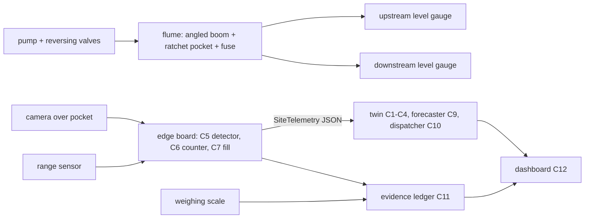

# Prototype plan — NullahNet (Round 2: report + working prototype due 1 Dec 2026)

> Draft v1, 4 Oct 2026, by the project lead. Labels used below:
> - **SIMULATED**, **SYNTHETIC**, **ASSUMPTION** — marked wherever they apply.
> - **⟨FILL⟩** — a price or number still to be pulled from the sourced BOM ([`../research/components/sensing-edge-bom.md`](../research/components/sensing-edge-bom.md)) or from a committed run.
> - **[V]** — a fact still to be verified.
>
> Architecture and contracts: [`../architecture/components.md`](../architecture/components.md). Spike rationale: [ADR 001](../architecture/adr/001-spike.md).

## 1. What we will demonstrate on 1 Dec and at the finals
1. **A. Reversible-flow flume demonstrator.** A tabletop model of a small tidal nullah outfall that pits three barrier designs against each other:
   - a straight boom;
   - an angled boom;
   - the **ratchet pocket with a fail-open fuse** (Spike 2).

   Flow can run "ebb" (seaward) or "flood" (landward). This shows capture, retention after the flow reverses, and the upstream head rise when the barrier is jammed.
2. **B. Edge sensor node** mounted over the flume pocket. It is the same design as the field node:
   - camera + range sensor;
   - computes pocket fill % and a floating-item count;
   - sends `SiteTelemetry` messages (see contracts) over Wi-Fi or 4G to the cloud.
3. **C. Cloud twin + dispatch + dashboard + evidence ledger** (software, already running as a walking skeleton):
   - the flume node appears as a *live* site next to SIMULATED Mumbai outfalls driven by real tide and rain data;
   - a clearance in the flume produces a signed, hash-chained ledger record reconciled against the before/after fill.

## 2. Flume design (A)
- **Channel.** A clear, straight channel about 2–2.5 m long and 0.25–0.30 m wide, built from acrylic sheet or a PVC/uPVC gutter section, with a 0.15–0.20 m water depth.
  - The two ends are sumps.
  - Two submersible pumps, or one pump with a 4-valve manifold, give **forward (ebb) and reverse (flood) flow**.
  - Surface velocity is set by pump choice and a gate. Target range: about 0.1–0.6 m/s, so tests straddle the speed at which booms start losing items under the skirt.

  These are design targets (ASSUMPTION). Velocity is measured by timing floats on phone video.
- **Barrier set-up.**
  - **Straight boom:** perpendicular to the flow.
  - **Angled boom:** about 30–45° to the flow, leading to a bank-side pocket.
  - **Ratchet pocket:** a funnel pocket at the bank, with light hinged one-way flaps. Flow carries items in; reversed flow presses the flaps shut. Flap material: HDPE sheet or a rubber flap on SS316 pins.
  - **Fail-open fuse:** a hinged boom section mid-channel, held by a calibrated counterweight or spring. It swings open when the head difference across the boom exceeds a set value, and recloses when flow drops. The pocket sits *outside* the fuse path, so stored catch stays when the fuse opens.
- **Test items.** Cut LDPE film and carry-bag pieces, empty multilayer sachets, small PET bottles and thermocol pieces, colour-tagged by type. A fixed mix per run.

  The mix proportions are an ASSUMPTION until a Mumbai composition survey is cited.
- **Scaling.** We claim *comparative* behaviour between designs (straight vs angled vs ratchet), not field efficiencies. Froude-similar velocities are noted for context only.

## 3. Test protocol and metrics (each test ≥5 repeats; report mean ± s.d.)
| Test | What we vary | Metric (scalar) | Pass / kill criterion |
|---|---|---|---|
| T1 Capture | design × velocity (3 levels) | captured items ÷ released items | — (characterisation) |
| **T2 Retention under reversal** (Spike 2 primary) | design × number of flow reversals (1, 3, 5) | items still held ÷ items captured | ratchet beats the angled boom by more than run-to-run s.d.; else drop the ratchet claim (ADR 001 kill criterion) |
| T3 Head rise and fuse | blockage (0–100%) × flow | upstream–downstream head difference; fuse opening head; items lost from the pocket at opening | head rise stays under a set cap at design flow; the pocket retains its catch when the fuse opens |
| T4 Fill alert (blinded) | fill states set by one teammate under glare, darkness, spray and occlusion | MAE of fill %; empty/half/full accuracy | — (characterisation; feeds C7) |
| T5 Clearance | pocket design | seconds to empty; kg per person-minute | — |

T2 and T3 feed the twin's ratchet sensitivity, replacing ASSUMPTION ranges with measured ones.

## 4. Bill of materials
All prices must come from a product page opened on a stated date. They are copied from [`../research/components/sensing-edge-bom.md`](../research/components/sensing-edge-bom.md) once that file lands. Until then, prices are **⟨FILL⟩** — never estimated here.

_Copied verbatim from [`../research/components/sensing-edge-bom.md`](../research/components/sensing-edge-bom.md) (every price from an Indian retailer product page opened 2026-10-04; GST inclusion UNVERIFIED). Flume structure (channel, pumps, valves, boom materials, test items) is not yet priced — **⟨FILL⟩** before purchase._

#### 4A. BOM A — pilot field node (one nullah outfall, solar profile P1)
| Function | Item (as listed by retailer) | Qty | Unit ₹ | Line ₹ | Retailer page (opened 2026-10-04) |
|---|---|---:|---:|---:|---|
| Compute | Raspberry Pi 5, 8GB variant (in stock; 4GB ₹16,199.99 out of stock) | 1 | 21,199.99 | 21,199.99 | https://thinkrobotics.com/products/raspberry-pi-5 |
| AI accelerator | Official Raspberry Pi AI HAT+ 13 TOPS (Hailo-8L) | 1 | 6,854.00 | 6,854.00 | https://quartzcomponents.com/products/official-raspberry-pi-ai-hat-13-tops |
| Camera | Raspberry Pi Camera Module 3 | 1 | 3,245.00 | 3,245.00 | https://robocraze.com/products/raspberry-pi-camera-module-3 |
| Backhaul (images + telemetry) | Waveshare SIM7600E-H 4G HAT for Raspberry Pi, LTE Cat-4, GNSS | 1 | 9,149.99 | 9,149.99 | https://thinkrobotics.com/products/sim7600e-h-4g-hat-for-raspberry-pi-lte-cat-4-4g-3g-2g-gnss |
| Water/boom-fill level | DFRobot A02YYUW waterproof ultrasonic distance sensor, 3–450 cm (retailer title) | 1 | 2,259.00 | 2,259.00 | https://robocraze.com/products/dfrobot-a02yyuw-waterproof-ultrasonic-distance-sensor |
| Solar | Loom Solar Mono PERC half-cut 55 Wp 12 V panel (x2 = 110 Wp for profile P1) | 2 | 2,200.00 | 4,400.00 | https://www.loomsolar.com/products/loom-solar-panel-55-watt-mono-crystalline |
| Storage battery | CAML 12.8 V 100 Ah (1.28 kWh) LiFePO4 — smallest 12.8 V LiFePO4 found on an opened Indian page; ~5.3 days of P1 autonomy at 80% DoD (1,280 × 0.8 / 192) | 1 | 34,500.00 | 34,500.00 | https://www.loomsolar.com/products/caml-10012-low-voltage-lithium-battery |
| Charge controller | 20A Digital PWM Solar Controller with LCD + USB (LiFePO4 profile support UNVERIFIED) | 1 | 339.00 | 339.00 | https://robocraze.com/products/20a-digital-pwm-solar-controller-with-lcd-and-usb-output-port |
| 12 V → 5 V | SmartElex TPS5430 buck module 5 V 3 A (below the official 5 V/5 A, 27 W PSU rating — bench-test; upgrade if brown-outs) | 1 | 335.00 | 335.00 | https://robocraze.com/products/smartelex-tps5430-buck-module-5v-3a-dc-dc-converter |
| **Subtotal (priced items)** | | | | **82,281.98** | |

Not priced from an opened page (**ESTIMATE**, excluded from subtotal): IP65/IP66 enclosure big enough for Pi 5 + HAT + 4G HAT (the only IP65 box found was 90×90×60 mm, ₹458 — too small: https://quartzcomponents.com/products/plastic-enclosure-90x90x60-mm-for-adapters-led-drivers-general-purpose-housing); microSD/SSD; GI pole + clamps; cable glands; surge/lightning protection; IR illuminator for night; installation labour; SIM data plan.
Cost levers: profile P2 (duty-cycled) needs one 55 Wp panel and a ~300 Wh pack instead of 1.28 kWh — the battery is ~50% of BOM A; a 4S LiFePO4 pack with a DALY 4S 12 V 40 A BMS (₹1,125, https://quartzcomponents.com/products/daly-lifepo4-4s-12v-40a-waterproof-battery-management-system-bms-protection-board) is the cheaper build-your-own route (cells not priced).

#### 4B. BOM B — student flume prototype (bench, mains-powered)
| Function | Item (as listed by retailer) | Qty | Unit ₹ | Line ₹ | Retailer page (opened 2026-10-04) |
|---|---|---:|---:|---:|---|
| Compute | Raspberry Pi 5, 8GB | 1 | 21,199.99 | 21,199.99 | https://thinkrobotics.com/products/raspberry-pi-5 |
| AI accelerator | Official Raspberry Pi AI HAT+ 13 TOPS (same stack as the field node, so models transfer) | 1 | 6,854.00 | 6,854.00 | https://quartzcomponents.com/products/official-raspberry-pi-ai-hat-13-tops |
| Camera | Raspberry Pi Camera Module 3 | 1 | 3,245.00 | 3,245.00 | https://robocraze.com/products/raspberry-pi-camera-module-3 |
| Power | Official Raspberry Pi 5 27W USB-C PD power supply | 1 | 1,249.00 | 1,249.00 | https://robocraze.com/products/raspberry-pi-5-27w-usb-c-power-supply-black-colour |
| Level in flume | Waterproof ultrasonic distance transducer (JSN-SR04T class) | 1 | 295.00 | 295.00 | https://quartzcomponents.com/products/waterproof-ultrasonic-distance-transducer-sensor |
| Sensor/actuator MCU | ESP32 38-pin WiFi + Bluetooth NodeMCU dev board (pump/gate control, level logging) | 1 | 425.00 | 425.00 | https://robocraze.com/products/esp32-development-board |
| LPWAN demo link | SX1278 LoRa module Ra-02 433 MHz (pair; note India's LoRaWAN band is 865–867 MHz — use for bench demo only) | 2 | 345.00 | 690.00 | https://robocraze.com/products/sx1278-lora-module-ra-02-433mhz-wireless-spread-spectrum-transmission |
| **Subtotal (priced items)** | | | | **33,957.99** | |

Not priced (**ESTIMATE**, excluded): acrylic/PVC flume channel + submersible pump + valve; mock boom (PVC pipe + mesh skirt); tide simulator (second pump on a timer via the ESP32); plastic test items (real bags/sachets/bottles).
Cheaper variant: drop the AI HAT+ and use the Raspberry Pi AI Camera (₹8,339) for on-sensor inference → saves ₹6,854 + ₹3,245 − ₹8,339 = ₹1,760, at the cost of a smaller model.

### 4C. Software and cloud
Open-source stack (Python, ultralytics, Leaflet). Data comes from free APIs (Open-Meteo; tide source per [`../research/components/twin.md`](../research/components/twin.md)). Hosting is a static site plus hourly batch jobs; an Azure student/VS subscription is enough for the prototype. Cost per site at scale: ⟨FILL⟩.

## 5. Power budget and solar sizing (edge node)
NASA POWER climatology for Mumbai (19.07 N, 72.85 E), all-sky surface shortwave, kWh/m²/day — query and caveats in [`sensing-edge-bom.md`](../research/components/sensing-edge-bom.md) §1:

| Jan | Feb | Mar | Apr | May | Jun | Jul | Aug | Sep | Oct | Nov | Dec | Annual |
|---:|---:|---:|---:|---:|---:|---:|---:|---:|---:|---:|---:|---:|
| 4.8833 | 5.7439 | 6.5887 | 7.0786 | 7.0942 | 5.0006 | **3.7920** | 4.0363 | 4.7818 | 5.2109 | 4.8430 | 4.5336 | 5.2942 |

- Design month = **July (3.79 kWh/m²/day ≈ 3.79 peak-sun-hours)**, i.e. 53% of the May peak — and July is exactly when nullahs carry the most plastic. Size for July, not the annual mean.

July (≈3.79 peak-sun-hours, about half of May) is the design month, and it is also the month of peak plastic flux.

### Sizing (ESTIMATE; loads are ASSUMPTIONS until bench-measured) (ESTIMATE — reproducible)
`P_panel_W = E_load_Wh_per_day / (PSH_July × η_system)`, `C_batt_Wh = E_load_Wh_per_day × autonomy_days / DoD`, with η_system = 0.65 (PWM/MPPT, temperature, soiling, battery round-trip — **ASSUMPTION**), DoD = 0.8 for LiFePO4 (**ASSUMPTION**), autonomy = 3 days (**ASSUMPTION** for monsoon).

| Profile | Avg load (ASSUMPTION) | E_load Wh/day | Panel W (July) | Pick | Battery Wh (3 days) | Pick |
|---|---:|---:|---:|---|---:|---|
| P1 — Pi 5 + AI HAT+ + camera + 4G, inference 24 h | 8 W | 192 | 192/(3.79×0.65) = **78 W** | 100 W | 192×3/0.8 = **720 Wh** | 12.8 V 60 Ah LiFePO4 (768 Wh) |
| P2 — duty-cycled: 2 min of video per 10 min in daylight + event-triggered; modem sleeps | 3 W | 72 | 72/(3.79×0.65) = **29 W** | 40 W | 72×3/0.8 = **270 Wh** | 12.8 V 24 Ah (307 Wh) |
| P3 — Raspberry Pi AI Camera (on-sensor inference) + Pi Zero 2 W class host + NB-IoT/LoRa telemetry | 1.5 W | 36 | 36/(3.79×0.65) = **15 W** | 20 W | 36×3/0.8 = **135 Wh** | 12.8 V 12 Ah (154 Wh) |

## 6. Build schedule (around the 10 Oct zonal and the 19–25 Nov exams)
| Window | Work | Owner |
|---|---|---|
| 4–9 Oct | Software skeleton live: twin on real data, dashboard, ledger, detector baseline. **Optional before 10 Oct:** a 2-hour tabletop reversal test (a box, a small pump, film pieces, phone video), so the pitch can show T2 evidence | lead + teammate with hands-on skills |
| 10 Oct | Zonal pitch | team |
| 11–25 Oct | Buy parts (sourced BOM); build flume v1; run T1–T3; edge node v1 (bench) | hardware teammate(s) |
| 26 Oct – 10 Nov | Edge node over the flume (T4); live telemetry into the twin; fuse abuse tests (repeated cycles, salt water, grit, cloth tangles) | team |
| 11–17 Nov | Freeze prototype; record demo video; draft report | team |
| 19–25 Nov | **Exams: no user-dependent work** | — |
| 26 Nov – 1 Dec | Final report (solution, prototype evidence, cost and market, implementation, scalability, impact) submitted by the team leader on the website | user (team leader) |
| 15–18 Dec | Finals: live flume + dashboard demo | team |

## 7. What is real, what is simulated (status at 4 Oct)
- **Real:** hourly rainfall (ERA5 reanalysis via Open-Meteo); tides (source and validation in [`twin.md`](../research/components/twin.md)); site coordinates; public detection dataset metrics.
- **SIMULATED:** every sensor reading, boom fill and escaped kg at Mumbai sites (digital twin, process parameters per [`twin.md`](../research/components/twin.md), Monte Carlo over ASSUMPTION ranges).
- **SYNTHETIC:** contractor clearance records used to test the evidence ledger. Current results are in [`../components/mrv_ledger/`](../components/mrv_ledger/); reproduce with `cd innovatex-t3-coastal-plastic/components && python3 -m mrv_ledger.evaluate`.
  - Inflated-claim recall: 0.716 at a 0.047 false-flag rate.
  - Precision: 0.445 at 5% fraud prevalence and 0.629 at 10%.
  - Tamper detection: 1.0.
  - A simple claimed-vs-sensor ratio baseline reaches 0.675 recall.

## 8. Field pilot (after the prototype; needs permissions)
- **Sites:** 2–3 small outfalls in one ward — one behind a tide-locked flap gate, one open tidal — chosen away from The Ocean Cleanup's Malad and Trombay sites [S1][S2 in the pitch].
- **Measurements:**
  - pocket fill (camera + range);
  - weighbridge kg per clearance;
  - random sort samples for the dry-plastic fraction;
  - **tagged-item releases** upstream to measure flux-weighted capture efficiency across tide and flow states.
- **Permissions and safety:**
  - MCGM Storm Water Drain department permission is required. The Ocean Cleanup obtained such permits for its sites [S2].
  - Crew safety rules apply: no work during red alerts, no entry into flowing channels.

## 9. Risks and mitigations
| Risk | Mitigation |
|---|---|
| Ratchet flaps foul with hyacinth, rags or silt | Test with cloth and grit (fuse abuse tests); flap clearance in the crew checklist; drop the claim if T2 fails |
| Fuse opens at peaks by design → losses | Pocket outside the fuse path; report FWCE honestly; dispatch empties pockets before forecast surges |
| Camera blind at night, in rain and with glare | IR camera + range sensor; primary metric is fill, not counts; health flags |
| Monsoon power deficit | July-sized panel + 3-day battery; adaptive duty cycle |
| Theft or vandalism | Pole mount above reach; tamper switch; GPS; no exposed valuables |
| Simulation circularity | Relative claims only; Monte Carlo; archived forecasts; field calibration plan |

## 10. Needs from the user
- **Team:** a teammate with fabrication skills for the flume (and ideally the edge node).
- **Purchases:** priced electronics are ₹82,282 for the field node (BOM A) and ₹33,958 for the flume electronics (BOM B), plus flume structure (⟨FILL⟩). Approve before buying.
- **Before the zonal (optional):** a ~2-hour tabletop reversal test before 10 Oct.
