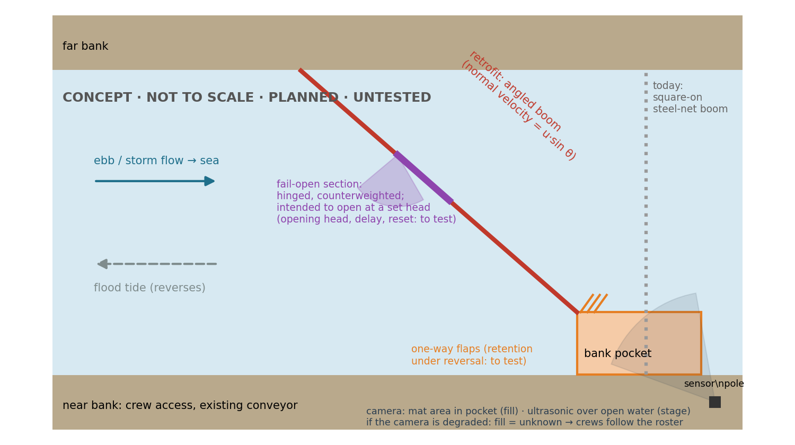
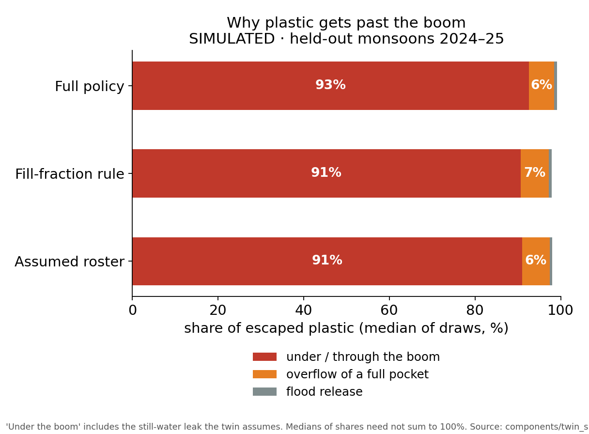
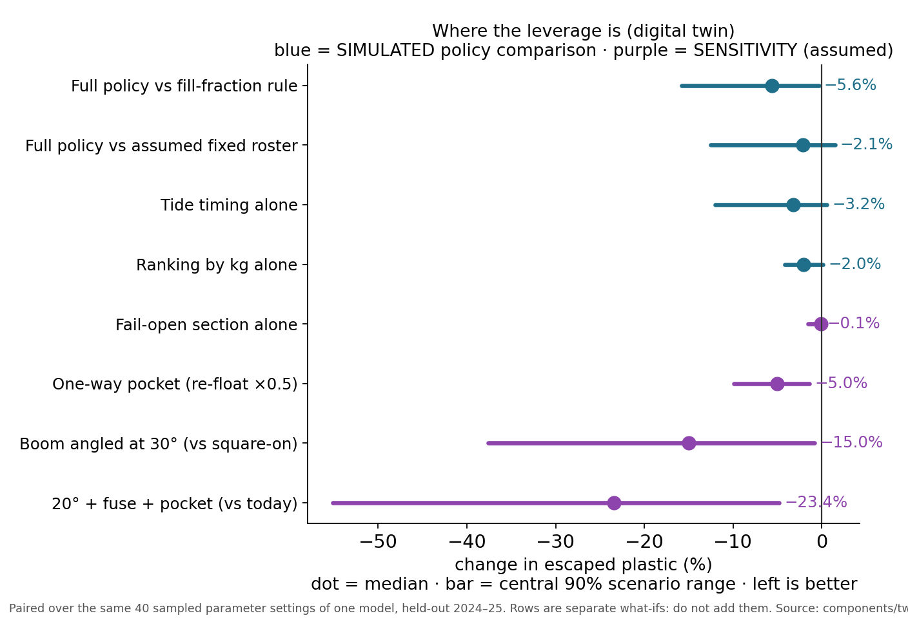

---
# GENERATED by eval/render_docs.py from deliverables/src/zonal-deck.md and committed results; edit the source, not this file.
marp: true
theme: default
paginate: true
size: 16:9
header: "NullahNet · InnovateX 2026 · Theme 3 · Delhi zonal"
footer: "Every number: research/fact-check.md or eval/RESULTS.md"
style: |
  section { font-size: 23px; }
  h1 { font-size: 36px; }
  table { font-size: 18px; }
  .small { font-size: 15px; color: #555; }
  .tag { font-size: 14px; font-weight: 700; padding: 1px 6px; border-radius: 4px; background: #eef2f5; }
---

<!-- _class: lead -->
# NullahNet
### Retrofit Mumbai's nullah trash booms: time clearance to the tide, test a boom that keeps its catch, and pay on evidenced kilograms

**Team:** ‹TEAM NAME› · **Team ID:** ‹ID› · **Theme 3:** Rising plastic pollution in coastal cities
‹Member 1 — role› · ‹Member 2 — role› · ‹Member 3 — role› · ‹Member 4 — role› · ‹email / phone›

BUILT software we ran · SIMULATED digital-twin output · SYNTHETIC generated test data · SENSITIVITY assumption-driven · PLANNED not built yet

<!--
TIME 0:00–0:25 (25 s). LOGISTICS: present zonal-deck.pdf from your own laptop; the dashboard open in a second tab (bash deliverables/serve_dashboard.sh, then http://localhost:8765); it runs offline except the map tiles.
SAY: "We're ‹team›. We picked one leak: floating single-use packaging escaping through Mumbai's storm-water outfalls. Mumbai already runs trash booms. We propose to make them measurable and better timed, and to test a retrofit that keeps more of what they catch."
LINE TO LAND: "Not another barrier: a way to make the city's existing barriers accountable."
DON'T SAY "we built a prototype". The software is built; the hardware is PLANNED.
-->

---

# The leak, and the plastic we target

| What | Value | Source |
|---|---|---|
| Plastic released to the sea by the metropolitan region | an estimated 5 million kg a year | The Ocean Cleanup survey, 10 Feb 2026 (an estimate) |
| Main pathways | "around 50 drains and nullahs" | Lokmat Times (2026), reporting the same study |
| What one wet spell brings back | BMC removed 2,498.66 t from seven beaches in 11 days; BMC said the rain washed refuse "from drains and natural waterways into the Arabian Sea" and "high tides then carried the waste back" | Mumbai Live, Jul 2026 |
| What the litter is | Plastic was 75.5 % of 52,770 beach litter items (Juhu, Aksa) | ICAR-CIFE study via HT, 2023 |

**Our source:** floating single-use *flexible* packaging (carry bags, films, multilayer sachets). It has almost no resale value: waste-picker groups report it is disregarded and sometimes given to cement kilns for free (Break Free From Plastic, 2023). It is light, so storms flush it into the nullahs.

<!--
TIME 0:25–1:25 (60 s).
SAY: "The 5-million-kilogram figure in the problem statement is The Ocean Cleanup's 2026 estimate for the region. BMC itself describes the cycle: July rain washed refuse from drains into the sea, and high tides carried it back onto the beaches. Most beach litter is plastic. We target the film and sachets that nobody is paid to collect."
LINE TO LAND: "We target the plastic nobody is paid to collect."
DON'T SAY the tonnage was measured. It is a survey estimate. DON'T SAY "pickers never collect film"; the source says it is disregarded and low-value.
-->

---

# NullahNet in one picture CONCEPT · PLANNED

**Mornings:** the ward engineer sees each boom's fill plus tomorrow's tide and rain, and gets a clearance plan. **Crews** clear in safe tide windows. **Each clearance** yields a signed record (photos, weighbridge slip, GPS) checked against the sensors. **The retrofit** is a design to test, not a proven device.

<!--
TIME 1:25–2:30 (65 s).
SAY: "Here is the whole idea on one drawing. Today's boom sits square across the nullah. We would angle it, lead the catch into a bank-side pocket with one-way flaps, and put a hinged section in the middle that is meant to swing open before the boom backs water up. A camera watches the pocket; an ultrasonic sensor watches the water level. In the morning, the engineer gets a plan; after each clearance, a signed record."
LINE TO LAND: "One operator decision changes: when the crew goes, and what proves what they removed."
DON'T SAY the release "can't fail" or that the pocket "keeps everything". The opening head, delay, fouling and retention during release are exactly what we test.
-->

---

# Mumbai already intercepts. Our gap is a hypothesis to test.

| Who | What they do | Scale (source) |
|---|---|---|
| **BMC** | Steel-net booms with conveyors at nullah mouths, since July 2022 on NGT directions; cleared daily by contractors | A May 2025 report: 9 booms, expanding to 23, about ₹1 crore each, 1.5 t/day dry and 2.5–3 t/day monsoon per boom (HT; current count UNVERIFIED). Operations and maintenance: ₹14.5 crore for two years across six rivers and nullahs (FPJ, Jul 2026) |
| **The Ocean Cleanup + Plastic Fischer** | Interceptors at Malad and Trombay creeks (MCGM permits, MPCB MoU) | 61 to 92 tonnes a year expected from the first systems, ≈ 1.2–1.8 % of the estimate |
| **Plastic Fischer** | TrashBooms, including one at Usha Nagar, Bhandup; kilograms verified by third-party software | 3.2 million kg across 8 sites in India and Indonesia |

**What we propose to test:** we found no public evidence that BMC's booms report their fill or are cleared by tide and forecast. Our hypothesis is that adding both, plus records checked against sensors, improves this existing workflow. Context, not proof of any contractor's conduct: in the Mithi desilting case, a police SIT's FIR alleges a loss to BMC of more than ₹65.54 crore (under investigation; The Hindu, May 2025).

<!--
TIME 2:30–3:25 (55 s).
SAY: "This is not an empty field. BMC has booms and a maintenance contract; The Ocean Cleanup is coming to Malad and Trombay; Plastic Fischer already runs booms and verifies kilograms. What we couldn't find in public is fill sensing or tide-timed clearance at BMC's booms. That's our hypothesis to test with BMC, not a claim that nobody does it."
LINE TO LAND: "We build on the city's booms and their verification norms; we don't compete with them."
DON'T SAY "the booms have no sensors" or "nobody does this". Say "we found no public evidence". DON'T SAY anything about guilt in the Mithi case.
-->

---

# Why booms leak, according to our twin SIMULATED

Twin of four Mumbai outfalls: real rain, forecasts and tide; *assumed* plastic and boom behaviour; held-out 2024–25; 40 parameter settings.
- **92.5%** of escape passes under or through the boom (central 90% scenario range 64.6%–100.0%); overflow 5.9%; flood release 0.7%
- But 51% of escape is a still-water leak we *assumed*; 38% is speed-driven; only 13.2% of plastic arrives at high speed
- Oil-boom guidance, as an analogy: booms leak above about 0.35 m/s across the boom

**Measure first:** a real boom's still-water leak, then capture vs speed, angle and retention (tow tank).

<!--
TIME 3:25–4:20 (55 s).
SAY: "In our model, most plastic escapes by slipping under or through the boom, not by overflowing a full pocket. But half of that is a constant leak we assumed, and fast flow is rare. So the first thing to measure is a real boom's leak, then angle and retention."
LINE TO LAND: "The twin tells us where to look; the tow tank must tell us whether it's true."
DON'T SAY "booms fail because they're square to the flow" as a finding. It is a hypothesis built into the model.
-->

---

# Evidence 1 · Timing the crews SIMULATED

Held-out 2024–25; equal crew-hours (2 crews x 8 h/day, all runs); paired over 40 parameter settings of one model.
- **Full policy** (rank by kg at risk; time to tide and forecast) vs **fill-fraction rule:** escaped **−5.6%** (central 90% scenario range −15.8% to −0.3%); lower in 39 of 40 settings
- vs **an assumed fixed roster** (not BMC's real one): −2.1% (range −12.5% to +1.5%): small, uncertain
- Alone: tide timing −3.2% (range −12.0% to +0.6%), forecasts −0.4%, kg ranking −2.0%. None clears zero alone

<!--
TIME 4:20–5:30 (70 s).
SAY: "Same two crews, same hours, one model with many parameter settings. Our full policy lets less plastic escape than a simple 'clear the fullest boom' rule in 39 of 40 settings. Against a fixed roster, which we assumed rather than observed, the gain is small and could be zero. The comparison bundles three changes (ranking by kilograms, tide timing, forecasts), so we don't credit any one of them alone."
LINE TO LAND: "In our model, a sensor without good timing can make things worse; the combination is what helps."
Decisions use only forecasts archived before the fact. DON'T SAY "tide timing saves this much" or call the settings "seasons". It's 39 of 40 parameter settings of one model, and the gain belongs to the whole policy; tide timing alone does not clear zero.
-->

---

# Evidence 2 · Retrofit levers SENSITIVITY

What-if runs in the same twin (full policy; each row relative to today's boom with the same dispatch):
- **Fail-open section alone:** −0.1%. Its job is flood safety, not capture, and that safety is unproven until we measure opening head, delay and reset.
- **One-way pocket**, assuming it halves the catch lifted out by the flood tide: −5.0% (range −9.9% to −1.4%); assuming a fifth: −9.4%.
- **Angling the boom** (this follows from the capture curve we assumed, so it is not a confirmation): 45° −10.4%, 30° −15.0%, 20° −17.2% vs square-on. At 20° the boom is 2.9× the channel width.
- 20° + fail-open section + pocket (halving re-float): −23.4% vs today's boom.
- Retention and capture-vs-speed are **assumptions** the tow tank must measure. Rows are separate what-ifs: don't add them up.

<!--
TIME 5:30–6:25 (55 s).
SAY: "These are what-ifs, not evidence. The fail-open section barely changes capture; it's there for flood safety, which we still have to measure. A pocket and an angled boom help in the model, but only because of curves we assumed. A 20-degree boom is about three times as long as the channel is wide, so it may not fit every nullah. The tow tank decides."
LINE TO LAND: "We only claim what the tow tank shows."
DON'T SAY the pocket "cuts escape" as a fact. Say "if it retains half, the model says −5.0%".
-->

---

# Evidence 3 · Sensing and records

**Detector** BUILT: YOLO11n trained on public floating-litter images (TUD-GV): on 254 held-out test images, mAP50 0.857 (off-the-shelf: 0.394), precision 0.845, recall 0.784. At another site's camera (Groningen, 63 images) mAP50 falls to 0.524: it does not yet transfer, and Mumbai nullah film is untested. Public river-litter images are not Mumbai nullah film; we treat detection as an aid, not proof.

**What measures fill:** the camera sees the mat area in the pocket; an ultrasonic sensor over open water gives water level. If the camera is degraded (night, rain, glare), fill is reported **unknown** and crews follow the roster.

**Evidence records** SYNTHETIC test data: across our synthetic fraud mixture (inflated, phantom and wetted claims), 71.6% caught at 4.7% false flags. Inflated claims alone: 69.4%; small inflations only 24.4%. If debris is a quarter denser than assumed, honest false flags rise to 17.8%, so density must be calibrated per site. Tampering is caught 100% only with an external anchor; the chain alone misses tail truncation (0%). A flag triggers **review, never automatic penalty**.

<!--
TIME 6:25–7:25 (60 s).
SAY: "The camera is an aid; when it can't see, we say so and fall back to the roster. The records system catches most inflated claims in synthetic tests, misses small ones, and its false flags depend on knowing the debris density, so a flag means a second look, never a penalty."
LINE TO LAND: "We report our weak numbers as plainly as our strong ones."
DON'T SAY "AI detects all plastic" or "tamper-proof". Hashes make edits detectable; they cannot make inputs true.
-->

---

# Built for Mumbai's conditions, priced from real parts

| Challenge | Design answer (status) |
|---|---|
| Tides reverse the flow twice a day | Twin models each site's tide; dispatch uses tide windows (BUILT); one-way pocket to keep the catch on the flood tide (PLANNED, test T2) |
| Monsoon surges | Fail-open section intended to limit extra head rise within a tested flow and blockage envelope (PLANNED, test T3) |
| Salt, silt, hyacinth | HDPE floats, SS316 fittings, node on a pole above the high-water mark; floating traps already use HDPE and marine aluminium (Bandalong) |
| Monsoon power | Sized for July: 3.79 kWh/m²/day vs 7.09 in May (NASA POWER); the load is an assumption until bench-measured |
| Cost (listed parts only) | Sensor node ₹83,481.98, enclosure included, ≈ 0.8 % of one boom's reported price. Excludes installation, anchoring, the retrofit itself, connectivity and servicing |

<!--
TIME 7:25–8:20 (55 s).
SAY: "Every hardware line is priced from a real Indian retailer page, with link and date in the prototype plan. That's listed parts, not an installed cost; installation, anchoring and servicing come on top. Even so, a sensor node is under one percent of a boom's reported price."
LINE TO LAND: "Small add-on, large existing asset."
DON'T SAY it "pays for itself"; the effect size is unmeasured. DON'T divide the maintenance contract per boom; we don't have its asset list.
-->

---

# What we will deliver, the pilot we ask for, who pays

- **By 1 Dec (committed):** a closed-loop rig, with no field permissions needed. A tow-tank boom model (straight, angled, pocket, fail-open) + the sensor node + the twin + signed records, with measured retention, head rise and fill error.
- **Field pilot (conditional on permission, safety and a site survey):** one existing open-tidal BMC boom first, e.g. the ML Complex nullah, Dahisar, which a 2025 report says catches the most (highest volume). It is unsurveyed and uncontacted, and its gate status is UNVERIFIED. Gated outfalls come later.
- **Who pays:** the existing boom maintenance budget (₹14.5 crore for two years); EPR is upside (Category II covers "carry bags, plastic sachet or pouches", but drain-plastic eligibility is not settled); verified-kilogram credits already sell (Plastic Fischer).
- **Hook:** BMC's proposed ₹13,000 crore flood plan adds 8 to 10 feet mesh screens and expands water-level sensors beyond seven pilot sites. Compatibility with those works is UNVERIFIED.

<!--
TIME 8:20–9:15 (55 s).
SAY: "By December we commit to a working closed loop on the bench: tow tank, sensor node, twin and records. With permission, our first field site would be one existing BMC boom. We ask for one site survey and one conversation with the storm-water drain department."
LINE TO LAND: "Give us one existing boom to measure, and we'll show whether timing, a better pocket and honest records move the numbers."
RESERVE 45 s for overrun.
-->

---

# Backup · The dashboard BUILT · values SIMULATED

Real rain (ERA5) and tide (harmonic fit) with provenance badges; boom fill and escape hatched SIMULATED; Marathi and Hindi labels; runs offline except map tiles.

<!--
Use if asked "show us the software". Walk: map → a site → rain + tide → fill and escape (SIMULATED) → tomorrow's plan → ledger tab with signature check → tamper demo.
-->

---

# Backup · How the twin works and what it leaves out

- **Inputs (real):** hourly ERA5 rain; JMA day-ahead forecasts as archived (the value issued 24 h before); tide from a UTide fit to Open-Meteo Marine model sea level. Fit RMSE 0.08 m at the Mithi is an in-sample residual against model data (fit window through Sep 2025), not gauge validation.
- **Process (assumed):** litter builds between storms and washes off with rain; capture falls with flow speed; pockets overflow; the flood tide lifts part of the catch; crews clear.
- **Uncertainty:** the main process parameters are drawn across ranges in 40 settings; site geometry, crew rules and some structures are fixed. Policy tuning used 2019–2023 only.
- **Circularity:** escaped kilograms come from the same assumed model the policies act on. Results guide experiments; they are not field evidence.
- **Not modelled yet:** flap-gated outfalls, travel time between sites, minimum clearance duration, a perfect-foresight upper bound.

<!-- Use for "your results are simulated". Parameter table with sources: research/components/twin.md. -->

---

# Backup · Limits we state up front

| Claim we do **not** make | Why |
|---|---|
| Tonnes diverted per year | The twin's absolute kilograms rest on assumed load and capture curves |
| The pocket keeps its catch | A SENSITIVITY until the tow tank measures retention under reversal |
| The boom cannot raise flood levels | The fail-open section's opening head, delay, fouling and reset are untested |
| The camera counts all plastic | Night, rain, glare and submerged film; fill is "unknown" when the camera is degraded |
| Item counts are accurate | On SYNTHETIC drifting-item video, the line-crossing counter over-counts by 33% (cause not yet diagnosed); counts are not used for kilograms |
| Records stop fraud | Hashes make edits detectable; they cannot make inputs true; flags trigger review |
| Drain plastic earns EPR certificates | Not found in the rules; upside only |

<!-- Use for any "too good to be true" question. -->

---

# Backup · More Mumbai context

- An independent global model ranks Malad Creek #30 of 31,819 modelled outfalls (2,724 t/yr, modelled, not measured; Meijer et al. 2021)
- A historical BRIMSTOWAD summary lists 186 outfalls, with legacy drains built for about 25 mm/h of rain at low tide; BMC's 2026 plan says drains handle about 50 mm per hour today, aiming at 100–120 mm per hour
- The 2018 plastic ban is weakly enforced: in 2024 BMC acted against 44,448 establishments and confiscated 2,148 kg
- An older BMC estimate: 500 t/day of waste goes uncollected and "ends up in the storm water drains"

<!-- Use for "how well do you know Mumbai?" -->

---

# Backup · Sources

- The Ocean Cleanup, press releases, 10 Feb and 30 Apr 2026 · Lokmat Times (2026) · Plastic Bank river pages (Meijer et al. 2021)
- Hindustan Times: trash booms (May 2025), beach litter (2023) · Free Press Journal, 30 Jul 2026 · Mumbai Live (2026) · The Hindu, 7 May 2025 · Citizen Matters
- ITOPF TIP 3 (booms) · NASA POWER climatology · Bandalong / Storm Water Systems · Break Free From Plastic (2023) · Ohmsett (TEAMER)
- PWM Rules 2016 as amended (UNEP LEAP text) · Pinwheel (Plastic Fischer)
- Every number with URL, quote and who opened it: `research/fact-check.md`. Every result with its reproduce command: `eval/RESULTS.md`.

<!-- Point judges to the repo files if they ask for evidence. -->
