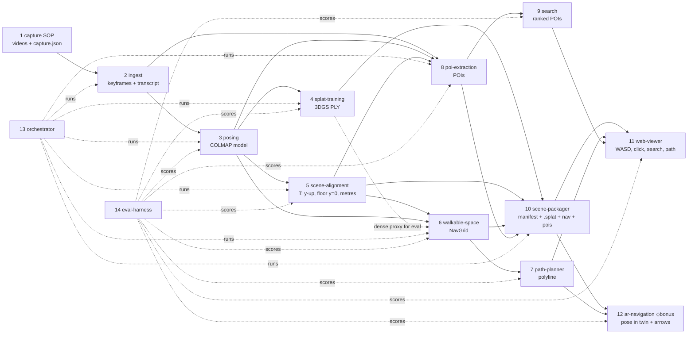

# Namma Space — component map (v1, 4 Oct 2026)

One pipeline, 14 components, each behind a typed contract ([`contracts/contracts.ts`](contracts/contracts.ts)) with an **isolated scalar metric**, so any component can be swapped or ratcheted on its own. Two **spikes** carry the innovation (ADR 001 v2): **D′ · quality-qualified capture→twin turnaround** (orchestrator: ingest→posing→splat→deploy) and **E · fidelity-constrained first-person delivery** (web-viewer + packager). Navigation and POIs are honestly measured baselines for R2. Everything else is best existing practice.

## Dependency graph

## Components
| # | Component | Responsibility (one sentence) | In → Out (contract types) | Calls | Baseline (existing practice) | Isolated scalar metric | SLO (target) | Error modes |
|---|---|---|---|---|---|---|---|---|
| 1 | capture | A non-expert records the space so that every later stage succeeds | person + phone → `CaptureBundle` (videos, `CaptureJson`) | – | [SOP v1.0](../deliverables/capture-sop.md) | QA pass rate (share of sharp frames, rooms with both loops); minutes per room | ≤2 min/room; ≥90% sharp | blur, missed doorway, HDR, WhatsApp recompression |
| 2 | ingest | Turn videos into a sharp, overlapping keyframe set plus timestamped voice tags | `CaptureBundle` → `FrameSet` | ffmpeg, blur filter, ASR | ffmpeg at 2–4 fps + variance-of-Laplacian filter | registration rate of kept frames in component 3 | ≤1 min per 5 min of video | variable frame rate, rotated video, no audio |
| 3 | posing | Estimate intrinsics, poses and sparse points | `FrameSet` → `PosedFrames` (COLMAP binary model) | COLMAP / pycolmap | COLMAP 4.2 (Homebrew), sequential matching for video | registration rate; mean reprojection error; ATE vs reference poses | ≥95% registered; ≤1 px | split models at doorways, wrong focal length |
| 4 | splat-training | Optimise a photoreal 3D Gaussian Splatting model | `PosedFrames` + images → `SplatModel` (PLY) | Brush CLI | Brush v0.3.0 on Metal | held-out PSNR at a fixed wall-clock budget | ≤30 min on M5 for one home | floaters, exposure seams, OOM at the splat cap |
| 5 | scene-alignment | Express everything in a gravity-aligned, floor-at-zero, metric frame | `PosedFrames` (+ `CaptureJson`) → `Alignment` | – | camera-up mean → floor height histogram → SVD plane; scale from marker or camera height | floor-plane residual; scale error vs ArUco marker | ≤2° tilt; ≤3% scale | wall taken as floor; mirror points below the floor |
| 6 | walkable-space (baseline; was spike A in ADR v1) | Decide where a person can stand and walk | aligned points + observation rays + trajectory → `NavGrid` | – | height-band occupancy from points (points-only) | **held-out trajectory recall** of the navigable map at a fixed **dense-collision rate** | ≤60 s; recall ≥0.95 at ≤10% path collisions | floaters block doors, unobserved floor, glass |
| 7 | path-planner | Shortest comfortable path that stays on the floor and off obstacles | `NavGrid` + `PathRequest` → `PathResult` | – | 8-connected A* + clearance penalty + line-of-sight string pulling (Python; JS port in the viewer) | success rate; collision rate vs dense proxy; path/straight ratio; p95 latency | p95 ≤50 ms in the browser | start or goal off the grid (snapped), disconnected components |
| 8 | poi-extraction (baseline; was spike B in ADR v1) | Name and place rooms and items without manual 3D work | `FrameSet` (voice tags, door signs) + `PosedFrames` + `Alignment` → `POI[]` | ASR, OCR, open-vocabulary detector | manual click-to-tag in the viewer | POI precision/recall: correct label within 1 m of the reference | ≤5 min for a venue | ASR mishears names, OCR on glare, duplicate POIs |
| 9 | search | Map a query ("3-seater sofa", "Meeting Room 4") to POIs | `SearchQuery` → `SearchResult[]` | text embedder (optional) | fuzzy lexical over names and aliases | top-1 accuracy / MRR on a held-out query set | ≤20 ms in the browser | synonyms, numbering ("Room 4" vs "R-04") |
| 10 | scene-packager | Bundle everything the viewer needs, small and streamable | `SplatModel` + `Alignment` + `NavGrid` + `POI[]` → `ScenePackage` | – | PLY → `.splat` (32 B/splat) or `.spz`, importance pruning | MB per 1M splats at a fixed PSNR loss | ≤60 MB per home | pruning removes thin structures |
| 11 | **web-viewer ★E** | Zero-install first-person exploration with POIs, search and paths | `ScenePackage` → interactive app | components 7 and 9 (in-browser) | three.js + Spark splat renderer, PointerLock WASD, collision against `NavGrid` | p95 frame time on a reference laptop; time to first frame | ≥50 fps p95 on a 2023 laptop; first frame ≤5 s | sort stalls, mobile GPU memory, clipping through walls |
| 12 | ar-navigation ◇ | Show live arrows on the phone camera along the planned path | camera frames + `ScenePackage` → `ARPoseFix` + overlay | relocaliser (server), component 7 | WebXR immersive-ar (Android/ARCore) + server-side visual relocalisation against posed keyframes | median localisation error (cm/°) and success rate at checkpoints | ≤25 cm / 5° | iOS WebXR gaps, drift between fixes |
| 13 | **orchestrator ★D′** | One command from capture folder to live URL | `CaptureBundle` → deployed URL | 2–10, hosting | shell/Python pipeline | end-to-end wall-clock (the Day-1 KPI) | ≤90 min for a venue | any stage failing silently |
| 14 | eval-harness | Fixed datasets, splits and seeds; scores every component | datasets → `results/*.json` | all | `eval/run_nav_e2e.py` | – | reproducible from one command | data drift |

## Current evidence (drjohnson, real runs)
- Components 3–7 and 14 run end-to-end: [`eval/results/`](../eval/results/) (reproduce: `cd namma-space && .venv/bin/python eval/run_nav_e2e.py`). Numbers and caveats: thought node Log, 4 Oct 08:00 IST.
- Component 4 timings: [`components/splat_training/README.md`](../components/splat_training/README.md).

## Seams (where we expect to swap implementations)
- **posing:** COLMAP ↔ feed-forward models (VGGT / MapAnything class) ↔ phone-native poses (ARKit). Same `PosedFrames` output, so 4–8 don't change.
- **walkable-space:** points-only ↔ evidence fusion (spike A) ↔ mesh-based navmesh (Recast over a 2DGS/TSDF mesh). Same `NavGrid` output.
- **splat-training:** Brush (Metal) ↔ gsplat/nerfstudio (CUDA, if quota arrives). Same PLY.
- **renderer:** Spark ↔ PlayCanvas, behind the `ScenePackage` manifest.
