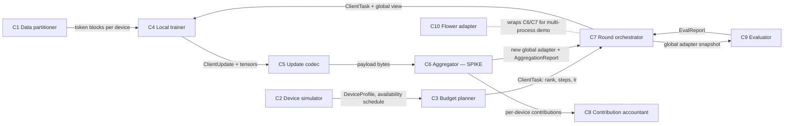

# Components and contracts

> Lead-owned. Contracts are pydantic models in [`components/contracts.py`](../components/contracts.py), exported as JSON Schema to [`contracts/`](contracts/) (`python -m components.contracts`). Contract tests: [`tests/test_contracts.py`](../tests/test_contracts.py) (7 pass, CPU, ~18 s).

**System in one line:** simulated devices hold different text domains and different compute/memory budgets; each round, every available device fine-tunes a LoRA adapter on a shared frozen base model, uploads a small update, and the server aggregates the updates into the next global adapter. A held-out evaluator scores every domain.

| # | Component | Responsibility | Input → output (contract) | Calls | Existing baseline | Isolated scalar metric | Status |
|---|---|---|---|---|---|---|---|
| C1 | Data partitioner | Turn a corpus into per-device shards with controlled domain and quantity skew | corpus spec → `blocks[N,128]` train/eval per domain | — | `flwr-datasets` DirichletPartitioner / pathological split | realised skew vs target: max \|realised − target\| of per-device domain mix and size share | ✅ local-text version (`data_partitioner/local_domains.py`) |
| C2 | Device simulator | Device profiles and a seeded availability process (offline, deadline cut-off, outage) | `DeviceProfile[]`, rounds, seed, scenario → `allowed_steps[(round, device)]` | — | Bernoulli participation | \|realised − target\| offline and cut-off rates over 1,000 simulated rounds | ✅ (`device_simulator/profiles.py`) |
| C3 | Budget planner | Map a device's memory/compute budget to rank, local steps and layers | `DeviceProfile` → `ClientTask` | C2 | one config for all (r=8) | loss reduction per device-FLOP at a fixed deadline-miss rate | 🟡 static: rank and steps read from the profile |
| C4 | Local trainer | LoRA fine-tuning on the device's blocks under its rank/step budget | `ClientTask`, global view, blocks → tensors + `ClientUpdate` | — | HF PEFT LoRA + AdamW | local held-out loss drop per second; peak memory | ✅ (`local_trainer/trainer.py`) |
| C5 | Update codec | Encode the update for upload and count bytes | tensors → payload (+ bytes) | — | fp32 A and B (Flower `ArrayRecord`) | bytes per round at ≤1 % relative reconstruction error | 🟡 fp32 only; anchor sends B columns only and regenerates A from a seed |
| C6 | **Aggregator (spike)** | Combine device updates into the next global adapter, exactly, fairly and robustly to dropout | payloads + metas → new global state + `AggregationReport` | C8 | FedAvg over A and B (n_k weights); published: FFA-LoRA, FlexLoRA | **macro held-out loss after 12 rounds of the fixed dropout scenario** (secondary: aggregation error, influence shares, worst domain, micro loss) | ✅ starter, FFA-LoRA, FlexLoRA, HetLoRA-style, `anchor_naive`, `anchor_full` + 5 ablations |
| C7 | Round orchestrator | Run rounds: dispatch tasks, apply the deadline, accept/discard partial work, trigger eval | config, schedule → per-round log, `RunSummary` | C3, C4, C5, C6, C9 | synchronous FedAvg; drop late devices | largest round-to-round rise in macro loss (stability), plus macro loss at a fixed wall-clock budget | ✅ (`orchestrator/simulate.py`) |
| C8 | Contribution accountant | Measure each device's influence on the applied update | per-device intended contributions c_k, applied update P → influence shares | — | weight ∝ n_k used as "contribution" | Spearman correlation of influence share with leave-one-device-out loss change | 🟡 influence share in ΔW space computed inside C6 (`product_space_report`); leave-one-out runs pending |
| C9 | Evaluator | Per-domain held-out loss of a global snapshot | global adapter, eval blocks → `EvalReport` | C4 (forward only) | single pooled test loss | determinism (identical re-run) and 95 % CI half-width across seeds | ✅ (`local_trainer.evaluate`, harness `eval/run_matrix.py`) |
| C10 | Flower adapter | Run C6/C7 inside Flower (`ServerApp`/`ClientApp`), one OS process per device | same contracts over Flower messages | C6, C7 | Flower FedAvg strategy | parity: identical metrics to the in-process simulator for the same seed; overhead per round | 🟡 built on Flower 1.39 Message API with an in-process `LocalGrid` (no Ray) + `kill_node`; 3 CPU tests pass; LLM parity run pending a quiet GPU |

## Contract summary

| Contract | Producer → consumer | Key fields |
|---|---|---|
| `DeviceProfile` | C2 → C3, C7 | client_id, device_class, domain, n_train_blocks, rank, local_steps, p_offline, p_cutoff, outage_rounds |
| `ClientTask` | C7 → C4 | round, client_id, rank, planned_steps, allowed_steps, batch_size, lr, train_A, seed |
| `ClientUpdate` | C4 → C6, C7 | steps_done, n_examples, train_loss, upload_bytes, wall_s, status ∈ {ok, partial, late_discarded, offline} |
| `AggregationReport` | C6 → C7, C8 | reporters, used_memory_for, weights, influence_share, aggregation_error, update_norm |
| `EvalReport` | C9 → C7 | per_domain_loss, macro_loss, worst_loss, worst_domain |
| `RunSummary` | C7 → harness | final macro / worst loss, min relative gain, mean macro loss (AUC), max spike, dominance (c0 and max), weak-device gain, aggregation error, upload MB per device |

Tensor payloads travel beside the contract objects as `dict[layer → tensor]`: FedAvgAB sends `(A_k, B_k)` and the anchor sends `ΔB_k` (its first r_k columns are non-zero).

## Error modes (handled today)
- Device offline → `status=offline`, no payload. Anchor with memory reuses its last update for ≤ 4 rounds (MIFA-style); baselines renormalise over the reporters.
- Deadline cut-off → baselines discard the work (`late_discarded`); the anchor accepts it (`partial`) and normalises by steps done (FedNova-style).
- No reporters in a round → global state unchanged; the report is empty.
- Too little text in a domain → C1 raises at build time.

## Metric definitions (used everywhere)
- **Macro loss:** mean over the 5 domains of held-out next-token cross-entropy (nats/token), 48 blocks × 128 tokens per domain. Each domain counts equally, whatever its data volume.
- **Worst loss:** max over domains. **Min relative gain:** min over domains of (base − final) / base.
- **Influence share** of device k in round t: s_k = ⟨c_k, P⟩ / ‖P‖², summed over layers. P = ΔW_new − ΔW_old is the update actually applied, and c_k is device k's weighted intended contribution in ΔW = BA space. When aggregation is exact, Σ_k s_k = 1. **Dominance index** = mean over rounds of s_c0 (the data-rich device), plus mean max_k s_k. This is our definition; the literature check is in [research/components/contribution_accountant.md](../research/components/contribution_accountant.md).
- **Aggregation error:** ‖P − Σ_k c_k‖ / ‖Σ_k c_k‖. It is 0 for exact schemes and > 0 when A and B are averaged separately.
- **Weak gain:** mean loss reduction vs the base model on the domains of the three weak devices (c2, c3, c4).
