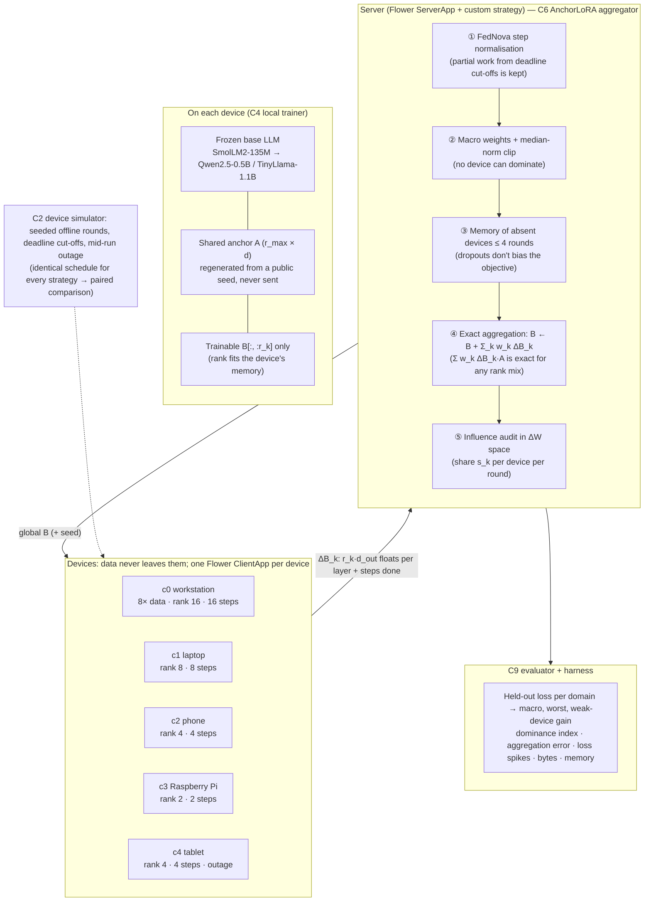

**Reading the diagram.** Every device runs the full global adapter but trains only as many columns of B as its memory allows. A is identical everywhere (regenerated from a seed), so the server's sum of B-updates is exactly the sum of the devices' weight updates ΔW_k = ΔB_k·A. Steps ①–③ are classic federated-optimisation corrections that become exact for LoRA because of this, and ⑤ makes "quiet domination" visible every round. The baselines in the evaluation swap the server box for FedAvg over A and B (the starter), HetLoRA-style zero-padding, FFA-LoRA, exact ΔW averaging + SVD (FlexLoRA-style), FedEx-LoRA and RoLoRA.
