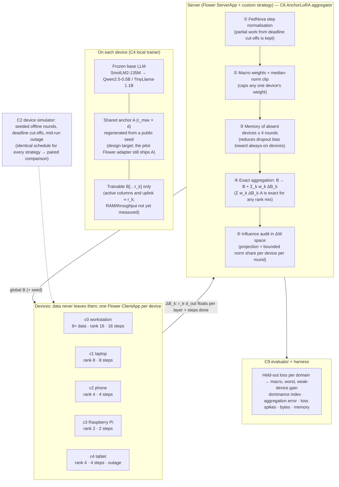

**Reading the diagram.** Every device runs the full global adapter but trains only as many columns of B as its memory allows. A is identical everywhere (regenerated from a seed), so the server's sum of zero-padded B-updates exactly reproduces the corresponding weight-space sum. This is an identity for the directions we choose; it is not a guarantee of unbiased averaging or convergence. Steps ①–③ are classic federated-optimisation corrections; sharing A removes the factorisation error underneath them (they keep their own assumptions, which the ablations test). ⑤ makes "quiet domination" a number every round. The evaluation swaps the server box for the baselines. Implemented baselines include the starter, FFA-LoRA, FlexLoRA and HetLoRA-style padding. The current paired sample sizes and completed scenarios are those in the generated results table (`eval/results/v2_summary.md`). Planned for the finals: FedEx-LoRA, PreLort and RoLoRA.
