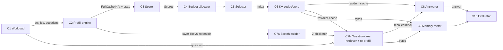

# Components and contracts — Perceptron P2 (KV-cache compression)

Every component has one job, typed I/O (see [`contracts/contracts.py`](contracts/contracts.py)) and an **isolated scalar metric**, so it can be swapped or auto-improved alone. The baseline implementations live in [`eval/kvbench.py`](../eval/kvbench.py) today; each will move to `components/<name>/` as it gets its own tests. Shapes: `T` = context tokens, `nkv` = KV heads (8), `hd` = head_dim (64), `L` = layers (16) for Llama-3.2-1B.

| # | Component | Input → Output | Baseline (existing) | Spike? | Isolated metric |
|---|---|---|---|---|---|
| C1 | **Workload** (recall tasks) | `seed, ctx_tokens, n_needles` → `Sample` | RULER-style multi-key needles in WikiText-103 | — | Full-cache recall ≥ 0.9 at target length (proves the task is solvable); needle depth uniform across 5–95% |
| C2 | **Prefill engine** | `ctx_ids` → `FullCache` (K,V per layer `[1,nkv,T,hd]` + stats) | `Engine.prefill` (explicit-cache forward over frozen mlx-lm weights, 256-token chunks) | — | Logit parity vs `mlx_lm.generate` (max \|Δlogit\|) · tokens/s |
| C3 | **Importance scorer** | `FullCache` (+ optional question queries) → `Scores [L][nkv,T]` | SnapKV window, H2O accumulated attention, K-norm | **Spike B** (later) | **Needle-token retention@budget**: share of needle tokens kept at a fixed budget. No generation needed. |
| C4 | **Budget allocator** | `T, keep_frac, Scores` → per-layer/head budgets | Uniform (PyramidKV / Ada-KV are candidates) | — | Same retention@budget at a fixed total byte budget |
| C5 | **Selector** | `Scores, budget` → `Index [L][nkv,B]` (sinks + recent always kept) | `topk_idx`, `stream_idx` | — | Unit tests (sinks/recent always present, sorted, no duplicates) · µs per call |
| C6 | **KV codec / store** | `K,V` → packed tensors + `bytes` | fp16 · group-64 int8/int4/int2 (`Packed`, per-token for K and V — not KIVI's per-channel keys) | Spike candidate ("demote, don't delete") | Attention-output relative error per stored byte |
| C7 | **Recall-on-demand** | `CompressedCache, Sketch, token_ids, question` → `RecalledBlocks` (re-prefilled KV) | — (ours) | **Spike A** | **Needle-block hit rate@m**: does a chosen block contain the needle? Plus recompute ms per block. |
| C8 | **Answerer** | `cache, question_ids` → `answer text` | Greedy decode, max 8 new tokens | — | n/a (frozen model) |
| C9 | **Memory meter** | any cache → `MemoryReport` (KV + scales + sketch + ids) | `nbytes` sum + `mx.get_peak_memory()` | — | Exact agreement with the analytic formula (fp16: 32 KiB/token) |
| C10 | **Evaluator** | rows → table (acc, Wilson 95% CI, MiB, ×, s/answer) | `kvbench.main` summary | — (frozen) | — |

**Call rules.** C3–C6 run once per context, *before* any question (the query-agnostic protocol). C7 runs once per question and may call C2's forward only on ≤ `B_recall` tokens. C8 never sees the full cache, except in the `full` and `snapkv_qa` reference rows.

**Error modes.**
- C2: out-of-memory at long `T` → chunked prefill.
- C5: budget below sinks + recent → clamp.
- C6: `head_dim` not divisible by the group size → reject.
- C7: no evicted region (budget ≥ T) → no-op; sketch layer out of range → reject.
- C9: dtype mismatch → count the actual `nbytes`, never the nominal size.

**SLOs (M5, 1B, 4k context).**
- Prefill ≤ 10 s.
- Answer ≤ 1 s for eviction methods; ≤ 2 s for C7 including re-prefill.
- Retained bytes ≤ 0.25 × full at the headline operating point.
