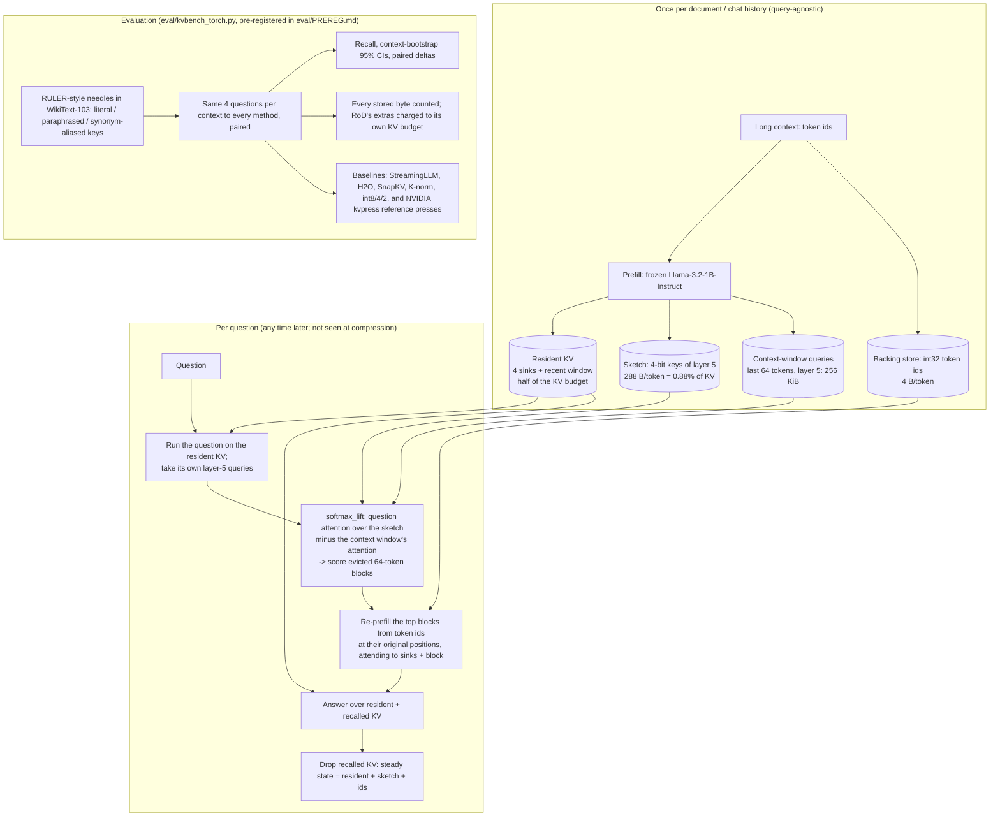

# Architecture — Recall-on-Demand (one-page diagram for the Round-1 abstract)

| Tier | What it holds | Bytes (Llama-3.2-1B, fp16 KV) | Lifetime |
|---|---|---|---|
| Full cache (baseline) | K, V for every layer and head | 32,768 per token | whole chat |
| Resident (ours) | K, V for 4 sinks + the most recent tokens | 32,768 × resident tokens | whole chat |
| Sketch (ours) | 4-bit keys of layer 5, 8 KV heads, group-64 fp16 scale + bias | 288 per token | whole chat |
| Window queries (ours) | layer-5 queries of the context's last 64 tokens (32 heads × 64 dims, fp16) | 262,144 per context | whole chat |
| Backing store (ours) | int32 token ids | 4 per token | whole chat |
| Recalled (ours) | re-prefilled K, V of the chosen blocks | 32,768 × recalled tokens | one answer |

Byte figures are analytic from the model config and equal the retained tensors' bytes (asserted in the harness). RoD's sketch, window queries and ids are charged to its own KV budget, so its answer-time bytes never exceed a baseline's at the same keep fraction. Measured results: [`../eval/RESULTS.md`](../eval/RESULTS.md).
