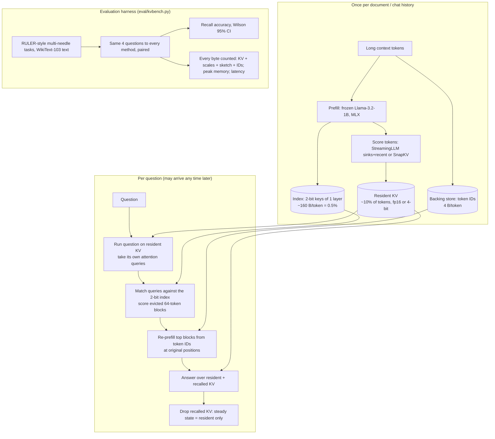

# Architecture — Recall-on-Demand (one-page diagram for the Round-1 abstract)

| Tier | What it holds | Bytes/token (Llama-3.2-1B) | Lifetime |
|---|---|---|---|
| Full cache (baseline) | K,V for every layer and head, fp16 | 32,768 | whole chat |
| Resident (ours) | K,V for the kept tokens | 32,768 × keep fraction | whole chat |
| Index (ours) | 2-bit keys, 1 layer, 8 KV heads, group-64 scales | ≈ 160 | whole chat |
| Backing store (ours) | token IDs | 4 | whole chat |
| Recalled (ours) | re-prefilled K,V of chosen blocks | 32,768 × recalled tokens | one answer |

Byte figures are analytic from the model config ([`research/landscape.md` §1](../research/landscape.md)); measured numbers will come from `eval/results/`.
