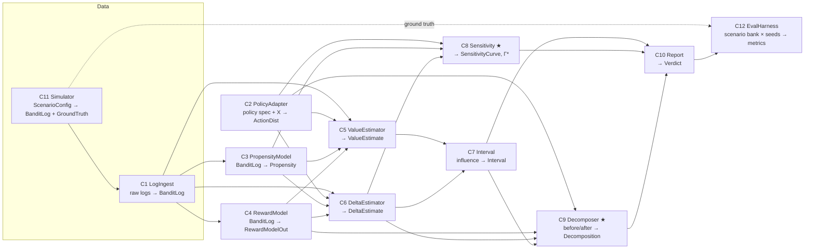

# Components — P3 "Did-It-Work": counterfactual attribution of a deployed policy

> Lead-owned. Typed contracts: [`contracts/contracts.py`](contracts/contracts.py) (pydantic with shape validators; the contract tests construct these objects). Research basis: [`../research/landscape.md`](../research/landscape.md).

**The question the system answers.** We switched from policy π₀ to π₁ and the metric moved by Ȳ_after − Ȳ_before. How much of that move did the switch cause, how sure are we, and how much hidden confounding would overturn the answer?

## Dependency graph

★ = spike components (see [`adr/001-spike.md`](adr/001-spike.md)).

## Component table

| # | Component | Responsibility (one sentence) | Input → Output contract | Calls | Baseline (existing practice) | Isolated scalar metric | SLO |
|---|---|---|---|---|---|---|---|
| C1 | **LogIngest** | Turn raw logs (OBD CSV, simulator, a customer's events) into a validated `BanditLog` | file or arrays → `BanditLog` | — | obp `OpenBanditDataset` | % of rows passing validation; propensity sanity (logged p ∈ (0,1]; for uniform logging, p = 1/K) | 1M rows in under 10 s |
| C2 | **PolicyAdapter** | Express any policy (softmax scorer, ε-greedy, Bernoulli-TS with priors) as π(a\|xᵢ) on logged contexts | policy spec + `X` → `ActionDist` | — | obp `BernoulliTS.compute_batch_action_dist` | Monte-Carlo error of action probabilities (max abs error vs 10⁶-draw reference) | rows sum to 1 ± 1e-6 |
| C3 | **PropensityModel** | Provide π_b(Aᵢ\|Xᵢ): logged if available, else estimated (multinomial logistic / GBM) | `BanditLog` → `Propensity` | — | logged pscore; sklearn `LogisticRegression` | held-out log-loss; on the simulator, mean \|p̂ − p_true\| | — |
| C4 | **RewardModel** | Cross-fitted outcome model q̂(x,a) for DM/DR and for the decomposition | `BanditLog` → `RewardModelOut` | — | obp `RegressionModel` (LightGBM/LogReg), 2-fold cross-fitting | held-out log-loss on logged actions; on the simulator, RMSE of q̂ vs the true q | — |
| C5 | **ValueEstimator** | Estimate V(π) from logs with per-round influence terms | `BanditLog` + `ActionDist` + `Propensity` + `RewardModelOut` → `ValueEstimate` | C2, C3, C4 | IPW, SNIPW, DM, DR, SNDR, Switch-DR (obp classes) | relative error \|V̂ − V\|/V on the OBD Random→BTS protocol; RMSE on the simulator bank | 1M rows in under 1 s |
| C6 | **DeltaEstimator** | Estimate Δ = V(π₁) − V(π₀) on the same traffic, sharing control variates (Δ-OPE) | logs + two `ActionDist` → `DeltaEstimate` | C2–C4 | V̂(π₁) − V̂(π₀) from C5 | **RMSE of Δ̂ across the frozen scenario bank** (ratchet metric) | — |
| C7 | **Interval** | Turn influence terms into a CI for V or Δ | `ValueEstimate`/`DeltaEstimate` → `Interval` | C5/C6 | Wald (influence function), percentile bootstrap (obp `estimate_interval`) | coverage at nominal 95% (must be ≥ 0.93 over ≥ 200 seeds) and mean width → interval score | — |
| C8 | **Sensitivity ★** | Bound V or Δ under the marginal sensitivity model for Γ ∈ [1, Γmax]; report Γ\* and benchmark Γ against observed covariates | `BanditLog` + `Propensity` + `ActionDist`s → `SensitivityCurve` | C2, C3, C6 | MSM bounds for IPW (Kallus & Zhou 2018); percentile bootstrap (Zhao et al. 2017) | on confounded scenarios: validity (truth inside the bounds at Γ ≥ Γ_true, rate ≥ 0.95) and sharpness (mean width) | Γ grid of 20 in under 5 s |
| C9 | **Decomposer ★** | Attribute the naive before/after gap to policy effect (OPE), user-mix shift and response drift | before and after `BanditLog`s + π₀, π₁ → `Decomposition` | C4, C6, C7 | naive Ȳ_after − Ȳ_before; DiD / CausalImpact need control series | RMSE of the policy-effect term vs the truth; sign accuracy over the scenario bank | — |
| C10 | **Report** | Produce the decision ("worked / hurt / inconclusive") with a waterfall, CI, Γ\* and diagnostics (ESS, max weight) | `Decomposition` + `SensitivityCurve` → `Verdict` | C7–C9 | dashboard before/after number | decision accuracy over the scenario bank (wrong-sign verdicts = 0 is the bar) | — |
| C11 | **Simulator** | Generate before/after logs with known counterfactuals; knobs: response drift, mix shift, effect, overlap ε, hidden confounding | `ScenarioConfig` → `BanditLog` + `GroundTruth` | — | obp `SyntheticBanditDataset` (no before/after, no confounding) | truth precision: Monte-Carlo SE of each true value < 1e-3 | — |
| C12 | **EvalHarness** | Run the frozen scenario bank × seeds plus OBD and write metrics tables | configs → `results/*.csv` | all | obp `OffPolicyEvaluation.evaluate_performance_of_estimators` | — (it is the yardstick) | full bank in under 10 min on the M5 |

## Contract rules
- Every estimator returns **per-round influence terms**, so any interval method (C7) and the sensitivity layer (C8) work with any estimator. This is the seam that makes components swappable.
- Policies are always materialised as `ActionDist` on the logged contexts: estimators never call a policy object, which makes BTS, softmax and LLM policies interchangeable.
- The simulator returns ground truth in a separate object (`GroundTruth`) that no estimator can see. The harness alone joins them.
- Error modes: missing propensities (C3 switches to "estimated" and C8 becomes mandatory), zero overlap (C5 diagnostics flag max_weight and ESS; C10 says "inconclusive"), deterministic logging (no overlap: refuse IPW and fall back to DM, flagged as model-dependent).
