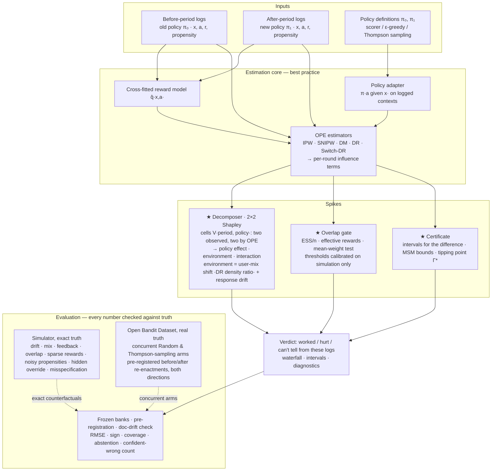

# Architecture — Did-It-Work (optional 1-page diagram for Round 1)

**The identity the system audits** (Shapley over two factors; the two counterfactual cells come from OPE):
naive = V(after, π₁) − V(before, π₀) = policy + environment, where
- policy = ½[(V(before, π₁) − V(before, π₀)) + (V(after, π₁) − V(after, π₀))];
- interaction = (V(after, π₁) − V(after, π₀)) − (V(before, π₁) − V(before, π₀)).

If the gate fails on the logs behind an OPE cell, the verdict is "can't tell from these logs".

Component contracts: [`../architecture/components.md`](../architecture/components.md) · spike rationale: [`../architecture/adr/001-spike.md`](../architecture/adr/001-spike.md).

**Figures** (regenerate with `.venv/bin/python eval/plot_waterfall.py` and `eval/run_decomposer_review.py`):
- Waterfall, simulator S1 (SYNTHETIC, 30 seeds): 
- Drift sweep (SYNTHETIC): 
