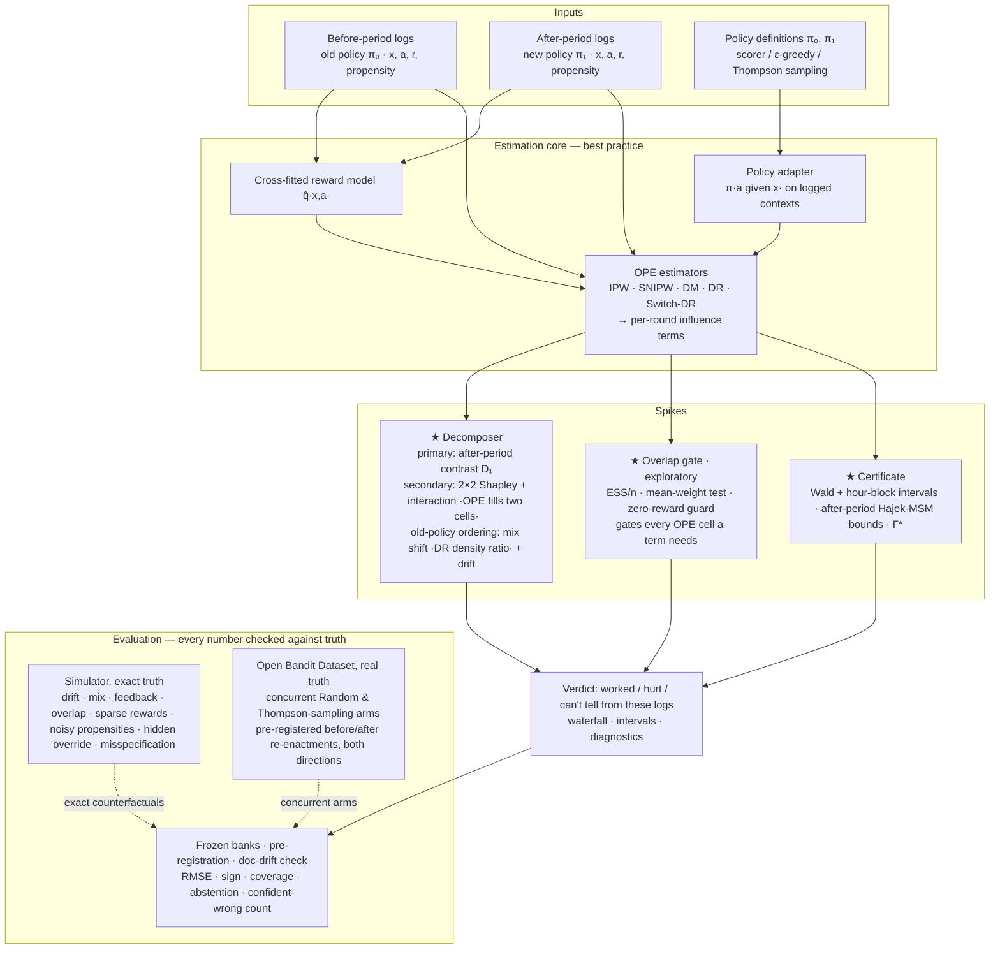
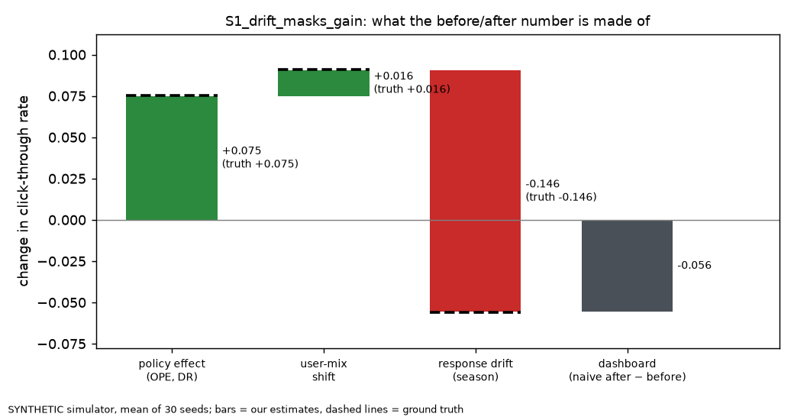
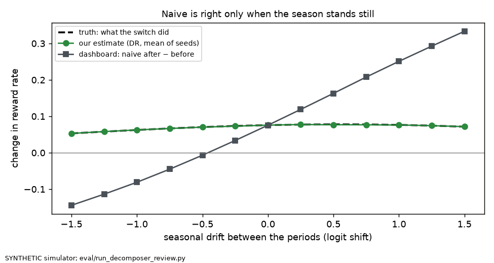

# Architecture — Did-It-Work (optional 1-page diagram for Round 1)

**Estimands (review A3):**
- *Primary:* the after-period policy contrast on the observed traffic, D₁ = V(after, π₁) − V(after, π₀). One OPE cell is needed, from the after logs.
- *Secondary:* the Shapley attribution over two factors. Both OPE cells (V(before, π₁) from before logs, V(after, π₀) from after logs) must pass the gate.
  - naive = V(after, π₁) − V(before, π₀) = policy + environment.
  - policy = ½[(V(before, π₁) − V(before, π₀)) + D₁]; interaction = D₁ − (V(before, π₁) − V(before, π₀)).
  - Half of the interaction sits inside each main term, so it is never added as a third bar.
- *Separately:* the old-policy-ordered environment change, V(after, π₀) − V(before, π₀), splits into user-mix shift (doubly robust density ratio) and response drift. It does not partition the Shapley environment term.
- *Not identified* from these logs: the total effect when the policy changes who arrives (feedback).

If the gate fails on the logs behind a needed cell, the verdict falls back to the ordering whose cell passes, or says "can't tell from these logs".

Component contracts: [`../architecture/components.md`](../architecture/components.md) · spike rationale: [`../architecture/adr/001-spike.md`](../architecture/adr/001-spike.md).

**Figures** (regenerate with `.venv/bin/python eval/plot_waterfall.py` and `eval/run_decomposer_review.py`):
- Waterfall, simulator S1 (SYNTHETIC, 30 seeds): 
- Drift sweep (SYNTHETIC): 
