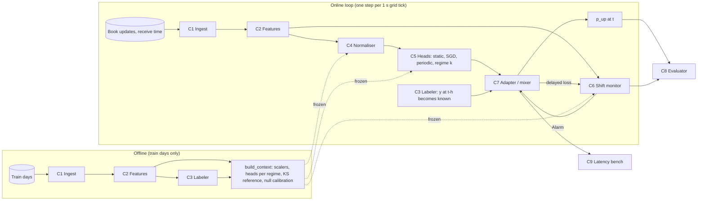

# Components and contracts

> Source of truth for types: [`components/contracts.py`](../components/contracts.py) (frozen dataclasses, shapes documented per field). Contract and leakage tests: [`tests/test_contracts.py`](../tests/test_contracts.py) (`python -m pytest -q tests` → 6 passed, 2026-10-04). Contract details: [`contracts/README.md`](contracts/README.md).

## Dependency graph

## Components

| # | Responsibility (one sentence) | Input → output (types in `contracts.py`) | Calls | Error modes | SLO | Baseline implementation | Isolated scalar metric |
|---|---|---|---|---|---|---|---|
| **C1 Ingest** | Turn a vendor file into a receive-time-ordered book stream. | Tardis `book_snapshot_5` CSV.gz → `BookDay` (recv_us, exch_us: (n,) int64; bid/ask px/sz: (n,5) float64) | — | missing/corrupt file (MD5 in `data/manifest.csv`); out-of-order receive times (asserted) | ≤5 s/day load (measured 2.8 s for 1.29 M rows) | polars reader, stable sort by `local_timestamp` | rows/s; recv−exch latency p50/p99 (measured 2.9/19 ms on 2023-11-01) |
| **C2 Features** | Compute causal microstructure features on a fixed grid. | `BookDay` → `FeatureFrame` (grid_us (T,), X (T,17), mid, spread_ticks) | C1 | look-ahead (guarded by the future-perturbation test); empty grid cells (forward-filled as-of) | ≤1 s/day batch; O(1)/update online | CKS OFI (L1 and 5-level, 1/5/30 s, depth-normalised), queue/depth imbalance, micro-price deviation, spread, log depth, returns, realised vol, message rate | single-feature AUC on dev; causality test pass/fail |
| **C3 Labeler** | Define the target and *when* it becomes observable. | `FeatureFrame`, h → `Labels` (y ∈ {0,1,NaN}, avail_step = t+h, move_bps) | C2 | smoothed/future-mixed labels (not used); ties (NaN, 21% at h=10 s) | — | raw sign of Δmid over h, ties excluded | tie rate; base rate; availability test |
| **C4 Normaliser** | Remove slowly drifting feature scales without labels. | X (T,d) → Z (T,d), clipped ±8 | — | stale statistics after a jump (bounded by the half-life) | O(d)/step | static z-score (train stats); EWMA z-score (half-life 1800 s, Numba) | Δlog-loss vs static z-score with the same head |
| **C5 Forecaster heads** | Map normalised features to P(mid up over h). | Z_t (d,) → p_t ∈ (0,1); `refit_towards`, `sgd_update` | — | overconfidence after a regime change; refits on tiny windows (MAP prior pulls to the train head) | predict ≤10 µs p50 (measured 2.3–3.4 µs) | logistic regression (sklearn fit), MAP refit, SGD | log-loss / AUC on dev with the head frozen |
| **C6 Shift monitor** ⚡ | Raise an alarm when the distribution has shifted *in a way that matters*, at a controlled false-alarm rate. | features X_t, delayed losses ℓ_{t−h} → `Alarm`(step, detector, statistic, detail) | C2, C7 (losses) | alarm storms (naive KS: 48/day on every day); missed slow drift | ≤50 µs amortised per step; ≤N false alarms/day (budget) | rolling KS (7 features, window 600 s, subsample 10, Bonferroni α=1e-3, 3 consecutive rejections, 30-min cooldown); Page-Hinkley on log-loss | **false alarms per calm day** at fixed **detection delay on the FOMC timestamps** (and on spliced semi-synthetic streams with known changepoints) |
| **C7 Adapter / mixer** ⚡ | Turn heads, delayed labels and alarms into one forecast that tracks the current regime. | heads, `Labels` (respecting avail_step), `Alarm`s → `EpisodeResult` (p_up (T,), alarms, step_ns) | C4, C5, C6 | refit on noisy windows (hurts: +0.0167 dev); mixer weights collapse onto one head (Fixed-Share floor α) | step p99 ≤1 ms (Python), target ≤50 µs compiled | static, periodic refit, online SGD, refit-on-alarm (KS/PH), volatility-regime gating, Fixed-Share over 7–8 heads, Fixed-Share + KS boost | **holdout Δlog-loss vs static (95% block-bootstrap CI)** |
| **C8 Evaluator** | Score every policy the same way, with uncertainty. | p, `Labels`, alarms, events → metrics JSON/markdown | — | autocorrelated errors (moving-block bootstrap, 600-step blocks) | — | prequential log-loss, accuracy, AUC, Brier, gross edge bps, event-window log-loss, detection report | — (the harness itself; frozen) |
| **C9 Latency bench** | Measure what the online loop costs. | per-step `perf_counter_ns` → p50/p99/p99.9 µs | C7 | noisy neighbours (runs share the machine) | report against the budget | Python reference loop | p99 µs per step against the budget (stretch goal) |

⚡ = spike component (see [ADR 001](adr/001-spike.md)).

## Budgets (proposed; to be argued in the abstract)

- **Decision cadence:** 1 s grid (MV). The architecture is event-driven, so a 100 ms grid needs only config changes.
- **Latency budget for the stretch goal:** ≤50 µs p99 for the full online step (features → heads → mixer → detector update) in the compiled version, i.e. well under the 2.9 ms median receive−exchange delay measured on our own data (C1). The current Python reference is 3–7 µs p50 for single-head policies and 41 µs p50 / ~3 ms p99 for the 7-head Fixed-Share mixer (measured with 9 processes sharing the machine — to be re-measured in isolation).

## Glossary

- **Regime:** a period in which the joint law of (features, next move) is roughly stable. Operationally: realised-volatility terciles from the train days (C7 baseline), or segments between confirmed alarms.
- **Shift (covariate):** a change in the law of X. **Harmful shift:** a change that raises the deployed model's expected loss [Podkopaev & Ramdas 2022].
- **Prequential:** predict at t, then learn from y_{t−h} once it is observable (test-then-train).
- **Receive time:** `local_timestamp` from Tardis, the only clock a live system has.
