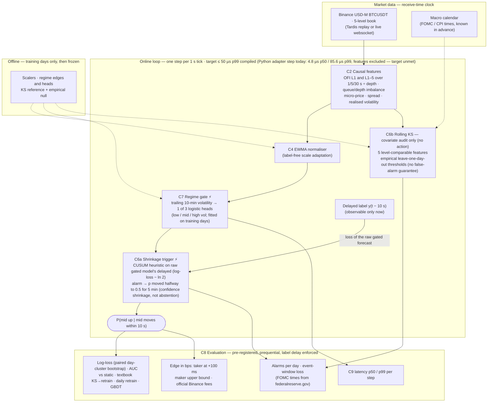
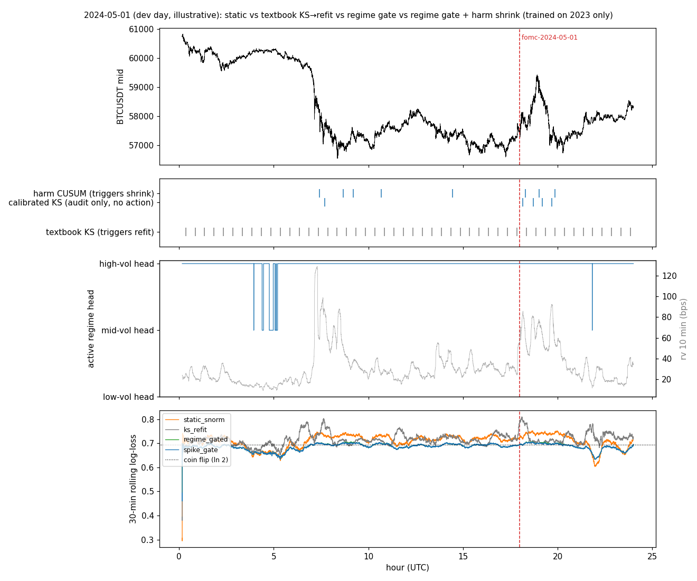

# Architecture (optional 1-page diagram for Round 1)

**Reading the diagram.**
- Every arrow is a typed contract (`components/contracts.py`).
- The label for step *t* reaches the CUSUM only at *t* + 10 s, when it would be observed live.
- **The regime gate (⚡) is what improves forecasts.** It beats one head on the same EWMA features by −0.0083 on held-out log-loss, better on 22/22 days (post-hoc ablation).
- **The CUSUM shrinkage trigger** makes forecasts less confident while the raw model is losing more than a coin flip. On average it costs +0.0006, and any benefit during events is unproven.
- **The rolling KS** is a label-free audit trail. It never changes a forecast.
- **What we rejected.** Refitting on post-alarm windows (KS→refit) made held-out loss worse on 21/22 days. A Fixed-Share mixture of online experts did not beat static. Both remain baselines and ablations (`eval/results/v2_holdout.md`). The dashed calendar prior is planned.

**Illustrative replay of a FOMC day (dev split, 2024-05-01; gate-only curve shown for attribution):** 
