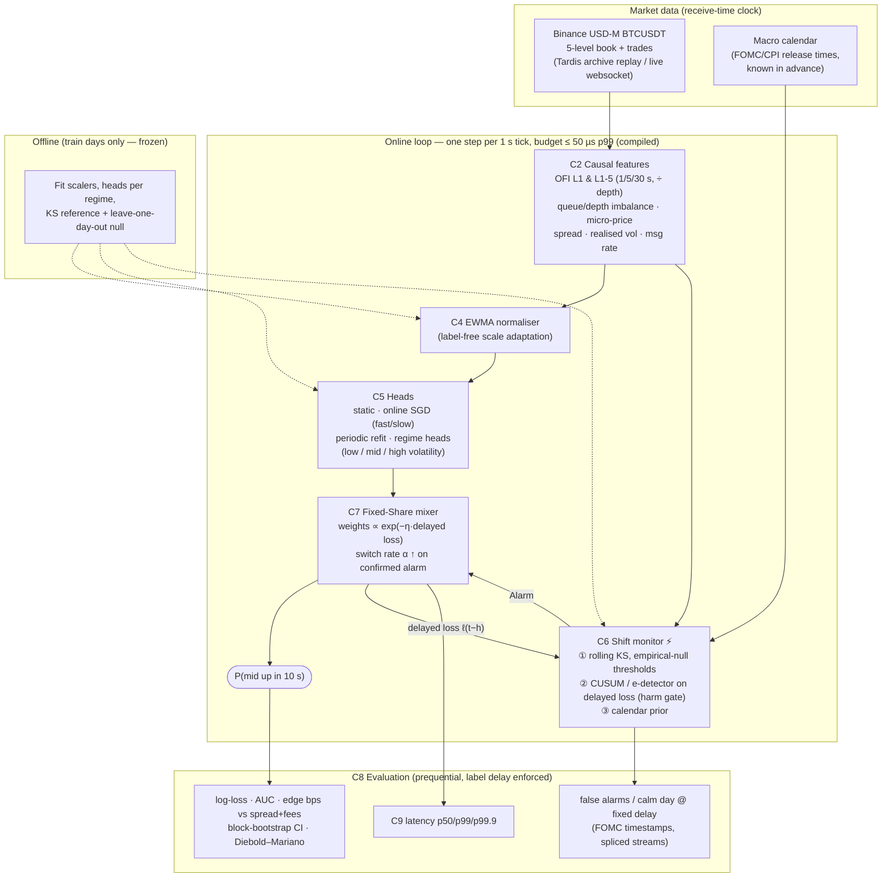

# Architecture (optional 1-page diagram for Round 1)

**Reading the diagram.** Every arrow is a typed contract (`components/contracts.py`). The label for step *t* reaches the mixer and the harm gate only at *t + h*, which is when it would be observed live. The two ⚡ components are the spikes: the shift monitor decides *whether* the world changed in a way that hurts, and the mixer decides *how much* to trust each regime head. Neither ever refits on a tiny post-shift window; on our data that hurt (+0.020 held-out log-loss for KS→refit).
