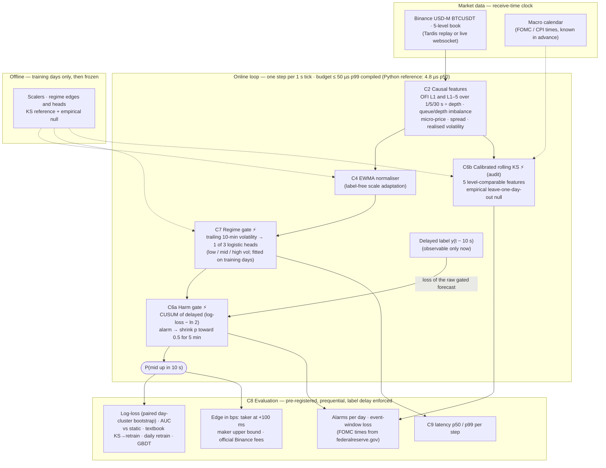

# Architecture (optional 1-page diagram for Round 1)

**Reading the diagram.**
- **Typed contracts.** Every arrow is a typed contract (`components/contracts.py`).
- **Label delay.** The label for step *t* reaches the harm gate only at *t* + 10 s, when it would be observed live.
- **The spike components (⚡):**
  - the **regime gate** decides *which* model applies to the current state, conditioning on the variable the theory names (volatility);
  - the **harm gate** decides *whether to trust it right now*: it abstains while the model is demonstrably worse than a coin flip;
  - the **calibrated KS** is the label-free audit trail of covariate shift.
- **What we rejected.** Refitting on tiny post-alarm windows (textbook KS→retrain) made held-out log-loss worse on 21 of 22 days. Mixing many online experts (Fixed-Share) did not beat a static model. Both remain in the code as baselines and ablations (`eval/results/v2_holdout.md`).
- **Not drawn yet.** The calendar prior (dashed) is planned and not built yet.

**Replay of a FOMC day (dev split, 2024-05-01):** 
