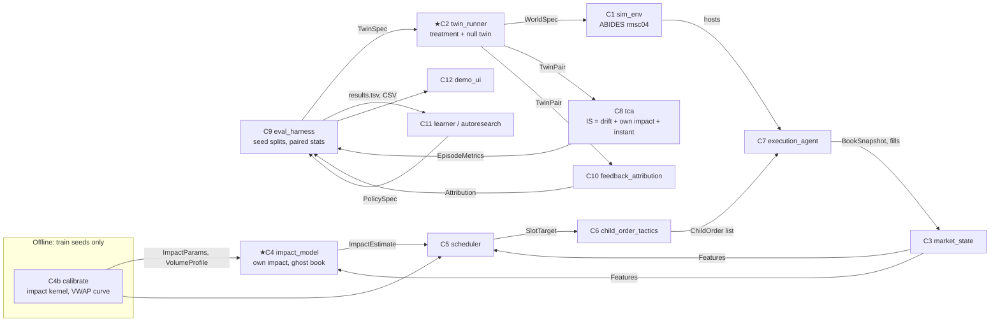

# Components and contracts: P5 market-impact-aware execution

Each component has one responsibility, typed contracts (pydantic models in [`contracts/contracts.py`](contracts/contracts.py)) and an **isolated scalar metric**, so it can be researched, swapped or auto-improved on its own. ★ marks a spike (see [ADR 001](adr/001-spike.md)). "Status" is as of 4 Oct 2026, 08:40 IST.

| # | Component | Responsibility (one sentence) | Input → Output (contract) | Calls | Existing baseline | Isolated metric | Status |
|---|---|---|---|---|---|---|---|
| C1 | `sim_env` | Build and run one reactive market day with exactly one extra agent | `WorldSpec` → `WorldResult` (book-top series, trades, holdings by agent type, agent record) | ABIDES kernel | ABIDES rmsc04 (J.P. Morgan) | **Realism scorecard**: fitted impact exponent δ vs 0.5, decay ratio, spread/depth/volume vs targets; plus sims/s | ✅ runs (Py3.11 + shim) |
| C2 ★ | `twin_runner` | Produce paired worlds (with vs without our order) on identical randomness | `TwinSpec` → `TwinPair` (+ integrity report) | C1 | Naive same-seed twins | **Noise-to-signal ratio** NSR = std_seeds(Δmid(T1)) / \|mean Δmid(T1)\| (lower is better). E4 (30 val seeds): naive 4.7 → synced 1.4 | ✅ naive + `per_wakeup` sync (E4/E5) |
| C3 | `market_state` | Turn the agent's book view and own fills into features | `BookSnapshot` + fills → `Features` | — | L1 quotes | R² of features → next-slot instantaneous cost (held-out seeds) | partial (inside policies) |
| C4 ★ | `impact_model` | Estimate our own outstanding impact and the counterfactual "ghost" mid from observables only | `Features` + own fills → `ImpactEstimate` (Î(t), ghost mid) | — | Exponential propagator (OW-style) | **Ghost-book RMSE** (¢) vs the true twin mid on held-out seeds, horizon ≤ 20 min | ✅ v0 fitted; OOS R² < 0 (noise) |
| C4b | `calibrate` | Fit kernel, instantaneous-cost slope and volume curve on train seeds | twin episodes → `ImpactParams`, `VolumeProfile` | C4 | — | Same as C4 (fit quality) | ✅ |
| C5 | `scheduler` | Plan the target cumulative trajectory | `ParentOrder` + `ImpactParams` (+ profile) → `Schedule` | C4 | TWAP, VWAP, Almgren–Chriss | Model-expected cost of the schedule; end-to-end ΔIS | ✅ TWAP/VWAP/propagator-QP |
| C6 | `child_order_tactics` | Turn a slot target into concrete orders | `SlotTarget` + `BookSnapshot` → `ChildOrder[]` | — | Market order | **Instantaneous cost** (bps vs decision mid) per filled share | ✅ MKT, touch-limit |
| C7 | `execution_agent` | Run a policy in the simulator on a decision grid, guaranteeing completion | `PolicySpec` + `ParentOrder` → fills, decision log | C3–C6 | ABIDES-Gym execution env | **Completion rate** (must be 100%) + IS | ✅ |
| C8 | `tca` | Measure cost: IS, exact twin decomposition, mark-outs | `TwinPair` + fills → `EpisodeMetrics` | — | Perold implementation shortfall | **Identity error** \|IS − (drift + own + instant)\| (must be ≤ 1e-9) | ✅ |
| C9 | `eval_harness` | Seed splits, paired comparisons, CIs, ledger | `ExperimentSpec` → CSV + summary (`ComparisonResult`) | C2, C8, C10 | Unpaired mean over seeds | **CI half-width** of ΔIS at fixed compute (variance-reduction factor vs unpaired) | ✅ v0 (runner + calibrate) |
| C10 | `feedback_attribution` | Say who absorbed or amplified our order, and how the market responded over time | `TwinPair` → `Attribution` (Δposition by agent type, MM spread/depth response, impulse response) | C1 data | none | **Share-conservation residual** (Σ Δpos + our qty = 0) and attribution CI width | ✅ v0 (Δpos by type) |
| C11 | `learner` / autoresearch | Improve the policy parameters (or an RL policy) against the frozen eval | `results.tsv` → new `PolicySpec` | C9 | grid search | Validation ΔIS vs TWAP (paired) | ⏳ next |
| C12 | `demo_ui` | Show the book vs the ghost book, the impact path and the decomposition live | results → figures/app | — | — | n/a (demo) | ⏳ |

## Seed protocol (C9)
- **train** seeds 0–99: calibration only (kernel, volume curve). **val** 100–199: tuning and autoresearch. **test** 1000–1199: final claims, touched once per release.
- Parent order (default): **SELL 4,000 shares, 09:35–09:55, 40 slots of 30 s**, forced completion at the last slot. That is ≈ 12% of null-twin window volume (≈ 33k shares measured in E1).
- Primary metric: **implementation shortfall** in bps vs the arrival mid (mid at 09:35, identical in both twins). The policy comparison is the **paired** difference per seed vs TWAP, with a 95% bootstrap CI.

## Contract rules
- Prices are integer cents and quantities integer shares. Times are ns since epoch in the sim (and seconds since window start in analysis).
- Sign convention: a positive cost/impact means adverse to us (for a SELL, the price went down).
- A component may only call the components listed in "Calls". Policies never import ABIDES, so they stay unit-testable and portable (e.g. to MarS).
