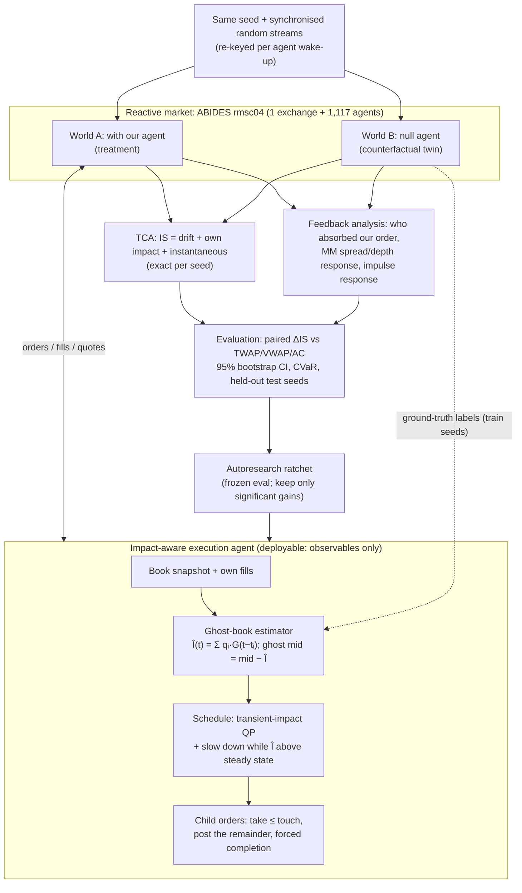

# Architecture (optional 1-page diagram for Round 1)

**Reading it:** both worlds start bit-identical. Every difference between them is caused by our orders, which yields the exact counterfactual book (stretch goal 1) and per-agent-type feedback (stretch goal 2). The agent itself never sees World B. It learns an estimator of it from training seeds, so the same agent could run on a live venue.
