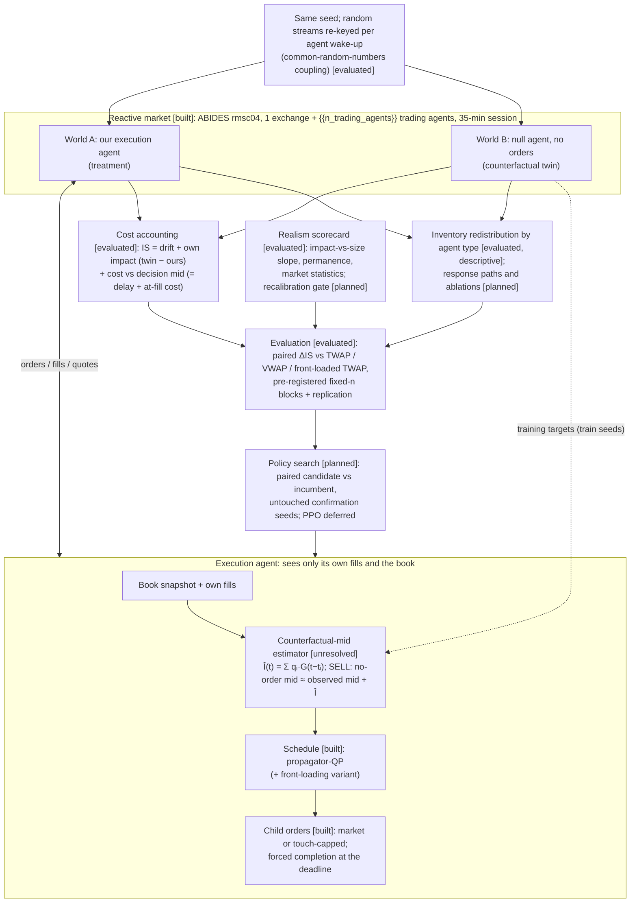

# Architecture (1-page diagram for Round 1)

Status tags: **[built]** code exists · **[evaluated]** measured in committed runs · **[unresolved]** measured but not yet working · **[planned]**. Numbers on this page are rendered from `eval/results/` (`eval/render_docs.py`, checked by `eval/check_docs.py`).

**Reading it:** both worlds share a seed and a random-number coupling; their pre-trade top-of-book logs match exactly. Afterwards, differences between them measure our footprint *within this simulator under the coupling*, which itself widens spreads (E11). The agent never sees World B; the estimator that is meant to stand in for it live has not yet passed its held-out test.
