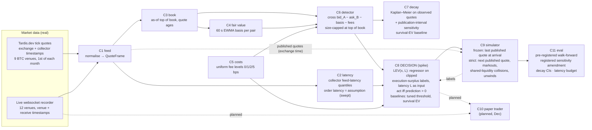

# Architecture (1-page diagram for the Round-1 submission)

Decisions are made on what we have *received*. Fills are simulated against *published* quotes, either the last quote at the order's arrival (frozen simulator) or the next one (strict stress scenario). The true book at arrival is not observable in public data.

*Future work, not part of any reported result:* residual-survival inputs to LEV, an act-now-or-wait rule, a Kalman/lead–lag fair value, deeper-book fills and inventory limits.

| Component | Isolated metric | Result (from committed results) |
|---|---|---|
| C6 detector | AUC-PR of "profitable at latency L" | 345,890 episodes ≥ 1 bp over the fair basis on the held-out day 2026-10-01 |
| C7 decay | median lifetime with hour-block CI | observed median 90.5 ms (95% CI 84.0–100.0); publication-interval sensitivity range 11.3–147.1 ms; 13 monthly medians 26–68 ms |
| C8 decision (spike) | simulated execution surplus at (latency, fee) | pre-registered: LEV − tuned threshold +$299/day, 95% t-CI [+$130, +$468], 12/12 months. Strict fills + 1 s markout: +$70/day ([+$0.2, +$140]). Collision-dropped: +$40/day ([−$12, +$92]) |
| C8 compiled step | p50/p99 per decision (in-kernel) | 6.1 µs / 41.5 µs (Numba, exact vs scikit-learn) |
| C2 latency | pinball loss of quantiles | Tardis collector p50 1.8 ms (Binance perp) to 40 ms |

Sources: `eval/results/headline.json` (rendered by `deliverables/render.py`; checked by `eval/check_docs.py`).
