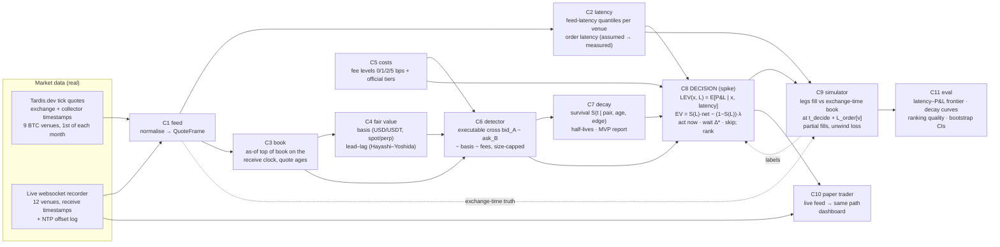

# Architecture (1-page diagram for the Round-1 submission)

Decisions are made on what we have *received*; fills happen on what the exchange *actually had* when our order arrived. The gap between the two is the latency budget.

| Component | Isolated metric | Result (from committed results) |
|---|---|---|
| C6 detector | AUC-PR of "profitable at latency L" | 345,890 episodes ≥ 1 bp over fair basis on the held-out day 2026-10-01 |
| C7 decay | integrated Brier (log-t), C-index; median lifetime with hour-block CI | median 90.5 ms (95% CI 84.0–100.0); 13 monthly medians 26–68 ms |
| C8 decision (spike) | simulated P&L at (latency, fee) | pre-registered walk-forward, LEV − tuned threshold: +$299/day, 95% t-CI [+$130, +$468], 12/12 months positive — supported (both 95% lower bounds are above zero) |
| C8 compiled step | p50/p99 per decision | 6.1 µs / 41.5 µs (Numba, exact vs scikit-learn) |
| C2 latency | pinball loss of quantiles | Tardis collector p50 1.8 ms (Binance perp) to 40 ms; Mac in India p05 69–107 ms |

Sources: `eval/results/headline.json` (rendered by `deliverables/render.py`; checked by `eval/check_docs.py`).
