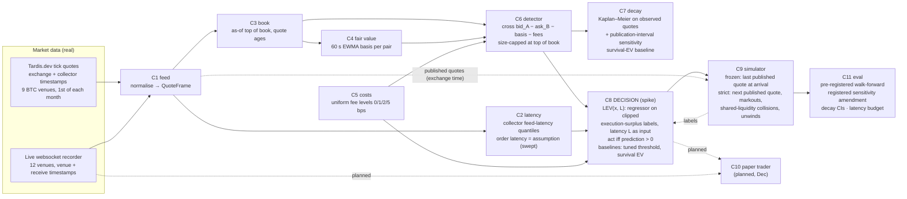

# Architecture (1-page diagram for the Round-1 submission)

Decisions are made on what we have *received*. Fills are simulated against *published* quotes, either the last quote at the order's arrival (frozen simulator) or the next one (strict stress scenario). The true book at arrival is not observable in public data.

*Future work, not part of any reported result:* residual-survival inputs to LEV, an act-now-or-wait rule, a Kalman/lead–lag fair value, deeper-book fills and inventory limits.

| Component | Isolated metric | Result (from committed results) |
|---|---|---|
| C6 detector | AUC-PR of "profitable at latency L" | {{n_episodes}} episodes ≥ 1 bp over the fair basis on the held-out day 2026-10-01 |
| C7 decay | median lifetime with hour-block CI | observed median {{median_life_ms}} ms (95% CI {{median_ci_lo}}–{{median_ci_hi}}); publication-interval sensitivity range {{med_lo}}–{{med_hi}} ms; {{n_months}} monthly medians {{month_median_min}}–{{month_median_max}} ms |
| C8 decision (spike) | simulated execution surplus at (latency, fee) | pre-registered: LEV − tuned threshold {{wf_mean}}/day, 95% t-CI {{wf_tci}}, {{wf_pos}}/{{wf_n}} months. Strict fills + 1 s markout: {{v2_mean}}/day ({{v2_tci}}). Collision-dropped: {{s3_mean}}/day ({{s3_tci}}) |
| C8 compiled step | p50/p99 per decision (in-kernel) | {{dec_p50_us}} µs / {{dec_p99_us}} µs (Numba, exact vs scikit-learn) |
| C2 latency | pinball loss of quantiles | Tardis collector p50 {{feed_fast_ms}} ms (Binance perp) to {{feed_slow_ms}} ms |

Sources: `eval/results/headline.json` (rendered by `deliverables/render.py`; checked by `eval/check_docs.py`).
